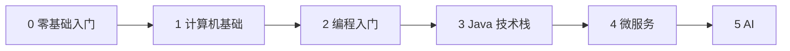

# tech-notes 技术笔记

[](https://huangyongliang.github.io/tech-notes/)

**在线阅读：** [https://huangyongliang.github.io/tech-notes/](https://huangyongliang.github.io/tech-notes/)

个人技术学习笔记：按主题整理链接、短笔记和学习记录，方便浏览和复习。

> [!NOTE]
> 本仓库和站点的内容由 AI 生成，资料与资源链接来源于网络，仅供学习参考；如有错误或侵权，请提 Issue 告知。

[主题索引](topics/) · [笔记](notes/) · [精选资料](resources/) · [贡献指南](CONTRIBUTING.md)

---

## 技术栈导航

| 主题 | 内容 | 状态 |
|------|------|------|
| 🗺️ [学习路线 Roadmap](topics/roadmap/) | 从零到 AI 的六个阶段总览 · 0 个子主题 | 🟡 搭建中 |
| 🌱 [零基础入门 Getting Started](topics/getting-started/) | 电脑、网络、自学方法，5 个子主题 | 🟡 搭建中 |
| 🧮 [计算机基础](topics/cs-basics/) | 组成、OS、Linux、Git、网络、DSA、数据库 · 7 个子主题 | 🟡 搭建中 |
| 📐 [理论基础 Theoretical Foundations](topics/cs-theory/) | 数理逻辑、图论、计算理论，14 个子主题；独立主题，网站阅读 | 🟡 搭建中 |
| 🔧 [编程入门 Programming Basics](topics/programming-basics/) | 第一门语言 C，6 个子主题 | 🟡 搭建中 |
| ☕ [Java 技术栈 Java Stack](topics/java/) | 语言、JVM、Spring 生态，12 个子主题 | 🟡 搭建中 |
| 🧩 [微服务 Microservices](topics/microservices/) | 网关、治理、消息、可观测、K8s，16 个子主题 | 🟡 搭建中 |
| 🤖 [AI 技术栈 AI Stack](topics/ai/) | 大模型、RAG、Agent、MCP、推理部署，21 个子主题 | 🟡 搭建中 |
| 💻 [编程 Programming](topics/programming/) | 编程语言、算法、设计 · 4 个子主题 | 🟡 搭建中 |
| 🌐 [Web](topics/web/) | 浏览器里的源；前端与后端目录仍空 · 1 个子主题 | 🟡 搭建中 |
| 🖥️ [系统 Systems](topics/systems/) | 分布式系统模型；单机 OS、网络、SQL 仍在计算机基础 · 1 个子主题 | 🟡 搭建中 |
| 🚀 [DevOps](topics/devops/) | CI/CD、容器、云 · 0 个子主题 | ⚪ 待开始 |
| 🔍 [产品调研 Product Research](topics/product-research/) | 产品、竞品、技术选型 · 0 个子主题 | ⚪ 待开始 |

🟢 已完成 · 🟡 搭建中 · ⚪ 待开始

> [!TIP]
> 完全零基础从 [学习路线](topics/roadmap/) 开始；已经会编程的从 [Java 技术栈](topics/java/) 开始。[理论基础](topics/cs-theory/) 是独立主题，用来理解更深的技术为什么成立。它不挡第一个 C 程序，这 14 个子主题也还不是全部理论，并且不在小程序打包的 35 篇里。

## 学习路线



1. **收集**：新链接或想法先放进 [`topics/inbox/`](topics/inbox/)。
2. **归类**：定期整理到对应的 `topics/<topic>/`，并更新那个主题的「资料索引」。
3. **沉淀**：值得深入的内容，用 [`templates/note.md`](https://github.com/huangyongliang/tech-notes/blob/main/templates/note.md) 写成笔记，放进 [`notes/`](notes/)。

## 目录结构

| 路径 | 用途 |
|------|------|
| [`topics/`](topics/) | 按主题分类，每个主题都有一个 README 索引 |
| [`topics/inbox/`](topics/inbox/) | 暂存还没分类的链接和笔记 |
| [`notes/`](notes/) | 跨主题或较长的笔记 |
| [`resources/`](resources/) | 精选外部资料，[`links.md`](resources/links.md) 是链接表 |
| [`templates/`](https://github.com/huangyongliang/tech-notes/tree/main/templates) | 笔记模板和主题 README 模板 |

## 如何使用

在 GitHub 网页上直接点开目录就能浏览。想在本地看：

```bash
git clone https://github.com/huangyongliang/tech-notes.git
cd tech-notes
```

> [!NOTE]
> 想补充内容？命名、提交和 PR 的约定见 [贡献指南](CONTRIBUTING.md)，排版约定见 [展示规范](STYLE.md)。

## 许可证

笔记内容采用 [CC BY 4.0](https://github.com/huangyongliang/tech-notes/blob/main/LICENSE) 许可，© tech-notes contributors。