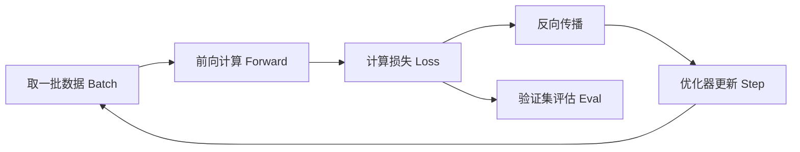

# 数学与机器学习基础 {#foundations-math}

> [AI](../) › 数学与机器学习基础

只补看懂 LLM 论文和训练日志够用的数学：线性代数、概率统计、微积分与优化，加上经典机器学习的训练、验证与过拟合概念。指标和损失只在对应的数据划分、类别分布和分词器下才解释得通。

---

> [!NOTE]
> 本仓库和站点的内容由 AI 生成，资料与资源链接来源于网络，仅供学习参考；如有错误或侵权，请提 Issue 告知。

## 这一页补哪一块 {#_1}

这一页给后面的训练循环、注意力、向量检索和对齐损失提供同一套说法。应用方向可以先跳过，遇到原理再回来。这里不使用「第四章」这种课表编号。

- 矩阵形状先决定一层算不算得成。
- Softmax、交叉熵和温度描述的是分布，不往模型里写入新事实。
- 手写梯度下降是全量数据、固定学习率的均方误差，用来看链式法则。
- 分数要连同划分、类别比例和有没有泄漏一起看。

## 形状、距离和检索用的是同一套乘法 {#_2}

<span id="_4"></span>

- 矩阵乘法 `(m, k) @ (k, n) -> (m, n)` 要求中间维度相等。一层可以写成 `y = xW + b`，再接一个非线性函数。
- 点积看两个向量在同一方向上有多少重合。L2 范数是长度。余弦相似度是归一化后的点积，范围在 `[-1, 1]`。先做同一套 L2 归一化，点积才等于余弦相似度。
- [检索增强](../08-rag/) 里的向量检索就是拿问题向量和文档向量做这个比较。这一页不讲向量库。

## 概率：Softmax、温度与交叉熵 {#softmax}

- Softmax 把 logits 变成和为 1 的分布：`p_i = exp(z_i / T) / Σ exp(z_j / T)`，`T > 0`。减去最大值不改变结果，只是避免 `exp` 溢出。这是实现条件，不是另一个公式。
- `T` 变小，分布更尖；`T` 变大，更接近均匀。概率和仍然是 1。`T` 趋近 0 时，质量集中到最大的 logit，这接近贪心。若有两个并列最大，这个极限不指定唯一的一个。
- 交叉熵 `H(p, q) = -Σ p log q` 里，`p` 是真实分布，`q` 是模型分布，两边不能对调之后还说「差距一样」。KL 散度 `KL(p‖q) = H(p, q) - H(p)` 也不对称。
- 困惑度是平均交叉熵的指数。只在同一分词器、同一文本切分下比较。跨模型的比较放到下一章。

```python
import numpy as np


def softmax(z, t=1.0):
    z = np.asarray(z, dtype=np.float64) / t
    e = np.exp(z - z.max())          # 减去最大值，防止溢出
    return e / e.sum()


logits = [2.0, 1.0, 0.1]
for t in (0.5, 1.0, 2.0):
    print(f"T={t}:", softmax(logits, t).round(3))

p_true = np.array([1.0, 0.0, 0.0])   # 正确答案是第 0 个 token
q = softmax(logits)
ce = -np.sum(p_true * np.log(q))
print("交叉熵", round(ce, 4), "困惑度", round(float(np.exp(ce)), 4))

p, r = np.array([0.7, 0.2, 0.1]), np.array([0.5, 0.3, 0.2])
kl = np.sum(p * np.log(p / r))
print("KL(p||r)", round(kl, 4), "KL(r||p)", round(np.sum(r * np.log(r / p)), 4))

a, b = np.array([1.0, 2.0, 3.0]), np.array([2.0, 4.0, 6.5])
cos = a @ b / (np.linalg.norm(a) * np.linalg.norm(b))
print("余弦相似度", round(cos, 4))
```

运行输出：

```text
T=0.5: [0.864 0.117 0.019]
T=1.0: [0.659 0.242 0.099]
T=2.0: [0.502 0.304 0.194]
交叉熵 0.417 困惑度 1.5174
KL(p||r) 0.0851 KL(r||p) 0.092
余弦相似度 0.9993
```

同一点的 Java 对照。2026-11-23 用 Temurin `25.0.5.1+2`、`javac --release 25` 运行，温度三行与上面一致。`printf` 把交叉熵打成 `0.4170`、把后一个 KL 打成 `0.0920`，数值相同。文本围栏仍保留 Python 的输出。

```java
class SoftmaxDemo {
    static double[] softmax(double[] z, double t) {
        double max = z[0];
        for (double v : z) max = Math.max(max, v);
        double[] e = new double[z.length];
        double sum = 0;
        for (int i = 0; i < z.length; i++) {
            e[i] = Math.exp(z[i] / t - max / t);
            sum += e[i];
        }
        for (int i = 0; i < e.length; i++) e[i] /= sum;
        return e;
    }

    static String round3(double[] a) {
        StringBuilder sb = new StringBuilder("[");
        for (int i = 0; i < a.length; i++) {
            if (i > 0) sb.append(' ');
            sb.append(String.format("%.3f", a[i]));
        }
        return sb.append(']').toString();
    }

    public static void main(String[] args) {
        double[] logits = {2.0, 1.0, 0.1};
        for (double t : new double[] {0.5, 1.0, 2.0}) {
            System.out.println("T=" + t + ": " + round3(softmax(logits, t)));
        }
        double[] q = softmax(logits, 1.0);
        double ce = -Math.log(q[0]);
        System.out.printf("交叉熵 %.4f 困惑度 %.4f%n", ce, Math.exp(ce));
        double[] p = {0.7, 0.2, 0.1}, r = {0.5, 0.3, 0.2};
        double klpr = 0, klrp = 0;
        for (int i = 0; i < 3; i++) {
            klpr += p[i] * Math.log(p[i] / r[i]);
            klrp += r[i] * Math.log(r[i] / p[i]);
        }
        double dot = 1*2 + 2*4 + 3*6.5;
        double na = Math.sqrt(1+4+9), nb = Math.sqrt(4+16+42.25);
        System.out.printf("KL(p||r) %.4f KL(r||p) %.4f%n", klpr, klrp);
        System.out.printf("余弦相似度 %.4f%n", dot / (na * nb));
    }
}
```

## 优化：梯度下降到 AdamW {#adamw}



- 梯度指向函数上升最快的方向。沿负梯度走一小步，损失才会下降。步长就是学习率。
- 反向传播是链式法则加上中间结果。框架里的 autograd 做这件事。
- Adam 为每个参数记梯度的一阶、二阶动量。AdamW 把权重衰减直接作用在参数上，避免和自适应步长缠在一起。它在 Transformer 训练里很常见，细节见 [微调与对齐](../14-fine-tuning/)，这一页不展开偏好优化。
- 学习率可以先线性预热，再余弦衰减。预热对应的是初期动量估计还不稳。小批量、自适应步长和这套调度的成立条件，都不同于下面这个全量、固定学习率的例子。

下面用全部 200 个点、固定学习率拟合 `y = 3x + 2`。它只说明损失能降到噪声附近，不是语言模型的训练协议。

```python
import numpy as np

rng = np.random.default_rng(0)
x = rng.uniform(-1, 1, size=200)
y = 3 * x + 2 + rng.normal(0, 0.1, size=200)

w, b, lr = 0.0, 0.0, 0.5
for step in range(201):
    pred = w * x + b
    loss = np.mean((pred - y) ** 2)          # 均方误差
    grad_w = np.mean(2 * (pred - y) * x)     # 链式法则手算梯度
    grad_b = np.mean(2 * (pred - y))
    w, b = w - lr * grad_w, b - lr * grad_b
    if step % 50 == 0:
        print(f"step {step:3d} loss {loss:.4f} w {w:.3f} b {b:.3f}")
```

运行输出：

```text
step   0 loss 8.2199 w 1.262 b 2.229
step  50 loss 0.0104 w 2.987 b 1.992
step 100 loss 0.0104 w 2.987 b 1.992
step 150 loss 0.0104 w 2.987 b 1.992
step 200 loss 0.0104 w 2.987 b 1.992
```

同一点的 Java 对照。注释已经写明随机源不同，只断言收敛到附近。2026-11-23 用 Temurin `25.0.5.1+2` 运行，停在 `loss 0.0103 w 2.998 b 2.005`。

```java
class GradientFit {
    public static void main(String[] args) {
        // java.util.Random 不是 NumPy default_rng，逐步数字不必与原文逐位相同。
        java.util.Random rng = new java.util.Random(0);
        double[] x = new double[200], y = new double[200];
        for (int i = 0; i < 200; i++) {
            x[i] = rng.nextDouble() * 2 - 1;
            y[i] = 3 * x[i] + 2 + rng.nextGaussian() * 0.1;
        }
        double w = 0, b = 0, lr = 0.5;
        double loss = 0;
        for (int step = 0; step < 201; step++) {
            double se = 0, gw = 0, gb = 0;
            for (int i = 0; i < 200; i++) {
                double pred = w * x[i] + b;
                double err = pred - y[i];
                se += err * err;
                gw += 2 * err * x[i];
                gb += 2 * err;
            }
            loss = se / 200;
            w -= lr * (gw / 200);
            b -= lr * (gb / 200);
            if (step % 50 == 0) {
                System.out.printf("step %3d loss %.4f w %.3f b %.3f%n", step, loss, w, b);
            }
        }
        if (!(loss < 0.05 && Math.abs(w - 3) < 0.2 && Math.abs(b - 2) < 0.2)) {
            throw new AssertionError("loss=" + loss + " w=" + w + " b=" + b);
        }
    }
}
```

## 经典机器学习：泛化才是目标 {#_5}

- 监督学习有标签。无监督学习没有标签。强化学习看奖励，不是这一页的拟合。
- 训练和验证都差，多半是模型或特征不够。训练好、验证变差，才是过拟合的典型形状。训练损失下降不等于已经泛化。
- 正则化包括权重衰减、Dropout、早停和更多数据。它们的作用条件不同。

```python
from sklearn.datasets import make_classification
from sklearn.linear_model import LogisticRegression
from sklearn.metrics import f1_score, roc_auc_score
from sklearn.model_selection import cross_val_score, train_test_split

X, y = make_classification(n_samples=1000, n_features=20, weights=[0.9, 0.1], random_state=0)
X_train, X_test, y_train, y_test = train_test_split(X, y, test_size=0.2, stratify=y, random_state=0)

clf = LogisticRegression(C=1.0, max_iter=1000)   # C 越小正则化越强
print("5 折交叉验证 F1", cross_val_score(clf, X_train, y_train, cv=5, scoring="f1").mean().round(3))

clf.fit(X_train, y_train)
pred = clf.predict(X_test)
print("准确率", (pred == y_test).mean().round(3))
print("F1", round(f1_score(y_test, pred), 3))
print("AUC", round(roc_auc_score(y_test, clf.predict_proba(X_test)[:, 1]), 3))
print("全猜 0 的准确率", round(1 - y_test.mean(), 3))
```

运行输出：

```text
5 折交叉验证 F1 0.802
准确率 0.96
F1 0.8
AUC 0.952
全猜 0 的准确率 0.895
```

这段 scikit-learn 示例本次没有重跑，数字保持原文。准确率 0.96 高于「全猜 0」的 0.895，F1 是 0.8。类别不均衡时这两个数会分开。

## 划分先于预处理：避免数据泄漏 {#_6}

- 先划分训练、验证、测试，再在训练集上 `fit` 标准化、填缺失和选特征。验证集和测试集只 `transform`。交叉验证用 `Pipeline`，保证每一折只拟合该折的训练数据。
- 独立同分布的分类样本可以分层随机划分。同一文档的多个切块、同一会话的多轮消息要按组隔开，用 `GroupKFold` 或 `StratifiedGroupKFold`。时间序列按时间向前切，必要时留出间隙，不能把未来混进训练。
- 验证集用来选超参数和阈值。测试集只用于最终报告。检索参数、提示词和微调样本反复对着测试集调，同样不再是一次未看见的评估。评测集见 [评测与可观测](../17-evals-observability/)。

## 分数之外：概率校准与不确定性 {#_7}

- 高准确率或高 AUC 不代表「预测 0.8 的事件大约有 80% 发生」。可靠性曲线、Brier score 和 log loss 看的是概率质量。校准器也要用独立数据或交叉验证来拟合，不能在测试集上拟合。
- 阈值要连同误报、漏报的成本和复核容量一起选，不能统一写成 0.5。稀有正类更适合看 PR 曲线。
- 报告样本数和各类别的指标。Bootstrap 重采样的是独立单位，例如整份文档或整个会话，不是把相关切块当成独立样本。

## 指标与优化器怎么选 {#ml-choice}

<span id="_8"></span>

| 指标 | 适用场景 | 注意 |
|------|----------|------|
| 准确率 Accuracy | 类别均衡的分类 | 类别不均衡时会虚高，见上例「全猜 0」 |
| 精确率 / 召回率 / F1 | 不均衡分类、信息抽取、检索 | 精确率看误报，召回率看漏报，F1 是二者调和平均 |
| AUC | 需要比较排序质量、阈值未定 | 与阈值无关；极度不均衡时可改看 PR-AUC |
| 困惑度 Perplexity | 语言模型预训练与微调 | 只能在同一分词器下比较 |
| 任务级评测 | LLM 应用 | 用评测集与 LLM-as-judge，见 [评测与可观测](../17-evals-observability/) |

| 优化器 | 特点 | 常见用途 |
|--------|------|----------|
| SGD + Momentum | 简单、显存省、需要细调学习率 | CV 经典模型 |
| Adam | 自适应步长、收敛快 | 通用默认 |
| AdamW | 解耦权重衰减，泛化更好 | Transformer 预训练与微调 |

## 常见误读 {#_3}

<span id="_9"></span>

- 在测试集上反复调参之后，测试分数不再代表一次未看见的泛化。
- 类别不均衡时只看准确率。95% 都是负类时，全猜负类就有 95% 准确率。
- 把温度当成创造力开关。它只改变分布有多尖，不增加模型里没有的事实。`T` 趋近 0 也不打破并列的最大 logit。
- 认为 KL 对称。`KL(p‖q)` 和 `KL(q‖p)` 一般不相等。
- 跨不同分词器比较困惑度。词表不同，每个 token 的粒度不同。
- 训练损失下降就等于已经泛化。校准器也不能在测试集上拟合。

## 可选核对 {#foundations-check}

<span id="_10"></span>

1. 把 Softmax 的温度从 1.0 调到 0.2，分布怎样变？概率和变不变？
2. 在 95% 都是负类的数据上准确率 95%，为什么说明不了模型好？应该看什么？这些分数在什么划分条件下才有效？

<details markdown><summary>参考答案</summary>

1. 分布更尖，质量集中到更大的 logit。概率和仍然是 1。若两个 logit 并列最大，降温不指定唯一的贪心结果。
2. 全猜负类也能得到 95% 准确率。要看少数类的精确率、召回率、F1，或 AUC / PR-AUC。这些分数只有在先划分、验证集选阈值、测试集没有被反复调过的时候，才是一次未看见的评估。

</details>

<span id="_12"></span>

## 资料索引 {#_11}

- [Dive into Deep Learning（动手学深度学习）](https://d2l.ai/) — 中英双语、代码驱动的教材
- [Mathematics for Machine Learning](https://mml-book.github.io/) — 免费 PDF 数学基础
- [scikit-learn User Guide](https://scikit-learn.org/stable/user_guide.html) — 经典 ML 概念与 API
- [Stanford CS229](https://cs229.stanford.edu/) — 机器学习课程讲义
- [3Blue1Brown 神经网络系列](https://www.3blue1brown.com/topics/neural-networks) — 反向传播可视化
- [Decoupled Weight Decay Regularization](https://arxiv.org/abs/1711.05101) — AdamW 原始论文
- [scikit-learn 常见陷阱](https://scikit-learn.org/stable/common_pitfalls.html) — 预处理、Pipeline 与泄漏
- [scikit-learn 交叉验证](https://scikit-learn.org/stable/modules/cross_validation.html) — 分层、分组与时间划分
- [scikit-learn 概率校准](https://scikit-learn.org/stable/modules/calibration.html) — 可靠性曲线和校准器
- [SciPy Bootstrap](https://docs.scipy.org/doc/scipy/reference/generated/scipy.stats.bootstrap.html) — 置信区间的重采样方法

---

← [上一节：Python 速成](../00-python-bridge/) · [返回 AI](../) · [下一节：深度学习框架](../02-dl-frameworks/) →
