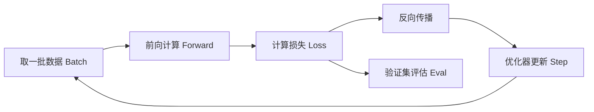

# 数学与机器学习基础 Foundations & Math

> [AI](../) › 数学与机器学习基础

只补看懂 LLM 论文和训练日志够用的数学：线性代数、概率统计、微积分与优化，加上经典机器学习的训练、验证与过拟合概念。不求推导完整，求能读懂损失曲线和评测指标。

## 本关定位

| 项 | 内容 |
|----|------|
| 定位 | 为 02 深度学习框架、03 Transformer 原理、14 微调打数学与 ML 底子 |
| 前置要求 | [Python 速成](../00-python-bridge/)；高中数学（函数、导数概念） |
| 粗略用时 | 2–4 周（粗略参考） |
| 章节 | 第四章 深入（应用方向可先跳过，遇到原理问题再回补） |

## 闯关任务

**QUEST 01 · 第四章 深入**

- [ ] 能够用矩阵形状推导神经网络一层的计算，并说出点积、范数、余弦相似度与 Embedding 检索的关系。
- [ ] 能够写出 Softmax、交叉熵和 KL 散度，解释温度参数如何改变输出分布。
- [ ] 能够说明梯度下降、反向传播、AdamW 与学习率预热 / 余弦衰减各自的作用。
- [ ] 能够用训练集 / 验证集 / 测试集和交叉验证判断过拟合，并说出常用的正则化手段。
- [ ] 能够根据任务选择准确率、精确率 / 召回率 / F1、AUC 或困惑度，并解释它们的含义。

**奖励**：+100 XP · 徽章「梯度下山者」（徽章名暂定，内容建设中）

## 知识要点

### 线性代数：一切都是矩阵乘法

- 向量是一组数，矩阵乘法 `(m, k) @ (k, n) -> (m, n)` 要求中间维度相等。神经网络的一层就是 `y = xW + b` 加一个非线性函数。
- 点积衡量两个向量「同方向的程度」；L2 范数是向量长度；余弦相似度是归一化后的点积，取值 `[-1, 1]`。
- 08 关的向量检索就是「问题向量」和「文档向量」算余弦相似度再排序；向量先做 L2 归一化后，点积就等于余弦相似度。

### 概率：Softmax、温度与交叉熵

- Softmax 把任意实数向量（logits）变成和为 1 的概率分布：`p_i = exp(z_i / T) / Σ exp(z_j / T)`。
- 温度 `T` 越小分布越尖锐（接近贪心），越大越平坦（更随机）；API 里的 `temperature` 就是这个参数。
- 交叉熵 `H(p, q) = -Σ p log q` 衡量预测分布 `q` 与真实分布 `p` 的差距，是语言模型的训练损失。
- KL 散度 `KL(p‖q) = H(p, q) - H(p)` 衡量两个分布的差异，不对称；14 关的 RLHF / DPO 用它约束模型不要偏离参考模型太远。
- 困惑度 Perplexity = `exp(平均交叉熵)`，可以理解为「模型平均在几个候选 token 之间犹豫」。

```python
import numpy as np


def softmax(z, t=1.0):
    z = np.asarray(z, dtype=np.float64) / t
    e = np.exp(z - z.max())          # 减去最大值，防止溢出
    return e / e.sum()


logits = [2.0, 1.0, 0.1]
for t in (0.5, 1.0, 2.0):
    print(f"T={t}:", softmax(logits, t).round(3))

p_true = np.array([1.0, 0.0, 0.0])   # 正确答案是第 0 个 token
q = softmax(logits)
ce = -np.sum(p_true * np.log(q))
print("交叉熵", round(ce, 4), "困惑度", round(float(np.exp(ce)), 4))

p, r = np.array([0.7, 0.2, 0.1]), np.array([0.5, 0.3, 0.2])
kl = np.sum(p * np.log(p / r))
print("KL(p||r)", round(kl, 4), "KL(r||p)", round(np.sum(r * np.log(r / p)), 4))

a, b = np.array([1.0, 2.0, 3.0]), np.array([2.0, 4.0, 6.5])
cos = a @ b / (np.linalg.norm(a) * np.linalg.norm(b))
print("余弦相似度", round(cos, 4))
```

运行输出：

```text
T=0.5: [0.864 0.117 0.019]
T=1.0: [0.659 0.242 0.099]
T=2.0: [0.502 0.304 0.194]
交叉熵 0.417 困惑度 1.5174
KL(p||r) 0.0851 KL(r||p) 0.092
余弦相似度 0.9993
```

### 优化：梯度下降到 AdamW



- 梯度指向函数增长最快的方向，沿负梯度走一小步（学习率）就能让损失下降。
- 反向传播 = 链式法则 + 缓存中间结果，框架的 autograd 自动完成（02 关）。
- Adam 为每个参数维护梯度的一阶、二阶动量，自适应调整步长；AdamW 把权重衰减从梯度里解耦出来，是 LLM 训练与微调的默认选择。
- 学习率调度：先线性预热（warmup）避免初期发散，再余弦衰减到较小值。

下面用纯 NumPy 手写梯度下降拟合 `y = 3x + 2`，看损失如何下降：

```python
import numpy as np

rng = np.random.default_rng(0)
x = rng.uniform(-1, 1, size=200)
y = 3 * x + 2 + rng.normal(0, 0.1, size=200)

w, b, lr = 0.0, 0.0, 0.5
for step in range(201):
    pred = w * x + b
    loss = np.mean((pred - y) ** 2)          # 均方误差
    grad_w = np.mean(2 * (pred - y) * x)     # 链式法则手算梯度
    grad_b = np.mean(2 * (pred - y))
    w, b = w - lr * grad_w, b - lr * grad_b
    if step % 50 == 0:
        print(f"step {step:3d} loss {loss:.4f} w {w:.3f} b {b:.3f}")
```

运行输出：

```text
step   0 loss 8.2199 w 1.262 b 2.229
step  50 loss 0.0104 w 2.987 b 1.992
step 100 loss 0.0104 w 2.987 b 1.992
step 150 loss 0.0104 w 2.987 b 1.992
step 200 loss 0.0104 w 2.987 b 1.992
```

### 经典机器学习：泛化才是目标

- 三类范式：监督学习（有标签）、无监督学习（聚类、降维）、强化学习（奖励信号，14 关的 RLHF / GRPO）。
- 偏差-方差：模型太简单欠拟合（训练、验证都差），太复杂过拟合（训练好、验证差）。
- 正则化：L2 / 权重衰减、Dropout、早停、数据增强、更多数据。
- 数据划分：训练集调参数，验证集选超参数和早停，测试集只在最后看一次；数据少时用 k 折交叉验证。

```python
from sklearn.datasets import make_classification
from sklearn.linear_model import LogisticRegression
from sklearn.metrics import f1_score, roc_auc_score
from sklearn.model_selection import cross_val_score, train_test_split

X, y = make_classification(n_samples=1000, n_features=20, weights=[0.9, 0.1], random_state=0)
X_train, X_test, y_train, y_test = train_test_split(X, y, test_size=0.2, stratify=y, random_state=0)

clf = LogisticRegression(C=1.0, max_iter=1000)   # C 越小正则化越强
print("5 折交叉验证 F1", cross_val_score(clf, X_train, y_train, cv=5, scoring="f1").mean().round(3))

clf.fit(X_train, y_train)
pred = clf.predict(X_test)
print("准确率", (pred == y_test).mean().round(3))
print("F1", round(f1_score(y_test, pred), 3))
print("AUC", round(roc_auc_score(y_test, clf.predict_proba(X_test)[:, 1]), 3))
print("全猜 0 的准确率", round(1 - y_test.mean(), 3))
```

运行输出：

```text
5 折交叉验证 F1 0.802
准确率 0.96
F1 0.8
AUC 0.952
全猜 0 的准确率 0.895
```

### 划分先于预处理：避免数据泄漏

- 先划分训练 / 验证 / 测试，再在训练集 `fit` 标准化、缺失值填充、特征选择；验证和测试只 `transform`。交叉验证时用 `Pipeline`，保证每折只拟合该折训练数据。
- 独立同分布的分类样本可分层随机划分；同一文档的多个切块、同一会话的多轮消息要按组隔离，使用 `GroupKFold` / `StratifiedGroupKFold`。时间序列按时间向前验证，必要时加 `gap`，不能随机混入未来数据。
- 验证集用于选择超参数和阈值，测试集只用于最终报告。RAG 的检索参数、提示词和微调样本也不能反复针对测试集调优，评测集管理见 [评测与可观测](../17-evals-observability/)。

### 分数之外：概率校准与不确定性

- 高准确率或高 AUC 不代表「预测 0.8 的事件约有 80% 发生」。用可靠性曲线、Brier score / log loss 检查概率质量；校准器也必须用独立数据或交叉验证训练。
- 阈值要结合误报 / 漏报成本、类别比例和人工复核容量选择，不能统一固定为 0.5；PR 曲线尤其适合观察稀有正类的权衡。
- 报告样本数、各类别指标及置信区间。Bootstrap 应重采样独立单位（如整份文档 / 整个会话），而不是把相关切块当独立样本；小样本的几个百分点提升未必可靠。

## 选型对比

| 指标 | 适用场景 | 注意 |
|------|----------|------|
| 准确率 Accuracy | 类别均衡的分类 | 类别不均衡时会虚高，见上例「全猜 0」 |
| 精确率 / 召回率 / F1 | 不均衡分类、信息抽取、检索 | 精确率看误报，召回率看漏报，F1 是二者调和平均 |
| AUC | 需要比较排序质量、阈值未定 | 与阈值无关；极度不均衡时可改看 PR-AUC |
| 困惑度 Perplexity | 语言模型预训练与微调 | 只能在同一分词器下比较 |
| 任务级评测 | LLM 应用 | 用评测集与 LLM-as-judge，见 [评测与可观测](../17-evals-observability/) |

| 优化器 | 特点 | 常见用途 |
|--------|------|----------|
| SGD + Momentum | 简单、显存省、需要细调学习率 | CV 经典模型 |
| Adam | 自适应步长、收敛快 | 通用默认 |
| AdamW | 解耦权重衰减，泛化更好 | Transformer 预训练与微调 |

## 常见误区

- 在测试集上反复调参，测试分数不再代表泛化能力。
- 类别不均衡时只看准确率；90% 都是负样本时，全猜负样本就有 90% 准确率。
- 把温度理解为「创造力开关」：它只改变采样分布的尖锐程度，不会增加模型知识。
- 认为 KL 散度对称：`KL(p‖q)` 与 `KL(q‖p)` 一般不相等。
- 跨不同分词器比较困惑度：词表不同，每个 token 的粒度不同，数值没有可比性。

## 实践任务

- 用 NumPy 实现 Softmax、交叉熵和余弦相似度，验证本页示例的输出。
- 把手写梯度下降改成小批量（mini-batch）版本，画出不同学习率（0.01、0.1、0.5、1.5）下的损失曲线，观察发散。
- 用 scikit-learn 在一个不均衡数据集上比较 `C=0.01` 与 `C=100` 的逻辑回归，用交叉验证 F1 选出更好的正则化强度。
- 用 3Blue1Brown 的视频把反向传播的链式法则讲给同伴听一遍。

## 资料索引

- [Dive into Deep Learning（动手学深度学习）](https://d2l.ai/) — 中英双语、代码驱动的教材
- [Mathematics for Machine Learning](https://mml-book.github.io/) — 免费 PDF 数学基础
- [scikit-learn User Guide](https://scikit-learn.org/stable/user_guide.html) — 经典 ML 概念与 API
- [Stanford CS229](https://cs229.stanford.edu/) — 机器学习课程讲义
- [3Blue1Brown 神经网络系列](https://www.3blue1brown.com/topics/neural-networks) — 反向传播可视化
- [Decoupled Weight Decay Regularization](https://arxiv.org/abs/1711.05101) — AdamW 原始论文
- [scikit-learn 常见陷阱](https://scikit-learn.org/stable/common_pitfalls.html) — 预处理、Pipeline 与泄漏
- [scikit-learn 交叉验证](https://scikit-learn.org/stable/modules/cross_validation.html) — 分层、分组与时间划分
- [scikit-learn 概率校准](https://scikit-learn.org/stable/modules/calibration.html) — 可靠性曲线和校准器
- [SciPy Bootstrap](https://docs.scipy.org/doc/scipy/reference/generated/scipy.stats.bootstrap.html) — 置信区间的重采样方法

## 通关自测

先独立作答，再展开参考答案核对；简答题答出要点即算对。答对 ≥ 80% 即可进入下一关。

1. 【单选】把 Softmax 的温度从 1.0 调到 0.2，输出分布会：
    - A. 更平坦，更随机
    - B. 更尖锐，更接近总选概率最大的 token
    - C. 不变
    - D. 概率和不再为 1
2. 【单选】形状 `(32, 768)` 的矩阵乘以 `(768, 3072)` 的矩阵，结果形状是：
    - A. `(32, 3072)`
    - B. `(768, 768)`
    - C. `(3072, 32)`
    - D. 无法相乘
3. 【简答】一个二分类模型在 95% 都是负样本的数据上准确率 95%，为什么这不能说明模型好？应该看什么指标？
4. 【简答】AdamW 和 Adam 的区别是什么？为什么 LLM 训练常配合学习率预热？
5. 【单选】训练损失持续下降、验证损失开始上升，最可能的情况和应对是：
    - A. 欠拟合，加大学习率
    - B. 过拟合，早停或加正则化
    - C. 数据泄露，删除验证集
    - D. 正常现象，继续训练

<details markdown><summary>参考答案</summary>

1. B — 温度越低，logits 之间的差距被放大，分布越尖锐。
2. A — 中间维度 768 相同，结果取外侧两维。
3. 全部预测为负样本也能得到 95% 准确率；应看少数类的精确率、召回率、F1，或 AUC / PR-AUC。
4. AdamW 把权重衰减直接作用在参数上，而不是混进梯度再被自适应步长缩放，正则化效果更可控；训练初期参数和动量估计不稳定，预热用小学习率避免发散。
5. B — 训练集与验证集表现背离是过拟合的典型信号。

</details>

---

← [上一节：Python 速成](../00-python-bridge/) · [返回 AI](../) · [下一节：深度学习框架](../02-dl-frameworks/) →
