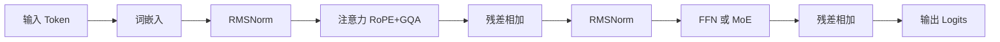

# Transformer 与大模型原理 {#transformer-transformer-llm}

> [AI](../) › Transformer 与大模型原理

从自注意力到现代 LLM 架构，理解「预训练 → 指令微调 → 偏好对齐 → 推理时计算」的完整链路，重点掌握 Token、上下文窗口、KV Cache、MoE 和推理模型这些直接影响工程决策的概念。

## 本关定位

| 项 | 内容 |
|----|------|
| 定位 | 第一章入门的原理关：知道模型「为什么这样计费、这样变慢、这样出错」 |
| 前置要求 | [Python 速成](../00-python-bridge/)；懂矩阵乘法与 Softmax 即可，细节可回补 [数学与机器学习基础](../01-foundations/) |
| 粗略用时 | 1–2 周（粗略参考） |
| 章节 | 第一章 入门 |

## 闯关任务

**QUEST 03 · 第一章 入门**

- [ ] 能够用自己的话解释缩放点积注意力、多头注意力与因果掩码，并手写一个 NumPy 版本。
- [ ] 能够说明 BPE 分词的原理，以及 Token 数如何决定计费、上下文占用和延迟。
- [ ] 能够画出 Decoder-only 模型的一层结构（注意力、FFN、归一化、残差），说出 RoPE、GQA、MoE 各自解决的问题。
- [ ] 能够描述预训练、指令微调、RLHF / RLVR 的分工，并解释推理模型「思考预算 / effort」的含义。
- [ ] 能够解释 KV Cache 为什么让生成变快、又为什么让长上下文变贵。

**奖励**：+100 XP · 徽章「注意力集中者」（徽章名暂定，内容建设中）

## 知识要点

### 分词：模型看到的是 Token

- 模型不直接读字符，而是读 Token ID。主流分词器用 BPE（Byte Pair Encoding）：从字节开始，反复合并语料中最常见的相邻对，直到词表达到目标大小（通常 10 万–25 万）。
- 同一段文字在不同模型上 Token 数不同；中文、代码、数字的切分差异尤其大。API 按 Token 计费，上下文窗口也按 Token 计。
- 下面是一个极简 BPE 训练过程，每轮合并出现最多的相邻符号对：

```python
from collections import Counter

corpus = ["low", "lower", "lowest", "newer", "wider"]
words = [list(w) + ["</w>"] for w in corpus]


def best_pair(words):
    pairs = Counter()
    for w in words:
        for a, b in zip(w, w[1:]):
            pairs[(a, b)] += 1
    return pairs.most_common(1)[0]


for step in range(4):
    (a, b), freq = best_pair(words)
    merged = []
    for w in words:
        out, i = [], 0
        while i < len(w):
            if i + 1 < len(w) and (w[i], w[i + 1]) == (a, b):
                out.append(a + b)
                i += 2
            else:
                out.append(w[i])
                i += 1
        merged.append(out)
    words = merged
    print(f"合并 {a!r}+{b!r}（{freq} 次）->", words[2])
```

运行输出：

```text
合并 'l'+'o'（3 次）-> ['lo', 'w', 'e', 's', 't', '</w>']
合并 'lo'+'w'（3 次）-> ['low', 'e', 's', 't', '</w>']
合并 'e'+'r'（3 次）-> ['low', 'e', 's', 't', '</w>']
合并 'er'+'</w>'（3 次）-> ['low', 'e', 's', 't', '</w>']
```

同一点的 Java 对照：

```java
import java.util.ArrayList;
import java.util.LinkedHashMap;
import java.util.List;
import java.util.Map;

class TinyBpe {
    static Map.Entry<String, Integer> bestPair(List<List<String>> words) {
            return Map.entry("", 0);
        }

    public static void main(String[] args) {
        String[] corpus = {"low", "lower", "lowest", "newer", "wider"};
        List<List<String>> words = new ArrayList<>();
        for (String w : corpus) {
            List<String> chars = new ArrayList<>();
            for (char ch : w.toCharArray()) chars.add(String.valueOf(ch));
            chars.add("</w>");
            words.add(chars);
        }
        for (int step = 0; step < 4; step++) {
            Map<String, Integer> pairs = new LinkedHashMap<>();
            for (List<String> w : words) {
                for (int i = 0; i + 1 < w.size(); i++) {
                    pairs.merge(w.get(i) + "\0" + w.get(i + 1), 1, Integer::sum);
                }
            }
            String best = null;
            int freq = -1;
            for (var e : pairs.entrySet()) {
                if (e.getValue() > freq) {
                    freq = e.getValue();
                    best = e.getKey();
                }
            }
            int cut = best.indexOf('\0');
            String a = best.substring(0, cut), b = best.substring(cut + 1);
            List<List<String>> merged = new ArrayList<>();
            for (List<String> w : words) {
                List<String> out = new ArrayList<>();
                for (int i = 0; i < w.size(); ) {
                    if (i + 1 < w.size() && w.get(i).equals(a) && w.get(i + 1).equals(b)) {
                        out.add(a + b);
                        i += 2;
                    } else {
                        out.add(w.get(i));
                        i++;
                    }
                }
                merged.add(out);
            }
            words = merged;
            System.out.println("合并 '" + a + "'+'" + b + "'（" + freq + " 次）-> " + words.get(2));
        }
    }
}
```


真实分词器可以用 Transformers 直接查看（首次运行会下载分词器文件）：

```python
from transformers import AutoTokenizer

tok = AutoTokenizer.from_pretrained("HuggingFaceTB/SmolLM2-135M-Instruct")
for text in ["Hello, world!", "你好，世界！", "def add(a, b): return a + b"]:
    ids = tok.encode(text)
    print(len(ids), tok.convert_ids_to_tokens(ids)[:8])
print("词表大小", tok.vocab_size)
```

运行输出：

```text
4 ['Hello', ',', 'Ġworld', '!']
12 ['ä½', 'ł', 'å¥', '½', 'ï¼Į', 'ä¸', 'ĸ', 'ç']
11 ['def', 'Ġadd', '(', 'a', ',', 'Ġb', '):', 'Ġreturn']
词表大小 49152
```

中文显示成乱码，是因为字节级 BPE 把每个汉字的 UTF-8 字节拆开了：这个小模型以英文语料为主，4 个汉字加 2 个全角标点用了 12 个 Token。中文优化的模型词表里有大量整字或整词 Token，同样文本的 Token 数会少很多。

### 注意力：每个 Token 去「查」其他 Token

- 每个 Token 的向量分别乘三个矩阵得到 Query、Key、Value。`softmax(Q Kᵀ / √d) V`：用 Query 和所有 Key 的相似度做权重，对 Value 加权求和。
- 除以 `√d` 防止点积过大导致 Softmax 饱和、梯度消失。
- 因果掩码：生成式模型的第 i 个 Token 只能看见 `≤ i` 的位置，用一个上三角 `-inf` 矩阵实现。
- 多头注意力：把维度切成多个头并行计算，各头关注不同关系，最后拼接。

```python
import numpy as np
import torch
import torch.nn.functional as F


def attention(q, k, v, causal=True):
    d = q.shape[-1]
    scores = q @ k.swapaxes(-1, -2) / np.sqrt(d)          # (T, T)
    if causal:
        mask = np.triu(np.ones(scores.shape, dtype=bool), k=1)
        scores = np.where(mask, -np.inf, scores)
    w = np.exp(scores - scores.max(axis=-1, keepdims=True))
    w = w / w.sum(axis=-1, keepdims=True)
    return w @ v, w


rng = np.random.default_rng(0)
T, d = 4, 8
q, k, v = (rng.standard_normal((T, d)) for _ in range(3))
out, w = attention(q, k, v)
print(w.round(2))                       # 上三角为 0：看不到未来

ref = F.scaled_dot_product_attention(*(torch.tensor(a) for a in (q, k, v)), is_causal=True)
print("与 PyTorch 结果一致：", np.allclose(out, ref.numpy()))
```

运行输出：

```text
[[1.   0.   0.   0.  ]
 [0.83 0.17 0.   0.  ]
 [0.34 0.41 0.25 0.  ]
 [0.1  0.03 0.68 0.18]]
与 PyTorch 结果一致： True
```

同一点的 Java 对照：

```java
class CausalAttention {
    public static void main(String[] args) {
        // 原文 Q/K/V 来自 NumPy default_rng(0)。这里写入同一组数，手写因果注意力，不用框架黑盒。
        double[][] q = {
            {0.1257302210933933, -0.13210486329130189, 0.64042265044328206, 0.10490011715303971, -0.53566937316111096, 0.36159505490948474, 1.3040000451301372, 0.94708096312924217},
            {-0.7037352358069926, -1.2654214710460525, -0.62327446253735219, 0.041325979347243601, -2.3250307746388343, -0.21879166393254573, -1.2459109472530652, -0.73226735470345161},
            {-0.54425898285730989, -0.31630015636915454, 0.41163053637413283, 1.0425133694426776, -0.12853466294403426, 1.3664634705496859, -0.66519467348661354, 0.35151007009301971},
            {0.90347018165180859, 0.094012297760874566, -0.7434992493538084, -0.92172537625841944, -0.45772582566733916, 0.22019512347004941, -1.0096181835387359, -0.20917557487171307}
        };
        double[][] k = {
            {-0.15922500991447772, 0.54084558468580768, 0.21465912250634089, 0.35537270903992141, -0.65382860941833942, -0.12961363369276946, 0.7839754700613295, 1.4934311452207607},
            {-1.2590655321041202, 1.5139237747390626, 1.3458754237823045, 0.78131140070042748, 0.26445563032930353, -0.31392281453642779, 1.4580206835369587, 1.9602583164499647},
            {1.8016348698661251, 1.31510376473437, 0.35738041065895598, -1.2083186322821715, -0.0044541331200832288, 0.65647493507633581, -1.2883614637495544, 0.39512206018200824},
            {0.42986369482223002, 0.69604272396286848, -1.1841179667571891, -0.66170257203903493, -0.43643524714322124, -1.1698019077728641, 1.739367877130134, -0.49591072844215189}
        };
        int t = 4, d = 8;
        double[][] w = new double[t][t];
        for (int i = 0; i < t; i++) {
            double max = Double.NEGATIVE_INFINITY;
            double[] scores = new double[t];
            for (int j = 0; j <= i; j++) {
                double dot = 0;
                for (int c = 0; c < d; c++) dot += q[i][c] * k[j][c];
                scores[j] = dot / Math.sqrt(d);
                max = Math.max(max, scores[j]);
            }
            double sum = 0;
            for (int j = 0; j <= i; j++) {
                w[i][j] = Math.exp(scores[j] - max);
                sum += w[i][j];
            }
            for (int j = 0; j <= i; j++) w[i][j] /= sum;
        }
        double[][] expect = {
            {1, 0, 0, 0},
            {0.83, 0.17, 0, 0},
            {0.34, 0.41, 0.25, 0},
            {0.10, 0.03, 0.68, 0.18}
        };
        for (int i = 0; i < t; i++) {
            for (int j = 0; j < t; j++) {
                double shown = Math.round(w[i][j] * 100.0) / 100.0;
                if (Math.abs(shown - expect[i][j]) > 0.011) {
                    throw new AssertionError(i + "," + j + " " + shown);
                }
                System.out.printf("%s%.2f", j == 0 ? "" : " ", w[i][j]);
            }
            System.out.println();
        }
    }
}
```


### 现代 Decoder-only 架构



- 一层 = 归一化 → 注意力 → 残差 → 归一化 → 前馈网络（FFN）→ 残差，堆叠几十到上百层。现代模型普遍用 Pre-Norm + RMSNorm、SwiGLU 激活。
- 位置编码：RoPE 把位置信息以旋转的方式注入 Q、K，长度外推性较好，是开源模型主流。
- GQA（分组查询注意力）：多个 Query 头共享一组 K / V 头，KV Cache 成倍缩小；DeepSeek 的 MLA 把 K / V 压缩成低秩潜向量，进一步省显存。
- MoE（混合专家）：FFN 换成多个专家 + 路由器，每个 Token 只激活少数专家。型号里的 `1T-A52B` 表示总参数 1T、每 Token 激活约 52B：显存按总参数算，计算量按激活参数算。

### 训练链路与推理模型

- 预训练：海量文本上做「下一个 Token 预测」，损失就是 01 关的交叉熵；Scaling Law 描述损失随参数量、数据量、算力的幂律下降。
- 指令微调 SFT：用「指令 → 回答」对教模型按对话格式响应。
- 偏好对齐：RLHF（奖励模型 + PPO）、DPO（直接用偏好对优化）；RLVR 用可验证奖励（单元测试、数学答案）训练推理能力，见 [微调与对齐](../14-fine-tuning/)。
- 推理模型 / test-time compute：回答前先生成一段思考 Token，思考越多通常越准，但更慢更贵。Claude 最新模型使用自适应思考，用 `effort` 控制力度；OpenAI 用 `reasoning.effort`，具体参数见 [LLM API 编程模式](../06-llm-api-programming/)。

### KV Cache 与长上下文

- 自回归生成时，前文每个 Token 的 K、V 不会变，缓存下来，每步只算新 Token，这就是 KV Cache。
- 代价：KV Cache 大小 ≈ `2 × 层数 × KV 头数 × 头维度 × 序列长度 × 字节数`，随上下文线性增长，是长上下文和高并发的显存瓶颈，计算器见 [推理与服务](../15-inference-serving/)。
- 2026 年旗舰模型普遍提供约 1M Token 上下文，但「能放进去」不等于「能用好」：信息埋在长上下文中间时召回率会下降（上下文腐烂），所以仍需要 RAG 和上下文工程。

### 分词器与模板也是模型契约

- BPE 不等于所有分词器：还包括 byte-level BPE、WordPiece、Unigram 等。Token ID 只在对应词表内有意义；中文、代码、空格、emoji 的字符 / Token 比例不同，不能按字数精确计费。
- 聊天模板加入角色、分隔符、结束标记和生成提示；训练与推理应使用同一模型要求的模板。`apply_chat_template(tokenize=False)` 后再次分词时避免重复添加特殊 Token。
- 上下文窗口不是「能放多少个汉字」，还包括模板、工具描述、图片 / 音频表示与待生成内容；最大输出往往有独立限制，工程预算见 [提示词与上下文](../05-prompt-context/)。

### Prefill、Decode、KV 与 MoE 的边界

- Prefill 并行处理已有输入并建立 KV；Decode 逐步生成新 Token。两阶段的算力 / 带宽瓶颈不同，延迟和分离部署见 [推理与服务](../15-inference-serving/)。
- KV Cache 保存各层 attention 的键值张量，不是最终答案缓存；前缀缓存复用的是相同前缀的计算。复用要求模型、Token 序列和相关配置匹配，不能把不同租户数据随意共享。
- GQA / MQA 减少 KV 头数，滑动窗口 / 压缩注意力可改变缓存规模，因此普通全注意力的估算式不能直接套到所有架构。
- MoE 的激活参数主要影响每 Token 计算量，总参数影响权重存储；专家并行还引入路由与跨卡通信。CPU / NVMe offload 可以降低 GPU 常驻权重，但会付出传输与延迟成本，不能据激活参数直接承诺单卡可部署。

## 选型对比

| 注意力变体 | KV 头数 | KV Cache | 代表 |
|------------|---------|----------|------|
| MHA 多头注意力 | 等于 Query 头数 | 最大 | 原始 Transformer、早期 GPT |
| MQA 多查询注意力 | 1 | 最小，质量略降 | PaLM |
| GQA 分组查询注意力 | 介于两者之间（如 8） | 中等，质量接近 MHA | Llama、Qwen、Mistral 系列 |
| MLA 多头潜在注意力 | 压缩成低秩潜向量 | 很小 | DeepSeek V3 及之后 |

| 架构 | 显存需求 | 每 Token 计算量 | 特点 |
|------|----------|-----------------|------|
| Dense 稠密 | 按总参数 | 按总参数 | 简单，微调和部署生态成熟 |
| MoE 混合专家 | 按总参数 | 按激活参数 | 同等算力下能力更强，部署需要更多显存与专家并行 |

## 常见误区

- 把 Token 当成「字」或「词」：一个汉字可能是 1–3 个 Token，英文单词也常被切成多段。估算成本要用对应模型的分词器或官方计数接口。
- 认为 MoE 模型显存只看激活参数：所有专家权重都要加载，`A52B` 只决定计算量。
- 以为上下文越长越好：长上下文更贵、更慢，中间位置的信息容易被忽略。
- 把模型输出的「思考过程」当成真实推理轨迹：它有助于提高正确率，但不保证忠实反映内部计算，也不应作为安全审计的唯一依据。
- 认为温度为 0 就完全确定：批处理、浮点并行累加顺序等因素仍可能导致输出差异。

## 实践任务

- 跑通本页的 NumPy 注意力，改成 2 个头的多头注意力，并用 `F.scaled_dot_product_attention` 校验。
- 用两个不同模型的分词器统计同一篇中文文章的 Token 数，算出各自的费用差异。
- 跟着 Karpathy 的 Zero to Hero 实现一个字符级小 GPT，在莎士比亚文本上训练到能生成像样的句子。
- 读 InstructGPT 论文的第 3 节，画出 SFT → 奖励模型 → PPO 的三步流程图。

## 资料索引

- [Attention Is All You Need](https://arxiv.org/abs/1706.03762) — Transformer 原始论文
- [The Illustrated Transformer](https://jalammar.github.io/illustrated-transformer/) — 图解注意力
- [Andrej Karpathy: Neural Networks Zero to Hero](https://karpathy.ai/zero-to-hero.html) — 从零实现 GPT
- [Training language models to follow instructions with human feedback](https://arxiv.org/abs/2203.02155) — InstructGPT，RLHF 指令对齐经典
- [Hugging Face LLM Course](https://huggingface.co/learn/llm-course/chapter1/1) — 免费 LLM 课程
- [GQA: Training Generalized Multi-Query Transformer Models](https://arxiv.org/abs/2305.13245) — 分组查询注意力论文
- [Transformers 分词算法](https://huggingface.co/docs/transformers/tokenizer_summary) — BPE、WordPiece、Unigram 的区别
- [Transformers 聊天模板](https://huggingface.co/docs/transformers/en/chat_templating) — 角色标记与特殊 Token 的正确使用
- [Transformers 缓存说明](https://huggingface.co/docs/transformers/en/cache_explanation) — KV 缓存及自回归生成
- [Megatron Core MoE](https://docs.nvidia.com/megatron-core/developer-guide/latest/user-guide/features/moe.html) — 专家并行与通信开销

## 通关自测

先独立作答，再展开参考答案核对；简答题答出要点即算对。答对 ≥ 80% 即可进入下一关。

1. 【单选】注意力分数要除以 `√d` 的主要原因是：
    - A. 减少参数量
    - B. 防止点积过大导致 Softmax 饱和
    - C. 实现因果掩码
    - D. 让输出长度不变
2. 【单选】一个标注为 `2.4T-A95B` 的 MoE 模型，部署时显存主要取决于：
    - A. 95B 激活参数
    - B. 2.4T 总参数
    - C. 只取决于上下文长度
    - D. 专家数量与显存无关
3. 【简答】为什么 GQA 能显著降低长上下文推理成本？
4. 【简答】同一段中文提示在两个模型上费用差了 40%，单价相同。可能的原因是什么？
5. 【简答】说出 SFT、RLHF / DPO、RLVR 各自主要解决什么问题。

<details markdown><summary>参考答案</summary>

1. B — `d` 越大点积方差越大，Softmax 会趋近 one-hot，梯度变小。
2. B — 所有专家都要常驻显存，激活参数只决定每个 Token 的计算量。
3. 多个 Query 头共享 K / V 头，KV Cache 按 KV 头数缩小，同样显存可以放更长的上下文或更多并发请求。
4. 两个模型的分词器不同，中文切分粒度不同，同一段文字的 Token 数不同。
5. SFT 教模型遵循指令与对话格式；RLHF / DPO 让输出符合人类偏好（有用、无害、风格）；RLVR 用可自动验证的奖励（测试通过、答案正确）提升推理与代码能力。

</details>

---

← [上一节：深度学习框架](../02-dl-frameworks/) · [返回 AI](../) · [下一节：模型全景](../04-model-landscape/) →
