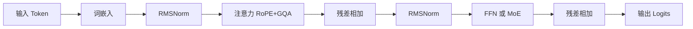

# Transformer 与大模型原理 {#transformer-transformer-llm}

> [AI](../) › Transformer 与大模型原理

从自注意力到现代 LLM 架构，理解「预训练 → 指令微调 → 偏好对齐 → 推理时计算」的完整链路，重点掌握 Token、上下文窗口、KV Cache、MoE 和推理模型这些直接影响工程决策的概念。

---

> [!NOTE]
> 本仓库和站点的内容由 AI 生成，资料与资源链接来源于网络，仅供学习参考；如有错误或侵权，请提 Issue 告知。

## 这一页补哪一块 {#_1}

计费对应 Token，变慢和变贵对应上下文与 KV Cache，显存对应总参数和缓存，看起来在思考对应多生成的 Token。矩阵和 Softmax 回 [数学与机器学习基础](../01-foundations/)，加载代码回 [深度学习框架](../02-dl-frameworks/)，部署回 [推理与服务](../15-inference-serving/)，对齐回 [微调与对齐](../14-fine-tuning/)。

## 分词：模型看到的是 Token {#token}

<span id="_2"></span>

- 模型读 Token ID，不直接读字符。BPE 从符号开始，反复合并语料里最常见的相邻对。十万到二十万是常见词表的数量级，不是某一家的现行规格。
- 中文、代码和数字的切分差异大。API 按 Token 计费，窗口也按 Token 计，不能按字数精确换算。
- 下面的 Java 类可以编译运行。`bestPair` 是未使用的空方法，固定返回空键，`main` 没有调用它。运行 `main` 只验证 `main` 里的合并循环。这个空方法不是完整或可复用的分词器，围栏保持原样。

```python
from collections import Counter

corpus = ["low", "lower", "lowest", "newer", "wider"]
words = [list(w) + ["</w>"] for w in corpus]


def best_pair(words):
    pairs = Counter()
    for w in words:
        for a, b in zip(w, w[1:]):
            pairs[(a, b)] += 1
    return pairs.most_common(1)[0]


for step in range(4):
    (a, b), freq = best_pair(words)
    merged = []
    for w in words:
        out, i = [], 0
        while i < len(w):
            if i + 1 < len(w) and (w[i], w[i + 1]) == (a, b):
                out.append(a + b)
                i += 2
            else:
                out.append(w[i])
                i += 1
        merged.append(out)
    words = merged
    print(f"合并 {a!r}+{b!r}（{freq} 次）->", words[2])
```

运行输出：

```text
合并 'l'+'o'（3 次）-> ['lo', 'w', 'e', 's', 't', '</w>']
合并 'lo'+'w'（3 次）-> ['low', 'e', 's', 't', '</w>']
合并 'e'+'r'（3 次）-> ['low', 'e', 's', 't', '</w>']
合并 'er'+'</w>'（3 次）-> ['low', 'e', 's', 't', '</w>']
```

同一点的 Java 对照：

```java
import java.util.ArrayList;
import java.util.LinkedHashMap;
import java.util.List;
import java.util.Map;

class TinyBpe {
    static Map.Entry<String, Integer> bestPair(List<List<String>> words) {
            return Map.entry("", 0);
        }

    public static void main(String[] args) {
        String[] corpus = {"low", "lower", "lowest", "newer", "wider"};
        List<List<String>> words = new ArrayList<>();
        for (String w : corpus) {
            List<String> chars = new ArrayList<>();
            for (char ch : w.toCharArray()) chars.add(String.valueOf(ch));
            chars.add("</w>");
            words.add(chars);
        }
        for (int step = 0; step < 4; step++) {
            Map<String, Integer> pairs = new LinkedHashMap<>();
            for (List<String> w : words) {
                for (int i = 0; i + 1 < w.size(); i++) {
                    pairs.merge(w.get(i) + "\0" + w.get(i + 1), 1, Integer::sum);
                }
            }
            String best = null;
            int freq = -1;
            for (var e : pairs.entrySet()) {
                if (e.getValue() > freq) {
                    freq = e.getValue();
                    best = e.getKey();
                }
            }
            int cut = best.indexOf('\0');
            String a = best.substring(0, cut), b = best.substring(cut + 1);
            List<List<String>> merged = new ArrayList<>();
            for (List<String> w : words) {
                List<String> out = new ArrayList<>();
                for (int i = 0; i < w.size(); ) {
                    if (i + 1 < w.size() && w.get(i).equals(a) && w.get(i + 1).equals(b)) {
                        out.add(a + b);
                        i += 2;
                    } else {
                        out.add(w.get(i));
                        i++;
                    }
                }
                merged.add(out);
            }
            words = merged;
            System.out.println("合并 '" + a + "'+'" + b + "'（" + freq + " 次）-> " + words.get(2));
        }
    }
}
```

2026-11-23 用 Temurin `25.0.5.1+2`、`javac --release 25` 运行了这个 `main`。四行合并与上面的 Python 输出对应，列表的打印格式是 Java 的。`bestPair` 没有被调用，这次运行不验证它。

真实分词器可以用 Transformers 直接查看。首次运行会下载分词器文件。本次没有下载，输出保持原文。

```python
from transformers import AutoTokenizer

tok = AutoTokenizer.from_pretrained("HuggingFaceTB/SmolLM2-135M-Instruct")
for text in ["Hello, world!", "你好，世界！", "def add(a, b): return a + b"]:
    ids = tok.encode(text)
    print(len(ids), tok.convert_ids_to_tokens(ids)[:8])
print("词表大小", tok.vocab_size)
```

运行输出：

```text
4 ['Hello', ',', 'Ġworld', '!']
12 ['ä½', 'ł', 'å¥', '½', 'ï¼Į', 'ä¸', 'ĸ', 'ç']
11 ['def', 'Ġadd', '(', 'a', ',', 'Ġb', '):', 'Ġreturn']
词表大小 49152
```

中文显示成那样，是因为这个以英文语料为主的小模型把 UTF-8 字节拆开了。四个汉字加两个全角标点用了 12 个 Token。词表里有整字 Token 的模型，同一段文字会短很多。

## 注意力：每个 Token 去「查」其他 Token {#token-token}

- 每个 Token 的向量分别乘出 Query、Key、Value。`softmax(QKᵀ / √d) V` 用相似度给 Value 做加权和。
- 除以 `√d` 是为了点积不至于大到让 Softmax 饱和、梯度变小。
- 因果掩码让第 i 个位置只能看见 `≤ i`。实现上是把未来位置设成 `-inf`。
- 多头把维度切开并行计算，再拼回来。

```python
import numpy as np
import torch
import torch.nn.functional as F


def attention(q, k, v, causal=True):
    d = q.shape[-1]
    scores = q @ k.swapaxes(-1, -2) / np.sqrt(d)          # (T, T)
    if causal:
        mask = np.triu(np.ones(scores.shape, dtype=bool), k=1)
        scores = np.where(mask, -np.inf, scores)
    w = np.exp(scores - scores.max(axis=-1, keepdims=True))
    w = w / w.sum(axis=-1, keepdims=True)
    return w @ v, w


rng = np.random.default_rng(0)
T, d = 4, 8
q, k, v = (rng.standard_normal((T, d)) for _ in range(3))
out, w = attention(q, k, v)
print(w.round(2))                       # 上三角为 0：看不到未来

ref = F.scaled_dot_product_attention(*(torch.tensor(a) for a in (q, k, v)), is_causal=True)
print("与 PyTorch 结果一致：", np.allclose(out, ref.numpy()))
```

运行输出：

```text
[[1.   0.   0.   0.  ]
 [0.83 0.17 0.   0.  ]
 [0.34 0.41 0.25 0.  ]
 [0.1  0.03 0.68 0.18]]
与 PyTorch 结果一致： True
```

这段同时依赖 NumPy 和 PyTorch。本次没有安装 PyTorch，整段没有运行，输出保持原文。

同一点的 Java 对照写入与 NumPy `default_rng(0)` 同一组数，手写因果注意力的权重，不用框架黑盒。它不计算 Value 的加权和。2026-11-23 用 Temurin `25.0.5.1+2`、`javac --release 25` 运行，程序正常退出，四行与围栏里的四舍五入值一致。

```java
class CausalAttention {
    public static void main(String[] args) {
        // 原文 Q/K/V 来自 NumPy default_rng(0)。这里写入同一组数，手写因果注意力，不用框架黑盒。
        double[][] q = {
            {0.1257302210933933, -0.13210486329130189, 0.64042265044328206, 0.10490011715303971, -0.53566937316111096, 0.36159505490948474, 1.3040000451301372, 0.94708096312924217},
            {-0.7037352358069926, -1.2654214710460525, -0.62327446253735219, 0.041325979347243601, -2.3250307746388343, -0.21879166393254573, -1.2459109472530652, -0.73226735470345161},
            {-0.54425898285730989, -0.31630015636915454, 0.41163053637413283, 1.0425133694426776, -0.12853466294403426, 1.3664634705496859, -0.66519467348661354, 0.35151007009301971},
            {0.90347018165180859, 0.094012297760874566, -0.7434992493538084, -0.92172537625841944, -0.45772582566733916, 0.22019512347004941, -1.0096181835387359, -0.20917557487171307}
        };
        double[][] k = {
            {-0.15922500991447772, 0.54084558468580768, 0.21465912250634089, 0.35537270903992141, -0.65382860941833942, -0.12961363369276946, 0.7839754700613295, 1.4934311452207607},
            {-1.2590655321041202, 1.5139237747390626, 1.3458754237823045, 0.78131140070042748, 0.26445563032930353, -0.31392281453642779, 1.4580206835369587, 1.9602583164499647},
            {1.8016348698661251, 1.31510376473437, 0.35738041065895598, -1.2083186322821715, -0.0044541331200832288, 0.65647493507633581, -1.2883614637495544, 0.39512206018200824},
            {0.42986369482223002, 0.69604272396286848, -1.1841179667571891, -0.66170257203903493, -0.43643524714322124, -1.1698019077728641, 1.739367877130134, -0.49591072844215189}
        };
        int t = 4, d = 8;
        double[][] w = new double[t][t];
        for (int i = 0; i < t; i++) {
            double max = Double.NEGATIVE_INFINITY;
            double[] scores = new double[t];
            for (int j = 0; j <= i; j++) {
                double dot = 0;
                for (int c = 0; c < d; c++) dot += q[i][c] * k[j][c];
                scores[j] = dot / Math.sqrt(d);
                max = Math.max(max, scores[j]);
            }
            double sum = 0;
            for (int j = 0; j <= i; j++) {
                w[i][j] = Math.exp(scores[j] - max);
                sum += w[i][j];
            }
            for (int j = 0; j <= i; j++) w[i][j] /= sum;
        }
        double[][] expect = {
            {1, 0, 0, 0},
            {0.83, 0.17, 0, 0},
            {0.34, 0.41, 0.25, 0},
            {0.10, 0.03, 0.68, 0.18}
        };
        for (int i = 0; i < t; i++) {
            for (int j = 0; j < t; j++) {
                double shown = Math.round(w[i][j] * 100.0) / 100.0;
                if (Math.abs(shown - expect[i][j]) > 0.011) {
                    throw new AssertionError(i + "," + j + " " + shown);
                }
                System.out.printf("%s%.2f", j == 0 ? "" : " ", w[i][j]);
            }
            System.out.println();
        }
    }
}
```

## 现代 Decoder-only 架构 {#decoder-only}

生成式语言模型把「预测下一个 Token」当作统一目标。Decoder-only 加因果掩码就够完成这件事，也便于把上下文堆进同一条序列。Encoder-decoder 仍适合输入和输出明确分开的条件生成或翻译。这一页不展开那种实现。



- 一层是归一化、注意力、残差，再归一化、前馈、残差。现代模型常用 Pre-Norm、RMSNorm 和 SwiGLU。残差让梯度有一条直接回去的路，这里不推导。
- RoPE 把位置以旋转的方式放进 Q 和 K。长度超出训练范围时仍可能变差。
- GQA 让多个 Query 头共享一组 K/V，KV Cache 按 KV 头数缩小。MLA 把 K/V 压成低秩向量，普通的「头数 × 头维度」估算不再直接适用。
- MoE 把前馈换成多个专家加路由。每个 Token 只激活少数专家。`1T-A52B` 表示总参数约 1T、每 Token 激活约 52B。权重存储看总参数，每个 Token 的计算量看激活参数。

## 训练链路与推理模型 {#_4}

- 预训练在大量文本上预测下一个 Token，损失是交叉熵。规模定律描述损失随参数、数据和算力变化的趋势，不是某一次训练的保证。
- SFT 用「指令 → 回答」教对话格式。RLHF 用奖励模型和策略优化对齐偏好，DPO 直接用偏好对。RLVR 用可以自动核对的奖励，例如测试是否通过。细节见 [微调与对齐](../14-fine-tuning/)。
- 推理时计算是用更多生成出来的 Token 换正确率，同时更慢、更贵。参数名以当时的官方 API 为准，见 [LLM API 编程模式](../06-llm-api-programming/)。思考文本可能提高正确率，它不是内部计算的忠实记录，也不能单独当作安全审计。

## KV Cache 与长上下文 {#kv-cache}

- 自回归生成时，已经算过的 K、V 可以缓存，每步只算新 Token。
- 全注意力下，缓存大小大致是 `2 × 层数 × KV 头数 × 头维度 × 序列长度 × 字节数`，随上下文线性增长。分组、滑动窗口和压缩注意力会改变这个式子。计算器见 [推理与服务](../15-inference-serving/)。
- 有的厂商文档宣称很长的上下文窗口。能放进去，不等于中间的信息还能被用到。检索和上下文安排仍然需要，见 [提示词与上下文](../05-prompt-context/) 和 [检索增强](../08-rag/)。这一页不列未核对的窗口数字。

## 分词器与模板也是模型契约 {#_5}

- BPE 不是全部。还有字节级 BPE、WordPiece 和 Unigram。Token ID 只在对应词表里有意义。
- 聊天模板加入角色、分隔符、结束标记和生成提示。训练和推理要用同一模型要求的模板。`apply_chat_template(tokenize=False)` 之后再分词，避免把特殊 Token 加第二次。
- 上下文窗口不是「能放多少个汉字」。模板、工具描述、图片或音频的表示，以及还要生成的内容，都占位置。最大输出往往另有限制。

## Prefill、Decode、KV 与 MoE 的边界 {#prefilldecodekv-moe}

- Prefill 并行处理已有输入并建立 KV。Decode 逐步生成新 Token。两段的算力和带宽瓶颈不同，分开部署见 [推理与服务](../15-inference-serving/)。
- KV Cache 保存的是各层注意力的键和值，不是最终答案的缓存。前缀缓存复用的是相同前缀的计算。模型、Token 序列和相关配置要匹配，不能把不同租户的前缀混用。
- GQA / MQA 减少 KV 头数。滑动窗口和压缩注意力改变缓存规模。全注意力的估算式不能套到所有架构。
- MoE 的激活参数主要影响每个 Token 的计算量，总参数影响权重放在哪里。专家并行还有路由和跨卡通信。CPU 或 NVMe offload 可以降低 GPU 上常驻的权重，同时付出传输和延迟。不能根据激活参数承诺单卡放得下。

## 架构与注意力变体怎么选 {#llm-choice}

<span id="_6"></span>

| 注意力变体 | KV 头数 | KV Cache | 代表 |
|------------|---------|----------|------|
| MHA 多头注意力 | 等于 Query 头数 | 最大 | 原始 Transformer、早期 GPT |
| MQA 多查询注意力 | 1 | 最小，质量略降 | PaLM |
| GQA 分组查询注意力 | 介于两者之间（如 8） | 中等，质量接近 MHA | Llama、Qwen、Mistral 系列 |
| MLA 多头潜在注意力 | 压缩成低秩潜向量 | 很小 | DeepSeek V3 及之后 |

| 架构 | 显存需求 | 每 Token 计算量 | 特点 |
|------|----------|-----------------|------|
| Dense 稠密 | 按总参数 | 按总参数 | 简单，微调和部署生态成熟 |
| MoE 混合专家 | 按总参数 | 按激活参数 | 同等算力下能力更强，部署需要更多显存与专家并行 |

offload 可以降低 GPU 常驻，但有传输和延迟。激活参数能进一张卡，不等于整个模型可以这样部署。

## 常见误读 {#_3}

<span id="_7"></span>

- 把 Token 当成字或词。一个汉字可能是多个 Token，英文单词也常被切开。费用要用对应模型的分词器或官方计数。
- 认为 MoE 的显存只看激活参数。专家权重都要有地方放。`A52B` 决定的是计算量。
- 以为上下文越长越好。更长更贵、更慢，中间位置的信息可能用不上。
- 把模型输出的思考过程当成真实推理轨迹。它可能提高正确率，不保证忠实反映内部计算，也不能单独当作安全审计。
- 认为温度为 0 就完全确定。并列的最大 logit 之外，批处理和浮点并行累加的顺序仍可能让输出不同。

## 可选核对 {#llm-check}

<span id="_8"></span>

1. 注意力分数要除以 `√d` 的原因是什么？
2. 标注为总参数很大、激活参数较小的 MoE，部署时显存主要跟哪一个走？为什么？

<details markdown><summary>参考答案</summary>

1. `d` 越大，点积的方差越大，Softmax 会趋近 one-hot，梯度变小。除以 `√d` 是为了避免饱和。
2. 跟总参数走。所有专家的权重都要存放。激活参数决定每个 Token 算多少，不把显存需求缩成那个较小的数。offload 能少占 GPU，同时增加传输延迟。

</details>

<span id="_10"></span>

## 资料索引 {#_9}

- [Attention Is All You Need](https://arxiv.org/abs/1706.03762) — Transformer 原始论文
- [The Illustrated Transformer](https://jalammar.github.io/illustrated-transformer/) — 图解注意力
- [Andrej Karpathy: Neural Networks Zero to Hero](https://karpathy.ai/zero-to-hero.html) — 从零实现 GPT
- [Training language models to follow instructions with human feedback](https://arxiv.org/abs/2203.02155) — InstructGPT，RLHF 指令对齐经典
- [Hugging Face LLM Course](https://huggingface.co/learn/llm-course/chapter1/1) — 免费 LLM 课程
- [GQA: Training Generalized Multi-Query Transformer Models](https://arxiv.org/abs/2305.13245) — 分组查询注意力论文
- [Transformers 分词算法](https://huggingface.co/docs/transformers/tokenizer_summary) — BPE、WordPiece、Unigram 的区别
- [Transformers 聊天模板](https://huggingface.co/docs/transformers/en/chat_templating) — 角色标记与特殊 Token 的正确使用
- [Transformers 缓存说明](https://huggingface.co/docs/transformers/en/cache_explanation) — KV 缓存及自回归生成
- [Megatron Core MoE](https://docs.nvidia.com/megatron-core/developer-guide/latest/user-guide/features/moe.html) — 专家并行与通信开销

---

← [上一节：深度学习框架](../02-dl-frameworks/) · [返回 AI](../) · [下一节：模型全景](../04-model-landscape/) →
