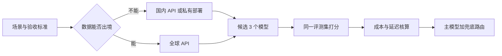

# 模型全景 {#model-landscape}

> [AI](../) › 模型全景

闭源与开放权重模型怎么选：合规约束、同一评测集、以及含思考 Token 和缓存的总成本。家族名和标价都只在某一天的官方页上成立。下面的表格和计算器是 2026-11-05 前后写入的快照，不是一份会自动更新的型号目录。

> [!NOTE]
> 本仓库和站点的内容由 AI 生成，资料与资源链接来源于网络，仅供学习参考；如有错误或侵权，请提 Issue 告知。

## 这一页补哪一块 {#_1}

选型先看数据能不能出境、验收标准是什么、一次请求的全部费用是多少。费用里要算上按输出计费的思考 Token，以及缓存命中后的折扣。型号目录会过期；方法不过期。Token、MoE 和推理模型的概念回 [Transformer 与大模型原理](../03-transformer-llm/)。

## 型号和标价只在官方页上成立 {#_2}

- 家族名不能代替可运行的模型 ID 或快照。生产配置要写官方页上的完整 ID，并保留回滚用的上一档 ID。
- Alias 会改指向。固定可用快照，比把「最新」写进代码更可预期。
- 收到弃用通知后，在自己的评测集上比较质量、延迟、价格和安全行为，而不是只替换字符串。能力矩阵一节把这件事展开。
- 把上周的旗舰表当成今天的官方页，会把旧单价写进预算。调用前重开模型页。

## 闭源旗舰（2026-11） {#2026-11}

下表是写入时抄下的型号和定位，列名不再叫「当前」。围栏里的 `PRICES` 和输出也是同一批快照，数字不改。

| 厂商 | 2026-11-05 前后写入的型号 | 说明 |
|------|--------------------------|------|
| OpenAI | GPT-6 Astra（`gpt-6-astra`）、GPT-6.1 Sol（`gpt-6.1-sol`）、GPT-6.1 Terra（`gpt-6.1-terra`）、GPT-6 Luna（`gpt-6-luna`） | 写入时记全系约 1.05M 上下文、128K 输出；Astra 最强，Sol 接近 Astra 而更便宜，Terra 偏快速与视觉 / 电脑操作，Luna 面向大批量简单任务 |
| Anthropic | Claude Fable 5.1、Claude Opus 5.5、Claude Sonnet 5.5、Claude Haiku 5.5 | 写入时记全系 1M 上下文、128K 输出；API ID 为 `claude-fable-5-1`、`claude-opus-5-5`、`claude-sonnet-5-5`、`claude-haiku-5-5` |
| Google | Gemini 4 Argon（`gemini-4-argon`）、Gemini 3.8 Flash（`gemini-3.8-flash`） | 写入时把 Argon 记成旗舰推理、Flash 记成低延迟。2026-11-25 打开的模型页已不是这个定位，见下文 |
| OpenAI 专项 | GPT-Image-2.6、GPT-Realtime-2.1、GPT-Live 1、GPT-Transcribe | 图像、实时语音、转写，见 [多模态](../16-multimodal/) |

写入时抄下的价格（每百万输入 / 输出 Token）：Claude Fable $10 / $50，Opus $4 / $20，Sonnet $2 / $10，Haiku $0.10 / $0.50 起。OpenAI Astra $10 / $50，Sol $2 / $10，Terra $1 / $5，Luna $0.1 / $0.5。这些数字留给下面的计算器，不代表 2026-11-25 的官方标价。

> [!WARNING]
> 2026-11-25 重开了官方页，只把当页读到的句子写在这里。计算器围栏没有改。
>
> OpenAI 模型页写：不确定时用 GPT-6.2 Astra 做复杂推理和编码，用 GPT-6.2 Sol 平衡能力与成本，用 GPT-6 Luna 做大批量低价任务。同页标价为 Astra 输入 $8 / 输出 $40、Sol $2 / $10、Luna $0.1 / $0.5（每百万 Token）；Astra 与 Sol 的上下文为 1.05M、最大输出 128K。Changelog 的 2026-11-17 条目给出模型 ID `gpt-6.2-astra`、`gpt-6.2-sol`，并写明 GPT-6.2 改变了 Responses API 在编辑对话前缀时如何保留推理，以及如何处理顶层 `instructions`。同一天的另一条 changelog 仍列出 `gpt-6.1-terra` 与 `gpt-6-luna`。示例代码仍用旧 ID，未按 6.2 重跑。
>
> Anthropic 模型总览写：多数工作可从 Claude Opus 5.5 开始；更重的推理和长程 agent 再用 Claude Fable 5.2。总览上的 API ID 与价格为 `claude-fable-5-2` $8 / $40，`claude-opus-5-5` $4 / $20，`claude-sonnet-5-5` $2 / $10，`claude-haiku-5-5` 从 $0.10 / $0.50 起。四者上下文 1M、最大输出 128K。总览仍列出 Fable 5.1，标价 $10 / $50。发布说明的 2026-11-09 条目宣布推出 Fable 5.2。
>
> Gemini 模型页把 Gemini 4 Carbon（`gemini-4-carbon`）写成最强推理，把 Argon（`gemini-4-argon`）写成相对 Carbon 更快、单轮 Token 更少的前线推理模型，并同时列出 Neon（`gemini-4-neon`）与 Hydrogen（`gemini-4-hydrogen`）。`gemini-3.8-flash` 仍在 Gemini 3 列表中，页面称它为上一代 Flash。该页把这些 Gemini 4 模型的上下文写成 1M，最大输出写成 64K / 1M。能放进窗口不等于中间信息可用，回 03 和 [提示词与上下文工程](../05-prompt-context/)。未在这些页面上出现的 ID 不写进本文。

## 开放权重家族 {#_4}

2026-11-25 没有逐家重开 Hugging Face 与各厂商模型卡。下表保持写入时的代表，不把它当成当日已证实的当前旗舰。调用前打开模型卡，核对许可证、上下文和推荐显存。

| 家族 | 写入时的代表 | 说明 |
|------|--------------|------|
| OpenAI gpt-oss | gpt-oss-120b、gpt-oss-20b（2025-08） | Apache 2.0，单卡可跑 20b |
| Google Gemma | Gemma 4（E2B / E4B / 12B / 31B） | 端侧到单卡服务器 |
| Meta Llama | Llama 4 Scout / Maverick（2025-04） | 写入时记为 Hugging Face 上仍是最新开放权重；2026-11-25 未复核 |
| Mistral | Mistral Large 4（`1T-A52B`，2026-09-30 发布权重）、Mistral Medium 3.5 | 欧洲厂商，MoE 旗舰 |
| 通义千问 Qwen | Qwen3.8（27B、Flash-Next、2.4T-A95B，2026-08） | 百炼 API 为 `qwen3.8-max` / `qwen3.8-flash` |
| DeepSeek | DeepSeek-V4.1-Flash、DeepSeek-V4-Pro-0813 | API 名 `deepseek-flash` / `deepseek-v4-pro`，兼容 OpenAI 与 Anthropic 接口格式 |
| 智谱 GLM | GLM-5.3 / GLM-5.3-Flash（2026-08） | Hugging Face 组织名 `zai-org` |
| 月之暗面 Kimi | Kimi K3（2026-06）、Kimi-K3.1-Pro（2026-11-02 上传） | 长上下文与 Agent 能力 |
| 其他国产 | MiniMax-M3 / M3.1-Flash、阶跃 Step-5-Preview、百度 ERNIE-5.5-Flash-Base、腾讯混元 Hy 系列 | 按场景补充评测 |

- 「开放权重」只代表能下载权重，训练数据和代码不一定公开；商用前读许可证（Apache 2.0、MIT、Llama 社区许可、Gemma 条款等差别很大）。
- 规格 `1T-A52B`：总参数 1T、每 Token 激活约 52B，显存按总参数估算，见 [Transformer 与大模型原理](../03-transformer-llm/)。

## 选型方法 {#_5}



- 先写验收标准和 30–100 条评测样本（见 [评测与可观测](../17-evals-observability/)），再挑 2–3 个候选模型跑同一套题，不凭排行榜直接拍板。
- 成本 = 输入 Token × 输入单价 + 输出 Token × 输出单价；推理模型的思考 Token 按输出计费；Prompt Caching 命中部分按折扣价计。
- 常见组合：小模型做分类、抽取、路由，旗舰模型处理难题与兜底。
- 缓存折扣按 10%、命中率按 80% 只是示意。`PRICES` 是上面的旧快照，不是 2026-11-25 的官方价。未重跑计算器，就不改单价和输出。

下面的计算器用写入时的单价估算月成本：

```python
PRICES = {  # 美元 / 百万 Token：(输入, 输出)，2026-11 官方价格页
    "gpt-6-astra": (10.0, 50.0),
    "gpt-6.1-sol": (2.0, 10.0),
    "gpt-6-luna": (0.10, 0.50),
    "claude-opus-5-5": (4.0, 20.0),
    "claude-sonnet-5-5": (2.0, 10.0),
    "claude-haiku-5-5": (0.10, 0.50),
}


def monthly_cost(model, req_per_day, in_tok, out_tok, cache_hit=0.0, cache_rate=0.1):
    p_in, p_out = PRICES[model]
    eff_in = in_tok * ((1 - cache_hit) + cache_hit * cache_rate)   # 命中部分按折扣计
    per_req = (eff_in * p_in + out_tok * p_out) / 1_000_000
    return per_req * req_per_day * 30


for m in PRICES:
    base = monthly_cost(m, 10_000, 3_000, 500)
    cached = monthly_cost(m, 10_000, 3_000, 500, cache_hit=0.8)
    print(f"{m:18s} 无缓存 ${base:>9,.0f}/月  缓存命中 80% ${cached:>9,.0f}/月")
```

运行输出（本地解释器执行这段算术，没有调用模型 API）：

```text
gpt-6-astra        无缓存 $   16,500/月  缓存命中 80% $   10,020/月
gpt-6.1-sol        无缓存 $    3,300/月  缓存命中 80% $    2,004/月
gpt-6-luna         无缓存 $      165/月  缓存命中 80% $      100/月
claude-opus-5-5    无缓存 $    6,600/月  缓存命中 80% $    4,008/月
claude-sonnet-5-5  无缓存 $    3,300/月  缓存命中 80% $    2,004/月
claude-haiku-5-5   无缓存 $      165/月  缓存命中 80% $      100/月
```

同一点的 Java 对照：

```java
class MonthlyCost {
    record Price(String name, double in, double out) {}

    static double monthly(Price p, double cacheHit) {
        double inTok = 3000, outTok = 500, cacheRate = 0.1;
        double effIn = inTok * ((1 - cacheHit) + cacheHit * cacheRate);
        double perReq = (effIn * p.in + outTok * p.out) / 1_000_000;
        return perReq * 10_000 * 30;
    }

    public static void main(String[] args) {
        Price[] prices = {
            new Price("gpt-6-astra", 10, 50),
            new Price("gpt-6.1-sol", 2, 10),
            new Price("gpt-6-luna", 0.10, 0.50),
            new Price("claude-opus-5-5", 4, 20),
            new Price("claude-sonnet-5-5", 2, 10),
            new Price("claude-haiku-5-5", 0.10, 0.50)
        };
        for (Price p : prices) {
            System.out.printf("%-18s 无缓存 $%,9.0f/月  缓存命中 80%% $%,9.0f/月%n",
                    p.name, monthly(p, 0), monthly(p, 0.8));
        }
    }
}
```

## 用能力矩阵而不是榜单决定上线 {#_6}

- 每个候选记录：精确模型 ID / 快照、地区与账户可用性、输入模态、上下文与输出限制、工具调用、原生 JSON Schema、流式行为、数据保留政策和许可证。模型家族名不能代替可运行配置。
- Alias 可能随供应商升级而指向新快照；生产尽量固定可用快照，保留回滚配置。收到弃用通知后在留出评测集上比较质量、延迟、价格与安全行为，而非只替换字符串。
- 按任务分桶：分类 / 抽取先试小模型，复杂规划再升级；设置低置信度、拒答或结构校验失败时的人工 / 强模型路径。路由阈值也要评测，详见 [评测与可观测](../17-evals-observability/)。
- API 标价不等于任务总成本：计入 reasoning / 输出、缓存读写、重试、检索 / 重排和人工复核；自托管还要算利用率、冗余、GPU、运维与许可，不能断言开放权重总是便宜。自托管的机器账见 [推理与服务](../15-inference-serving/)。
- 本页规格与价格是 2026-11 的快照；「最强」只描述厂商在某一天页面上的定位，不替代同数据、同预算、同工具条件下的本地比较。服务停用与迁移案例见 [多模态](../16-multimodal/)。

## 三种落地形态各自付出什么 {#landscape-choice}

<span id="_7"></span>

| 维度 | API 闭源旗舰 | 开放权重自托管 | 国内 API |
|------|--------------|----------------|----------|
| 能力上限 | 最高 | 接近或略低，差距逐代缩小 | 与开放权重同源，部分有独家型号 |
| 上手成本 | 最低，申请密钥即可 | 需要 GPU 与推理服务（见 [推理与服务](../15-inference-serving/)） | 低，多数兼容 OpenAI 接口 |
| 数据合规 | 数据出境，需评估 | 数据不出域 | 境内处理，需关注备案 |
| 成本结构 | 按 Token 计费 | 按 GPU 时长，规模越大越划算 | 按 Token 计费，通常更低 |
| 定制能力 | 提示词、部分支持微调 | 可全量或 LoRA 微调（见 [微调与对齐](../14-fine-tuning/)） | 视平台而定 |

这三列是形态差异，不是当天的报价。自托管「规模越大越划算」取决于利用率；空转的 GPU 可能比按 Token 付费更贵。

## 常见误读 {#_3}

<span id="_8"></span>

- 只看排行榜选模型：公开榜单题目可能已被训练数据污染，与你的任务分布也不同。
- 按命名规律猜模型 ID：各家命名并不统一（同一家也会变），一律以官方模型页为准。
- 忽略输出单价：输出单价通常明显高于输入（本页快照所列模型均为 5 倍），推理模型的思考 Token 也算输出。
- 把「开放权重」等同于「可随意商用」：要逐条看许可证中的用户规模、用途和署名限制。
- 把模型 ID 硬编码在业务代码里：应放在配置中，方便灰度切换和下线迁移。
- 把上周的旗舰表当成今天的官方页：Astra $10 / $50、Fable 5.1 $10 / $50 是写入时的快照。2026-11-25 打开的页面已经换了推荐型号和标价，见上面的警告。

## 可选核对 {#landscape-check}

<span id="_9"></span>

1. 开放权重和开源有什么区别，商用前要看什么？
2. 客户数据不能出境时，为什么不能直接先调海外 API，正确起点是什么？

<details markdown><summary>参考答案</summary>

1. 开放权重只公开可下载的模型权重，训练数据、训练代码不一定公开。商用前要看许可证对用户规模、用途、再分发和署名的限制。
2. 海外 API 默认把请求发到境外，先违反数据位置约束。起点是国内 API 或开放权重的私有部署，再用自己的评测集比较候选，而不是先把数据送出去再补合规。

</details>

<span id="_11"></span>

## 资料索引 {#_10}

- [OpenAI Models](https://developers.openai.com/api/docs/models) — 2026-11-25 打开的官方模型列表
- [OpenAI API changelog](https://developers.openai.com/api/docs/changelog) — 2026-11-17 的 GPT-6.2 条目
- [Claude Models overview](https://platform.claude.com/docs/en/about-claude/models/overview) — 2026-11-25 打开的 Anthropic 模型总览
- [Claude release notes](https://platform.claude.com/docs/en/release-notes/overview) — 2026-11-09 的 Fable 5.2 发布说明
- [Gemini API Models](https://ai.google.dev/gemini-api/docs/models) — 章内原链接
- [Gemini models on AI Studio](https://aistudio.google.com/docs/models) — 2026-11-25 打开的模型页
- [DeepSeek 模型与价格](https://api-docs.deepseek.com/zh-cn/quick_start/pricing) — DeepSeek 官方 API 文档；2026-11-25 未重开
- [阿里云百炼模型列表](https://help.aliyun.com/zh/model-studio/models) — 通义千问 API 型号；2026-11-25 未重开
- [Hugging Face Models](https://huggingface.co/models) — 开放权重模型检索；家族表未在 2026-11-25 逐条重开
- [OpenAI 模型目录](https://platform.openai.com/docs/models) — 能力与模型 ID 契约
- [OpenAI 弃用时间表](https://platform.openai.com/docs/deprecations) — 快照迁移和关闭计划
- [OpenAI 延迟优化](https://platform.openai.com/docs/guides/latency-optimization) — 任务路由与端到端性能取舍

---

← [上一节：Transformer 与大模型原理](../03-transformer-llm/) · [返回 AI](../) · [下一节：提示词与上下文工程](../05-prompt-context/) →
