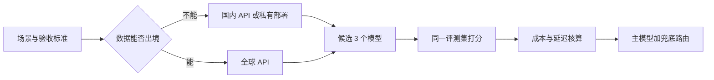

# 模型全景 {#model-landscape}

> [AI](../) › 模型全景

截至 2026-11 的闭源与开放权重模型地图，以及按能力、上下文、价格、延迟、部署方式与合规做选型的方法。模型按月迭代，本页只记「家族 + 当前旗舰」，具体型号与价格以官方页为准。

## 本关定位

| 项 | 内容 |
|----|------|
| 定位 | 知道有哪些模型可选、怎么为一个需求挑模型并估算成本 |
| 前置要求 | [Transformer 与大模型原理](../03-transformer-llm/)（Token、MoE、推理模型概念） |
| 粗略用时 | 3–5 天（粗略参考），之后按月刷新 |
| 章节 | 第一章 入门 |

## 闯关任务

**QUEST 04 · 第一章 入门**

- [ ] 能够说出主要闭源厂商（OpenAI、Anthropic、Google）与开放权重家族（Llama、Qwen、DeepSeek、Mistral、GLM、Kimi、Gemma、gpt-oss）的当前旗舰。
- [ ] 能够按能力、上下文、价格、延迟、许可证、部署与合规六个维度为一个场景列出候选模型。
- [ ] 能够根据输入 / 输出 Token 单价与缓存命中率估算一个应用的月成本。
- [ ] 能够区分「开放权重」与「开源」，并读懂 `1T-A52B` 这类 MoE 规格标注。
- [ ] 能够设计「旗舰模型兜底 + 小模型分流」的多模型路由方案。

**奖励**：+100 XP · 徽章「模型图鉴收集者」（徽章名暂定，内容建设中）

## 知识要点

### 闭源旗舰（2026-11）

| 厂商 | 当前型号 | 说明 |
|------|----------|------|
| OpenAI | GPT-6 Astra（`gpt-6-astra`）、GPT-6.1 Sol（`gpt-6.1-sol`）、GPT-6.1 Terra（`gpt-6.1-terra`）、GPT-6 Luna（`gpt-6-luna`） | 全系约 1.05M 上下文、128K 输出；Astra 最强，Sol 接近 Astra 而更便宜，Terra 偏快速与视觉 / 电脑操作，Luna 面向大批量简单任务 |
| Anthropic | Claude Fable 5.1、Claude Opus 5.5、Claude Sonnet 5.5、Claude Haiku 5.5 | 全系 1M 上下文、128K 输出；API ID 为 `claude-fable-5-1`、`claude-opus-5-5`、`claude-sonnet-5-5`、`claude-haiku-5-5` |
| Google | Gemini 4 Argon（`gemini-4-argon`）、Gemini 3.8 Flash（`gemini-3.8-flash`） | Argon 为旗舰推理模型，Flash 定位低延迟 |
| OpenAI 专项 | GPT-Image-2.6、GPT-Realtime-2.1、GPT-Live 1、GPT-Transcribe | 图像、实时语音、转写，见 [多模态](../16-multimodal/) |

Claude 价格（每百万输入 / 输出 Token）：Fable $10 / $50，Opus $4 / $20，Sonnet $2 / $10，Haiku $0.10 / $0.50 起。

OpenAI 价格（每百万输入 / 输出 Token）：Astra $10 / $50，Sol $2 / $10，Terra $1 / $5，Luna $0.1 / $0.5。

> [!WARNING]
> 本页型号与价格于 2026-11-04 至 2026-11-05 从各家官方模型页核对。模型名与价格变化最快，调用前以官方模型页为准，不要按命名规律猜 ID。

### 开放权重家族

| 家族 | 当前代表 | 说明 |
|------|----------|------|
| OpenAI gpt-oss | gpt-oss-120b、gpt-oss-20b（2025-08） | Apache 2.0，单卡可跑 20b |
| Google Gemma | Gemma 4（E2B / E4B / 12B / 31B） | 端侧到单卡服务器 |
| Meta Llama | Llama 4 Scout / Maverick（2025-04） | Hugging Face 上仍是最新开放权重 |
| Mistral | Mistral Large 4（`1T-A52B`，2026-09-30 发布权重）、Mistral Medium 3.5 | 欧洲厂商，MoE 旗舰 |
| 通义千问 Qwen | Qwen3.8（27B、Flash-Next、2.4T-A95B，2026-08） | 百炼 API 为 `qwen3.8-max` / `qwen3.8-flash` |
| DeepSeek | DeepSeek-V4.1-Flash、DeepSeek-V4-Pro-0813 | API 名 `deepseek-flash` / `deepseek-v4-pro`，兼容 OpenAI 与 Anthropic 接口格式 |
| 智谱 GLM | GLM-5.3 / GLM-5.3-Flash（2026-08） | Hugging Face 组织名 `zai-org` |
| 月之暗面 Kimi | Kimi K3（2026-06）、Kimi-K3.1-Pro（2026-11-02 上传） | 长上下文与 Agent 能力 |
| 其他国产 | MiniMax-M3 / M3.1-Flash、阶跃 Step-5-Preview、百度 ERNIE-5.5-Flash-Base、腾讯混元 Hy 系列 | 按场景补充评测 |

- 「开放权重」只代表能下载权重，训练数据和代码不一定公开；商用前读许可证（Apache 2.0、MIT、Llama 社区许可、Gemma 条款等差别很大）。
- 规格 `1T-A52B`：总参数 1T、每 Token 激活约 52B，显存按总参数估算，见 [Transformer 与大模型原理](../03-transformer-llm/)。

### 选型方法



- 先写验收标准和 30–100 条评测样本（见 [评测与可观测](../17-evals-observability/)），再挑 2–3 个候选模型跑同一套题，不凭排行榜直接拍板。
- 成本 = 输入 Token × 输入单价 + 输出 Token × 输出单价；推理模型的思考 Token 按输出计费；Prompt Caching 命中部分按折扣价计。
- 常见组合：小模型做分类、抽取、路由，旗舰模型处理难题与兜底。

下面的计算器用本页已核实的单价估算月成本（缓存折扣率按 10% 计，仅作示意，实际以各家价格页为准）：

```python
PRICES = {  # 美元 / 百万 Token：(输入, 输出)，2026-11 官方价格页
    "gpt-6-astra": (10.0, 50.0),
    "gpt-6.1-sol": (2.0, 10.0),
    "gpt-6-luna": (0.10, 0.50),
    "claude-opus-5-5": (4.0, 20.0),
    "claude-sonnet-5-5": (2.0, 10.0),
    "claude-haiku-5-5": (0.10, 0.50),
}


def monthly_cost(model, req_per_day, in_tok, out_tok, cache_hit=0.0, cache_rate=0.1):
    p_in, p_out = PRICES[model]
    eff_in = in_tok * ((1 - cache_hit) + cache_hit * cache_rate)   # 命中部分按折扣计
    per_req = (eff_in * p_in + out_tok * p_out) / 1_000_000
    return per_req * req_per_day * 30


for m in PRICES:
    base = monthly_cost(m, 10_000, 3_000, 500)
    cached = monthly_cost(m, 10_000, 3_000, 500, cache_hit=0.8)
    print(f"{m:18s} 无缓存 ${base:>9,.0f}/月  缓存命中 80% ${cached:>9,.0f}/月")
```

运行输出：

```text
gpt-6-astra        无缓存 $   16,500/月  缓存命中 80% $   10,020/月
gpt-6.1-sol        无缓存 $    3,300/月  缓存命中 80% $    2,004/月
gpt-6-luna         无缓存 $      165/月  缓存命中 80% $      100/月
claude-opus-5-5    无缓存 $    6,600/月  缓存命中 80% $    4,008/月
claude-sonnet-5-5  无缓存 $    3,300/月  缓存命中 80% $    2,004/月
claude-haiku-5-5   无缓存 $      165/月  缓存命中 80% $      100/月
```

### 用能力矩阵而不是榜单决定上线

- 每个候选记录：精确模型 ID / 快照、地区与账户可用性、输入模态、上下文与输出限制、工具调用、原生 JSON Schema、流式行为、数据保留政策和许可证。模型家族名不能代替可运行配置。
- Alias 可能随供应商升级而指向新快照；生产尽量固定可用快照，保留回滚配置。收到弃用通知后在留出评测集上比较质量、延迟、价格与安全行为，而非只替换字符串。
- 按任务分桶：分类 / 抽取先试小模型，复杂规划再升级；设置低置信度、拒答或结构校验失败时的人工 / 强模型路径。路由阈值也要评测，详见 [评测与可观测](../17-evals-observability/)。
- API 标价不等于任务总成本：计入 reasoning / 输出、缓存读写、重试、检索 / 重排和人工复核；自托管还要算利用率、冗余、GPU、运维与许可，不能断言开放权重总是便宜。
- 本页规格与价格是 2026-11 的快照；「最强」只描述厂商定位，不替代同数据、同预算、同工具条件下的本地比较。服务停用与迁移案例见 [多模态](../16-multimodal/)。

## 选型对比

| 维度 | API 闭源旗舰 | 开放权重自托管 | 国内 API |
|------|--------------|----------------|----------|
| 能力上限 | 最高 | 接近或略低，差距逐代缩小 | 与开放权重同源，部分有独家型号 |
| 上手成本 | 最低，申请密钥即可 | 需要 GPU 与推理服务（见 [推理与服务](../15-inference-serving/)） | 低，多数兼容 OpenAI 接口 |
| 数据合规 | 数据出境，需评估 | 数据不出域 | 境内处理，需关注备案 |
| 成本结构 | 按 Token 计费 | 按 GPU 时长，规模越大越划算 | 按 Token 计费，通常更低 |
| 定制能力 | 提示词、部分支持微调 | 可全量或 LoRA 微调（见 [微调与对齐](../14-fine-tuning/)） | 视平台而定 |

## 常见误区

- 只看排行榜选模型：公开榜单题目可能已被训练数据污染，与你的任务分布也不同。
- 按命名规律猜模型 ID：各家命名并不统一（同一家也会变），一律以官方模型页为准。
- 忽略输出单价：输出单价通常明显高于输入（本页所列模型均为 5 倍），推理模型的思考 Token 也算输出。
- 把「开放权重」等同于「可随意商用」：要逐条看许可证中的用户规模、用途和署名限制。
- 把模型 ID 硬编码在业务代码里：应放在配置中，方便灰度切换和下线迁移。

## 实践任务

- 为「客服工单分类 + 回复草稿」场景写 50 条评测样本，在 3 个模型（至少 1 个开放权重）上跑分，记录准确率、延迟和成本。
- 用本页计算器估算你所在团队一个 AI 功能的月成本，并给出加缓存与模型分流后的优化方案。
- 在 Hugging Face 上找到 Qwen3.8 与 Gemma 4 的模型卡，对比许可证、上下文长度与推荐部署显存。
- 设计一个模型配置文件（YAML 或 JSON），支持按任务类型路由到不同模型和失败兜底。

## 资料索引

- [OpenAI Models](https://developers.openai.com/api/docs/models) — OpenAI 官方模型列表
- [Claude Models overview](https://platform.claude.com/docs/en/about-claude/models/overview) — Anthropic 官方模型对比
- [Gemini API Models](https://ai.google.dev/gemini-api/docs/models) — Google 官方模型列表
- [DeepSeek 模型与价格](https://api-docs.deepseek.com/zh-cn/quick_start/pricing) — DeepSeek 官方 API 文档
- [阿里云百炼模型列表](https://help.aliyun.com/zh/model-studio/models) — 通义千问 API 型号
- [Hugging Face Models](https://huggingface.co/models) — 开放权重模型检索
- [OpenAI 模型目录](https://platform.openai.com/docs/models) — 能力与模型 ID 契约
- [OpenAI 弃用时间表](https://platform.openai.com/docs/deprecations) — 快照迁移和关闭计划
- [OpenAI 延迟优化](https://platform.openai.com/docs/guides/latency-optimization) — 任务路由与端到端性能取舍

## 通关自测

先独立作答，再展开参考答案核对；简答题答出要点即算对。答对 ≥ 80% 即可进入下一关。

1. 【单选】一个请求输入 2,000 Token、输出 1,000 Token，用 `claude-sonnet-5-5`（$2 / $10 每百万 Token），不计缓存，费用约为：
    - A. $0.006
    - B. $0.014
    - C. $0.024
    - D. $0.14
2. 【简答】「开放权重」和「开源」有什么区别？商用前要看什么？
3. 【单选】客户数据不允许出境，同时需要较强的代码能力，最合适的起点是：
    - A. 直接调用海外闭源 API
    - B. 国内 API 或开放权重模型私有部署，再用评测集比较
    - C. 只用最小的端侧模型
    - D. 不用 LLM
4. 【简答】为什么不建议在代码里根据命名规律拼接模型 ID？
5. 【简答】描述一种「小模型分流 + 旗舰兜底」的路由策略，并说明它节省成本的原理。

<details markdown><summary>参考答案</summary>

1. B — 2,000 × $2 / 1M + 1,000 × $10 / 1M = $0.004 + $0.010 = $0.014。
2. 开放权重只公开可下载的模型权重，训练数据、训练代码不一定公开；商用前要看许可证对用户规模、用途、再分发、署名的限制。
3. B — 先满足合规约束，再在候选里用自己的评测集选能力最好的。
4. 各家命名不统一且会变化，猜出的 ID 可能不存在或指向别的模型；应以官方模型页为准，并把 ID 放进配置。
5. 先用低价小模型判断请求难度或完成简单任务，置信度低、校验失败或判定为难题时再转给旗舰模型；大部分流量走便宜模型，平均单价下降，难题质量由旗舰保证。

</details>

---

← [上一节：Transformer 与大模型原理](../03-transformer-llm/) · [返回 AI](../) · [下一节：提示词与上下文工程](../05-prompt-context/) →
