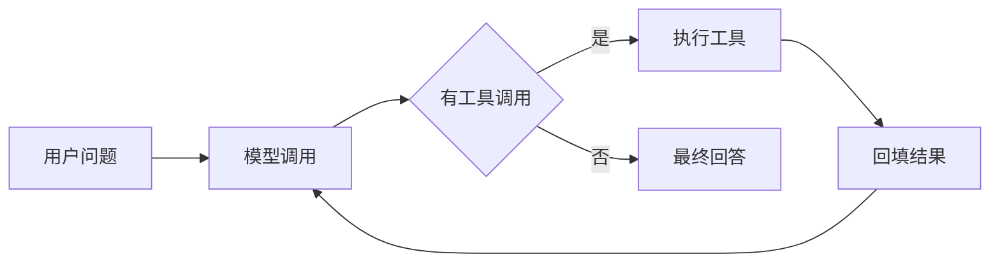

# LLM API 编程模式 {#llm-api-llm-api-programming}

> [AI](../) › LLM API 编程模式

不依赖框架，直接用官方 SDK 写 LLM 调用：消息结构、流式、结构化输出、函数调用、多轮工具循环、重试与成本控制。这是 07–10 关的共同底座，按 Python、Java、TypeScript 给出对应写法。

> 相关主题：[Java 并发](../../java/05-concurrency/) · [微服务容错](../../microservices/05-resilience/)

## 本关定位

| 项 | 内容 |
|----|------|
| 定位 | 第一章入门的编程主线：不借助框架也能写出可靠的 LLM 调用代码 |
| 前置要求 | [Python 速成](../00-python-bridge/)、[提示词与上下文工程](../05-prompt-context/)；Java 方向需熟悉 HTTP 客户端与 JSON |
| 粗略用时 | 1–2 周（粗略参考） |
| 章节 | 第一章 入门 |

## 闯关任务

**QUEST 06 · 第一章 入门**

- [ ] 能够用 OpenAI Responses API、Anthropic Messages API 和 Gemini API 完成一次调用，并读出文本与 Token 用量。
- [ ] 能够实现流式输出，并说明 SSE 事件的增量拼接方式。
- [ ] 能够用 JSON Schema 约束的结构化输出把模型结果映射到 Pydantic 模型、Zod schema 或 Java 类。
- [ ] 能够手写一个带上限的多轮工具调用循环，正确回填工具结果。
- [ ] 能够为 LLM 调用配置超时、重试、限流和成本记录，并说明密钥为什么不能进前端。

**奖励**：+100 XP · 徽章「接口驯服师」（徽章名暂定，内容建设中）

## 知识要点

### 三种主流接口形态

- OpenAI Responses API：`input` 可以是字符串或「条目列表」，`instructions` 放系统指令，结果用 `output_text` 读取；工具调用和工具结果都是 `input` / `output` 里的条目。
- Anthropic Messages API：`system` 单独传，`messages` 是 user / assistant 交替的列表，`max_tokens` 必填；工具调用以 `tool_use` 内容块出现，结果以 `tool_result` 块回填。
- Gemini API：`google-genai` SDK 的 `client.models.generate_content(model=, contents=, config=)`。
- OpenAI 兼容接口是国产模型的通用接入方式：改 `base_url` 和模型名即可；DeepSeek 同时兼容 Anthropic 格式。

> [!NOTE]
> 下面带「运行输出」的 Python 示例在编写时连接本地模拟服务运行（返回固定响应），用来验证 SDK 参数与循环逻辑；换成真实 API Key 后，模型的措辞会不同。标注「需要真实 API Key」的示例只做了参数校验。

OpenAI 基础调用与结构化输出：

```python
from typing import Literal

from openai import OpenAI
from pydantic import BaseModel

client = OpenAI(timeout=30, max_retries=2)   # 从环境变量 OPENAI_API_KEY 读取密钥

resp = client.responses.create(
    model="gpt-6-astra",
    instructions="用一句话回答，面向 Java 后端工程师。",
    input="什么是 KV Cache？",
    reasoning={"effort": "low"},
    max_output_tokens=300,
)
print(resp.output_text)
print("tokens:", resp.usage.input_tokens, resp.usage.output_tokens)


class Ticket(BaseModel):
    category: Literal["物流", "退款", "商品质量", "其他"]
    urgent: bool
    reason: str


parsed = client.responses.parse(
    model="gpt-6-astra",
    input="订单还没发货，我要退款。",
    text_format=Ticket,               # SDK 把 Pydantic 模型转换成严格 JSON Schema
)
ticket = parsed.output_parsed
print(type(ticket).__name__, ticket.category, ticket.urgent)
```

运行输出：

```text
KV Cache 缓存已生成 Token 的键和值，避免重复计算。
tokens: 12 8
Ticket 退款 False
```

Gemini 的写法（`google-genai` SDK）：

```python
# 需要真实 API Key：Gemini 调用，本机只做了参数校验
from google import genai
from google.genai import types

client = genai.Client()                            # 从环境变量 GEMINI_API_KEY 读取密钥
resp = client.models.generate_content(
    model="gemini-3.8-flash",
    contents="用一句话解释 RAG。",
    config=types.GenerateContentConfig(system_instruction="回答面向后端工程师。", max_output_tokens=200),
)
print(resp.text)
```

### 流式输出

- 服务端用 SSE（Server-Sent Events）逐段推送事件；客户端按事件类型拼接文本增量，最后一个事件带完整用量。
- 后端转发给浏览器时，Java 可以用虚拟线程处理大量长连接（见 [Java 并发](../../java/05-concurrency/)），前端用 `EventSource` 或 `fetch` 读取流。

```python
# 需要真实 API Key：流式输出，本机只做了参数校验
import anthropic
from openai import OpenAI

stream = OpenAI().responses.create(model="gpt-6-luna", input="写一首四行短诗", stream=True)
for event in stream:
    if event.type == "response.output_text.delta":
        print(event.delta, end="", flush=True)
    elif event.type == "response.completed":
        print("\n用量", event.response.usage.output_tokens)

with anthropic.Anthropic().messages.stream(
    model="claude-haiku-5-5",
    max_tokens=512,
    messages=[{"role": "user", "content": "写一首四行短诗"}],
) as s:
    for text in s.text_stream:
        print(text, end="", flush=True)
    print("\n用量", s.get_final_message().usage.output_tokens)
```

### 函数调用与工具循环



- 工具 = 名称 + 描述 + JSON Schema 参数。描述写清「什么时候用、参数含义」，模型才会选对工具。
- 循环终止条件：模型不再请求工具，或达到步数上限。一定要设上限，防止死循环烧钱。
- 模型可能一次返回多个工具调用（并行调用），要逐个执行并按 `call_id` / `tool_use_id` 对应回填。
- `strict: true` 让工具参数严格符合 schema；`tool_choice` 可以强制或禁止调用工具。

OpenAI Responses API 版本：

```python
import json

from openai import OpenAI

client = OpenAI()


def get_weather(city: str) -> dict:
    return {"city": city, "temp_c": 21}          # 真实项目里调用天气服务


TOOLS = [{
    "type": "function",
    "name": "get_weather",
    "description": "查询城市当前气温",
    "parameters": {
        "type": "object",
        "properties": {"city": {"type": "string", "description": "城市名"}},
        "required": ["city"],
        "additionalProperties": False,
    },
    "strict": True,
}]
REGISTRY = {"get_weather": get_weather}

items: list = [{"role": "user", "content": "北京现在多少度？"}]
for step in range(5):                              # 上限防止无限循环
    resp = client.responses.create(model="gpt-6-astra", input=items, tools=TOOLS)
    calls = [o for o in resp.output if o.type == "function_call"]
    if not calls:
        print(resp.output_text)
        break
    items += resp.output                           # 把模型的工具调用原样放回上下文
    for call in calls:
        result = REGISTRY[call.name](**json.loads(call.arguments))
        print(f"step {step}: {call.name}({call.arguments}) -> {result}")
        items.append({"type": "function_call_output", "call_id": call.call_id, "output": json.dumps(result)})
```

运行输出：

```text
step 0: get_weather({"city": "北京"}) -> {'city': '北京', 'temp_c': 21}
北京现在 21°C。
```

Anthropic Messages API 版本：

```python
import json

import anthropic

client = anthropic.Anthropic()                     # 从环境变量 ANTHROPIC_API_KEY 读取密钥

TOOLS = [{
    "name": "get_weather",
    "description": "查询城市当前气温",
    "input_schema": {
        "type": "object",
        "properties": {"city": {"type": "string"}},
        "required": ["city"],
    },
}]

messages = [{"role": "user", "content": "北京现在多少度？"}]
for step in range(5):
    msg = client.messages.create(
        model="claude-sonnet-5-5",
        max_tokens=2048,
        system="你是简洁的中文助手。",
        thinking={"type": "adaptive"},             # 最新模型使用自适应思考
        output_config={"effort": "low"},
        tools=TOOLS,
        messages=messages,
    )
    if msg.stop_reason != "tool_use":
        print("".join(b.text for b in msg.content if b.type == "text"))
        break
    messages.append({"role": "assistant", "content": msg.content})
    results = []
    for block in msg.content:
        if block.type == "tool_use":
            out = {"city": block.input["city"], "temp_c": 21}
            print(f"step {step}: {block.name}({block.input}) -> {out}")
            results.append({"type": "tool_result", "tool_use_id": block.id, "content": json.dumps(out)})
    messages.append({"role": "user", "content": results})
```

运行输出：

```text
step 0: get_weather({'city': '北京'}) -> {'city': '北京', 'temp_c': 21}
北京现在 21°C。
```

### 结构化输出

- 让支持该能力的 API 用 JSON Schema 约束解码，通常比仅提示「请输出 JSON」更可靠；拒答、截断和协议错误仍须单独处理。
- Python 用 Pydantic、TypeScript 用 Zod、Java 用普通类或 record 描述结构，SDK 负责转成 schema 并解析结果。
- 上面 OpenAI 示例里的 `responses.parse(text_format=Ticket)` 就是结构化输出；Anthropic 对应 `messages.parse(output_format=Ticket)`：

```python
from typing import Literal

import anthropic
from pydantic import BaseModel


class Ticket(BaseModel):
    category: Literal["物流", "退款", "商品质量", "其他"]
    urgent: bool
    reason: str


client = anthropic.Anthropic()
msg = client.messages.parse(
    model="claude-haiku-5-5",
    max_tokens=512,
    messages=[{"role": "user", "content": "订单还没发货，我要退款。"}],
    output_format=Ticket,
)
print(msg.parsed_output)
```

运行输出：

```text
category='退款' urgent=False reason='未发货要求退款'
```

### Java 与 TypeScript

依赖坐标：`com.openai:openai-java:4.101.0`（Maven Central 与官方 SDK 源码核对，2026-11-05）；Anthropic 对应 `com.anthropic:anthropic-java:3.6.0`。保存为 `TicketClassifier.java`；完整 imports 如下。编译状态：2026-11-06 在 JDK 21.0.12.1、Maven 3.8.7 上 `mvn -DskipTests compile` 通过；未运行程序，未发送 API 请求。

```java
import com.openai.client.OpenAIClient;
import com.openai.client.okhttp.OpenAIOkHttpClient;
import com.openai.models.responses.ResponseCreateParams;
import com.openai.models.responses.StructuredResponseCreateParams;

public class TicketClassifier {

    public static class Ticket {
        public String category;
        public boolean urgent;
        public String reason;
    }

    public static void main(String[] args) {
        OpenAIClient client = OpenAIOkHttpClient.fromEnv();   // 读取 OPENAI_API_KEY、OPENAI_BASE_URL

        ResponseCreateParams params = ResponseCreateParams.builder()
                .model(System.getenv().getOrDefault("OPENAI_MODEL", "gpt-6-luna"))
                .input("用一句话解释 KV Cache")
                .build();
        client.responses().create(params).output().stream()
                .flatMap(item -> item.message().stream())
                .flatMap(message -> message.content().stream())
                .flatMap(content -> content.outputText().stream())
                .forEach(text -> System.out.println(text.text()));

        StructuredResponseCreateParams<Ticket> structured = ResponseCreateParams.builder()
                .model(System.getenv().getOrDefault("OPENAI_MODEL", "gpt-6-luna"))
                .input("订单还没发货，我要退款。")
                .text(Ticket.class)                              // 由类生成 JSON Schema
                .build();
        client.responses().create(structured).output().stream()
                .flatMap(item -> item.message().stream())
                .flatMap(message -> message.content().stream())
                .flatMap(content -> content.outputText().stream())
                .forEach(t -> System.out.println(t.category + " " + t.urgent));
    }
}
```

仅 JDK 示例：保存为 `JdkLlmClient.java`，目标 JDK 21，无 Maven 依赖，预期命令 `javac --release 21 JdkLlmClient.java`。编译状态：2026-11-06 `javac --release 21` 与 `mvn -DskipTests compile` 均通过；未运行程序，未调用付费 API。本例只演示普通 HTTP / 原始 JSON，不实现生产级重试、流式、响应体限额或 JSON 解析。

```java
import java.net.URI;
import java.net.http.HttpClient;
import java.net.http.HttpRequest;
import java.net.http.HttpResponse;
import java.nio.charset.StandardCharsets;
import java.time.Duration;

public class JdkLlmClient {
    public static void main(String[] args) throws Exception {
        String key = required("OPENAI_API_KEY");
        String model = System.getenv().getOrDefault("OPENAI_MODEL", "gpt-6-luna");
        // 受限模型标识允许安全插入本例 JSON；一般请求应使用 JSON 库序列化
        if (!model.matches("[A-Za-z0-9][A-Za-z0-9._:/-]{0,199}")) {
            throw new IllegalArgumentException("模型标识格式不支持");
        }
        String body = """
                {"model":"%s","messages":[{"role":"user","content":"用一句话解释 KV Cache"}],"stream":false}
                """.formatted(model);
        HttpRequest request = HttpRequest.newBuilder()
                .uri(URI.create("https://api.openai.com/v1/chat/completions"))
                .timeout(Duration.ofSeconds(30))
                .header("Authorization", "Bearer " + key)
                .header("Content-Type", "application/json")
                .POST(HttpRequest.BodyPublishers.ofString(body, StandardCharsets.UTF_8))
                .build();
        try (HttpClient client = HttpClient.newBuilder()
                .connectTimeout(Duration.ofSeconds(5)).build()) {
            HttpResponse<String> response = client.send(request,
                    HttpResponse.BodyHandlers.ofString(StandardCharsets.UTF_8));
            if (response.statusCode() / 100 != 2) {
                throw new IllegalStateException("LLM HTTP 状态：" + response.statusCode());
            }
            System.out.println(response.body()); // 仅演示原始 JSON，生产日志不记录原文
        }
    }

    private static String required(String name) {
        String value = System.getenv(name);
        if (value == null || value.isBlank()) {
            throw new IllegalStateException("缺少环境变量：" + name);
        }
        return value;
    }
}
```

TypeScript 推荐 Vercel AI SDK 7（`ai` 7.0.163），工具循环由 `stopWhen` 控制。下面的代码在本机连接同一个模拟服务运行，输出 `北京现在 21°C。`，共 2 步：

```typescript
import { generateText, tool, isStepCount } from 'ai';
import { openai } from '@ai-sdk/openai';
import { z } from 'zod';

const weather = tool({
  description: '查询城市当前气温',
  inputSchema: z.object({ city: z.string() }),
  execute: async ({ city }) => ({ city, tempC: 21 }),
});

const { text, steps } = await generateText({
  model: openai('gpt-6-astra'),
  tools: { weather },
  stopWhen: isStepCount(5),        // 最多 5 步；旧名 stepCountIs 仍可用
  prompt: '北京现在多少度？',
});
console.log(text, steps.length);
```

### 工程化：超时、重试、限流、成本

- 超时与重试：官方 SDK 默认对连接错误、429、5xx 做指数退避重试，`timeout`、`max_retries` 可在客户端或单次请求上配置；业务层再加熔断与降级（见 [微服务容错](../../microservices/05-resilience/)）。
- 限流：按供应商的 RPM / TPM 配额做客户端令牌桶，429 时尊重 `retry-after`。
- 成本记录：每次调用记录模型、输入 / 输出 / 缓存 Token、耗时，汇总到可观测平台（见 [评测与可观测](../17-evals-observability/)）。
- 降本：Prompt Caching（稳定前缀）、Batch API（离线任务通常半价）、小模型分流。
- 统一网关：LiteLLM 等多模型代理统一鉴权、配额与日志；API Key 只放在服务端，绝不下发到浏览器或 App。

### 失败也是协议的一部分

- 原生 Structured Outputs 约束受支持的 JSON Schema 子集；仍需分别处理拒答、截断 / incomplete、网络错误、空内容和业务字段校验。合法 JSON 不代表事实正确，工具参数也必须重新授权。
- `strict`、JSON mode、函数调用和普通文本输出是不同契约；OpenAI-compatible 仅表示部分接口形态兼容，不能默认 Responses、reasoning、缓存、工具并行和 schema 全部等价。
- 流式接口先缓存工具参数碎片，等调用完成再解析 / 执行；不要对每个 chunk 执行工具。连接可能在 usage / 完成事件到达前中断，缺失用量记为未知并对账，不能按零计费。
- 区分连接超时、首字 / 空闲超时与总 deadline；下游取消应向上游传播，并限制缓冲区与排队长度。浏览器断开不等于模型或异步任务已停止计费。
- SDK、网关和服务重试叠加会放大请求；统一重试预算，尊重 `Retry-After`，指数退避加抖动，只重试适合的暂时错误。工具副作用用业务幂等键 / 去重记录，不能假设模型生成接口天然幂等。

### 接入已有微服务的职责边界

把本页客户端封装成出站适配器；入口沿用 [API 网关](../../microservices/02-api-gateway/) 的身份、限流和租户预算。地址 / 模型名由 [服务发现与配置](../../microservices/03-discovery-config/) 管理，密钥由服务端 secret 注入，不下发浏览器。Spring 适配、Resilience4j 与会话隔离集中在 [下一关](../07-app-frameworks/)，避免每个业务控制器复制重试逻辑。

## 选型对比

| 语言 | 官方 SDK（2026-11） | 结构化输出 | 适合 |
|------|---------------------|------------|------|
| Python | `openai` 3.46.0、`anthropic` 2.6.0、`google-genai` 2.34.0 | Pydantic | 原型、数据处理、Agent |
| Java | `openai-java` 4.101.0、`anthropic-java` 3.6.0 | Java 类 / record | 已有 Spring 后端，见 [应用开发框架](../07-app-frameworks/) |
| TypeScript | `openai` 7.52.0、`@anthropic-ai/sdk` 1.6.0、AI SDK 7.0.163 | Zod | Web 全栈、流式 UI |
| Go | `openai-go` v3.95.0、`anthropic-sdk-go` v2.7.0 | struct + schema | 网关、高并发服务 |
| 多模型代理 | LiteLLM 1.108.1 | 透传 | 统一接入多家模型 |

> [!WARNING]
> 版本以 2026-11-05 的注册表 / 官方发布记录复核；未变更条目保留原发布基线。Instructor 1.17.0 依赖 `jiter<0.15`，而 `openai` 3.46.0 依赖 `jiter>=0.16`，两者在同一环境中无法一起安装；需要 Instructor 时要用它支持的旧版 `openai`，或直接用 SDK 自带的 `parse` 结构化输出。

## 常见误区

- 不设步数上限的工具循环：模型反复调用同一工具时会无限消耗 Token。
- 只回填工具结果、不回填模型的工具调用条目：OpenAI 需要 `function_call` 与 `function_call_output` 成对出现，Anthropic 需要 assistant 的 `tool_use` 块后紧跟 user 的 `tool_result` 块。
- 在提示词里要求「输出 JSON」然后 `json.loads`：偶发的多余文字就会解析失败，应使用结构化输出。
- 把 API Key 写进前端代码或移动端安装包：任何人都能提取并盗刷。
- 重试不加退避和上限：429 时立即重试会让限流更严重。
- 忽略 `max_tokens` / `max_output_tokens`：输出被截断时要检查结束原因（`stop_reason`、`status`），而不是当作完整答案。

## 实践任务

- 用 Python 分别调用三家 API 完成同一道题，打印文本、Token 用量和耗时。
- 实现一个「查天气 + 查日程」两个工具的循环，让模型回答「明天下午适合户外开会吗」，记录每一步的工具调用。
- 用结构化输出把 20 条非结构化简历文本解析成 Pydantic 模型，统计解析成功率。
- 用 Spring Boot 或 Node.js 写一个转发接口，把模型的流式输出通过 SSE 推给浏览器，前端不接触 API Key。

## 资料索引

- [OpenAI Function calling](https://developers.openai.com/api/docs/guides/function-calling) — 函数调用与工具循环
- [OpenAI Structured Outputs](https://developers.openai.com/api/docs/guides/structured-outputs) — JSON Schema 结构化输出
- [Anthropic Tool use](https://platform.claude.com/docs/en/agents-and-tools/tool-use/overview) — Claude 工具调用
- [Anthropic Streaming](https://platform.claude.com/docs/en/build-with-claude/streaming) — 流式事件格式
- [openai-java](https://github.com/openai/openai-java) — OpenAI 官方 Java SDK
- [Gemini API 文档](https://ai.google.dev/gemini-api/docs) — google-genai SDK 用法
- [OpenAI 结构化输出](https://platform.openai.com/docs/guides/structured-outputs) — schema 子集、拒答与 incomplete 处理
- [OpenAI 流式响应](https://platform.openai.com/docs/guides/streaming-responses) — 事件流与完成语义
- [openai-java Maven 元数据](https://repo1.maven.org/maven2/com/openai/openai-java/maven-metadata.xml) — 2026-11-05 正式版 4.101.0
- [JDK 21 HttpClient](https://docs.oracle.com/en/java/javase/21/docs/api/java.net.http/java/net/http/HttpClient.html) — 连接复用、超时与发送请求
- [Anthropic Python 版本](https://pypi.org/project/anthropic/) — 2.6.0
- [OpenAI JS 版本](https://www.npmjs.com/package/openai) — 7.52.0
- [Anthropic JS 版本](https://www.npmjs.com/package/@anthropic-ai/sdk) — 1.6.0
- [LiteLLM 版本](https://pypi.org/project/litellm/) — 1.108.1
- [Anthropic Java 发布记录](https://github.com/anthropics/anthropic-sdk-java/releases) — 2026-11-05 正式版 3.6.0
- [Anthropic Go 发布记录](https://github.com/anthropics/anthropic-sdk-go/releases) — 2026-11-05 正式版 v2.7.0；搜索索引曾落后于实时发布页
- [OpenAI Go 发布记录](https://github.com/openai/openai-go/releases/tag/v3.95.0) — v3.95.0 的官方发布证据

## 通关自测

先独立作答，再展开参考答案核对；简答题答出要点即算对。答对 ≥ 80% 即可进入下一关。

1. 【单选】在 OpenAI Responses API 的工具循环中，执行完工具后应当：
    - A. 只把工具结果作为新的 user 消息发送
    - B. 把模型返回的 `function_call` 条目和对应 `call_id` 的 `function_call_output` 一起加入 `input`
    - C. 重新开一个对话
    - D. 把结果放进 `instructions`
2. 【单选】Anthropic Messages API 中哪个参数是必填的？
    - A. `system`
    - B. `tools`
    - C. `max_tokens`
    - D. `thinking`
3. 【简答】为什么结构化输出比「在提示词里要求输出 JSON」更可靠？
4. 【简答】列出工具调用循环至少三个必须处理的边界情况。
5. 【简答】前端页面需要展示 LLM 流式回答，密钥和流式链路应该怎么设计？

<details markdown><summary>参考答案</summary>

1. B — 模型需要看到自己发起的调用和对应结果，二者通过 `call_id` 配对。
2. C — `max_tokens` 必填，`system`、`tools`、`thinking` 都是可选的。
3. 原生结构化输出在正常完成且无拒答时按支持的 JSON Schema 约束生成，仍需处理失败状态并校验业务语义；只靠提示词，模型可能输出多余文字、漏字段或类型错误。
4. 步数上限；并行多个工具调用逐一回填；工具执行异常（把错误信息回填给模型而不是直接崩溃）；参数不合法；输出被 `max_tokens` 截断；超时与重试。答出任意三点即可。
5. 浏览器只调用自己的后端接口；后端持有密钥，调用模型的流式接口，再通过 SSE 或 WebSocket 把增量转发给前端，同时做鉴权、限流和用量记录。

</details>

---

← [上一节：提示词与上下文工程](../05-prompt-context/) · [返回 AI](../) · [下一节：应用开发框架](../07-app-frameworks/) →
