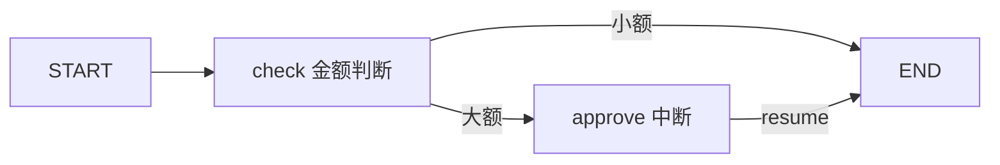

# 应用开发框架 {#llm-app-frameworks}

> [AI](../) › 应用开发框架

在 SDK 之上提供模型抽象、编排、记忆、RAG 组件和 Agent 循环。本页按 Python、Java、TypeScript、Go 分区介绍主流框架，核心是判断什么时候该用框架，什么时候直接写 SDK。

> 相关主题：[Spring 框架](../../java/09-spring/) · [LLM API 编程模式](../06-llm-api-programming/) · [智能体](../09-agents/)

> [!NOTE]
> 本仓库和站点的内容由 AI 生成，资料与资源链接来源于网络，仅供学习参考；如有错误或侵权，请提 Issue 告知。

## 这一页补哪一块 {#_1}

框架多出来的是模型抽象、托管循环、状态图和组件。效果上限仍在模型和提示。会话记忆必须按服务端确认的租户、用户和会话隔离，不能把演示用的一块内存当成全体用户的聊天记录。手写循环的契约回 [LLM API 编程模式](../06-llm-api-programming/)。

## 框架在 SDK 之上多做了什么 {#sdk}

<span id="_2"></span>

- 模型抽象：同一套接口切换 OpenAI、Anthropic、Gemini、本地模型，例如 LangChain 的 `"anthropic:claude-sonnet-5-5"` 字符串、Spring AI 的 `ChatModel`。抽象不保证各模型的工具、schema 和缓存行为相同。
- Agent 循环：06 手写的「调用 → 工具 → 回填」循环由框架托管，并提供步数上限、中间件或 Advisor 挂点。上限仍要设置，框架不会替你保证工具没有副作用。
- 编排与状态：LangGraph 用状态图表达分支、循环、并行，配合 checkpointer 做持久化与人机协同。内存 checkpointer 只适合演示。
- 组件生态：文档加载器、切块器、向量库适配、记忆、MCP 客户端，供 [检索增强生成](../08-rag/) 和 [MCP](../10-mcp/) 复用。组件在不在，不提高模型本身的正确率。

## 各语言主流框架 {#_4}

- Python：LangChain 1.x（`create_agent`、中间件）与 LangGraph（状态图、持久化、人机协同）；LlamaIndex 偏数据接入与检索；Pydantic AI 强调类型安全；DSPy 用声明式程序和提示优化替代手写提示词。
- Java：Spring AI 2.0 提供 `ChatClient`、Advisors、结构化输出、Tool Calling、向量库抽象和 MCP Starter，基于 Spring Boot 4；LangChain4j 以 AI Services 注解式接口为核心，集成 Quarkus 与 Spring；Spring AI Alibaba 对接通义 / 百炼并提供 Graph 多 Agent。
- TypeScript：Vercel AI SDK 7 的 `generateText` / `streamText` 与 UI hooks；LangChain.js 与 LangGraph.js；Mastra 集成 Agent、工作流、记忆与评测。
- Go：CloudWeGo Eino（字节，组件加编排）、Firebase Genkit、LangChainGo。

上面的版本线是写入时的生态划分。2026-11-25 只重开了 PyPI 上的 `langchain` 和 GitHub 上的 Spring AI 发布页，其余框架的「当前版本」见选型表下的说明，没有逐个打开注册表。

## LangChain：create_agent {#langchaincreate_agent}

> [!NOTE]
> 本页带「运行输出」的 Python 示例在编写时实际运行：LangChain 示例连接本地模拟服务（返回固定的工具调用和回答），LangGraph 示例不调用模型。换成真实 API Key 后模型措辞会不同。2026-11-25 未改这些围栏，也未发送真实请求。

```python
from langchain.agents import create_agent
from langchain.tools import tool


@tool
def get_weather(city: str) -> str:
    """查询城市当前气温。"""
    return '{"city": "%s", "temp_c": 21}' % city


agent = create_agent(
    model="anthropic:claude-sonnet-5-5",     # 也可以传 "openai:gpt-6-astra" 或模型对象
    tools=[get_weather],
    system_prompt="你是简洁的中文助手。",
)
result = agent.invoke({"messages": [{"role": "user", "content": "北京现在多少度？"}]})
for m in result["messages"]:
    print(type(m).__name__, (m.content if isinstance(m.content, str) else m.content[0].get("type")))
```

编写时的模拟运行输出：

```text
HumanMessage 北京现在多少度？
AIMessage tool_use
ToolMessage {"city": "北京", "temp_c": 21}
AIMessage 北京现在 21°C。
```

`create_agent` 返回的是一个编译好的 LangGraph 图，所以它支持流式、checkpointer 和中断；消息序列与 06 手写循环的结构一一对应。返回图意味着中断和恢复走的是图的状态，不是一个普通函数的局部变量。2026-11-25 打开的 PyPI 项目页标题为 `langchain` 1.5.2。围栏仍按写入时的 `create_agent` 调用保留，没有为了跟上 1.5.2 改 API。

## LangGraph：状态图与人工审批 {#langgraph}

```python
from typing import TypedDict

from langgraph.checkpoint.memory import InMemorySaver
from langgraph.graph import END, START, StateGraph
from langgraph.types import Command, interrupt


class State(TypedDict):
    amount: int
    status: str


def check(state: State) -> State:
    return {"status": "需审批" if state["amount"] > 1000 else "自动通过"}


def approve(state: State) -> State:
    decision = interrupt({"question": f"退款 {state['amount']} 元，是否批准？"})
    return {"status": "已批准" if decision == "yes" else "已拒绝"}


def route(state: State) -> str:
    return "approve" if state["status"] == "需审批" else END


builder = StateGraph(State)
builder.add_node("check", check)
builder.add_node("approve", approve)
builder.add_edge(START, "check")
builder.add_conditional_edges("check", route, ["approve", END])
builder.add_edge("approve", END)
graph = builder.compile(checkpointer=InMemorySaver())

cfg = {"configurable": {"thread_id": "order-42"}}
first = graph.invoke({"amount": 3000, "status": ""}, cfg)
print(first["__interrupt__"][0].value)          # 图在这里暂停，状态已存进 checkpointer
final = graph.invoke(Command(resume="yes"), cfg)  # 人工审批后从断点继续
print(final)
```

不调用模型时的运行输出：

```text
{'question': '退款 3000 元，是否批准？'}
{'amount': 3000, 'status': '已批准'}
```

`interrupt` 让图暂停并把状态写进 checkpointer，同一个 `thread_id` 用 `Command(resume=...)` 恢复。生产环境把 `InMemorySaver` 换成 PostgreSQL 等持久化 checkpointer，服务重启后也能继续。进程内的 saver 在重启后丢失未完成的审批。退款金额只是已有示例，不扩展成支付系统。



## Spring AI：ChatClient、结构化输出与工具 {#spring-aichatclient}

依赖坐标仍是示例所用的快照：BOM `org.springframework.ai:spring-ai-bom:2.0.2`、`org.springframework.ai:spring-ai-starter-model-openai:2.0.2`、`org.springframework.boot:spring-boot-starter-web:4.1.2`；Boot parent 为 `org.springframework.boot:spring-boot-starter-parent:4.1.2`，JDK 21。文件为 `src/main/java/example/ai/SupportApplication.java`；编译状态：2026-11-06 `mvn -DskipTests compile` 通过（JDK 21.0.12.1 / Maven 3.8.7）；未启动应用，未调用模型。发布源码 API 仍按 2.0.2 核对。2026-11-25 不把这段注记改成更新的 JDK 或 2.1.0 已跑通。

服务端配置 `spring.ai.openai.api-key=${OPENAI_API_KEY}`、`spring.ai.openai.chat.model=${OPENAI_MODEL}`；真实订单工具必须增加用户 / 租户授权，不可直接上线此教学接口。

```java
package example.ai;

import org.springframework.ai.chat.client.ChatClient;
import org.springframework.ai.tool.annotation.Tool;
import org.springframework.boot.SpringApplication;
import org.springframework.boot.autoconfigure.SpringBootApplication;
import org.springframework.web.bind.annotation.GetMapping;
import org.springframework.web.bind.annotation.PostMapping;
import org.springframework.web.bind.annotation.RequestBody;
import org.springframework.web.bind.annotation.RequestParam;
import org.springframework.web.bind.annotation.RestController;

@SpringBootApplication
@RestController
public class SupportApplication {
    private final ChatClient chatClient;

    public SupportApplication(ChatClient.Builder builder) {
        this.chatClient = builder.defaultSystem("你是电商客服，回答简洁。").build();
    }

    public static void main(String[] args) {
        SpringApplication.run(SupportApplication.class, args);
    }

    public record Ticket(String category, boolean urgent, String reason) {}

    public static class OrderTools {
        @Tool(description = "查询演示订单的物流状态，不访问真实订单")
        public String shippingStatus(String orderId) {
            return "演示订单 " + orderId + " 尚未发货";
        }
    }

    @GetMapping("/ask")
    public String ask(@RequestParam("q") String q) {
        return chatClient.prompt().user(q).tools(new OrderTools()).call().content();
    }

    @PostMapping("/classify")
    public Ticket classify(@RequestBody String text) {
        return chatClient.prompt().user("把这条工单分类：" + text)
                .call().entity(Ticket.class);
    }
}
```

`.entity(Ticket.class)` 是结果映射，不自动证明供应商启用了原生约束解码。工具方法只返回演示字符串；没有授权检查就不能接到真实订单。

## LangChain4j：AI Services {#langchain4jai-services}

依赖坐标：`dev.langchain4j:langchain4j:1.23.0` 与 `dev.langchain4j:langchain4j-open-ai:1.23.0`，JDK 21，编译启用 `-parameters`。示例坐标是 1.23.0。集成模块可能使用 `1.23.0-beta33`，不可混称全生态稳定版。2026-11-25 未重开 Maven Central，不把 1.23.0 写成当日重新证实的最新核心版。保存为 `src/main/java/example/ai/LangChain4jDemo.java`。

编译以 2026-11-06 的注记为准：`mvn -DskipTests compile` 通过；已核对 Maven 源码和官方构造示例，未调用真实模型。旧稿里「未在本机编译」与这条注记矛盾，那句是笔误，以编译通过为准。本批没有用新的运行结果替换这条注记。

LangChain4j 用接口加注解声明能力，框架生成实现：

```java
package example.ai;

import dev.langchain4j.agent.tool.Tool;
import dev.langchain4j.memory.chat.MessageWindowChatMemory;
import dev.langchain4j.model.openai.OpenAiChatModel;
import dev.langchain4j.service.AiServices;
import dev.langchain4j.service.SystemMessage;
import java.time.Duration;
import java.util.Objects;

public class LangChain4jDemo {
    public interface Assistant {
        @SystemMessage("你是电商客服，回答简洁。")
        String chat(String userMessage);
    }

    public static class OrderTools {
        @Tool("查询演示订单物流，不访问真实数据")
        public String shippingStatus(String orderId) {
            return "演示订单 " + orderId + " 尚未发货";
        }
    }

    public static void main(String[] args) {
        OpenAiChatModel model = OpenAiChatModel.builder()
                .apiKey(Objects.requireNonNull(System.getenv("OPENAI_API_KEY"), "缺少 OPENAI_API_KEY"))
                .modelName(System.getenv().getOrDefault("OPENAI_MODEL", "gpt-6-luna"))
                .timeout(Duration.ofSeconds(30)).build();
        // 仅单用户 CLI 会话；Web 服务不能全局共享这个 memory
        Assistant assistant = AiServices.builder(Assistant.class)
                .chatModel(model)
                .chatMemory(MessageWindowChatMemory.withMaxMessages(10))
                .tools(new OrderTools()).build();
        System.out.println(assistant.chat("演示订单 42 到哪了？"));
    }
}
```

`MessageWindowChatMemory` 在示例里只服务一个 CLI 会话。把它注册成全局 bean，会把所有用户的对话写进同一块记忆。

## Vercel AI SDK：结构化输出 {#vercel-ai-sdk}

AI SDK 7 中 `generateObject` 已标注为 deprecated，推荐用 `generateText` 加 `output` 设置。以下代码在编写时连接本地模拟服务运行，输出 `{ category: '退款', urgent: false, reason: '未发货要求退款' }`。2026-11-25 未重开 `ai` 的注册表，7.0.163 仍是表内快照，不是当日核过的最新版。

```typescript
import { generateText, Output } from 'ai';
import { openai } from '@ai-sdk/openai';
import { z } from 'zod';

const Ticket = z.object({
  category: z.enum(['退款', '物流', '其他']),
  urgent: z.boolean(),
  reason: z.string(),
});

const { output } = await generateText({
  model: openai('gpt-6-luna'),
  output: Output.object({ schema: Ticket }),
  prompt: '把这条工单分类：我的订单 3 天没发货，要求退款。',
});
console.log(output);
```

## 接上 Spring Boot，而不是再造业务平台 {#spring-boot}

- 沿用 [Java Spring](../../java/09-spring/) 的依赖注入、配置校验和测试；把 `ChatClient` / AI Services 放在应用服务或出站适配器，不让订单实体直接依赖供应商 SDK。框架抽象不保证不同模型能力一致。
- `.entity(Ticket.class)` 表示结果映射，并不自动证明供应商启用了原生约束解码；区分提示驱动转换与 native structured output，校验分类枚举、长度及业务约束，拒答 / 截断见 [API 编程](../06-llm-api-programming/)。
- `ChatClient` 可以复用，但会话记忆必须按服务端确认的租户、用户、会话隔离；不能把示例中的单个 `MessageWindowChatMemory` 注册成所有用户共享的全局聊天记录。MCP 的协议会话也不是用户身份边界，见 [MCP](../10-mcp/)。

## LLM 出站调用的韧性与测试 {#llm}

- 复用 [微服务韧性](../../microservices/05-resilience/)：HTTP 客户端设超时，用 Resilience4j `CircuitBreaker` 统计失败 / 慢调用，`Bulkhead` 限并发，`Retry` 仅处理允许重试的暂时故障。熔断器本身不限制并发，也不取消已经运行的 HTTP 请求。
- 先确定总 deadline，再分配每次尝试、等待和工具执行预算；不要同时打开 SDK、框架、网关的多层无限重试。流式输出已经交付一部分后，不可无感切换模型并拼接答案。
- 用 [Java 测试](../../java/08-testing/) 替身测试超时、429、拒答、断流、工具重复调用和跨租户读取；真实供应商回归单独限额。网关拓扑与上线清单见 [AI 索引](../)。

## 框架怎么选 {#framework-choice}

<span id="_5"></span>

| 框架 | 语言 | 版本（2026-11-05 快照） | 擅长 | 何时选 |
|------|------|------------------------|------|--------|
| LangChain + LangGraph | Python / JS | `langchain` 1.4.9、`langgraph` 1.2.20 | Agent、状态图、人机协同 | 多步骤、需中断恢复的流程 |
| LlamaIndex | Python | 0.14.25 | 数据接入、索引与检索 | 以 RAG 为主的应用 |
| Pydantic AI | Python | 2.66.0 | 类型安全的 Agent | 重视类型与测试的 Python 团队 |
| DSPy | Python | 3.4.1 | 声明式程序、提示优化 | 有评测集、想自动优化提示 |
| Spring AI | Java | 2.0.2 | `ChatClient`、Advisors、Spring 生态 | 已有 Spring Boot 系统，且版本线匹配 |
| LangChain4j | Java | 1.23.0 | AI Services 注解接口 | Quarkus 或非 Spring 的 Java 项目 |
| Spring AI Alibaba | Java | 1.1.2.2（官方发布基线） | 通义 / 百炼、Graph 多 Agent | 阿里云生态 |
| Vercel AI SDK | TypeScript | `ai` 7.0.163 | 流式 UI、多模型统一接口 | Next.js 等 Web 全栈 |
| Mastra | TypeScript | `@mastra/core` 1.82.0 | Agent、工作流、记忆、评测一体 | TS 团队的 Agent 产品 |
| Eino | Go | v0.9.22 | 组件加编排 | Go 后端服务 |

> [!WARNING]
> 表内数字是 2026-11-05 的快照。围栏里的 Spring AI BOM 仍是 2.0.2，LangChain 调用也不改成新版本。
>
> 2026-11-25 打开的 GitHub 发布页： [v2.1.0](https://github.com/spring-projects/spring-ai/releases/tag/v2.1.0) 发布于 `2026-11-20T15:46:59Z`（PST 2026-11-20 07:46:59），[v2.0.3](https://github.com/spring-projects/spring-ai/releases/tag/v2.0.3) 发布于 `2026-11-20T15:47:36Z`。2.1.0 是该页上的一个正式 tag。本批没有重开入门文档，没有核对它和 Boot 的组合，也没有把示例从 2.0.2 升上去。2026-11-05 把 2.1.0-RC2 写成预发布、把 2.0.2 写成当时的稳定版，那是当天的记录，不能再原句照抄成今天的结论。
>
> 同日打开的 PyPI 项目页标题为 `langchain` 1.5.2。`langgraph`、LlamaIndex、Pydantic AI、DSPy、Vercel `ai`、Mastra、Eino、Spring AI Alibaba 的当前版本本批没有重开，表内数字保持快照。写入时还记下：Pydantic AI 同时维护 v1（1.107.10）与 v2（2.66.0）；AI SDK 同时发布 6.x 与 7.x；Spring AI Alibaba 另有 2.0.0-M1.1，Central BOM 还列有 1.1.2.3 / 1.1.2.4-security-fix，但配套说明当时未对齐。这些句子没有在 2026-11-25 重核。

## 常见误读 {#_3}

<span id="_6"></span>

- 简单的单次调用也套框架：多一层抽象，调试时还得读框架源码；一两个接口直接用 SDK 即可。
- 把框架当成模型能力的来源：框架只做编排，效果上限仍由模型和提示词决定。
- 生产环境用 `InMemorySaver`：进程重启后中断的流程全部丢失，应换成持久化 checkpointer。
- 照抄旧教程的 API：LangChain 0.x 的 `initialize_agent`、AI SDK 的 `generateObject` 都已被新 API 替代，先查当前版本文档。
- 在 Spring AI 1.x 项目里直接升级 2.x：2.x 基于 Spring Boot 4，需要连同 Boot 一起迁移。已有 Boot 3 不能因为 GitHub 上有 2.1.0 就直接换 BOM。
- 仍把 2.1.0 只写成 RC：2026-11-20 的发布页已经有 v2.1.0 tag。示例没升级，是因为没有重做兼容编译，不是因为 2.1.0 还停在候选版。
- 框架升级不锁版本：小版本也可能改动消息格式或默认参数，应锁定版本并用评测集回归（见 [评测与可观测](../17-evals-observability/)）。

## 可选核对 {#framework-check}

<span id="_7"></span>

1. `create_agent` 返回的对象本质上是什么？这对中断和恢复意味着什么？
2. 已有 Spring Boot 3 的系统要加客服时，为什么不能想当然上 Spring AI 2.x？需要先核对哪条版本线？

<details markdown><summary>参考答案</summary>

1. 它是编译好的 LangGraph 图，不是普通函数。中断和恢复依赖图的 checkpointer 与 `thread_id`。`InMemorySaver` 只活在当前进程里，重启后未完成的审批会丢。
2. 本章记录的 Spring AI 2.x 要求 Spring Boot 4，不能直接放进 Boot 3。先核对现有 Boot 版本。2026-11-25 只确认 GitHub 上有 2.1.0 和 2.0.3 两个 tag，没有重编译 2.0.2 示例，也没有重开 1.1 线的当前版本。不升级 Boot 时，要另找不绑定 Boot 4 的版本线或 LangChain4j，而不是把 2.1.0 写进旧工程。

</details>

<span id="_9"></span>

## 资料索引 {#_8}

- [LangChain 文档](https://docs.langchain.com/) — LangChain 与 LangGraph 的 Python / JS 官方文档
- [langchain on PyPI](https://pypi.org/project/langchain/) — 2026-11-25 打开的项目页标题为 1.5.2；围栏未改
- [Spring AI 参考文档](https://docs.spring.io/spring-ai/reference/) — `ChatClient`、Tool Calling 与 Advisors
- [LangChain4j 文档](https://docs.langchain4j.dev/) — AI Services 与各模型集成
- [Pydantic AI 文档](https://ai.pydantic.dev/) — 类型安全的 Python Agent 框架
- [AI SDK 文档](https://ai-sdk.dev/docs/introduction) — Vercel TypeScript AI 工具包
- [Eino 文档](https://www.cloudwego.io/zh/docs/eino/) — Go LLM 应用框架（中文）
- [Spring AI 2.0.2 发布](https://github.com/spring-projects/spring-ai/releases/tag/v2.0.2) — 示例仍用的坐标
- [Spring AI 2.1.0 发布](https://github.com/spring-projects/spring-ai/releases/tag/v2.1.0) — 2026-11-25 打开，发布于 2026-11-20T15:46:59Z
- [Spring AI 2.0.3 发布](https://github.com/spring-projects/spring-ai/releases/tag/v2.0.3) — 2026-11-25 打开，发布于 2026-11-20T15:47:36Z
- [Spring AI 入门](https://docs.spring.io/spring-ai/reference/getting-started.html) — BOM 与 Spring Boot 兼容范围；2026-11-25 未重开
- [Spring AI 结构化输出](https://docs.spring.io/spring-ai/reference/api/structured-output-converter.html) — 转换器与模型原生约束的区别
- [LangChain4j OpenAI 集成](https://docs.langchain4j.dev/integrations/language-models/open-ai/) — 示例坐标、模型构造与 schema 能力
- [LangChain4j Maven 元数据](https://repo1.maven.org/maven2/dev/langchain4j/langchain4j/maven-metadata.xml) — 1.23.0 记录；2026-11-25 未重开
- [Resilience4j CircuitBreaker](https://resilience4j.readme.io/docs/circuitbreaker) — 慢调用阈值、并发与 Bulkhead 边界
- [Spring AI Chat Memory](https://docs.spring.io/spring-ai/reference/api/chat-memory.html) — 按会话标识隔离历史
- [Spring AI BOM 元数据](https://repo1.maven.org/maven2/org/springframework/ai/spring-ai-bom/maven-metadata.xml) — 2026-11-05 记录的 2.0.2 与 2.1.0-RC2；2026-11-25 未重开
- [Spring Boot 元数据](https://repo1.maven.org/maven2/org/springframework/boot/spring-boot-dependencies/maven-metadata.xml) — 2026-11-05 记录的 4.1.2；2026-11-25 未重开
- [Spring AI Alibaba BOM 元数据](https://repo1.maven.org/maven2/com/alibaba/cloud/ai/spring-ai-alibaba-bom/maven-metadata.xml) — 2026-11-05 的注册表记录；2026-11-25 未重开
- [Spring AI Alibaba 发布记录](https://github.com/alibaba/spring-ai-alibaba/releases) — 2026-11-05 记下 1.1.2.2 与预发布 2.0.0-M1.1；2026-11-25 未重开

---

← [上一节：LLM API 编程模式](../06-llm-api-programming/) · [返回 AI](../) · [下一节：检索增强生成](../08-rag/) →
