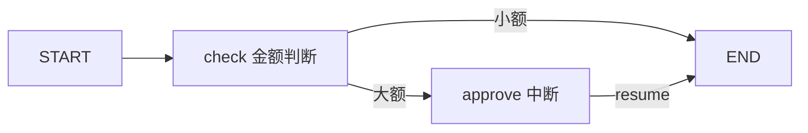

# 应用开发框架 LLM App Frameworks

> [AI](../) › 应用开发框架

在 SDK 之上提供模型抽象、编排、记忆、RAG 组件和 Agent 循环。本关按 Python、Java、TypeScript、Go 分区介绍主流框架，核心是判断什么时候该用框架，什么时候直接写 SDK。

> 相关主题：[Spring 框架](../../java/09-spring/) · [LLM API 编程模式](../06-llm-api-programming/) · [智能体](../09-agents/)

## 本关定位

| 项 | 内容 |
|----|------|
| 定位 | 第二章应用工程的起点：把 06 关手写的调用与工具循环交给框架管理 |
| 前置要求 | [LLM API 编程模式](../06-llm-api-programming/)；Java 方向需掌握 [Spring](../../java/09-spring/) 依赖注入与配置 |
| 粗略用时 | 1–2 周（粗略参考） |
| 章节 | 第二章 应用工程 |

## 闯关任务

**QUEST 07 · 第二章 应用工程**

- [ ] 能够说出 LangChain、LangGraph、Spring AI、LangChain4j、AI SDK 各自解决的问题与所属语言生态。
- [ ] 能够用 LangChain `create_agent` 写出带工具的 Agent，并读懂返回的消息序列。
- [ ] 能够用 LangGraph 状态图实现「条件分支 + 人工审批中断 + 断点恢复」。
- [ ] 能够在 Spring Boot 中用 `ChatClient` 完成对话、结构化输出与 `@Tool` 工具调用。
- [ ] 能够根据状态复杂度、团队语言和存量系统，判断该用框架还是直接用 SDK。

**奖励**：+100 XP · 徽章「框架架构师」（徽章名暂定，内容建设中）

## 知识要点

### 框架在 SDK 之上多做了什么

- 模型抽象：同一套接口切换 OpenAI、Anthropic、Gemini、本地模型，例如 LangChain 的 `"anthropic:claude-sonnet-5-5"` 字符串、Spring AI 的 `ChatModel`。
- Agent 循环：06 关手写的「调用 → 工具 → 回填」循环由框架托管，并提供步数上限、中间件或 Advisor 挂点。
- 编排与状态：LangGraph 用状态图表达分支、循环、并行，配合 checkpointer 做持久化与人机协同。
- 组件生态：文档加载器、切块器、向量库适配、记忆、MCP 客户端，供 [检索增强生成](../08-rag/) 和 [MCP](../10-mcp/) 复用。

### 各语言主流框架

- Python：LangChain 1.x（`create_agent`、中间件）与 LangGraph（状态图、持久化、人机协同）；LlamaIndex 偏数据接入与检索；Pydantic AI 强调类型安全；DSPy 用声明式程序和提示优化替代手写提示词。
- Java：Spring AI 2.0 提供 `ChatClient`、Advisors、结构化输出、Tool Calling、向量库抽象和 MCP Starter，基于 Spring Boot 4；LangChain4j 以 AI Services 注解式接口为核心，集成 Quarkus 与 Spring；Spring AI Alibaba 对接通义 / 百炼并提供 Graph 多 Agent。
- TypeScript：Vercel AI SDK 7 的 `generateText` / `streamText` 与 UI hooks；LangChain.js 与 LangGraph.js；Mastra 集成 Agent、工作流、记忆与评测。
- Go：CloudWeGo Eino（字节，组件加编排）、Firebase Genkit、LangChainGo。

### LangChain：create_agent

> [!NOTE]
> 本页带「运行输出」的 Python 示例在编写时实际运行：LangChain 示例连接本地模拟服务（返回固定的工具调用和回答），LangGraph 示例不调用模型。换成真实 API Key 后模型措辞会不同。

```python
from langchain.agents import create_agent
from langchain.tools import tool


@tool
def get_weather(city: str) -> str:
    """查询城市当前气温。"""
    return '{"city": "%s", "temp_c": 21}' % city


agent = create_agent(
    model="anthropic:claude-sonnet-5-5",     # 也可以传 "openai:gpt-6-astra" 或模型对象
    tools=[get_weather],
    system_prompt="你是简洁的中文助手。",
)
result = agent.invoke({"messages": [{"role": "user", "content": "北京现在多少度？"}]})
for m in result["messages"]:
    print(type(m).__name__, (m.content if isinstance(m.content, str) else m.content[0].get("type")))
```

运行输出：

```text
HumanMessage 北京现在多少度？
AIMessage tool_use
ToolMessage {"city": "北京", "temp_c": 21}
AIMessage 北京现在 21°C。
```

`create_agent` 返回的是一个编译好的 LangGraph 图，所以它天然支持流式、checkpointer 和中断；消息序列与 06 关手写循环的结构一一对应。

### LangGraph：状态图与人工审批

```python
from typing import TypedDict

from langgraph.checkpoint.memory import InMemorySaver
from langgraph.graph import END, START, StateGraph
from langgraph.types import Command, interrupt


class State(TypedDict):
    amount: int
    status: str


def check(state: State) -> State:
    return {"status": "需审批" if state["amount"] > 1000 else "自动通过"}


def approve(state: State) -> State:
    decision = interrupt({"question": f"退款 {state['amount']} 元，是否批准？"})
    return {"status": "已批准" if decision == "yes" else "已拒绝"}


def route(state: State) -> str:
    return "approve" if state["status"] == "需审批" else END


builder = StateGraph(State)
builder.add_node("check", check)
builder.add_node("approve", approve)
builder.add_edge(START, "check")
builder.add_conditional_edges("check", route, ["approve", END])
builder.add_edge("approve", END)
graph = builder.compile(checkpointer=InMemorySaver())

cfg = {"configurable": {"thread_id": "order-42"}}
first = graph.invoke({"amount": 3000, "status": ""}, cfg)
print(first["__interrupt__"][0].value)          # 图在这里暂停，状态已存进 checkpointer
final = graph.invoke(Command(resume="yes"), cfg)  # 人工审批后从断点继续
print(final)
```

运行输出：

```text
{'question': '退款 3000 元，是否批准？'}
{'amount': 3000, 'status': '已批准'}
```

`interrupt` 让图暂停并把状态写进 checkpointer，同一个 `thread_id` 用 `Command(resume=...)` 恢复。生产环境把 `InMemorySaver` 换成 PostgreSQL 等持久化 checkpointer，服务重启后也能继续。



### Spring AI：ChatClient、结构化输出与工具

依赖坐标：BOM `org.springframework.ai:spring-ai-bom:2.0.2`、`org.springframework.ai:spring-ai-starter-model-openai:2.0.2`、`org.springframework.boot:spring-boot-starter-web:4.1.2`；Boot parent 为 `org.springframework.boot:spring-boot-starter-parent:4.1.2`，JDK 21。稳定版由 Maven Central 与官方发布记录交叉核对，未采用 2.1.0-RC2。文件为 `src/main/java/example/ai/SupportApplication.java`；编译状态：2026-11-06 `mvn -DskipTests compile` 通过（JDK 21.0.12.1 / Maven 3.8.7）；未启动应用，未调用模型。发布源码 API 仍按 2.0.2 核对。

服务端配置 `spring.ai.openai.api-key=${OPENAI_API_KEY}`、`spring.ai.openai.chat.model=${OPENAI_MODEL}`；真实订单工具必须增加用户 / 租户授权，不可直接上线此教学接口。

```java
package example.ai;

import org.springframework.ai.chat.client.ChatClient;
import org.springframework.ai.tool.annotation.Tool;
import org.springframework.boot.SpringApplication;
import org.springframework.boot.autoconfigure.SpringBootApplication;
import org.springframework.web.bind.annotation.GetMapping;
import org.springframework.web.bind.annotation.PostMapping;
import org.springframework.web.bind.annotation.RequestBody;
import org.springframework.web.bind.annotation.RequestParam;
import org.springframework.web.bind.annotation.RestController;

@SpringBootApplication
@RestController
public class SupportApplication {
    private final ChatClient chatClient;

    public SupportApplication(ChatClient.Builder builder) {
        this.chatClient = builder.defaultSystem("你是电商客服，回答简洁。").build();
    }

    public static void main(String[] args) {
        SpringApplication.run(SupportApplication.class, args);
    }

    public record Ticket(String category, boolean urgent, String reason) {}

    public static class OrderTools {
        @Tool(description = "查询演示订单的物流状态，不访问真实订单")
        public String shippingStatus(String orderId) {
            return "演示订单 " + orderId + " 尚未发货";
        }
    }

    @GetMapping("/ask")
    public String ask(@RequestParam("q") String q) {
        return chatClient.prompt().user(q).tools(new OrderTools()).call().content();
    }

    @PostMapping("/classify")
    public Ticket classify(@RequestBody String text) {
        return chatClient.prompt().user("把这条工单分类：" + text)
                .call().entity(Ticket.class);
    }
}
```

### LangChain4j：AI Services

依赖坐标：`dev.langchain4j:langchain4j:1.23.0` 与 `dev.langchain4j:langchain4j-open-ai:1.23.0`，JDK 21，编译启用 `-parameters`。1.23.0 是当前核心正式版，集成模块可能使用 `1.23.0-beta33`，不可混称全生态稳定版。保存为 `src/main/java/example/ai/LangChain4jDemo.java`；编译状态：2026-11-06 `mvn -DskipTests compile` 通过；已核对 Maven 源码和官方构造示例，未调用真实模型。

LangChain4j 用接口加注解声明能力，框架生成实现（未在本机编译）：

```java
package example.ai;

import dev.langchain4j.agent.tool.Tool;
import dev.langchain4j.memory.chat.MessageWindowChatMemory;
import dev.langchain4j.model.openai.OpenAiChatModel;
import dev.langchain4j.service.AiServices;
import dev.langchain4j.service.SystemMessage;
import java.time.Duration;
import java.util.Objects;

public class LangChain4jDemo {
    public interface Assistant {
        @SystemMessage("你是电商客服，回答简洁。")
        String chat(String userMessage);
    }

    public static class OrderTools {
        @Tool("查询演示订单物流，不访问真实数据")
        public String shippingStatus(String orderId) {
            return "演示订单 " + orderId + " 尚未发货";
        }
    }

    public static void main(String[] args) {
        OpenAiChatModel model = OpenAiChatModel.builder()
                .apiKey(Objects.requireNonNull(System.getenv("OPENAI_API_KEY"), "缺少 OPENAI_API_KEY"))
                .modelName(System.getenv().getOrDefault("OPENAI_MODEL", "gpt-6-luna"))
                .timeout(Duration.ofSeconds(30)).build();
        // 仅单用户 CLI 会话；Web 服务不能全局共享这个 memory
        Assistant assistant = AiServices.builder(Assistant.class)
                .chatModel(model)
                .chatMemory(MessageWindowChatMemory.withMaxMessages(10))
                .tools(new OrderTools()).build();
        System.out.println(assistant.chat("演示订单 42 到哪了？"));
    }
}
```

### Vercel AI SDK：结构化输出

AI SDK 7 中 `generateObject` 已标注为 deprecated，推荐用 `generateText` 加 `output` 设置。以下代码在编写时连接本地模拟服务运行，输出 `{ category: '退款', urgent: false, reason: '未发货要求退款' }`：

```typescript
import { generateText, Output } from 'ai';
import { openai } from '@ai-sdk/openai';
import { z } from 'zod';

const Ticket = z.object({
  category: z.enum(['退款', '物流', '其他']),
  urgent: z.boolean(),
  reason: z.string(),
});

const { output } = await generateText({
  model: openai('gpt-6-luna'),
  output: Output.object({ schema: Ticket }),
  prompt: '把这条工单分类：我的订单 3 天没发货，要求退款。',
});
console.log(output);
```

### 接上 Spring Boot，而不是再造业务平台

- 沿用 [Java Spring](../../java/09-spring/) 的依赖注入、配置校验和测试；把 `ChatClient` / AI Services 放在应用服务或出站适配器，不让订单实体直接依赖供应商 SDK。框架抽象不保证不同模型能力一致。
- `.entity(Ticket.class)` 表示结果映射，并不自动证明供应商启用了原生约束解码；区分提示驱动转换与 native structured output，校验分类枚举、长度及业务约束，拒答 / 截断见 [API 编程](../06-llm-api-programming/)。
- `ChatClient` 可以复用，但会话记忆必须按服务端确认的租户、用户、会话隔离；不能把示例中的单个 `MessageWindowChatMemory` 注册成所有用户共享的全局聊天记录。MCP 的协议会话也不是用户身份边界，见 [MCP](../10-mcp/)。

### LLM 出站调用的韧性与测试

- 复用 [微服务韧性](../../microservices/05-resilience/)：HTTP 客户端设超时，用 Resilience4j `CircuitBreaker` 统计失败 / 慢调用，`Bulkhead` 限并发，`Retry` 仅处理允许重试的暂时故障。熔断器本身不限制并发，也不取消已经运行的 HTTP 请求。
- 先确定总 deadline，再分配每次尝试、等待和工具执行预算；不要同时打开 SDK、框架、网关的多层无限重试。流式输出已经交付一部分后，不可无感切换模型并拼接答案。
- 用 [Java 测试](../../java/08-testing/) 替身测试超时、429、拒答、断流、工具重复调用和跨租户读取；真实供应商回归单独限额。网关拓扑与上线清单见 [AI 索引](../)。

## 选型对比

| 框架 | 语言 | 版本（2026-11） | 擅长 | 何时选 |
|------|------|-----------------|------|--------|
| LangChain + LangGraph | Python / JS | `langchain` 1.4.9、`langgraph` 1.2.20 | Agent、状态图、人机协同 | 多步骤、需中断恢复的流程 |
| LlamaIndex | Python | 0.14.25 | 数据接入、索引与检索 | 以 RAG 为主的应用 |
| Pydantic AI | Python | 2.66.0 | 类型安全的 Agent | 重视类型与测试的 Python 团队 |
| DSPy | Python | 3.4.1 | 声明式程序、提示优化 | 有评测集、想自动优化提示 |
| Spring AI | Java | 2.0.2 | `ChatClient`、Advisors、Spring 生态 | 已有 Spring Boot 系统 |
| LangChain4j | Java | 1.23.0 | AI Services 注解接口 | Quarkus 或非 Spring 的 Java 项目 |
| Spring AI Alibaba | Java | 1.1.2.2（官方发布基线） | 通义 / 百炼、Graph 多 Agent | 阿里云生态 |
| Vercel AI SDK | TypeScript | `ai` 7.0.163 | 流式 UI、多模型统一接口 | Next.js 等 Web 全栈 |
| Mastra | TypeScript | `@mastra/core` 1.82.0 | Agent、工作流、记忆、评测一体 | TS 团队的 Agent 产品 |
| Eino | Go | v0.9.22 | 组件加编排 | Go 后端服务 |

> [!WARNING]
> 版本以 2026-11-05 核对为准。Spring AI 2.1.0-RC2 是预发布版，稳定版为 2.0.2；Spring AI 2.x 要求 Spring Boot 4，1.1.x 线当前为 1.1.8。Pydantic AI 同时维护 v1（1.107.10）与 v2（2.66.0）；AI SDK 同时发布 6.x 与 7.x，新项目用 7.x。Spring AI Alibaba 另有 2.0.0-M1.1 里程碑版；Central BOM 还列有 1.1.2.3 / 1.1.2.4-security-fix，但对应发布说明与模块对齐情况待核实：已检查官方 Releases 和 BOM 元数据，暂未找到配套说明，不直接替换示例基线。

## 常见误区

- 简单的单次调用也套框架：多一层抽象，调试时还得读框架源码；一两个接口直接用 SDK 即可。
- 把框架当成模型能力的来源：框架只做编排，效果上限仍由模型和提示词决定。
- 生产环境用 `InMemorySaver`：进程重启后中断的流程全部丢失，应换成持久化 checkpointer。
- 照抄旧教程的 API：LangChain 0.x 的 `initialize_agent`、AI SDK 的 `generateObject` 都已被新 API 替代，先查当前版本文档。
- 在 Spring AI 1.x 项目里直接升级 2.x：2.x 基于 Spring Boot 4，需要连同 Boot 一起迁移。
- 框架升级不锁版本：小版本也可能改动消息格式或默认参数，应锁定版本并用评测集回归（见 [评测与可观测](../17-evals-observability/)）。

## 实践任务

- 用 LangChain `create_agent` 实现「查订单 + 查物流」两个工具的客服 Agent，打印完整消息序列。
- 把上面的 LangGraph 审批图改成三级审批（小于 1000 自动、1000–10000 主管、更高财务），并用 SQLite 或 PostgreSQL checkpointer 验证进程重启后可恢复。
- 用 Spring Boot 4 加 Spring AI 2.0 写 `/ask` 和 `/classify` 两个接口，并为工具方法写单元测试（见 [Java 测试](../../java/08-testing/)）。
- 同一个需求分别用 SDK 手写和用框架实现，对比代码量、可调试性和依赖数量，写一段选型结论。

## 资料索引

- [LangChain 文档](https://docs.langchain.com/) — LangChain 与 LangGraph 的 Python / JS 官方文档
- [Spring AI 参考文档](https://docs.spring.io/spring-ai/reference/) — `ChatClient`、Tool Calling 与 Advisors
- [LangChain4j 文档](https://docs.langchain4j.dev/) — AI Services 与各模型集成
- [Pydantic AI 文档](https://ai.pydantic.dev/) — 类型安全的 Python Agent 框架
- [AI SDK 文档](https://ai-sdk.dev/docs/introduction) — Vercel TypeScript AI 工具包
- [Eino 文档](https://www.cloudwego.io/zh/docs/eino/) — Go LLM 应用框架（中文）
- [Spring AI 2.0.2 发布](https://github.com/spring-projects/spring-ai/releases/tag/v2.0.2) — 稳定版本与升级说明；2.1.0-RC2 仍是预发布
- [Spring AI 入门](https://docs.spring.io/spring-ai/reference/getting-started.html) — BOM 与 Spring Boot 4.0 / 4.1 兼容范围
- [Spring AI 结构化输出](https://docs.spring.io/spring-ai/reference/api/structured-output-converter.html) — 转换器与模型原生约束的区别
- [LangChain4j OpenAI 集成](https://docs.langchain4j.dev/integrations/language-models/open-ai/) — 1.23.0 坐标、模型构造与 schema 能力
- [LangChain4j Maven 元数据](https://repo1.maven.org/maven2/dev/langchain4j/langchain4j/maven-metadata.xml) — 1.23.0 主线与旧分支补丁交叉核对
- [Resilience4j CircuitBreaker](https://resilience4j.readme.io/docs/circuitbreaker) — 慢调用阈值、并发与 Bulkhead 边界
- [Spring AI Chat Memory](https://docs.spring.io/spring-ai/reference/api/chat-memory.html) — 按会话标识隔离历史
- [Spring AI BOM 元数据](https://repo1.maven.org/maven2/org/springframework/ai/spring-ai-bom/maven-metadata.xml) — 2.0.2 稳定、2.1.0-RC2 预发布
- [Spring Boot 元数据](https://repo1.maven.org/maven2/org/springframework/boot/spring-boot-dependencies/maven-metadata.xml) — 4.1.2 正式版与 4.2 RC 区分
- [Spring AI Alibaba BOM 元数据](https://repo1.maven.org/maven2/com/alibaba/cloud/ai/spring-ai-alibaba-bom/maven-metadata.xml) — 注册表版本与 GitHub 发布说明不完全一致
- [Spring AI Alibaba 发布记录](https://github.com/alibaba/spring-ai-alibaba/releases) — 1.1.2.2 已核实，2.0.0-M1.1 为预发布

## 通关自测

先独立作答，再展开参考答案核对；简答题答出要点即算对。答对 ≥ 80% 即可进入下一关。

1. 【单选】LangChain 1.x 的 `create_agent` 返回的对象本质上是：
    - A. 一个普通 Python 函数
    - B. 一个编译好的 LangGraph 图
    - C. 一个 OpenAI Assistant
    - D. 一个 MCP Server
2. 【单选】LangGraph 中让流程暂停等待人工输入、之后从断点继续，需要哪两样配合？
    - A. `interrupt` 与 checkpointer
    - B. `print` 与 `input`
    - C. 重试装饰器与超时
    - D. 向量库与 Embedding
3. 【单选】在 Spring AI 中把模型输出直接映射为 Java record，应调用：
    - A. `.content()`
    - B. `.stream()`
    - C. `.entity(Ticket.class)`
    - D. `.tools(Ticket.class)`
4. 【简答】什么情况下应直接使用 SDK 而不是框架？
5. 【简答】一个已有的 Spring Boot 3 + Java 17 订单系统要加 AI 客服，你会选哪个框架和版本线？说明理由。

<details markdown><summary>参考答案</summary>

1. B — `create_agent` 基于 LangGraph 构建，返回可 `invoke` / `stream` 的编译图。
2. A — `interrupt` 暂停并抛出待确认内容，checkpointer 按 `thread_id` 保存状态，之后用 `Command(resume=...)` 恢复。
3. C — `.entity()` 按目标类型生成 JSON Schema 并解析结果；`.content()` 返回字符串。
4. 调用少、流程线性、没有复杂状态时；对延迟和依赖体积敏感时；需要用到框架尚未支持的新 API 参数时。
5. 要点：Spring AI 2.x 需要 Spring Boot 4，不升级 Boot 就选 Spring AI 1.1.x 线，或选不绑定 Boot 版本的 LangChain4j；若计划升级 Boot 4 则可直接用 Spring AI 2.0.2。理由围绕与现有 Spring 生态的契合与迁移成本。

</details>

---

← [上一节：LLM API 编程模式](../06-llm-api-programming/) · [返回 AI](../) · [下一节：检索增强生成](../08-rag/) →
