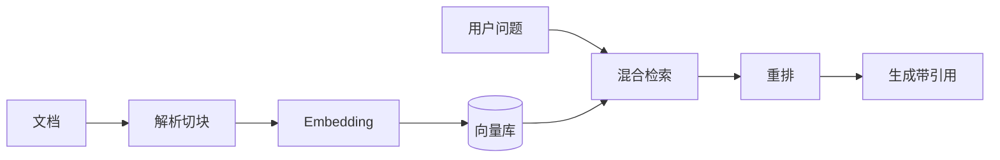

# 检索增强生成 {#rag}

> [AI](../) › 检索增强生成

检索负责把私有、会变的资料放进上下文。生成仍可能用错这些资料，也可能在没有资料时作答。这一页用来判断失败出在检索还是生成，以及权限过滤放在哪一步会伤召回、哪一步会先越过泄露边界。

> 相关主题：[缓存](../../microservices/08-caching/) · [分库分表](../../microservices/09-database-sharding/) · [评测与可观测](../17-evals-observability/)

> [!NOTE]
> 本仓库和站点的内容由 AI 生成，资料与资源链接来源于网络，仅供学习参考；如有错误或侵权，请提 Issue 告知。

## 这一页补哪一块 {#_1}

离线链路把文档变成可过滤的索引，在线链路在授权范围内取出少量片段再生成。评测先分开四种失败：没检索到、检索到但被裁掉、证据还在上下文里但生成答错、没有证据仍然作答。权限条件要进检索算子。先取全局 top-K 再丢掉别的租户，授权文档可能进不了这 K 条，未授权片段却已经进过进程、日志或模型请求。

## 两条链路 {#_4}

<span id="_2"></span>



- 离线：解析、切块、Embedding、写入。元数据至少有来源、租户或 ACL、更新时间。换 Embedding 模型就是换向量空间，旧索引不能混用。
- 在线：查询改写、混合检索、重排，再把编了号的片段放进提示。模型只应看到这一步已经授权的文本。

## 解析与切块 {#_5}

解析错了，后面测出来也是「未检索到」，改提示没有用。表格、页眉和多栏先看解析结果。

固定长度加重叠是基线，按标题切通常更稳。父子块用小块命中、把父块送进提示，避免一句话离开它的例外条款。块太碎会把规则和例外拆开，评测上仍像没检索到。块里带上文档标题和章节路径，孤立片段才知道自己属于哪一节。

## Embedding 与向量库 {#embedding}

中文语料先用自己的问答对比模型。向量归一化之后，余弦和点积是一回事。HNSW 召回高、占内存；IVF 更省内存。已经在用 PostgreSQL，就先用 pgvector，过滤和业务数据在同一处。数据量上去、要分布式，再看 Milvus 或 Qdrant。已有 Elasticsearch / OpenSearch 时，BM25 和向量可以留在同一集群。

下面的 SQL 把 `tenant_id` 放进 `WHERE`，再按距离排序取 5 条。过滤发生在结果返回之前。

```sql
CREATE EXTENSION IF NOT EXISTS vector;

CREATE TABLE chunks (
    id        bigserial PRIMARY KEY,
    doc_id    bigint NOT NULL,
    tenant_id bigint NOT NULL,
    content   text NOT NULL,
    embedding vector(512)
);

CREATE INDEX ON chunks USING hnsw (embedding vector_cosine_ops);

SELECT id, content, 1 - (embedding <=> $1) AS score
FROM chunks
WHERE tenant_id = $2              -- 权限过滤必须在检索阶段做
ORDER BY embedding <=> $1
LIMIT 5;
```

ANN 是近似的。过滤很严、搜索束很窄时，授权文档在库里也可能不出现。这时测的是授权子集上的召回，不是全库召回。过滤表达式由服务端按已认证身份生成，不接受模型或用户传来的任意条件。

## 混合检索与 RRF {#rrf}

BM25 保字面：错误码、SKU、人名。向量保改写和口语。只留向量时，E1042 会被语义相近的另一句挤掉。

RRF 只加排名，不加原始分数：`score = Σ 1 / (k + rank)`，`k` 常用 60。两路分数不必先归一到同一尺度。

> [!NOTE]
> 下面的示例在编写时实际运行，使用 `rank-bm25` 与 Sentence Transformers 加载的 `BAAI/bge-small-zh-v1.5`（首次运行需下载模型）。文档序号从 0 开始。

2026-11-25 没有重跑这段 Python，也没有下载该模型。输出块保持编写时的原文。

```python
from rank_bm25 import BM25Okapi
from sentence_transformers import SentenceTransformer

docs = [
    "退款申请通过后，款项一般 3 到 5 个工作日原路退回。",
    "订单发货后无法修改收货地址，请联系快递改派。",
    "错误码 E1042 表示支付渠道超时，请稍后重试。",
    "会员积分在每年 12 月 31 日清零。",
    "商品签收 7 天内支持无理由退货，需保持包装完好。",
    "发票可在订单详情页申请，电子发票即时开具。",
]


def bigrams(text: str) -> list[str]:          # 中文没有空格，这里用字二元组代替分词
    s = "".join(ch for ch in text if not ch.isspace())
    return [s[i:i + 2] for i in range(len(s) - 1)]


bm25 = BM25Okapi([bigrams(d) for d in docs])
model = SentenceTransformer("BAAI/bge-small-zh-v1.5")
doc_vecs = model.encode(docs, normalize_embeddings=True)


def rank_bm25(q: str) -> list[int]:
    scores = bm25.get_scores(bigrams(q))
    return sorted(range(len(docs)), key=lambda i: -scores[i])


def rank_vector(q: str) -> list[int]:
    sims = doc_vecs @ model.encode(q, normalize_embeddings=True)   # 已归一化，点积即余弦
    return sorted(range(len(docs)), key=lambda i: -sims[i])


def rrf(*rankings: list[int], k: int = 60) -> list[int]:
    score: dict[int, float] = {}
    for ranking in rankings:
        for pos, doc_id in enumerate(ranking):
            score[doc_id] = score.get(doc_id, 0.0) + 1 / (k + pos + 1)
    return sorted(score, key=lambda i: -score[i])


for q in ["钱什么时候能退回来", "E1042 是什么意思"]:
    b, v = rank_bm25(q), rank_vector(q)
    print(q)
    print("  BM25 top2:", b[:2], " 向量 top2:", v[:2], " RRF top2:", rrf(b, v)[:2])
    print("  RRF 第一名:", docs[rrf(b, v)[0]])
```

编写时的输出：

```text
钱什么时候能退回来
  BM25 top2: [0, 1]  向量 top2: [0, 4]  RRF top2: [0, 1]
  RRF 第一名: 退款申请通过后，款项一般 3 到 5 个工作日原路退回。
E1042 是什么意思
  BM25 top2: [2, 0]  向量 top2: [2, 5]  RRF top2: [2, 0]
  RRF 第一名: 错误码 E1042 表示支付渠道超时，请稍后重试。
```

同一公式的 Java 对照只重放这两路已经有的排名，不自己做检索：

```java
class RrfDemo {
    static int[] rrf(int[][] rankings, int k) {
        java.util.Map<Integer, Double> score = new java.util.LinkedHashMap<>();
        for (int[] ranking : rankings) {
            for (int pos = 0; pos < ranking.length; pos++) {
                score.merge(ranking[pos], 1.0 / (k + pos + 1), Double::sum);
            }
        }
        return score.entrySet().stream()
                .sorted((a, b) -> Double.compare(b.getValue(), a.getValue()))
                .mapToInt(java.util.Map.Entry::getKey)
                .toArray();
    }

    public static void main(String[] args) {
        String[] docs = {
            "退款申请通过后，款项一般 3 到 5 个工作日原路退回。",
            "订单发货后无法修改收货地址，请联系快递改派。",
            "错误码 E1042 表示支付渠道超时，请稍后重试。"
        };
        int[] money = rrf(new int[][] {{0, 1}, {0, 4}}, 60);
        int[] code = rrf(new int[][] {{2, 0}, {2, 5}}, 60);
        if (money[0] != 0 || money[1] != 1) throw new AssertionError(java.util.Arrays.toString(money));
        if (code[0] != 2 || code[1] != 0) throw new AssertionError(java.util.Arrays.toString(code));
        System.out.println("钱什么时候能退回来");
        System.out.println("  BM25 top2: [0, 1]  向量 top2: [0, 4]  RRF top2: [0, 1]");
        System.out.println("  RRF 第一名: " + docs[money[0]]);
        System.out.println("E1042 是什么意思");
        System.out.println("  BM25 top2: [2, 0]  向量 top2: [2, 5]  RRF top2: [2, 0]");
        System.out.println("  RRF 第一名: " + docs[code[0]]);
    }
}
```

`main` 传入的是写死的 `{0, 1}` 配 `{0, 4}`，以及 `{2, 0}` 配 `{2, 5}`，然后打印和上面相同的那几行字。类里没有分词，也没有向量。它核对的是 RRF 名次，不是一次新的 BM25 或向量检索。

## 重排、生成与引用 {#_6}

Cross-encoder 或 LLM 重排只打召回后的前几十条。生成时给片段编号，要求只依据片段作答，没有依据就说资料里没有。答案里出现 `[1]` 不够：编号要能指回那个片段的文档版本、页码或段落，并且那一段确实支持这句话。

Java 侧，Spring AI 用 `QuestionAnswerAdvisor` 把检索接到 `ChatClient` 上（依赖 `spring-ai-vector-store-advisor`，未在本机编译）：

依赖坐标：BOM `org.springframework.ai:spring-ai-bom:2.0.2`，`org.springframework.ai:spring-ai-vector-store-advisor:2.0.2` 与 `org.springframework.ai:spring-ai-starter-model-openai:2.0.2`；JDK 21 / Boot 4.1.2，路径 `src/main/java/example/ai/RagAnswerService.java`。构造器需传入已配置模型与已授权的向量库视图（此类不负责租户鉴权），`0.8` 阈值仅示意，需按 embedding / 数据集调优。编译状态：2026-11-06 `mvn -DskipTests compile` 通过；已核对 2.0.2 发布源码包名与签名，未连接向量库或模型。

2026-11-25 没有重跑这条编译，也没有改坐标。上面的日期和「未连接」保持原注记。

```java
package example.ai;

import org.springframework.ai.chat.client.ChatClient;
import org.springframework.ai.chat.client.advisor.vectorstore.QuestionAnswerAdvisor;
import org.springframework.ai.chat.model.ChatModel;
import org.springframework.ai.vectorstore.SearchRequest;
import org.springframework.ai.vectorstore.VectorStore;

public final class RagAnswerService {
    private final ChatClient client;
    private final QuestionAnswerAdvisor advisor;

    public RagAnswerService(ChatModel model, VectorStore authorizedStore) {
        this.client = ChatClient.builder(model).build();
        this.advisor = QuestionAnswerAdvisor.builder(authorizedStore)
                .searchRequest(SearchRequest.builder()
                        .similarityThreshold(0.8d).topK(6).build()).build();
    }

    public String ask(String question) {
        return client.prompt().advisors(advisor).user(question).call().content();
    }
}
```

## GraphRAG 与 Agentic RAG {#graphrag-agentic-rag}

GraphRAG 先抽实体关系、再做社区摘要，适合问「这批文档整体在讲什么」。建图贵，单条事实问答通常不需要。

Agentic RAG 把检索做成工具，由 [智能体](../09-agents/) 决定要不要再查、换什么词。多跳问题才值得付这个循环的费用。每多一轮都是一次检索加一次生成。失败类型仍然用上面的四类分开记，不能因为又查了一次就当成已经找到证据。

长上下文没有取消 RAG：费用和延迟随上下文涨，资料每天变，用户之间的权限也不一样。

## 先测检索，再测生成 {#_7}

评测集要有相关切块和期望答案。先测 Recall@K、MRR 或 nDCG，再把检索结果固定住测忠实度和引用。Ragas 或裁判模型的分数要校准，不能代替人工抽查，流程见 [评测与可观测](../17-evals-observability/)。

四类失败对应不同的下一刀。混在一个准确率里，就不知道改索引、改预算还是改提示：

1. 未检索到：标注的证据不在 top-K。下一刀是解析、切块、查询改写或 Embedding。提示词还没被用到。
2. 检索到但被裁剪：证据进过候选，然后被重排阈值、父块展开或上下文预算丢掉。下一刀是重排和预算。索引可能没问题。
3. 证据在上下文里但生成答错：支持句还在提示里，模型改了数字或引用了另一块。下一刀是提示、引用约束或模型。
4. 无证据仍回答：候选集不支持结论，模型仍给了肯定句。这是拒答失败。引用标记不能代替「这句话指回哪一段」。

样本里要有无答案、过期文档、多跳和恶意文档，否则拒答的精确率和召回率测不出来。

权限过滤的时机同时决定召回和泄露边界：

- 条件写在查询里（SQL 的 `WHERE`、向量库的 payload filter）时，返回给应用和模型的已是授权子集。召回要在这个子集上测。束宽不够时，授权文档在库里也会表现为未检索到。这和「库里没有」不是同一种空。
- 先取全局 top-K 再按租户丢掉时，两件事一起发生。授权文档可能没进这 K 条，召回下降。未授权片段已经进过进程、追踪日志或模型请求。事后从展示结果里删掉，只是显示层干净，泄露边界已经过了。把结果滤成空，修不好这次读取。

## 业务库与向量投影 {#mysql}

订单和文档元数据仍以 MySQL 为事实源，向量库是可重建的投影，不替代业务事务。本章写到这里时，MySQL 自 26.7.0 起用日历版本号，并记下 Innovation 26.10.0。2026-11-25 没有重开这两份发布说明，所以不把 26.10.0 称为今天的当前版本，也不再沿用「最新 9.x」。

索引用 [消息队列](../../microservices/06-messaging/) 加 CDC 或 outbox 更新，按文档 ID 加版本幂等消费。业务提交和建索引不做跨库双写。换 Embedding 要新建索引，灰度后再切别名。删除、撤权和过期要同时清原文、向量、缓存和引用。索引延迟期间，旧向量不能绕过最新权限。一致性取舍见 [分布式事务](../../microservices/07-distributed-transactions/)。

## 组件怎么选 {#rag-choice}

<span id="_8"></span>

表里的版本是 2026-11-04 的核对记录。2026-11-25 没有重开这些发布页，不把它们改写成当前版本。

| 组件 | 选项（2026-11-04 记录） | 适合 |
|------|-----------------|------|
| 向量库 | pgvector 0.8.7 | 已用 PostgreSQL，千万级以内，和业务数据同库事务 |
| 向量库 | Milvus 3.0.5（`pymilvus` 3.0.2） | 亿级、分布式、多索引类型 |
| 向量库 | Qdrant 1.20.0 | 单机易部署，过滤与 payload 能力强 |
| 向量库 | Elasticsearch / OpenSearch | 已有全文检索集群，BM25 与向量一处完成 |
| Embedding 推理 | Sentence Transformers 6.2.0、Text Embeddings Inference 1.9.4 | 本地开发与生产部署 |
| 图谱增强 | Microsoft GraphRAG 3.3.0 | 全局总结类问题 |
| 一体化平台 | RAGFlow 0.27.3 | 文档解析强，开箱即用 |

> [!WARNING]
> 版本以 2026-11-04 核对为准。当时记下 Milvus 2.6.x 仍在维护（2.6.26），RAGFlow 1.0.0-rc3 是预发布版。2026-11-25 没有重开这些版本。

## 常见误读 {#_3}

<span id="_9"></span>

- 上了 RAG 就不会胡说：检索只改变上下文。模型仍可能无视片段，或在没有片段时作答。
- 只调向量库：解析失败和字面错误码，都不是 HNSW 参数能补的。
- 切得越碎越好：规则和例外被拆开时，召回命中的是半句。
- 先写出答案再补引用：引用要能指回被选中的那一段，并支持结论。
- 全局 top-K 之后再滤权限：召回和泄露会同时坏，见上面的时机。
- 把 Java 的 `RrfDemo` 当成另一次检索：它只重放已有排名。
- 把 Innovation 26.10.0 写成今天核对过的当前版本：那是本章原有的日期快照。

## 可选核对 {#rag-check}

<span id="_10"></span>

1. 用户搜错误码 E1042。为什么只靠向量检索不够？若标准片段不在 top-K，这属于哪一类失败，下一刀改什么？
2. 权限过滤放在全局 top-K 之后，召回和泄露分别坏在哪里？

<details markdown><summary>参考答案</summary>

1. 错误码要字面命中。向量检索按语义邻近排序，可能把 E1042 挤出 top-K，BM25 负责把这串字符捞回来，RRF 再合并名次。标准片段不在 top-K，是「未检索到」。下一刀是检索（BM25、切块或查询），不是先改生成提示。
2. 授权文档可能根本没进这 K 条，所以授权子集上的召回下降。未授权片段在被丢掉之前，已经进过应用进程、日志或模型请求，泄露边界先被越过。滤成空结果修不好这次读取。过滤要写进查询，召回也要在授权子集上测。

</details>

<span id="_12"></span>

## 资料索引 {#_11}

- [RAG 原始论文](https://arxiv.org/abs/2005.11401) — Retrieval-Augmented Generation for Knowledge-Intensive NLP Tasks
- [GraphRAG 论文](https://arxiv.org/abs/2404.16130) — From Local to Global：基于图的全局问答
- [pgvector](https://github.com/pgvector/pgvector) — PostgreSQL 向量扩展，含索引与查询示例
- [Qdrant 文档](https://qdrant.tech/documentation/) — 向量检索、过滤与混合检索
- [Sentence Transformers 文档](https://sbert.net/) — Embedding 与 Cross-encoder 重排
- [Spring AI RAG](https://docs.spring.io/spring-ai/reference/api/retrieval-augmented-generation.html) — Java 侧的检索增强 Advisor
- [Qdrant 过滤](https://qdrant.tech/documentation/concepts/filtering/) — 向量查询与 payload 过滤
- [Microsoft RAG 评测](https://learn.microsoft.com/en-us/azure/ai-foundry/concepts/evaluation-evaluators/rag-evaluators) — 检索与 groundedness 分层评测
- [Debezium Outbox Event Router](https://debezium.io/documentation/reference/stable/transformations/outbox-event-router.html) — 事务 outbox 与事件路由
- [MySQL 26.7.0 发布说明](https://dev.mysql.com/doc/relnotes/mysql/26.7/en/news-26-7-0.html) — 日历版本命名起点；2026-11-25 未重开
- [MySQL 26.10.0 发布说明](https://dev.mysql.com/doc/relnotes/mysql/26.10/en/news-26-10-0.html) — 本章原记录的 Innovation 快照；2026-11-25 未重开

---

← [上一节：应用开发框架](../07-app-frameworks/) · [返回 AI](../) · [下一节：智能体](../09-agents/) →
