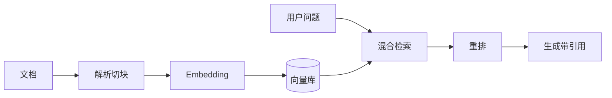

# 检索增强生成 {#rag}

> [AI](../) › 检索增强生成

用外部知识降低幻觉、接入私有数据。本关覆盖完整链路：文档解析、切块、Embedding、向量库、混合检索、重排、生成与引用，以及进阶的 GraphRAG 和 Agentic RAG。

> 相关主题：[缓存](../../microservices/08-caching/) · [分库分表](../../microservices/09-database-sharding/) · [评测与可观测](../17-evals-observability/)

## 本关定位

| 项 | 内容 |
|----|------|
| 定位 | 第二章应用工程的核心关：让模型基于私有、最新的资料作答并给出引用 |
| 前置要求 | [提示词与上下文工程](../05-prompt-context/)、[LLM API 编程模式](../06-llm-api-programming/)；了解 SQL 与索引 |
| 粗略用时 | 2–3 周（粗略参考） |
| 章节 | 第二章 应用工程 |

## 闯关任务

**QUEST 08 · 第二章 应用工程**

- [ ] 能够画出 RAG 的离线索引链路与在线问答链路，并说出每一步的可调参数。
- [ ] 能够根据文档类型选择切块策略，并解释块大小与重叠对召回的影响。
- [ ] 能够用 BM25 加向量检索加 RRF 实现混合检索，并说明二者各自擅长的查询。
- [ ] 能够在 pgvector 或 Milvus 中建表、建 HNSW 索引并带元数据过滤查询。
- [ ] 能够用召回率、上下文精度和答案忠实度评估一个 RAG 系统，并定位问题出在检索还是生成。

**奖励**：+100 XP · 徽章「知识检索官」（徽章名暂定，内容建设中）

## 知识要点

### 两条链路



- 离线索引：解析（PDF 版面、表格、OCR）→ 切块 → Embedding → 写入向量库，同时保存来源、权限、更新时间等元数据。
- 在线问答：查询改写 → 混合检索 → 重排 → 把 Top-K 片段连同编号放进提示词 → 生成并引用编号。

### 解析与切块

- 先保证解析质量：表格、页眉页脚、多栏排版解析错了，后面的检索都救不回来。
- 固定长度切块加重叠是基线；按标题、段落的结构化切块通常更好；语义切块按相邻句子的 Embedding 相似度断开。
- 父子块：用小块检索提高精度，命中后把所属的大块（父块）送进提示词，保留上下文。
- 块里补上文档标题和章节路径，能显著改善孤立片段的检索。

### Embedding 与向量库

- Embedding 模型决定语义检索的上限：中文场景优先选多语言或中文专用模型，用自己的问答对做小规模评测再定。
- 归一化后余弦相似度等于点积；索引常用 HNSW（图索引，召回高、内存大）或 IVF（倒排聚类，内存省）。
- 向量库选型：PostgreSQL 已在用就先上 pgvector；数据量大、要分布式用 Milvus；Qdrant 部署轻、过滤能力强；已有 Elasticsearch / OpenSearch 可直接用其向量字段。

pgvector 的典型用法（`<=>` 是余弦距离）：

```sql
CREATE EXTENSION IF NOT EXISTS vector;

CREATE TABLE chunks (
    id        bigserial PRIMARY KEY,
    doc_id    bigint NOT NULL,
    tenant_id bigint NOT NULL,
    content   text NOT NULL,
    embedding vector(512)
);

CREATE INDEX ON chunks USING hnsw (embedding vector_cosine_ops);

SELECT id, content, 1 - (embedding <=> $1) AS score
FROM chunks
WHERE tenant_id = $2              -- 权限过滤必须在检索阶段做
ORDER BY embedding <=> $1
LIMIT 5;
```

### 混合检索与 RRF

- BM25 擅长精确词：错误码、型号、人名；向量检索擅长同义改写与口语化问题。
- RRF（Reciprocal Rank Fusion）只看排名不看分数：`score = Σ 1 / (k + rank)`，不需要把两种分数归一到同一尺度，`k` 常取 60。

> [!NOTE]
> 下面的示例在编写时实际运行，使用 `rank-bm25` 与 Sentence Transformers 加载的 `BAAI/bge-small-zh-v1.5`（首次运行需下载模型）。文档序号从 0 开始。

```python
from rank_bm25 import BM25Okapi
from sentence_transformers import SentenceTransformer

docs = [
    "退款申请通过后，款项一般 3 到 5 个工作日原路退回。",
    "订单发货后无法修改收货地址，请联系快递改派。",
    "错误码 E1042 表示支付渠道超时，请稍后重试。",
    "会员积分在每年 12 月 31 日清零。",
    "商品签收 7 天内支持无理由退货，需保持包装完好。",
    "发票可在订单详情页申请，电子发票即时开具。",
]


def bigrams(text: str) -> list[str]:          # 中文没有空格，这里用字二元组代替分词
    s = "".join(ch for ch in text if not ch.isspace())
    return [s[i:i + 2] for i in range(len(s) - 1)]


bm25 = BM25Okapi([bigrams(d) for d in docs])
model = SentenceTransformer("BAAI/bge-small-zh-v1.5")
doc_vecs = model.encode(docs, normalize_embeddings=True)


def rank_bm25(q: str) -> list[int]:
    scores = bm25.get_scores(bigrams(q))
    return sorted(range(len(docs)), key=lambda i: -scores[i])


def rank_vector(q: str) -> list[int]:
    sims = doc_vecs @ model.encode(q, normalize_embeddings=True)   # 已归一化，点积即余弦
    return sorted(range(len(docs)), key=lambda i: -sims[i])


def rrf(*rankings: list[int], k: int = 60) -> list[int]:
    score: dict[int, float] = {}
    for ranking in rankings:
        for pos, doc_id in enumerate(ranking):
            score[doc_id] = score.get(doc_id, 0.0) + 1 / (k + pos + 1)
    return sorted(score, key=lambda i: -score[i])


for q in ["钱什么时候能退回来", "E1042 是什么意思"]:
    b, v = rank_bm25(q), rank_vector(q)
    print(q)
    print("  BM25 top2:", b[:2], " 向量 top2:", v[:2], " RRF top2:", rrf(b, v)[:2])
    print("  RRF 第一名:", docs[rrf(b, v)[0]])
```

运行输出：

```text
钱什么时候能退回来
  BM25 top2: [0, 1]  向量 top2: [0, 4]  RRF top2: [0, 1]
  RRF 第一名: 退款申请通过后，款项一般 3 到 5 个工作日原路退回。
E1042 是什么意思
  BM25 top2: [2, 0]  向量 top2: [2, 5]  RRF top2: [2, 0]
  RRF 第一名: 错误码 E1042 表示支付渠道超时，请稍后重试。
```

### 重排、生成与引用

- 重排：Cross-encoder 把「问题 + 片段」一起编码打分，比双塔向量更准但更慢，所以只对召回的前几十条做；也可以用 LLM 重排。
- 生成：给每个片段编号，要求模型只依据片段作答、用 `[1]` 这样的编号引用，找不到依据时明确说「资料中没有」。
- Java 侧，Spring AI 用 `QuestionAnswerAdvisor` 把检索接到 `ChatClient` 上（依赖 `spring-ai-vector-store-advisor`，未在本机编译）：

依赖坐标：BOM `org.springframework.ai:spring-ai-bom:2.0.2`，`org.springframework.ai:spring-ai-vector-store-advisor:2.0.2` 与 `org.springframework.ai:spring-ai-starter-model-openai:2.0.2`；JDK 21 / Boot 4.1.2，路径 `src/main/java/example/ai/RagAnswerService.java`。构造器需传入已配置模型与已授权的向量库视图（此类不负责租户鉴权），`0.8` 阈值仅示意，需按 embedding / 数据集调优。编译状态：2026-11-06 `mvn -DskipTests compile` 通过；已核对 2.0.2 发布源码包名与签名，未连接向量库或模型。

```java
package example.ai;

import org.springframework.ai.chat.client.ChatClient;
import org.springframework.ai.chat.client.advisor.vectorstore.QuestionAnswerAdvisor;
import org.springframework.ai.chat.model.ChatModel;
import org.springframework.ai.vectorstore.SearchRequest;
import org.springframework.ai.vectorstore.VectorStore;

public final class RagAnswerService {
    private final ChatClient client;
    private final QuestionAnswerAdvisor advisor;

    public RagAnswerService(ChatModel model, VectorStore authorizedStore) {
        this.client = ChatClient.builder(model).build();
        this.advisor = QuestionAnswerAdvisor.builder(authorizedStore)
                .searchRequest(SearchRequest.builder()
                        .similarityThreshold(0.8d).topK(6).build()).build();
    }

    public String ask(String question) {
        return client.prompt().advisors(advisor).user(question).call().content();
    }
}
```

### 进阶：GraphRAG 与 Agentic RAG

- GraphRAG：先用 LLM 从文档中抽取实体与关系建图，再做社区划分和社区摘要，适合「这批文档整体讲了什么」这类全局问题；建图成本高。
- Agentic RAG：把检索做成工具，让 [智能体](../09-agents/) 决定是否检索、检索几轮、换什么关键词，适合多跳问题。
- 长上下文时代 RAG 仍有价值：成本和延迟随上下文线性增长；资料每天更新；不同用户看到的文档权限不同。

### 先测检索，再测生成

- 给评测集标注相关文档 / 切块与期望答案；先测 Recall@K、MRR / nDCG，再固定检索结果测忠实度、答案正确性与引用定位。Ragas / judge 的分数不是人工标注的替代品，校准流程见 [评测与可观测](../17-evals-observability/)。
- 分开统计「未检索到」「检索到但被裁剪」「证据存在但生成答错」「无证据仍回答」；加入无答案、过期文档、多跳和恶意文档样本，测拒答的精确率与召回率。
- ANN 是近似检索，带权限过滤的 recall 与延迟也要实测；先全局 top-K 再过滤可能只剩少量结果。租户 / ACL 过滤由服务端可信身份生成，不能接受模型或用户直接传任意过滤表达式。
- 引用要能回到文档版本、页码 / 段落或时间戳；校验引用实际存在且支持结论，不能只因答案含有 `[1]` 就判定 grounded。

### MySQL 主数据 + 向量投影：衔接已有数据库与消息链路

保留 [Java 持久化](../../java/10-persistence/) 与 MySQL 的订单 / 文档元数据作为事实源，向量库保存可重建的检索投影，不替代业务事务。MySQL 自 26.7.0 起采用日历版本号，当前 Innovation 为 26.10.0，不能继续套用「最新 9.x」的旧说法。

- 用 [消息队列](../../microservices/06-messaging/) 加 CDC / outbox 触发解析、切块、embedding 与索引更新；业务提交和索引写入不做脆弱的跨库同步双写，事件按文档 ID + 版本幂等消费。
- 记录 embedding 模型 / 维度、切块器、原文版本和索引版本；换 embedding 模型时通常需重嵌入并新建索引，灰度验证后切换别名，不能混用不同向量空间。
- 处理删除、权限撤销和过期：清理原文、向量、缓存及引用；跟踪索引延迟，更新期间不能让旧向量绕过最新权限。跨库一致性取舍回看 [分布式事务](../../microservices/07-distributed-transactions/)。

## 选型对比

| 组件 | 选项（2026-11） | 适合 |
|------|-----------------|------|
| 向量库 | pgvector 0.8.7 | 已用 PostgreSQL，千万级以内，和业务数据同库事务 |
| 向量库 | Milvus 3.0.5（`pymilvus` 3.0.2） | 亿级、分布式、多索引类型 |
| 向量库 | Qdrant 1.20.0 | 单机易部署，过滤与 payload 能力强 |
| 向量库 | Elasticsearch / OpenSearch | 已有全文检索集群，BM25 与向量一处完成 |
| Embedding 推理 | Sentence Transformers 6.2.0、Text Embeddings Inference 1.9.4 | 本地开发与生产部署 |
| 图谱增强 | Microsoft GraphRAG 3.3.0 | 全局总结类问题 |
| 一体化平台 | RAGFlow 0.27.3 | 文档解析强，开箱即用 |

> [!WARNING]
> 版本以 2026-11-04 核对为准。Milvus 2.6.x 仍在维护（2.6.26）；RAGFlow 1.0.0-rc3 是预发布版。

## 常见误区

- 只调向量库参数、不看解析结果：表格和扫描件解析失败是 RAG 效果差最常见的原因。
- 只用向量检索：错误码、SKU、专有名词常被语义相近但错误的片段挤掉，应加 BM25 做混合检索。
- 检索后再做权限过滤：Top-K 被无权限文档占满，用户拿到的结果为空或泄露片段，过滤条件应进入检索查询。
- 片段越多越好：无关片段会稀释注意力、增加成本，重排后取少量高质量片段更好。
- 更换 Embedding 模型不重建索引：不同模型的向量空间不兼容，必须全量重新编码。
- 没有评测集就上线：无法判断是召回不到还是生成没用上，见 [评测与可观测](../17-evals-observability/)。

## 实践任务

- 用本页示例的检索函数，为 50 篇公司内部 FAQ 构建索引，并准备 30 条问题与标准答案片段，计算 Recall@5。
- 对比固定 300 字切块、按标题切块、父子块三种策略的 Recall@5。
- 用 PostgreSQL 加 pgvector 实现带 `tenant_id` 过滤的检索接口，并用 `EXPLAIN` 确认走了 HNSW 索引。
- 在生成提示词中加入片段编号，让回答带引用，人工检查 20 条回答的引用是否真的支持结论。

## 资料索引

- [RAG 原始论文](https://arxiv.org/abs/2005.11401) — Retrieval-Augmented Generation for Knowledge-Intensive NLP Tasks
- [GraphRAG 论文](https://arxiv.org/abs/2404.16130) — From Local to Global：基于图的全局问答
- [pgvector](https://github.com/pgvector/pgvector) — PostgreSQL 向量扩展，含索引与查询示例
- [Qdrant 文档](https://qdrant.tech/documentation/) — 向量检索、过滤与混合检索
- [Sentence Transformers 文档](https://sbert.net/) — Embedding 与 Cross-encoder 重排
- [Spring AI RAG](https://docs.spring.io/spring-ai/reference/api/retrieval-augmented-generation.html) — Java 侧的检索增强 Advisor
- [Qdrant 过滤](https://qdrant.tech/documentation/concepts/filtering/) — 向量查询与 payload 过滤
- [Microsoft RAG 评测](https://learn.microsoft.com/en-us/azure/ai-foundry/concepts/evaluation-evaluators/rag-evaluators) — 检索与 groundedness 分层评测
- [Debezium Outbox Event Router](https://debezium.io/documentation/reference/stable/transformations/outbox-event-router.html) — 事务 outbox 与事件路由
- [MySQL 26.7.0 发布说明](https://dev.mysql.com/doc/relnotes/mysql/26.7/en/news-26-7-0.html) — 日历版本命名起点
- [MySQL 26.10.0 发布说明](https://dev.mysql.com/doc/relnotes/mysql/26.10/en/news-26-10-0.html) — 当前 Innovation 基线

## 通关自测

先独立作答，再展开参考答案核对；简答题答出要点即算对。答对 ≥ 80% 即可进入下一关。

1. 【单选】用户搜索错误码「E1042」时，最可能稳定命中的检索方式是：
    - A. 纯向量检索
    - B. BM25 关键词检索
    - C. 随机抽样
    - D. 只靠长上下文
2. 【单选】RRF 融合的依据是：
    - A. 两路检索的原始分数相加
    - B. 各路结果中的排名
    - C. 文档长度
    - D. 文档更新时间
3. 【单选】更换 Embedding 模型后必须：
    - A. 只重建 HNSW 索引参数
    - B. 用新模型重新编码全部文档
    - C. 调大 Top-K
    - D. 什么都不用做
4. 【简答】说明父子块策略的做法和它解决的问题。
5. 【简答】一个 RAG 系统回答错误，如何判断问题出在检索还是生成？

<details markdown><summary>参考答案</summary>

1. B — 错误码是精确字面匹配，BM25 擅长；向量检索可能召回语义相近但不同的错误码。
2. B — RRF 按 `1 / (k + rank)` 累加，只依赖排名，免去不同分数尺度的归一化。
3. B — 不同模型的向量空间不兼容，新旧向量无法比较。
4. 用小块建索引检索，命中后返回其所属的大块给模型；小块让匹配更精确，大块保留足够上下文，兼顾检索精度与回答完整性。
5. 先看检索结果中是否包含正确片段（召回率、上下文精度）：没有则是检索问题；有但答错或没引用，则是生成问题（提示词、片段过多、模型能力）。

</details>

---

← [上一节：应用开发框架](../07-app-frameworks/) · [返回 AI](../) · [下一节：智能体](../09-agents/) →
