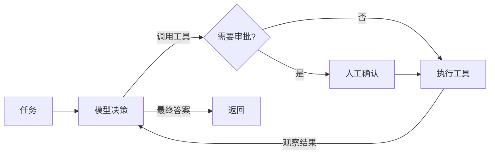

# 智能体 {#agents}

> [AI](../) › 智能体

模型在循环里选择工具时，才需要 Agent。步骤和顺序事先写得死，用工作流。这一页用来判断循环该何时把工具错误交回去、何时用预算停掉，以及一次审批到底批准了哪一组参数。

> 相关主题：[LLM API 编程模式](../06-llm-api-programming/) · [MCP 协议与开发](../10-mcp/) · [安全与治理](../19-security-governance/)

> [!NOTE]
> 本仓库和站点的内容由 AI 生成，资料与资源链接来源于网络，仅供学习参考；如有错误或侵权，请提 Issue 告知。

## 这一页补哪一块 {#_1}

工作流把分支写在代码里，Agent 把下一步交给模型。工具返回的错误是一条观察，通常要回填，让模型改参数或换工具。步数、Token 预算和截止时间是另一类停止：模型还想再试，循环也停。多 Agent 会把同一份上下文再付一次钱，并把轨迹拆开。审批必须绑住这次调用的工具名和参数，而且来自模型外面的人或策略服务。

## 工作流还是 Agent {#agent}

<span id="_2"></span>

- 工作流：每一步和顺序在模型运行前就定了。查订单、对状态、填一句政策说明，都是代码调用。模型只填一个槽。延迟、费用和审计都按这条路径估算。
- Agent：下一步工具取决于上一步返回，分支表写不全。灵活的代价是模型可能选到有副作用的工具，错一次比写错一句话更贵。
- 能用固定流程解决就不要上 Agent。先从单 Agent 加少量工具开始。



图里的审批菱形必须发生在工具执行之前。确认的内容是这一次的工具名和参数，不是模型自己写的「我已获批准」。

## 常见设计模式 {#_4}

- ReAct：思考、调用工具、读观察，直到给出答案。多数框架的默认循环是这一形。
- Plan-and-Execute：先写出计划再逐步执行。步骤多、但还能预先拆开时有用。计划本身不是审批。
- Reflection：生成后再评一次、改一次。适合写作和代码这类能检查的产出，不适合代替退款前的人审。
- Router：先分类，再交给写死的分支。分类后面的路径是工作流，不是第二个 Agent。
- Orchestrator-Workers：编排者拆任务，工人分别做，再汇总。每个工人拿到一份上下文副本，同一段资料会再付一次 Token。编排者的摘要可能丢掉工人需要的约束。轨迹要靠关联 ID 才能拼回去。一个 Agent 加工具能完成时，不要拆。

## 循环骨架 {#_5}

下面用脚本化的假模型演示 Agent 循环必须具备的护栏，在编写时实际运行：

这段是标准库脚本，按固定顺序返回工具调用，不下载模型。2026-11-25 的离线重跑只复核打印，输出块仍是编写时的原文，没有改写。

```python
import json

# 用脚本化的「假模型」演示 Agent 循环骨架：真实项目里 fake_llm 换成 06 关的 API 调用
SCRIPT = [
    {"tool": "search_orders", "args": {"user": "u42"}},
    {"tool": "refund", "args": {"order_id": "A1001", "amount": 3000}},
    {"final": "已为订单 A1001 发起退款 3000 元。"},
]


def fake_llm(history: list[dict]) -> dict:
    return SCRIPT[sum(1 for h in history if h["role"] == "tool")]


def search_orders(user: str) -> list[dict]:
    return [{"order_id": "A1001", "status": "未发货", "amount": 3000}]


def refund(order_id: str, amount: int) -> str:
    return f"refund_ok:{order_id}"


TOOLS = {"search_orders": search_orders, "refund": refund}
NEEDS_APPROVAL = {"refund"}                      # 有副作用的工具需要人工审批


def run_agent(task: str, approve, max_steps: int = 5) -> str:
    history = [{"role": "user", "content": task}]
    for step in range(max_steps):                # 终止条件一：步数上限
        action = fake_llm(history)
        if "final" in action:                    # 终止条件二：模型给出最终答案
            return action["final"]
        name, args = action["tool"], action["args"]
        if name not in TOOLS:                    # 白名单之外的工具一律拒绝
            result = f"error: unknown tool {name}"
        elif name in NEEDS_APPROVAL and not approve(name, args):
            result = "error: 用户拒绝了该操作"
        else:
            result = TOOLS[name](**args)
        print(f"step {step}: {name}({json.dumps(args, ensure_ascii=False)}) -> {result}")
        history.append({"role": "tool", "content": json.dumps(result, ensure_ascii=False)})
    return "超过最大步数，已停止"


print(run_agent("帮我把没发货的订单退款", approve=lambda name, args: args["amount"] <= 5000))
```

编写时的输出：

```text
step 0: search_orders({"user": "u42"}) -> [{'order_id': 'A1001', 'status': '未发货', 'amount': 3000}]
step 1: refund({"order_id": "A1001", "amount": 3000}) -> refund_ok:A1001
已为订单 A1001 发起退款 3000 元。
```

假模型不会自己做决定。这段脚本说明三件事。工具结果，包括错误字符串，作为观察回到下一轮。金额阈值由 `approve` 回调检查，未通过则返回 `error: 用户拒绝了该操作` 且不调用 `refund`；`refund` 本体是直接返回 `refund_ok` 的模拟桩，本例 3000 走获批分支，不代表真实退款服务或完整权限。示例的停止条件是模型不再发起工具调用。生产里还要有步数、Token 或费用上限，以及截止时间。这三样会在模型仍想继续时切断循环。工具报错和预算耗尽不是同一种退出。

同一形状的 Java 对照把批准写死了：

```java
class RefundScript {
    public static void main(String[] args) {
        String[][] script = {
            {"search_orders", "{\"user\": \"u42\"}"},
            {"refund", "{\"order_id\": \"A1001\", \"amount\": 3000}"}
        };
        String[] results = {
            "[{'order_id': 'A1001', 'status': '未发货', 'amount': 3000}]",
            "refund_ok:A1001"
        };
        int tools = 0;
        for (int step = 0; step < 5; step++) {
            if (tools == script.length) {
                System.out.println("已为订单 A1001 发起退款 3000 元。");
                return;
            }
            String name = script[tools][0];
            boolean approve = true;
            String result = name.equals("refund") && !approve ? "error: 用户拒绝了该操作" : results[tools];
            System.out.println("step " + step + ": " + name + "(" + script[tools][1] + ") -> " + result);
            tools++;
        }
    }
}
```

`boolean approve = true` 写在循环里面，下面的拒绝分支到不了。这不是权限实现，也没有读任何外部决定。批准必须来自模型之外的人或策略服务。执行前，运行器要把即将发出的工具名和参数与已经批准的那一组比对。批准订单 A1001、金额 3000，不能拿去执行另一笔金额或另一张订单。参数变了就是一次新的审批。

循环至少还要能在这些地方停：模型给出最终答案、步数上限、Token 或费用上限、超时。有副作用的工具（退款、发邮件、删数据）在执行前等外部批准，或只在沙箱里跑。工具出错时把错误回填给模型，让它有机会改；不要把第一次错误当成循环崩溃。回填不等于无限重试，预算到了就停。

## OpenAI Agents SDK {#openai-agents-sdk}

其他框架的循环形状相同。Claude Agent SDK 把 Claude Code 的循环开放成库。Google ADK 有 Python 与 Java。Microsoft Agent Framework 是 AutoGen 与 Semantic Kernel 的后继。CrewAI 按角色和任务组织多 Agent。需要显式状态图时用 LangGraph，见 [应用开发框架](../07-app-frameworks/)。

> [!NOTE]
> 本示例在编写时连接本地模拟服务运行（返回固定的工具调用和回答），用来验证 SDK 用法；换成真实 API Key 后模型措辞会不同。

围栏里的模型名 `gpt-6-luna` 是该示例的字符串。2026-11-25 没有安装这个 SDK，没有跑 CLI，也没有换真实 API Key。输出块保持原文。

```python
from agents import Agent, Runner, function_tool, set_tracing_disabled

set_tracing_disabled(True)   # 示例不上报 Trace；生产中可保留默认的 Tracing


@function_tool
def get_weather(city: str) -> dict:
    """查询城市当前气温。"""
    return {"city": city, "temp_c": 21}


agent = Agent(
    name="天气助手",
    instructions="你是简洁的中文助手，需要数据时调用工具。",
    model="gpt-6-luna",
    tools=[get_weather],
)
result = Runner.run_sync(agent, "北京现在多少度？", max_turns=5)
print(result.final_output)
print([type(item).__name__ for item in result.new_items])
```

编写时的输出：

```text
北京现在 21°C。
['ToolCallItem', 'ToolCallOutputItem', 'MessageOutputItem']
```

`max_turns` 是这个 SDK 调用上的步数上限。它切断的是循环，不是工具错误的回填。追踪在示例里关掉了；生产要留下每一步的工具名、参数和结果，见 [评测与可观测](../17-evals-observability/)。

## 记忆 {#_6}

短期记忆是当前会话的消息，受窗口限制，要截断或摘要，见 [提示词与上下文工程](../05-prompt-context/)。长期记忆是跨会话的偏好和事实，放进向量库或结构化存储，按需取回。记忆要能查看、能删除。一条错误记忆会在以后每次对话里继续误导模型。记忆不是审批记录，也不能充当租户隔离。

## 多 Agent 与 A2A {#agent-a2a}

协作可以是主从、交接或群聊。交接把整段对话交给另一个 Agent，上下文通常要再送一遍。主从还要为编排者的汇总再付一次生成。调试时轨迹被拆到多个进程，没有关联 ID 就拼不回「是谁在哪一步改了参数」。

A2A（Agent2Agent）解决跨团队、跨厂商的 Agent 互通。Agent 在 `/.well-known/agent-card.json` 发布 Agent Card，声明能力与技能。调用方用 `SendMessage` 等操作创建任务。任务会经过 `TASK_STATE_SUBMITTED`、`TASK_STATE_WORKING`、`TASK_STATE_INPUT_REQUIRED`、`TASK_STATE_COMPLETED` 等状态。MCP 连接 Agent 与工具或数据，A2A 连接 Agent 与 Agent。多一个远程 Agent，就多一份上下文拷贝和一条需要拼接的轨迹。

一个最小的 Agent Card（字段取自 A2A 规范示例）：

```json
{
  "name": "Refund Agent",
  "description": "处理电商订单退款申请。",
  "supportedInterfaces": [
    {
      "url": "https://agents.example.com/a2a/v1",
      "protocolBinding": "JSONRPC",
      "protocolVersion": "1.0"
    }
  ],
  "version": "1.0.0",
  "capabilities": { "streaming": true, "pushNotifications": false },
  "defaultInputModes": ["text/plain"],
  "defaultOutputModes": ["text/plain"],
  "skills": [
    { "id": "refund", "name": "Refund", "description": "按订单号发起退款。", "tags": ["refund"] }
  ]
}
```

## 从循环到可恢复的执行 {#_7}

状态图记下的不只是聊天，还应有目标、已完成步骤、工具调用 ID、审批状态、预算和结果引用。Checkpoint 恢复会重放部分代码。持久化不会自动变成外部副作用的 exactly-once。

发消息、退款、写库要包成独立任务。执行前检查业务幂等键，成功后保存结果。超时但远端可能已经成功时，先查询状态，不能让模型自行再试一次。

审批绑住的是具体工具名、规范化之后的参数、资源版本、用户或租户，以及期限。参数变了，或资源状态变了，就要重新校验。批准 A 却执行 B，就是这组绑定没做。审批记录和模型自己写的「已获批准」不是同一回事。

长任务交给 [消息队列](../../microservices/06-messaging/) 和持久化 worker，入口返回任务 ID，并提供查询、取消和人工接管。取消是业务状态，不表示已经发生的副作用都能回滚。

## 发现不是信任 {#a2a}

2026-11-25 打开的 [A2A 规范页](https://a2a-protocol.org/latest/specification/) 首行写的是 Latest Released Version `1.0.0`。页上示例使用 `protocolVersion` `"1.0"`，以及请求头 `A2A-Version: 1.0`。下面表格里的 GitHub `v1.0.1` 和 `a2a-sdk` 1.3.0 是 2026-11-04 至 2026-11-05 的快照。2026-11-25 没有重开这个 GitHub tag，不把 1.0.1 写成当天核对过的当前版本。

Agent Card 声明能力、协议和认证方式，不证明对方是谁，也不授予权限。服务端按任务、数据和操作检查访问权。出站调用带的是已经验证过的用户和租户，不采信模型生成的身份字段。异步事件、结果和 webhook 都按不可信输入处理。认证和工具的最小权限见 [安全与治理](../19-security-governance/)。

## 框架怎么选 {#agent-choice}

<span id="_8"></span>

版本是 2026-11-04 至 2026-11-05 的核对记录。2026-11-25 没有重开这些发布页。

| 框架 / 协议 | 版本（2026-11-04 至 11-05 记录） | 语言 | 特点 |
|-------------|----------------------------------|------|------|
| OpenAI Agents SDK | `openai-agents` 0.24.0、`@openai/agents` 0.21.0 | Python / TS | 轻量，Handoff、Guardrails、Tracing 内置 |
| Claude Agent SDK | `claude-agent-sdk` 0.2.178、`@anthropic-ai/claude-agent-sdk` 0.3.318 | Python / TS | 复用 Claude Code 的循环、工具与权限机制 |
| Google ADK | Python 2.13.0、Java `google-adk` 1.14.0 | Python / Java | 多 Agent 层级编排，对接 Gemini 与 Vertex |
| Microsoft Agent Framework | python-1.24.0、dotnet-1.27.0 | Python / .NET | AutoGen 与 Semantic Kernel 的后继 |
| CrewAI | 1.15.35 | Python | 角色加任务的多 Agent 编排 |
| LangGraph | 1.2.20 | Python / JS | 显式状态图、持久化与中断 |
| A2A 协议 | 当时记下规范 v1.0.1，`a2a-sdk` 1.3.0 | 协议 | 跨厂商 Agent 互通；2026-11-25 只重开了规范页上的 1.0.0 |

> [!WARNING]
> 上表不是 2026-11-25 的当前版本。Agent 框架变得快，升级前读变更日志。2026-11-25 只确认规范页写着 Latest Released Version `1.0.0`。GitHub tag 未重开。规范要求 Agent Card 里写 `1.0` 这样的主次版本号；围栏里的 `"protocolVersion": "1.0"` 与此一致，没有改成 1.0.1。

## 常见误读 {#_3}

<span id="_9"></span>

- 什么任务都上 Agent：步骤固定、要审计、要卡住延迟时，工作流更合适。
- 工具一报错就结束循环：错误文本应回填。该停的是步数、费用和超时。
- 多 Agent 更聪明：每一跳都复制上下文、增加工具调用，并把轨迹拆开。
- 模型写出「已批准」就算审批：批准要来自外部，并绑住工具名和这一次的参数。
- Java 示例里的 `approve = true` 是权限系统：那是写死的常量，拒绝分支不会执行。
- 把表里的 A2A 1.0.1 当成 2026-11-25 核对过的当前 tag：当天只重开了规范页上的 1.0.0。

## 可选核对 {#agent-check}

<span id="_10"></span>

1. 工具返回错误时，为什么通常要把错误回填，而不是立刻结束循环？什么情况才该停？
2. 退款状态查询的步骤是固定的。为什么用工作流？若随后要执行退款，审批至少要绑住哪些参数？

<details markdown><summary>参考答案</summary>

1. 错误字符串是一条观察。模型可以据此改参数或换工具，例如金额超限后缩小金额或停在查询。立刻终止会丢掉这次改正。该停的是另一类条件：步数、Token 或费用预算、截止时间。这些条件在模型还想继续时也要切断循环。
2. 查订单、对状态、填说明在运行前就定了顺序，代码直接调用即可，不必让模型选择下一步。退款有副作用。审批要记下工具名、订单号、金额、资源版本和租户。换一笔金额就是一次新审批。模型自己写的批准，以及示例里写死的 `approve = true`，都不是这套外部决定。

</details>

<span id="_12"></span>

## 资料索引 {#_11}

- [Building effective agents](https://www.anthropic.com/engineering/building-effective-agents) — Anthropic 的工作流与 Agent 设计模式
- [ReAct 论文](https://arxiv.org/abs/2210.03629) — 推理与行动交替的 Agent 范式
- [OpenAI Agents SDK](https://openai.github.io/openai-agents-python/) — Agent、Handoff、Guardrails 与 Tracing
- [Claude Agent SDK](https://code.claude.com/docs/en/agent-sdk/overview) — 基于 Claude Code 的 Agent 开发库
- [Google ADK 文档](https://google.github.io/adk-docs/) — Agent Development Kit
- [A2A 协议规范](https://a2a-protocol.org/latest/specification/) — 2026-11-25 打开，页首为 Latest Released Version 1.0.0
- [LangGraph 持久执行](https://docs.langchain.com/oss/python/langgraph/durable-execution) — 重放、任务与幂等副作用
- [A2A 企业级安全](https://a2a-protocol.org/latest/topics/enterprise-ready/) — 认证、授权与 Agent Card 的边界
- [A2A 异步与流式操作](https://a2a-protocol.org/latest/topics/streaming-and-async/) — 任务、产物与 push notification

---

← [上一节：检索增强生成](../08-rag/) · [返回 AI](../) · [下一节：MCP 协议与开发](../10-mcp/) →
