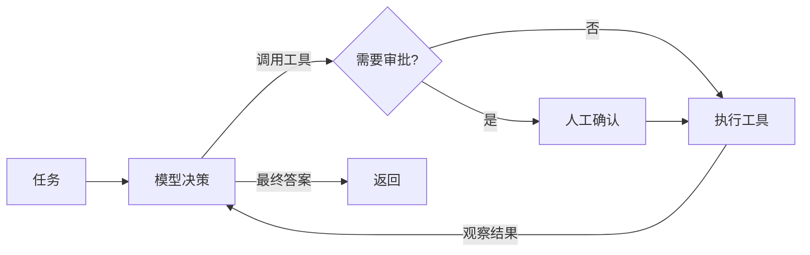

# 智能体 Agents

> [AI](../) › 智能体

Agent 等于 LLM 加工具、循环、记忆与规划。本关讲 Agent 设计模式、终止与人工审批、记忆、多 Agent 协作与 A2A 协议，以及主流框架；MCP 见第 10 关，编程类 Agent 见第 12 关。

> 相关主题：[LLM API 编程模式](../06-llm-api-programming/) · [MCP 协议与开发](../10-mcp/) · [安全与治理](../19-security-governance/)

## 本关定位

| 项 | 内容 |
|----|------|
| 定位 | 第二章应用工程：从「一问一答」走到「自主多步完成任务」 |
| 前置要求 | [LLM API 编程模式](../06-llm-api-programming/)（工具循环）、[应用开发框架](../07-app-frameworks/) |
| 粗略用时 | 2 周（粗略参考） |
| 章节 | 第二章 应用工程 |

## 闯关任务

**QUEST 09 · 第二章 应用工程**

- [ ] 能够区分工作流（Workflow）与 Agent，并说出 ReAct、Plan-and-Execute、Reflection、Router、Orchestrator-Workers 的适用场景。
- [ ] 能够为 Agent 循环设计终止条件、工具白名单和人工审批（HITL）。
- [ ] 能够区分短期记忆与长期记忆，并说明上下文压缩的做法。
- [ ] 能够用 OpenAI Agents SDK 等框架实现带工具的 Agent，并读懂运行记录。
- [ ] 能够说明 A2A 协议中 Agent Card 与任务生命周期的作用，以及它与 MCP 的分工。

**奖励**：+100 XP · 徽章「智能体指挥官」（徽章名暂定，内容建设中）

## 知识要点

### 工作流还是 Agent

- 工作流：步骤由代码预先编排，LLM 只负责其中某些节点，可预测、易测试。
- Agent：由模型在循环中决定下一步调用什么工具、何时结束，灵活但成本与风险更高。
- 经验法则：能用固定流程解决就不要上 Agent；先从单 Agent 加少量工具开始。

### 常见设计模式

- ReAct：思考 → 行动（调用工具）→ 观察结果，循环直到得出答案，是多数 Agent 框架的默认循环。
- Plan-and-Execute：先生成计划再逐步执行，适合步骤多、可预先拆分的任务。
- Reflection：生成后让模型（或另一个模型）自评并修改，适合写作、代码等可检查的产出。
- Router：先分类再交给专门的处理分支。
- Orchestrator-Workers：编排者动态拆分子任务交给多个 Worker，再汇总结果。



### 循环骨架：终止条件、白名单与审批

下面用脚本化的假模型演示 Agent 循环必须具备的护栏，在编写时实际运行：

```python
import json

# 用脚本化的「假模型」演示 Agent 循环骨架：真实项目里 fake_llm 换成 06 关的 API 调用
SCRIPT = [
    {"tool": "search_orders", "args": {"user": "u42"}},
    {"tool": "refund", "args": {"order_id": "A1001", "amount": 3000}},
    {"final": "已为订单 A1001 发起退款 3000 元。"},
]


def fake_llm(history: list[dict]) -> dict:
    return SCRIPT[sum(1 for h in history if h["role"] == "tool")]


def search_orders(user: str) -> list[dict]:
    return [{"order_id": "A1001", "status": "未发货", "amount": 3000}]


def refund(order_id: str, amount: int) -> str:
    return f"refund_ok:{order_id}"


TOOLS = {"search_orders": search_orders, "refund": refund}
NEEDS_APPROVAL = {"refund"}                      # 有副作用的工具需要人工审批


def run_agent(task: str, approve, max_steps: int = 5) -> str:
    history = [{"role": "user", "content": task}]
    for step in range(max_steps):                # 终止条件一：步数上限
        action = fake_llm(history)
        if "final" in action:                    # 终止条件二：模型给出最终答案
            return action["final"]
        name, args = action["tool"], action["args"]
        if name not in TOOLS:                    # 白名单之外的工具一律拒绝
            result = f"error: unknown tool {name}"
        elif name in NEEDS_APPROVAL and not approve(name, args):
            result = "error: 用户拒绝了该操作"
        else:
            result = TOOLS[name](**args)
        print(f"step {step}: {name}({json.dumps(args, ensure_ascii=False)}) -> {result}")
        history.append({"role": "tool", "content": json.dumps(result, ensure_ascii=False)})
    return "超过最大步数，已停止"


print(run_agent("帮我把没发货的订单退款", approve=lambda name, args: args["amount"] <= 5000))
```

运行输出：

```text
step 0: search_orders({"user": "u42"}) -> [{'order_id': 'A1001', 'status': '未发货', 'amount': 3000}]
step 1: refund({"order_id": "A1001", "amount": 3000}) -> refund_ok:A1001
已为订单 A1001 发起退款 3000 元。
```

- 终止条件至少包括：模型给出最终答案、步数上限、Token 或费用上限、超时。
- 有副作用的工具（退款、发邮件、删数据）需要人工审批，或在沙箱中执行。
- 工具出错时把错误信息回填给模型，让它有机会改正，而不是让整个循环崩溃。

### 用框架实现：OpenAI Agents SDK

> [!NOTE]
> 本示例在编写时连接本地模拟服务运行（返回固定的工具调用和回答），用来验证 SDK 用法；换成真实 API Key 后模型措辞会不同。

```python
from agents import Agent, Runner, function_tool, set_tracing_disabled

set_tracing_disabled(True)   # 示例不上报 Trace；生产中可保留默认的 Tracing


@function_tool
def get_weather(city: str) -> dict:
    """查询城市当前气温。"""
    return {"city": city, "temp_c": 21}


agent = Agent(
    name="天气助手",
    instructions="你是简洁的中文助手，需要数据时调用工具。",
    model="gpt-6-luna",
    tools=[get_weather],
)
result = Runner.run_sync(agent, "北京现在多少度？", max_turns=5)
print(result.final_output)
print([type(item).__name__ for item in result.new_items])
```

运行输出：

```text
北京现在 21°C。
['ToolCallItem', 'ToolCallOutputItem', 'MessageOutputItem']
```

其他框架的思路相同：Claude Agent SDK 把 Claude Code 的 Agent 循环开放成库；Google ADK 提供 Python 与 Java 版本；Microsoft Agent Framework 是 AutoGen 与 Semantic Kernel 的后继；CrewAI 以角色和任务组织多 Agent；LangGraph 适合需要显式状态图的场景（见 [应用开发框架](../07-app-frameworks/)）。

### 记忆

- 短期记忆：当前会话的消息历史，受上下文窗口限制，需要截断或摘要压缩（见 [提示词与上下文工程](../05-prompt-context/)）。
- 长期记忆：跨会话保存的用户偏好、事实与经验，存进向量库或结构化存储，按需检索回上下文。
- 记忆要可查看、可删除：错误的记忆会在后续每次对话中持续误导模型。

### 多 Agent 与 A2A

- 协作方式：主从（Supervisor 调度子 Agent）、交接（Handoff，把对话整体转交给另一个 Agent）、群聊。
- 何时不用多 Agent：任务能由单 Agent 加工具完成时，多 Agent 只会增加 Token 消耗和调试难度。
- A2A（Agent2Agent）协议解决跨团队、跨厂商的 Agent 互通：Agent 在 `/.well-known/agent-card.json` 发布 Agent Card，声明能力与技能；调用方通过 `SendMessage` 等操作创建任务，任务经历 `TASK_STATE_SUBMITTED`、`TASK_STATE_WORKING`、`TASK_STATE_INPUT_REQUIRED`、`TASK_STATE_COMPLETED` 等状态。
- 分工：MCP 连接 Agent 与工具 / 数据，A2A 连接 Agent 与 Agent。

一个最小的 Agent Card（字段取自 A2A 规范示例）：

```json
{
  "name": "Refund Agent",
  "description": "处理电商订单退款申请。",
  "supportedInterfaces": [
    {
      "url": "https://agents.example.com/a2a/v1",
      "protocolBinding": "JSONRPC",
      "protocolVersion": "1.0"
    }
  ],
  "version": "1.0.0",
  "capabilities": { "streaming": true, "pushNotifications": false },
  "defaultInputModes": ["text/plain"],
  "defaultOutputModes": ["text/plain"],
  "skills": [
    { "id": "refund", "name": "Refund", "description": "按订单号发起退款。", "tags": ["refund"] }
  ]
}
```

### 从循环到可恢复的业务执行

- 状态图记录的不只是聊天：还应包含目标、已完成步骤、工具调用 ID、审批状态、预算和结果引用。Checkpoint 恢复会重放部分代码，持久化并不自动带来 exactly-once 外部副作用。
- 将发消息、退款、写库等操作封装为独立任务；执行前检查业务幂等键，成功后保存结果。超时但远端可能成功时先查询状态，不能让模型自行「再试一次」。
- 审批绑定具体工具名、规范化参数、资源版本、用户 / 租户、期限；参数改变或资源状态变化后重新校验，避免批准 A 实际执行 B。审批记录和模型自己写的「已获批准」不是同一回事。
- 把长任务交给 [消息队列](../../microservices/06-messaging/) 和持久化 worker，入口返回任务 ID；提供查询、取消与人工接管。任务的取消是业务状态，不代表所有已发生副作用可回滚。

### A2A 发现不等于信任

Agent Card 声明能力、协议和认证方式，不证明服务身份或授权。服务端逐任务 / 数据 / 操作检查访问权，出站调用保留经过验证的用户与租户上下文，不能采信模型生成的身份字段。异步事件、结果产物和 webhook 都按不可信输入处理；认证、重放保护与工具最小权限见 [安全与治理](../19-security-governance/)，协议工具接入见 [MCP](../10-mcp/)。

## 选型对比

| 框架 / 协议 | 版本（2026-11） | 语言 | 特点 |
|-------------|-----------------|------|------|
| OpenAI Agents SDK | `openai-agents` 0.24.0、`@openai/agents` 0.21.0 | Python / TS | 轻量，Handoff、Guardrails、Tracing 内置 |
| Claude Agent SDK | `claude-agent-sdk` 0.2.178、`@anthropic-ai/claude-agent-sdk` 0.3.318 | Python / TS | 复用 Claude Code 的循环、工具与权限机制 |
| Google ADK | Python 2.13.0、Java `google-adk` 1.14.0 | Python / Java | 多 Agent 层级编排，对接 Gemini 与 Vertex |
| Microsoft Agent Framework | python-1.24.0、dotnet-1.27.0 | Python / .NET | AutoGen 与 Semantic Kernel 的后继 |
| CrewAI | 1.15.35 | Python | 角色加任务的多 Agent 编排 |
| LangGraph | 1.2.20 | Python / JS | 显式状态图、持久化与中断 |
| A2A 协议 | 规范 v1.0.1，`a2a-sdk` 1.3.0 | 协议 | 跨厂商 Agent 互通 |

> [!WARNING]
> 版本以 2026-11-04 至 2026-11-05 核对为准，Agent 框架迭代极快，升级前先读变更日志。A2A 规范页标注的最新版本为 1.0.0，GitHub 发布为 v1.0.1；规范规定补丁号不影响协议兼容，Agent Card 中只写 `1.0` 这样的主次版本号。

## 常见误区

- 一上来就做多 Agent：多数任务单 Agent 加好工具就够了，多 Agent 让成本和调试难度成倍增加。
- 没有步数和费用上限：模型在两个工具之间反复横跳时会持续烧钱。
- 有副作用的工具不经审批：提示注入（网页、邮件、文档里的恶意指令）可以诱导 Agent 执行危险操作，见 [安全与治理](../19-security-governance/)。
- 工具描述写得含糊：模型靠名称和描述决定何时调用，描述应说明用途、参数含义和返回格式。
- 把所有工具一次性塞给模型：几十个工具会降低选择准确率，应按场景动态筛选或分给子 Agent。
- 不保存运行轨迹：出错后无法复盘，应记录每一步的输入、工具调用和结果（见 [评测与可观测](../17-evals-observability/)）。

## 实践任务

- 把本页的循环骨架接上真实模型（06 关的工具循环），加入 Token 上限与超时两种终止条件。
- 用 OpenAI Agents SDK 或 Claude Agent SDK 实现「客服分诊 Agent → 退款 Agent / 物流 Agent」的 Handoff，并打印运行记录。
- 为退款工具加上审批：金额超过阈值时暂停，等待命令行输入确认后继续。
- 为你的 Agent 写一份 Agent Card，并说明哪些能力适合通过 A2A 暴露给其他团队。

## 资料索引

- [Building effective agents](https://www.anthropic.com/engineering/building-effective-agents) — Anthropic 的工作流与 Agent 设计模式
- [ReAct 论文](https://arxiv.org/abs/2210.03629) — 推理与行动交替的 Agent 范式
- [OpenAI Agents SDK](https://openai.github.io/openai-agents-python/) — Agent、Handoff、Guardrails 与 Tracing
- [Claude Agent SDK](https://code.claude.com/docs/en/agent-sdk/overview) — 基于 Claude Code 的 Agent 开发库
- [Google ADK 文档](https://google.github.io/adk-docs/) — Agent Development Kit
- [A2A 协议规范](https://a2a-protocol.org/latest/specification/) — Agent Card、任务生命周期与传输绑定
- [LangGraph 持久执行](https://docs.langchain.com/oss/python/langgraph/durable-execution) — 重放、任务与幂等副作用
- [A2A 企业级安全](https://a2a-protocol.org/latest/topics/enterprise-ready/) — 认证、授权与 Agent Card 的边界
- [A2A 异步与流式操作](https://a2a-protocol.org/latest/topics/streaming-and-async/) — 任务、产物与 push notification

## 通关自测

先独立作答，再展开参考答案核对；简答题答出要点即算对。答对 ≥ 80% 即可进入下一关。

1. 【单选】以下哪一项不是 Agent 循环的合理终止条件？
    - A. 模型给出最终答案
    - B. 达到最大步数
    - C. 达到费用上限
    - D. 工具第一次返回错误
2. 【单选】A2A 协议主要解决的问题是：
    - A. Agent 访问本地文件
    - B. 不同团队、厂商的 Agent 之间发现与协作
    - C. 模型量化
    - D. 向量检索
3. 【单选】「先对请求分类，再交给专门的处理分支」对应的模式是：
    - A. Router
    - B. Reflection
    - C. ReAct
    - D. Plan-and-Execute
4. 【简答】什么情况下应该用工作流而不是 Agent？
5. 【简答】一个能发邮件、能读网页的 Agent 存在什么风险？列出至少两条防护措施。

<details markdown><summary>参考答案</summary>

1. D — 工具出错应把错误回填给模型让它改正，而不是直接终止。
2. B — A2A 通过 Agent Card 发现能力、通过任务生命周期协作；连接工具和数据是 MCP 的职责。
3. A — Router 先分类再路由到专门的分支。
4. 步骤固定、可预先编排，对可预测性、延迟和成本要求高，或需要严格审计时，用代码编排的工作流更合适。
5. 风险：网页中的提示注入诱导 Agent 把隐私数据发出去。措施：发邮件需人工审批；限定收件人白名单；读取的外部内容按不可信数据处理；最小权限；记录完整运行轨迹。答出两条即可。

</details>

---

← [上一节：检索增强生成](../08-rag/) · [返回 AI](../) · [下一节：MCP 协议与开发](../10-mcp/) →
