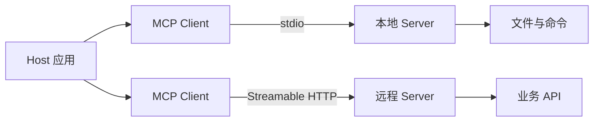

# MCP 协议与开发 {#mcp-model-context-protocol}

> [AI](../) › MCP 协议与开发

MCP 把工具、资源和提示词模板做成可复用的服务器。协议修订号回答消息怎么写，SDK 版本号回答哪一个库实现了它。发现文档和工具注解都不是授权。stdio 上把日志写进协议流，和 HTTP 上还没有鉴权，是两条不同的边界。

> 相关主题：[智能体](../09-agents/) · [LLM API 编程模式](../06-llm-api-programming/) · [API 网关](../../microservices/02-api-gateway/)

> [!NOTE]
> 本仓库和站点的内容由 AI 生成，资料与资源链接来源于网络，仅供学习参考；如有错误或侵权，请提 Issue 告知。

## 这一页补哪一块 {#_1}

2026-11-25 重开的是规范总览和传输页，不是整份 SDK 表，也不是安全页或 Tools 页的每一节。能直接引用的边界是：请求如何自包含、扩展如何被发现、stdio 与 Streamable HTTP 各承担什么、注解为什么不能当成批准。`ping`、Sampling 等旧修订细节没有在当天重开，下面会单独标出来。

## 架构与能力 {#_4}

<span id="_2"></span>



- Host 是用户使用的应用（IDE、Claude Code、自研 Agent）。每连一个 Server 就有一个 Client。
- 2026-11-25 打开的 [2026-07-28 总览](https://modelcontextprotocol.io/specification/2026-07-28) 写的是 JSON-RPC 2.0。请求无状态、自包含。能力按请求协商。Server 提供 Resources、Prompts、Tools。扩展通过每次请求里的客户端能力，以及服务器的 `server/discover` 结果来协商。
- 同一天打开的传输页写明：传输是 stdio 和 Streamable HTTP。服务器不主动发起 JSON-RPC 请求。协议元数据放在消息体里，键名在 `_meta.io.modelcontextprotocol/*` 下。更早的修订使用 `initialize`，并允许服务器发起请求。
- 总览的 Tool Safety 写明：descriptions of tool behavior such as annotations should be considered untrusted, unless obtained from a trusted server。紧接着要求 Host 在调用任何工具前取得用户的明确同意。

一次工具调用的请求大致如下（省略了客户端能力等 `_meta` 字段）。围栏里的 `protocolVersion` 仍是 `2026-07-28`：

```json
{
  "jsonrpc": "2.0",
  "id": 1,
  "method": "tools/call",
  "params": {
    "name": "add",
    "arguments": { "a": 1, "b": 2 },
    "_meta": { "io.modelcontextprotocol/protocolVersion": "2026-07-28" }
  }
}
```

本章原先还记下：2026-07-28 去掉 `initialize` 握手和 `Mcp-Session-Id`，用多轮往返（结果里的 `resultType: "input_required"`）取代服务器主动发起的 `sampling/createMessage`、`elicitation/create`、`roots/list`，并把 Roots、Sampling、Logging 标为弃用，移除 `ping` 和 `logging/setLevel`。这些句子是原先对那一版的记录。2026-11-25 没有重开对应小节，不能把它们当成当天新核对的结论。当天能确认的是上面总览和传输页里的那些原句。

## 用 Python 写 Server {#python-server}

Python 官方 SDK 2.x 里，原来的 `FastMCP` 更名为 `MCPServer`。下面的示例在编写时实际运行，进程内连接协商到的协议版本为 `2026-07-28`。那是编写时的运行注记。2026-11-25 没有安装 `mcp` 包，也没有重跑这段服务器。表里的 `mcp` 2.3.0 仍是 2026-11 的快照，不是当天重开 PyPI 的结果。

```python
import asyncio

from mcp import Client
from mcp.server.mcpserver import MCPServer

mcp = MCPServer("notes")


@mcp.tool()
def add(a: int, b: int) -> int:
    """两个整数相加。"""
    return a + b


@mcp.resource("notes://{name}")
def note(name: str) -> str:
    """按名称读取一条笔记。"""
    return f"这是笔记 {name}"


@mcp.prompt()
def review(code: str) -> str:
    """生成代码评审提示词。"""
    return f"请评审下面的代码，指出缺陷和改进建议：\n{code}"


async def main() -> None:
    async with Client(mcp) as client:            # 测试时可在进程内直接连接
        tools = await client.list_tools()
        print("tools:", [t.name for t in tools.tools])
        result = await client.call_tool("add", {"a": 1, "b": 2})
        print("add:", result.content[0].text, result.structured_content)
        res = await client.read_resource("notes://mcp")
        print("resource:", res.contents[0].text)
        prompts = await client.list_prompts()
        print("prompts:", [p.name for p in prompts.prompts])


if __name__ == "__main__":
    asyncio.run(main())   # 作为真正的 Server 运行时改为 mcp.run()（默认 stdio 传输）
```

编写时的输出：

```text
tools: ['add']
add: 3 {'result': 3}
resource: 这是笔记 mcp
prompts: ['review']
```

## 用 TypeScript 写 Server {#typescript-server}

TypeScript SDK 的包名和版本见下面的日期表。2026-11-25 没有重开 npm，也没有运行这段代码。

```typescript
import { McpServer } from '@modelcontextprotocol/server';
import { StdioServerTransport } from '@modelcontextprotocol/server/stdio';
import { z } from 'zod';

const server = new McpServer({ name: 'demo', version: '1.0.0' });

server.registerTool(
  'add',
  {
    description: '两个整数相加',
    inputSchema: z.object({ a: z.number(), b: z.number() }),
    outputSchema: z.object({ result: z.number() }),
  },
  async ({ a, b }) => {
    const output = { result: a + b };
    return { content: [{ type: 'text', text: String(output.result) }], structuredContent: output };
  },
);

await server.connect(new StdioServerTransport());
console.error('demo server ready');   // stdio 传输下日志只能写 stderr
```

## 接入 Host {#host}

Host 的配置告诉客户端如何启动或连接 Server。stdio 项是一条本地命令。HTTP 项是一个 URL。两种配置都还不是授权。

```json
{
  "mcpServers": {
    "notes": {
      "command": "python",
      "args": ["server.py"]
    }
  }
}
```

Spring 侧把同一个 Server 配进 MCP client。这段 YAML 是接线示例，不是一次已经鉴权的部署。

```yaml
spring:
  ai:
    mcp:
      client:
        stdio:
          connections:
            notes:
              command: python
              args:
                - server.py
        streamable-http:
          connections:
            orders:
              url: http://localhost:8080
```

MCP 工具不会自动注册到 `ChatClient`，需要显式注入（未在本机编译）：

依赖坐标：BOM `org.springframework.ai:spring-ai-bom:2.0.2`，`org.springframework.ai:spring-ai-starter-mcp-client-webflux:2.0.2`、`org.springframework.ai:spring-ai-starter-model-openai:2.0.2`；JDK 21 / Boot 4.1.2。路径 `src/main/java/example/ai/McpOrderService.java`，由调用方传入已初始化、已授权的 provider 与 builder。2.0.2 的 `.tools(Object...)` 支持 provider（旧 `.toolCallbacks(...)` 已弃用），不要混用 1.x API。编译状态：2026-11-06 `mvn -DskipTests compile` 通过；已核对发布源码。运行仍需配置 MCP 地址、凭证与模型环境变量，本次未运行。

「本次未运行」指的是上面这条 2026-11-06 的注记。2026-11-25 没有重跑这条编译，也没有启动 MCP Inspector。

```java
package example.ai;

import org.springframework.ai.chat.client.ChatClient;
import org.springframework.ai.mcp.SyncMcpToolCallbackProvider;

public final class McpOrderService {
    private final ChatClient client;
    private final SyncMcpToolCallbackProvider tools;

    public McpOrderService(ChatClient.Builder builder, SyncMcpToolCallbackProvider tools) {
        this.client = builder.build();
        this.tools = tools;
    }

    public String ask(String question) {
        return client.prompt().user(question).tools(tools).call().content();
    }
}
```

## 传输、日志与鉴权 {#_5}

协议 revision 和 SDK 版本回答的不是同一个问题。`2026-07-28` 是上面总览和传输页的修订号。表里的 `mcp` 2.3.0、TypeScript 2.4.0、Java 2.1.0 / 2.2.0-M2、Go v1.8.0 是 2026-11 记下的库版本。2026-11-25 没有重开这些发布页。库的版本号变大，不表示协议修订号变了。协议修订号变了，也不会自动抬高 SDK 的版本号。

本章原先记下：Java SDK 2.0 / 2.1 稳定线仍以 2025-11-25 为协议基线；2.2.0-M1 引入 modern server（当时不含 modern client）；Central 上有 2.2.0-M2，GitHub Releases 当时仍列 M1。这是那次记录，2026-11-25 没有重开 Maven 或 GitHub Releases，不把它升级成当天的矩阵。

stdio 在传输页上是客户端拉起的子进程，标准流上走换行分隔的消息。消息走 stdout 时，日志若写进同一条流，就会插进 JSON-RPC。日志改走 stderr，只是把流让出来。子进程仍持有拉起它的用户的本地权限。改 stderr 不是鉴权，传输页也没有把这条绑定写成访问检查。

Streamable HTTP 在当天打开的传输页上是另一种绑定：每条消息是发往同一个 MCP 端点的 HTTP POST，响应可以是一个 JSON 对象，也可以是这次请求范围内的 SSE 流。服务器不主动发 JSON-RPC 请求。协议元数据在消息体的 `_meta.io.modelcontextprotocol/*`；这一绑定可以把部分字段抄进 HTTP 头，消息体仍是准绳。传输页没有代替调用者鉴权。用了 Streamable HTTP，只说明消息怎么送，不说明这个调用者已被授权。仅有 TLS 同样不够。本章原先写的 OAuth 2.1、令牌受众和「不能把用户令牌透传给下游」没有在 2026-11-25 重开安全页，所以不把它当成当天新验证的句子。远程部署仍然要有应用自己的访问检查，不能从传输名称推断已经授权。

更早的修订用 `initialize` 建立连接级会话，并允许服务器发起 JSON-RPC 请求。这是传输页 Backward Compatibility 的原句。旧教程里的独立 HTTP+SSE、会话头、断点续传，以及 `ping`、Sampling 的去留，是本章原先的记录。当天没有另开这些小节，传输页上的「请求范围内的 SSE 流」也不能用来重证旧传输已经删除。

## 错误、注解与授权 {#_6}

协议错误（未知方法、无效参数）走 JSON-RPC error。工具被正常调用但业务失败时，本章原先按 Tools 页记下：返回带 `isError: true` 的工具结果，不要把错误伪装成成功文本，也不要泄漏堆栈或密钥。2026-11-25 没有重开 Tools 页，这句保持为原先的记录，不当成当天新验证。

当天从总览可以引用的是上面那句：annotations 这类工具行为描述，除非来自受信任的服务器，否则不可信；并且调用前要有用户的明确同意。`readOnlyHint`、`destructiveHint`、`idempotentHint` 因此只是提示，不是跳过同意的授权。`server/discover` 在总览里是服务器用来声明扩展能力的结果，不是一次授权。

工具描述和工具结果都可能夹带提示注入。发现文档、注解和返回文本都不能代替人对这次调用的同意。

## 接到已有 Java 服务 {#java}

MCP 是适配层，不是让模型直连数据库或绕过 [API 网关](../../microservices/02-api-gateway/) 的捷径。对外发布窄工具，对内调用现有 [服务通信](../../microservices/04-communication/) 接口，并复用 [安全](../../microservices/11-security/) 里的资源级授权、超时和业务幂等。

Spring AI 自动配置的 MCP client 是应用级共享对象，不当作用户或租户的隔离边界。无状态传输仍然要逐请求认证和授权。换一个 SDK 版本号，不等于换了协议 revision，也不等于这道隔离已经成立。

## SDK 与传输怎么读 {#mcp-choice}

<span id="_7"></span>

两张表都是 2026-11 的快照。2026-11-25 没有重开 PyPI、npm、Maven 或 GitHub tag，数字不更新。

| SDK / 规范 | 版本（2026-11 记录） | 说明 |
|------------|----------------------|------|
| MCP 规范 | 2026-07-28 | 上一版记为 2025-11-25。2026-11-25 重开的总览与此修订号一致；没有据此证明不存在更新的日期修订 |
| Python SDK `mcp` | 2.3.0 | 内置 `MCPServer`（原 FastMCP）；v1 线当时记下 1.30.0 |
| 独立 FastMCP | 4.1.6 | 第三方高层框架 |
| TypeScript SDK | `@modelcontextprotocol/server` / `client` 2.4.0 | v1 包当时记下 `@modelcontextprotocol/sdk` 1.32.2 |
| Java SDK | 2.1.0 | 当时记下稳定线仍兼容 2025-11-25；Central 有 2.2.0-M2 预览制品 |
| Go SDK | v1.8.0 | 官方 go-sdk 的当时记录 |

| 传输 | 适合 | 注意 |
|------|------|------|
| stdio | 本地工具、IDE 插件 | 继承本地用户权限；日志写 stderr，否则截断 JSON-RPC |
| Streamable HTTP | 远程服务、多租户 | 传输不完成鉴权。OAuth 2.1 的细节是原先的安全页记录，2026-11-25 未重开 |

## 常见误读 {#_3}

<span id="_8"></span>

- 把 MCP 当成另一种函数调用 API：它标准化的是工具怎么分发和复用。模型侧仍通过 [工具调用](../06-llm-api-programming/) 使用这些工具。
- 用 SDK 版本号代替协议 revision：2.3.0 或 2.4.0 是库的发布号。`2026-07-28` 是消息修订号。两者都要写，而且日期表没有在 2026-11-25 刷新。
- stdio Server 往 stdout 打日志：协议流被截断。日志写 stderr 仍不构成鉴权，进程还是用户权限。
- 把 `server/discover` 或 annotation 当成授权：发现结果和提示都不可信，除非服务器本身在信任边界内，而且 Host 仍要单独同意。
- 随手安装第三方 Server：它以你的权限跑在本机，等同于安装任意程序。
- 把用户访问令牌原样透传给下游：这是本章原先的鉴权记录，不是传输页能证明的句子。远程调用仍要有发给这个 Server 的检查。
- 把 `initialize`、`ping` 或 Sampling 的去留写成 2026-11-25 的新结论：这些小节当天没有重开。

## 可选核对 {#mcp-check}

<span id="_9"></span>

1. 协议 revision `2026-07-28` 和表里的 SDK 版本号，各回答什么问题？为什么不能用较大的 SDK 数字代替协议修订？
2. `server/discover` 或工具 annotation 能不能当成授权？stdio 上日志写进 stdout，和 HTTP 上只有传输、没有调用者检查，分别越过了哪条边界？

<details markdown><summary>参考答案</summary>

1. `2026-07-28` 是规范修订，回答消息是否自包含、能力如何按请求协商、扩展如何通过 `server/discover` 协商。SDK 版本是库的发布号，回答你依赖的是哪一版实现。2026-11-25 没有重开 SDK 发布页，所以表中的 2.3.0、2.4.0、2.1.0 仍是 2026-11 快照。库号变大不会自动变成新的协议修订，协议修订也不会自动抬高库号。
2. 不能。总览写明 annotations 除非来自受信任服务器，否则不可信，而且 Host 在调用工具前必须取得明确同意。`server/discover` 只是服务器声明自己支持哪些扩展。stdio 是子进程标准流上的换行分隔消息，日志写进 stdout 会插进这条流；改到 stderr 只把流让出来，进程仍有用户的本地权限。Streamable HTTP 是每条消息一次 POST，响应可以是 JSON 或这次请求的 SSE，元数据以消息体为准。传输和 TLS 都不证明调用者已被授权。

</details>

<span id="_11"></span>

## 资料索引 {#_10}

- [MCP 规范 2026-07-28](https://modelcontextprotocol.io/specification/2026-07-28) — 2026-11-25 重开的总览
- [MCP 传输](https://modelcontextprotocol.io/specification/2026-07-28/basic/transports) — 2026-11-25 重开；stdio 与 Streamable HTTP
- [MCP 官方文档](https://modelcontextprotocol.io/docs/getting-started/intro) — 概念与快速上手；2026-11-25 未重开
- [MCP Python SDK](https://github.com/modelcontextprotocol/python-sdk) — 官方 Python SDK；版本号未在 2026-11-25 重开
- [MCP TypeScript SDK](https://github.com/modelcontextprotocol/typescript-sdk) — 官方 TypeScript SDK；版本号未在 2026-11-25 重开
- [MCP Inspector](https://github.com/modelcontextprotocol/inspector) — 调试工具；2026-11-25 未运行
- [Spring AI MCP](https://docs.spring.io/spring-ai/reference/api/mcp/mcp-overview.html) — Spring Boot 中的 MCP Client 与 Server
- [MCP 2026-07-28 Tools](https://modelcontextprotocol.io/specification/2026-07-28/server/tools) — 执行错误与 annotations；2026-11-25 未重开
- [MCP 安全最佳实践](https://modelcontextprotocol.io/specification/2026-07-28/basic/security_best_practices) — 2026-11-25 未重开，文中不把 OAuth 细节当成当天新验证
- [Spring AI MCP Client Starter](https://docs.spring.io/spring-ai/reference/api/mcp/mcp-client-boot-starter-docs.html) — Starter 与共享 client
- [MCP Java Maven 元数据](https://repo1.maven.org/maven2/io/modelcontextprotocol/sdk/mcp/maven-metadata.xml) — 2026-11 记下的 2.1.0 与 2.2.0-M2；2026-11-25 未重开
- [MCP Java 发布记录](https://github.com/modelcontextprotocol/java-sdk/releases) — 2026-11 的记录；2026-11-25 未重开

---

← [上一节：智能体](../09-agents/) · [返回 AI](../) · [下一节：AI 编程助手与 IDE](../11-ai-coding-tools/) →
