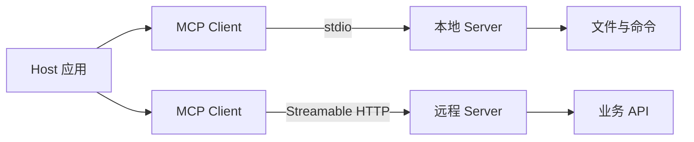

# MCP 协议与开发 {#mcp-model-context-protocol}

> [AI](../) › MCP 协议与开发

MCP 是连接 LLM 应用与工具、数据的开放协议，已成为 Agent 接工具的事实标准。本关从协议到实战：读规范、用官方 SDK 写 Server 与 Client、选传输方式、做鉴权与安全审查，并接入 Spring AI 和 IDE。

> 相关主题：[智能体](../09-agents/) · [微服务安全](../../microservices/11-security/) · [安全与治理](../19-security-governance/)

## 本关定位

| 项 | 内容 |
|----|------|
| 定位 | 第二章应用工程：把内部系统封装成任何 Agent 都能调用的标准工具 |
| 前置要求 | [LLM API 编程模式](../06-llm-api-programming/)（工具调用）、[智能体](../09-agents/)；了解 JSON-RPC 与 OAuth 更佳 |
| 粗略用时 | 1–2 周（粗略参考） |
| 章节 | 第二章 应用工程 |

## 闯关任务

**QUEST 10 · 第二章 应用工程**

- [ ] 能够说明 MCP 中 Host、Client、Server 的角色，以及 Tools、Resources、Prompts 三类能力的区别。
- [ ] 能够用 Python 或 TypeScript 官方 SDK 写一个 MCP Server，并用 Client 或 MCP Inspector 调试。
- [ ] 能够在 stdio 与 Streamable HTTP 两种传输之间做出选择，并说明远程 Server 的 OAuth 鉴权流程。
- [ ] 能够在 Spring AI 或 IDE / CLI 编程工具中接入 MCP Server。
- [ ] 能够识别工具描述投毒、过度授权和 Server 供应链风险，并给出审查清单。

**奖励**：+100 XP · 徽章「协议连接者」（徽章名暂定，内容建设中）

## 知识要点

### 架构与能力



- Host 是用户使用的应用（IDE、Claude Code、自研 Agent），每连一个 Server 就创建一个 Client。
- 消息格式是 JSON-RPC 2.0。
- Server 提供三类能力：Tools（模型决定调用的函数）、Resources（应用读取的上下文数据，用 URI 标识）、Prompts（用户选用的提示词模板）。
- 2026-07-28 版规范把 MCP 改为无状态：去掉了 `initialize` 握手和 `Mcp-Session-Id` 会话头，每个请求在 `_meta` 中携带协议版本与客户端能力；新增 `server/discover` 让客户端预先查询 Server 支持的版本。
- 同一版本引入多轮往返请求（MRTR）：Server 需要更多信息时返回 `resultType: "input_required"` 的结果，客户端补齐信息后重试原请求，取代此前由 Server 主动发起的 `sampling/createMessage`、`elicitation/create`、`roots/list` 请求。

一次工具调用的请求大致如下（省略了客户端能力等 `_meta` 字段）：

```json
{
  "jsonrpc": "2.0",
  "id": 1,
  "method": "tools/call",
  "params": {
    "name": "add",
    "arguments": { "a": 1, "b": 2 },
    "_meta": { "io.modelcontextprotocol/protocolVersion": "2026-07-28" }
  }
}
```

> [!WARNING]
> 2026-07-28 版规范把 Roots、Sampling、Logging 标为 Deprecated：仍可使用，但新实现不应再加入支持；`ping`、`logging/setLevel` 已移除。旧教程中「先 `initialize` 再调用」的流程只适用于 2025-11-25 及更早版本，与旧 Server 互通时由 SDK 处理兼容。

### 用 Python 写 Server

Python 官方 SDK 2.x 中，原来的 `FastMCP` 类更名为 `MCPServer`。下面的示例在编写时实际运行，进程内连接时协商到的协议版本为 `2026-07-28`：

```python
import asyncio

from mcp import Client
from mcp.server.mcpserver import MCPServer

mcp = MCPServer("notes")


@mcp.tool()
def add(a: int, b: int) -> int:
    """两个整数相加。"""
    return a + b


@mcp.resource("notes://{name}")
def note(name: str) -> str:
    """按名称读取一条笔记。"""
    return f"这是笔记 {name}"


@mcp.prompt()
def review(code: str) -> str:
    """生成代码评审提示词。"""
    return f"请评审下面的代码，指出缺陷和改进建议：\n{code}"


async def main() -> None:
    async with Client(mcp) as client:            # 测试时可在进程内直接连接
        tools = await client.list_tools()
        print("tools:", [t.name for t in tools.tools])
        result = await client.call_tool("add", {"a": 1, "b": 2})
        print("add:", result.content[0].text, result.structured_content)
        res = await client.read_resource("notes://mcp")
        print("resource:", res.contents[0].text)
        prompts = await client.list_prompts()
        print("prompts:", [p.name for p in prompts.prompts])


if __name__ == "__main__":
    asyncio.run(main())   # 作为真正的 Server 运行时改为 mcp.run()（默认 stdio 传输）
```

运行输出：

```text
tools: ['add']
add: 3 {'result': 3}
resource: 这是笔记 mcp
prompts: ['review']
```

- 函数签名和类型注解自动生成工具的 `inputSchema`，返回值同时生成文本内容与 `structuredContent`。
- 文档字符串就是工具描述，模型靠它决定何时调用，要写清用途和参数含义。
- 本地 Server 用 `mcp.run()` 走 stdio；远程部署用 `mcp.run(transport="streamable-http")`。

### 用 TypeScript 写 Server

TypeScript SDK v2 拆分为 `@modelcontextprotocol/server` 与 `@modelcontextprotocol/client`：

```typescript
import { McpServer } from '@modelcontextprotocol/server';
import { StdioServerTransport } from '@modelcontextprotocol/server/stdio';
import { z } from 'zod';

const server = new McpServer({ name: 'demo', version: '1.0.0' });

server.registerTool(
  'add',
  {
    description: '两个整数相加',
    inputSchema: z.object({ a: z.number(), b: z.number() }),
    outputSchema: z.object({ result: z.number() }),
  },
  async ({ a, b }) => {
    const output = { result: a + b };
    return { content: [{ type: 'text', text: String(output.result) }], structuredContent: output };
  },
);

await server.connect(new StdioServerTransport());
console.error('demo server ready');   // stdio 传输下日志只能写 stderr
```

### 接入 Host

多数 IDE 和 CLI 工具接受类似 Claude Desktop 的 `mcpServers` 配置格式：

```json
{
  "mcpServers": {
    "notes": {
      "command": "python",
      "args": ["server.py"]
    }
  }
}
```

Spring AI 用 `spring-ai-starter-mcp-client` 连接 Server（生产环境推荐 `spring-ai-starter-mcp-client-webflux`）：

```yaml
spring:
  ai:
    mcp:
      client:
        stdio:
          connections:
            notes:
              command: python
              args:
                - server.py
        streamable-http:
          connections:
            orders:
              url: http://localhost:8080
```

MCP 工具不会自动注册到 `ChatClient`，需要显式注入（未在本机编译）：

依赖坐标：BOM `org.springframework.ai:spring-ai-bom:2.0.2`，`org.springframework.ai:spring-ai-starter-mcp-client-webflux:2.0.2`、`org.springframework.ai:spring-ai-starter-model-openai:2.0.2`；JDK 21 / Boot 4.1.2。路径 `src/main/java/example/ai/McpOrderService.java`，由调用方传入已初始化、已授权的 provider 与 builder。2.0.2 的 `.tools(Object...)` 支持 provider（旧 `.toolCallbacks(...)` 已弃用），不要混用 1.x API。编译状态：2026-11-06 `mvn -DskipTests compile` 通过；已核对发布源码。运行仍需配置 MCP 地址、凭证与模型环境变量，本次未运行。

```java
package example.ai;

import org.springframework.ai.chat.client.ChatClient;
import org.springframework.ai.mcp.SyncMcpToolCallbackProvider;

public final class McpOrderService {
    private final ChatClient client;
    private final SyncMcpToolCallbackProvider tools;

    public McpOrderService(ChatClient.Builder builder, SyncMcpToolCallbackProvider tools) {
        this.client = builder.build();
        this.tools = tools;
    }

    public String ask(String question) {
        return client.prompt().user(question).tools(tools).call().content();
    }
}
```

### 传输、鉴权与安全

- stdio：Host 以子进程启动 Server，适合本地工具，无需网络鉴权，但 Server 拥有当前用户的全部本地权限。
- Streamable HTTP：适合远程和多用户部署；旧的 HTTP+SSE 传输已被替换。2026-07-28 版去掉了会话与 SSE 断点续传，响应流中断时客户端要用新的请求 ID 重发。
- 远程 Server 的鉴权基于 OAuth 2.1，Server 作为资源服务器校验访问令牌，令牌必须是签发给该 Server 的，不能透传给下游 API。
- 安全审查清单：工具描述投毒（描述里藏指令）、过度授权（一个 Token 能做所有事）、Server 供应链（来路不明的 npm / PyPI 包）、返回内容中的提示注入。
- 调试：MCP Inspector 可以直接列出并调用 Server 的工具、资源和提示词。

### 错误、提示与授权不是一回事

- 协议错误（如未知方法、无效参数）使用 JSON-RPC error；工具正常被调用但业务执行失败，按规范返回带 `isError: true` 的工具结果。不要把所有错误伪装成成功文本，也不要泄漏堆栈 / 密钥。
- `readOnlyHint`、`destructiveHint`、`idempotentHint` 等 annotations 是提示，不是可信授权策略；工具描述和结果可能包含提示注入，Host 不能仅据描述自动授予权限。
- HTTP 部署按规范验证 `Origin`，本地服务只绑定需要的接口，防范 DNS rebinding；再配合访问令牌 audience / resource 校验、最小 scope、URL / 出站网络限制和审计。仅启用 TLS 不足以完成鉴权。

### 把已有 Java 微服务适配成工具

MCP 是适配层，不是让模型直连数据库或绕过 [API 网关](../../microservices/02-api-gateway/) 的捷径。对外发布窄粒度工具，内部调用现有 [服务通信](../../microservices/04-communication/) 接口；复用 [安全](../../microservices/11-security/) 中的资源级授权、超时和业务幂等。

Spring AI 自动配置的 MCP client 是应用级共享对象，不应当作用户 / 租户隔离边界。官方 client 文档中的 session 风险针对仍支持的旧会话式兼容传输（如 2025-11-25）；2026-07-28 规范已无状态，不能混淆协议代际。旧会话下若发现结果或状态依赖身份，要自行管理每用户 / 租户生命周期，不能只换 token 就认为 session 隔离；无状态传输同样必须逐请求认证和授权。SDK / Spring AI 的版本号不等于协议 revision，升级前核对两端支持矩阵。Java SDK 2.0 / 2.1 稳定线仍以 2025-11-25 为协议基线；2.2.0-M1 才引入 modern server（当时不含 modern client），Central 已有 M2 制品，但 GitHub Releases 仍列 M1，不能由较大 SDK 数字推断双端全部兼容。

## 选型对比

| SDK / 规范 | 版本（2026-11） | 说明 |
|------------|-----------------|------|
| MCP 规范 | 2026-07-28 | 上一版 2025-11-25 |
| Python SDK `mcp` | 2.3.0 | 内置 `MCPServer`（原 FastMCP）；v1 线 1.30.0 |
| 独立 FastMCP | 4.1.6 | 第三方高层框架，功能更多 |
| TypeScript SDK | `@modelcontextprotocol/server` / `client` 2.4.0 | v1 包 `@modelcontextprotocol/sdk` 1.32.2 |
| Java SDK | 2.1.0 | 稳定线仍兼容 2025-11-25；Central 已有 2.2.0-M2 预览制品 |
| Go SDK | v1.8.0 | 官方 go-sdk |

| 传输 | 适合 | 注意 |
|------|------|------|
| stdio | 本地工具、IDE 插件 | 继承本地用户权限，日志写 stderr |
| Streamable HTTP | 远程服务、多租户 | 需要 OAuth 2.1、限流和审计 |

## 常见误区

- 把 MCP 当成「另一种函数调用 API」：MCP 解决的是工具的标准化分发与复用，模型侧仍然通过 06 关的工具调用机制使用它。
- stdio Server 往 stdout 打日志：会破坏 JSON-RPC 消息流，日志只能写 stderr。
- 一个 Server 暴露几十个工具：工具过多会降低模型选择准确率，应按领域拆分或只暴露必要工具。
- 随手安装第三方 Server：Server 代码在本机以你的权限运行，等同于安装任意软件，要审查来源与权限。
- 把用户的访问令牌原样透传给下游 API：违反 MCP 鉴权规范，也会放大泄露后的影响面。
- 照搬旧版教程实现 `initialize` 握手或 Sampling：新版规范已改为无状态并弃用 Sampling，优先使用官方 SDK 的当前版本。

## 实践任务

- 把本页 Python 示例改造成「笔记」Server：提供增删查工具和 `notes://{name}` 资源，用 MCP Inspector 调试。
- 把这个 Server 配置进你常用的 IDE 或 CLI 编程工具，让 Agent 用它完成一次记笔记任务。
- 用 Streamable HTTP 部署同一个 Server，加上基于 OAuth 2.1 的访问令牌校验和按用户的限流。
- 在 Spring Boot 中通过 `spring-ai-starter-mcp-client` 接入该 Server，并为一个第三方 Server 写一份安全审查记录。

## 资料索引

- [MCP 规范 2026-07-28](https://modelcontextprotocol.io/specification/2026-07-28) — 最新协议规范
- [MCP 官方文档](https://modelcontextprotocol.io/docs/getting-started/intro) — 概念与快速上手
- [MCP Python SDK](https://github.com/modelcontextprotocol/python-sdk) — 官方 Python SDK
- [MCP TypeScript SDK](https://github.com/modelcontextprotocol/typescript-sdk) — 官方 TypeScript SDK
- [MCP Inspector](https://github.com/modelcontextprotocol/inspector) — 官方可视化调试工具
- [Spring AI MCP](https://docs.spring.io/spring-ai/reference/api/mcp/mcp-overview.html) — Spring Boot 中的 MCP Client 与 Server
- [MCP 2026-07-28 Tools](https://modelcontextprotocol.io/specification/2026-07-28/server/tools) — 执行错误与 annotations 的可信度
- [MCP 安全最佳实践](https://modelcontextprotocol.io/specification/2026-07-28/basic/security_best_practices) — 令牌、代理与会话安全
- [MCP 传输](https://modelcontextprotocol.io/specification/2026-07-28/basic/transports) — Origin 验证与本地绑定要求
- [Spring AI MCP Client Starter](https://docs.spring.io/spring-ai/reference/api/mcp/mcp-client-boot-starter-docs.html) — Starter 坐标、共享 client 与会话边界
- [MCP Java Maven 元数据](https://repo1.maven.org/maven2/io/modelcontextprotocol/sdk/mcp/maven-metadata.xml) — 稳定 2.1.0 与预览 2.2.0-M2 制品
- [MCP Java 发布记录](https://github.com/modelcontextprotocol/java-sdk/releases) — modern server、旧规范兼容与里程碑范围

## 通关自测

先独立作答，再展开参考答案核对；简答题答出要点即算对。答对 ≥ 80% 即可进入下一关。

1. 【单选】MCP 的消息格式基于：
    - A. gRPC
    - B. JSON-RPC 2.0
    - C. GraphQL
    - D. SOAP
2. 【单选】由用户在界面中选择、用来生成标准化提示词的 MCP 能力是：
    - A. Tools
    - B. Resources
    - C. Prompts
    - D. Roots
3. 【单选】stdio 传输的 Server 应当把日志写到：
    - A. stdout
    - B. stderr
    - C. 工具返回值
    - D. 不能写日志
4. 【简答】2026-07-28 版规范相对 2025-11-25 版最大的变化是什么？
5. 【简答】团队准备接入一个开源的「数据库查询」MCP Server，请列出上线前的安全审查要点。

<details markdown><summary>参考答案</summary>

1. B — MCP 所有消息都是 JSON-RPC 2.0 请求、响应或通知。
2. C — Prompts 由用户选用；Tools 由模型决定调用；Resources 由应用读取。
3. B — stdout 承载 JSON-RPC 消息流，写入日志会破坏协议。
4. 协议改为无状态：去掉 `initialize` 握手和会话头，每个请求在 `_meta` 中带协议版本和客户端能力，新增 `server/discover`；用多轮往返请求取代 Server 主动发起的请求；Roots、Sampling、Logging 被标为弃用。答出无状态化即算对。
5. 来源与维护情况、依赖供应链；只授予只读账号和必要的库表权限；工具描述是否含隐藏指令；查询结果按不可信内容处理，防止提示注入；远程部署需 OAuth 鉴权、限流与审计日志；锁定版本，升级前复审。

</details>

---

← [上一节：智能体](../09-agents/) · [返回 AI](../) · [下一节：AI 编程助手与 IDE](../11-ai-coding-tools/) →
