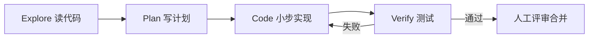

# 编程智能体工作流 {#coding-agent-workflows}

> [AI](../) › 编程智能体工作流

规则文件固定构建、测试和禁区。Agent 仍会自己选改哪些文件。没有可失败的测试时，Verify 停不住错误。worktree 和命令白名单也不是凭证隔离。

> 相关主题：[AI 编程助手与 IDE](../11-ai-coding-tools/) · [持续交付与 GitOps](../../microservices/14-cicd-gitops/) · [安全与治理](../19-security-governance/)

> [!NOTE]
> 本仓库和站点的内容由 AI 生成，资料与资源链接来源于网络，仅供学习参考；如有错误或侵权，请提 Issue 告知。

## 这一页补哪一块 {#_1}

`AGENTS.md` 写的是稳定命令和禁止项，不是这一次的需求，更不是密钥。Explore → Plan → Code → Verify 里，测试是唯一能让 Agent 自己停下来的信号。并行用的 worktree 只是另一份工作树。CI 里的示例 YAML 是只读示意：没有固定 Action 的完整 SHA，也没有在带 secret 的上下文检出不可信 PR。

## 规则文件 {#_4}

<span id="_2"></span>

- `AGENTS.md` 放在仓库根目录，子目录可以再放一份覆盖局部规则。多数编程 Agent 会读它。
- Claude Code 的 `CLAUDE.md`、Cursor Rules、Copilot 的 `.github/copilot-instructions.md` 可以指向同一份 `AGENTS.md`，避免两处各写一套。
- 写构建、测试、lint、目录、风格和禁止项。不写人人都知道的常识，不写公司史，不写生产密码，不写只属于这一次任务的需求。
- 规则要短。Agent 每次都会读。同一类错误反复出现时，把正确做法补进文件，而不是把文件写成手册。

```markdown
# AGENTS.md

## 构建与测试
- 构建：`./mvnw -q package -DskipTests`
- 单元测试：`./mvnw -q test`；只跑一个类：`./mvnw -q test -Dtest=OrderServiceTest`
- 提交前必须通过：`./mvnw -q verify`

## 代码约定
- Java 21，Spring Boot；业务代码放在 `src/main/java/com/example/order/`
- 新接口必须有单元测试；不要修改 `db/migration/` 中已发布的脚本

## 禁止事项
- 不要提交 `.env`、密钥或真实客户数据
- 不要升级依赖版本，除非任务明确要求
```

具体需求放在当次任务里。密钥放在仓库和规则都读不到的地方。这和 [AI 编程助手与 IDE](../11-ai-coding-tools/) 里「ignore 不是系统权限」是同一条边界。

## Explore、Plan、Code、Verify {#explore-plan-code-verify}



- Explore：先只读相关代码，不改文件。
- Plan：写出要改什么，复杂任务把计划存成可评审的文件。人确认之前不开始改。
- Code：小步提交，每步能单独回滚。
- Verify：测试是验收标准。失败就回到 Code。通过之后仍由人评审再合并。

没有测试时，这一环没有失败信号。Agent 只能停在「看起来对」。这和 [智能体](../09-agents/) 里「步骤事先写死就用工作流」是同一类选择：能写成固定命令和固定测试的，不要指望模型自己发明完成定义。测试怎么算数，见 [代码模型与评测](../13-code-models-evals/)。

## 先写规格 {#spec}

规格写做什么和为什么，然后是技术计划和任务清单，最后才是实现。这些文件留在仓库里，供人评审。GitHub Spec Kit 提供 `specify` CLI。Kiro 有自己的 specs 流程。

```bash
uv tool install specify-cli
specify init my-project --integration copilot
```

```text
/speckit-constitution 以代码质量、测试和可维护性为原则。
/speckit-specify 实现订单退款功能：大额退款需要主管审批。
/speckit-plan 使用 Spring Boot 与 PostgreSQL，审批状态存数据库。
/speckit-tasks
/speckit-implement
```

上面是 Copilot 的默认写法。其他 Agent 的语法以 Spec Kit 文档为准。2026-11-25 没有安装 `specify`，也没有跑这些斜杠命令。

## 并行与权限 {#_5}

每个 Agent 一份 `git worktree`，减少互相改同一批文件。需要安全隔离时另配受限容器。主 Agent 可以把独立子任务派给子 Agent。命令按白名单开放，例如只允许 `git diff` 和 `./mvnw test`。网络和写操作默认要人确认。

无人值守时用 headless，并写明允许的工具：

```bash
git worktree add ../order-refund -b feat/refund
cd ../order-refund
claude -p "修复 OrderServiceTest 中失败的测试，只修改 src/ 下的文件" \
  --allowedTools "Read,Edit,Bash(./mvnw -q test *)"
```

worktree 不是凭证隔离。它不新建操作系统用户，SSH 密钥、环境变量和网络仍是同一套。`--allowedTools` 是产品白名单，不是操作系统权限。允许 `./mvnw test` 时，Maven 插件、注解处理器和测试代码仍会执行。无人值守还要无生产凭证、受限网络和可丢弃环境。2026-11-25 没有执行上面的 `git worktree` 和 `claude -p`。

## CI 里的 Agent {#ci-agent}

PR 评审、Issue 实现和失败测试的修复，最后的合并仍由人决定。Claude Code GitHub Actions 用 Issue 或 PR 评论里的 `@claude` 触发。Copilot coding agent 和 Codex 云任务是同类的异步做法。

```yaml
name: Claude Code
on:
  issue_comment:
    types: [created]
  pull_request_review_comment:
    types: [created]
jobs:
  claude:
    if: >-
      contains(github.event.comment.body, '@claude') &&
      contains(fromJSON('["OWNER","MEMBER","COLLABORATOR"]'), github.event.comment.author_association)
    runs-on: ubuntu-latest
    permissions:
      contents: read
      pull-requests: read
      issues: read
    steps:
      - uses: actions/checkout@v6
        with:
          fetch-depth: 1
          persist-credentials: false
      - uses: anthropics/claude-code-action@v1
        with:
          anthropic_api_key: ${{ secrets.ANTHROPIC_API_KEY }}
          prompt: "只分析问题并给出修复建议，不提交、不推送、不评论。"
```

此 YAML 是受信维护者触发的只读分析配置示意，不包含自动提交 / 评论权限；生产前需按官方仓库解析并固定两项 Action 的完整 SHA，配置环境审批、模型预算与工具限制。不要在此 secret 上下文检出不可信 PR 分支；若需要发布分析结果，放在独立、经过审批且只处理数据的 job 中。

2026-11-25 没有部署这条工作流，也没有重开 Actions 文档。`author_association` 只限制谁能触发，不证明评论内容可信。Issue、PR 评论、仓库文档和测试日志都可以夹带提示注入。

## 扩展 {#_6}

- Skills 和斜杠命令：把发版检查、写迁移这类重复流程收成可复用指令。
- Hooks：在编辑或跑命令的前后做格式化、lint 或安全检查。检查失败就停，不把 Hook 当成已经授权。
- MCP Server：接工单、文档或监控，见 [MCP 协议与开发](../10-mcp/)。发现到一个 Server 不是授权。
- Agent SDK：Claude Agent SDK、Cursor Agent SDK、Codex SDK 用来做内部编程 Agent。SDK 版本不是本章核对过的当前号。

## 检查结果才算交付 {#ci-java}

评论、文档、测试日志和依赖脚本都可能带提示注入。触发者是维护者，也不表示内容可信。身份校验、工具白名单、预算和环境隔离要同时在。

默认 `GITHUB_TOKEN` 只读，按 job 开最小权限。第三方 Action 在生产配置里固定完整 commit SHA，并核对来自官方仓库。不要在有 secret 或写权限的 `pull_request_target` 上检出或执行不可信 PR。

构建会跑 Maven 或 Gradle 插件、注解处理器和测试代码。命令白名单里即使只有 `mvn test`，也要放在无生产凭证、网络受限的临时环境。worktree 不是沙箱。

交出去的是规格、diff、单元和集成测试、依赖与漏洞报告、模型预算，以及没有验证的项。复用 [Java 构建工具](../../java/07-build-tools/)、[微服务测试](../../microservices/15-testing/) 和 [CI/CD](../../microservices/14-cicd-gitops/)。「Agent 说完成」换成这些检查的结果。合并仍留给人，见 [安全与治理](../19-security-governance/)。

## 怎么选 {#agent-workflow-choice}

<span id="_7"></span>

| 方式 | 代表 | 适合 | 风险控制 |
|------|------|------|----------|
| 本地交互 | IDE Agent 模式、CLI Agent | 探索、调试、需要频繁确认的任务 | 逐步审批，看 diff |
| 本地 headless | `claude -p`、Codex 非交互模式 | 批量重构、脚本化任务 | 工具白名单、worktree 隔离；白名单不是沙箱 |
| CI 触发 | Claude Code GitHub Actions | PR 评审、评论触发的修改 | 最小 `permissions`、密钥放 Secrets、固定 Action SHA |
| 云端异步 | Copilot coding agent、Codex 云任务 | 从 Issue 到 PR 的独立任务 | 沙箱环境、人工评审合并 |
| 规格驱动 | GitHub Spec Kit v1.3.0、Kiro specs | 新功能、需求不清晰的任务 | 规格与计划先评审 |

> [!WARNING]
> Spec Kit v1.3.0 发布于 2026-11-04（太平洋时间），命令写法为 `/speckit-specify` 这类连字符形式，旧教程中的 `/speckit.specify` 已过时。Claude Code GitHub Actions 示例取自 2026-11-05 的官方文档（`anthropics/claude-code-action@v1`）。2026-11-25 没有重开这些页，不把它们称为当前版本。

## 常见误读 {#_3}

<span id="_8"></span>

- 规则写成手册：每次都读，无关段落挤掉构建命令。
- 一次丢一个大需求：中间没有可失败的检查，跑偏后无从回滚。
- 没有测试就改代码：Verify 没有失败信号。
- 多个 Agent 共用一个目录：用 worktree 或容器分开文件。worktree 仍共享凭证。
- 把 `--allowedTools` 当成沙箱：`./mvnw test` 仍会执行插件和测试代码。
- CI 权限过大：一条评论里的提示注入就可能碰到密钥。YAML 示意没有代替固定 SHA。
- 让 Agent 自己合并：评审和合并留给人。

## 可选核对 {#agent-workflow-check}

<span id="_9"></span>

1. 构建命令、这一次的需求、生产密码，各应写在哪里？为什么密码不能进 `AGENTS.md`？
2. 每个 Agent 一个 worktree，再加上命令白名单，为什么仍不是沙箱？上面那份只读 YAML 在生产里还要另做哪两件事？

<details markdown><summary>参考答案</summary>

1. 构建、测试和禁止项写进 `AGENTS.md`。这一次做什么写在任务里。密码不进仓库、不进规则、不进提示。规则会被 Agent 反复读，写进去就等于交给模型上下文。
2. worktree 只是另一份工作树，密钥、环境和网络还在。白名单只限制产品允许的命令名；`./mvnw test` 仍会跑插件和测试。YAML 还要把两个 Action 固定到官方仓库的完整 SHA，并且不要在带 secret 的上下文检出不可信 PR。2026-11-25 没有跑这些命令，也没有部署这条工作流。

</details>

<span id="_11"></span>

## 资料索引 {#_10}

- [AGENTS.md](https://agents.md/) — 编程 Agent 规则文件开放格式
- [GitHub Spec Kit](https://github.com/github/spec-kit) — Spec 驱动开发工具包；v1.3.0 是 2026-11-04 的记录，2026-11-25 未重开
- [Claude Code 最佳实践](https://www.anthropic.com/engineering/claude-code-best-practices) — 官方工作流建议；2026-11-25 未重开
- [Claude Code GitHub Actions](https://code.claude.com/docs/en/github-actions) — CI 集成与权限说明；示例取自 2026-11-05
- [Claude Code headless 模式](https://code.claude.com/docs/en/headless) — 非交互运行与工具白名单；2026-11-25 未运行
- [Copilot coding agent](https://docs.github.com/en/copilot/concepts/agents/coding-agent/about-coding-agent) — GitHub 异步编程 Agent
- [GitHub Actions 安全使用](https://docs.github.com/en/actions/reference/security/secure-use) — 最小权限与固定完整 SHA
- [GitHub pull_request_target 安全](https://docs.github.com/en/actions/reference/security/securely-using-pull_request_target) — 禁止在特权上下文运行不可信代码
- [GitHub 脚本注入](https://docs.github.com/en/actions/concepts/security/script-injections) — 事件字段与命令拼接风险

---

← [上一节：AI 编程助手与 IDE](../11-ai-coding-tools/) · [返回 AI](../) · [下一节：代码模型与评测](../13-code-models-evals/) →
