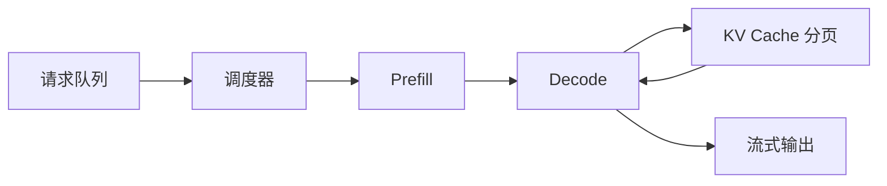

# 推理与服务 {#inference-serving}

> [AI](../) › 推理与服务

等很久才出第一个字，先看 TTFT，不是先看 TPOT。权重和 KV Cache 是两笔显存。Java 打印的 22.5 KiB 来自写死的层数，不是今天读取了模型配置。没有启动的服务不能称为测过 TTFT。

> 相关主题：[Transformer 与大模型原理](../03-transformer-llm/) · [API 网关](../../microservices/02-api-gateway/) · [LLMOps 与 GPU 基础设施](../18-llmops-infra/)

> [!NOTE]
> 本仓库和站点的内容由 AI 生成，资料与资源链接来源于网络，仅供学习参考；如有错误或侵权，请提 Issue 告知。

## 这一页补哪一块 {#_1}

TTFT 包含排队、网关、冷启动和 Prefill。TPOT 是出字之后的间隔。比较引擎要锁住模型 revision、精度、硬件、长度分布、并发和缓存冷热。峰值吞吐不能外推到另一张 GPU。goodput 是同时满足 TTFT 和 TPOT 门限的请求数，不是只统计已经完成的成功流。

## 先分清等的是哪一段 {#_4}

<span id="_2"></span>

- TTFT：从发送到第一个 Token。排队、网络、网关和 Prefill 都算在这里。用户说「点了很久才开始出字」，先看这一项。
- TPOT / ITL：之后每个 Token 的间隔，由 Decode 决定，对应「出字快不快」。
- 吞吐：单位时间的 Token 数。并发上去吞吐往往上升，单请求变差。按 SLO 取平衡，而不是取峰值。
- 成本：每百万输出 Token 的 GPU 成本，用 GPU 小时成本除以每小时输出 Token，再乘 1,000,000。空闲冗余、CPU、网络、存储和运维另计。

端到端数字还要带上 P50、P95、P99 和错误率。只报成功请求的平均延迟，会把超时的人从分母里拿掉。

## 权重和 KV 是两笔账 {#_5}

权重显存大约是参数量乘每参数字节数。KV Cache 随上下文长度和并发线性涨。长上下文、高并发时，KV 可以比权重更大。GQA 让多个 Query 头共享一组 K/V，用来减小这份 Cache。

把 `max-model-len` 设到模型允许的最大值，会先按这个长度占 KV，能同时服务的请求变少。这是容量选择，不是精度选择。

下面第一段 Python 会用 `transformers` 读取 `HuggingFaceTB/SmolLM2-135M-Instruct` 的配置。2026-11-25 没有下载这个配置，也没有跑这段。

```python
from transformers import AutoConfig

def kv_cache_bytes(layers, kv_heads, head_dim, seq_len, batch, bytes_per_elem=2):
    # 每个 token 在每层存 K 和 V 两份，形状都是 kv_heads × head_dim
    return 2 * layers * kv_heads * head_dim * seq_len * batch * bytes_per_elem

cfg = AutoConfig.from_pretrained("HuggingFaceTB/SmolLM2-135M-Instruct")
head_dim = cfg.hidden_size // cfg.num_attention_heads
print(f"SmolLM2-135M: 层数 {cfg.num_hidden_layers}, KV 头 {cfg.num_key_value_heads}, head_dim {head_dim}")
per_token = kv_cache_bytes(cfg.num_hidden_layers, cfg.num_key_value_heads, head_dim, 1, 1)
print(f"每 token KV Cache: {per_token / 1024:.1f} KiB (BF16)")

# 一个 8B 级稠密模型的典型结构（示例参数：32 层、8 个 KV 头、head_dim 128）
for seq, batch in [(8_192, 1), (8_192, 32), (131_072, 1)]:
    gib = kv_cache_bytes(32, 8, 128, seq, batch) / 1024**3
    print(f"8B 级示例  上下文 {seq:>7,} × 并发 {batch:>2}: {gib:6.1f} GiB")

print(f"同配置若不用 GQA（32 个 KV 头），8K × 32 并发: {kv_cache_bytes(32, 32, 128, 8_192, 32) / 1024**3:.1f} GiB")
```

编写时的输出：

```text
SmolLM2-135M: 层数 30, KV 头 3, head_dim 64
每 token KV Cache: 22.5 KiB (BF16)
8B 级示例  上下文   8,192 × 并发  1:    1.0 GiB
8B 级示例  上下文   8,192 × 并发 32:   32.0 GiB
8B 级示例  上下文 131,072 × 并发  1:   16.0 GiB
同配置若不用 GQA（32 个 KV 头），8K × 32 并发: 128.0 GiB
```

Java 把层数 30、KV 头 3、head_dim 64，以及 8B 示例的 32 层、8 个 KV 头、head_dim 128 写在源码里再套公式：

```java
class KvCache {
    static double bytes(int layers, int kvHeads, int headDim, int seq, int batch) {
        return 2.0 * layers * kvHeads * headDim * seq * batch * 2;
    }

    public static void main(String[] args) {
        int layers = 30, kv = 3, head = 64;
        System.out.printf("SmolLM2-135M: 层数 %d, KV 头 %d, head_dim %d%n", layers, kv, head);
        System.out.printf("每 token KV Cache: %.1f KiB (BF16)%n", bytes(layers, kv, head, 1, 1) / 1024);
        int[][] cases = {{8192, 1}, {8192, 32}, {131072, 1}};
        for (int[] c : cases) {
            System.out.printf("8B 级示例  上下文 %,7d × 并发 %2d: %6.1f GiB%n",
                    c[0], c[1], bytes(32, 8, 128, c[0], c[1]) / 1024 / 1024 / 1024);
        }
        System.out.printf("同配置若不用 GQA（32 个 KV 头），8K × 32 并发: %.1f GiB%n",
                bytes(32, 32, 128, 8192, 32) / 1024 / 1024 / 1024);
    }
}
```

2026-11-25 用 OpenJDK 21.0.13.0.3 运行了这段。打印与上面的输出块一致，包括每 token 22.5 KiB。这些数字是字面量，不是今天读取的模型配置。它只证明公式和这些字面量对得上原输出，不证明 SmolLM2 的层数。

权重字节与 KV 分开算。8B 参数只做乘法，不加载模型：

```python
params = 8e9
for name, bits in [("BF16", 16), ("FP8", 8), ("INT4 (AWQ/GPTQ)", 4)]:
    print(f"8B 参数 {name:<16} 权重约 {params * bits / 8 / 1024**3:5.1f} GiB")
```

编写时的输出：

```text
8B 参数 BF16             权重约  14.9 GiB
8B 参数 FP8              权重约   7.5 GiB
8B 参数 INT4 (AWQ/GPTQ)  权重约   3.7 GiB
```

```java
class WeightBytes {
    public static void main(String[] args) {
        double params = 8e9;
        String[] names = {"BF16", "FP8", "INT4 (AWQ/GPTQ)"};
        int[] bits = {16, 8, 4};
        for (int i = 0; i < names.length; i++) {
            System.out.printf("8B 参数 %-16s 权重约 %5.1f GiB%n", names[i], params * bits[i] / 8 / 1024 / 1024 / 1024);
        }
    }
}
```

2026-11-25 用 Python 3.12.3 和同一 JDK 重算了这两段，打印与输出块一致。没有加载权重，没有 GPU。BF16 约 14.9 GiB、FP8 约 7.5 GiB、INT4 约 3.7 GiB，都是 `8e9 × 位宽 / 8`，不含 KV。

## 机制各改一个瓶颈 {#_6}



- PagedAttention：按块管理 KV，减少按最大长度预留整段连续显存造成的碎片。并发容量上去，不提高单次矩阵的精度。
- 连续批处理：每一步把已经结束的请求移出、把新请求加进来，不必等整批里最长的那个结束。
- 前缀缓存：相同的系统提示或文档前缀可以复用 KV，TTFT 和费用下降。云端「缓存命中价」也基于此。前缀里放了时间戳或另一租户的内容，要么不命中，要么不该共享。
- Chunked Prefill：长输入切块，和 Decode 交错，避免一个长请求堵住别人。
- PD 分离：Prefill 偏算力，Decode 偏显存带宽。分到不同 GPU 池再分别扩缩。
- 投机解码：小草稿或 EAGLE / MTP 一次猜多个 Token，大模型并行验证。接受的部分保持原分布，延迟下降。它不改变你该报的 SLO 定义。

## 命令没有启动服务 {#openai}

```bash
# vLLM：单机 2 卡张量并行
vllm serve Qwen/Qwen3-8B --tensor-parallel-size 2 \
  --max-model-len 32768 --gpu-memory-utilization 0.9

# SGLang：默认端口 30000
sglang serve --model-path Qwen/Qwen3-8B

# Ollama：本地 GGUF 模型
ollama run qwen3:8b
```

```python
# 示意：需要先按上面的命令启动 vLLM（默认端口 8000）
from openai import OpenAI

client = OpenAI(base_url="http://localhost:8000/v1", api_key="EMPTY")
stream = client.chat.completions.create(
    model="Qwen/Qwen3-8B",
    messages=[{"role": "user", "content": "用一句话解释 KV Cache"}],
    stream=True,
)
for chunk in stream:
    print(chunk.choices[0].delta.content or "", end="", flush=True)
```

2026-11-25 没有安装或启动 vLLM、SGLang、Ollama，没有调用 OpenAI 兼容接口，也没有 GPU。因此没有 TTFT、TPOT 或吞吐的新测量。`Qwen/Qwen3-8B` 和 `qwen3:8b` 仍是示例名。

## 量化不要并成一个开关 {#_7}

- FP8：章内记为数据中心 GPU 上精度损失较小、速度提升明显，常被当作自托管的默认。这是当时的判断，不是今天重测的结果。
- NVFP4 / MXFP8：新一代 GPU 的低精度格式，见 [前沿与趋势](../20-trends/)。
- INT4（AWQ / GPTQ）：权重量化，显存大约是 BF16 的四分之一。数学和代码任务上可能退步，上线前要有评测，不能只看 GiB。
- GGUF：llama.cpp / Ollama 的文件格式，里面可以有多种量化。它不是一种精度的名字。

权重的量化方式和 KV 的量化方式是两件事。INT4 或 FP8 不是对所有 GPU 和所有模型都能打开的开关。

## 网关和租户 {#_8}

llm-d、NVIDIA Dynamo 做多副本、PD 分离和 KV 感知路由。版本号见下面的日期表，2026-11-25 没有重开。

入口做鉴权、限流、路由和降级，见 [API 网关](../../microservices/02-api-gateway/) 和 [容错与弹性](../../microservices/05-resilience/)。推理服务不要直接暴露公网。

## 用 goodput 选，不外推峰值 {#slo-goodput}

vLLM、SGLang、TensorRT-LLM 要在相同的模型 revision、精度、硬件、输入输出长度、并发和缓存冷热下比较。先看功能支不支持，再看分数。某张卡上的峰值不能外推到别的 GPU。

分别压冷启动、冷缓存和热前缀。到达速率接近真实流量。拒绝和超时要记进分母。只统计完成的成功流，会把最差的请求藏掉。

前缀缓存按可信租户分开。章内记录支持时使用租户 salt。语义上的答案缓存还要绑模型、提示、权限和数据版本，不能照搬 [业务缓存](../../microservices/08-caching/) 的通用键。这和 [检索增强生成](../08-rag/) 里「过滤要发生在进入共享结果之前」是同一类边界：先共享再隔离，命中率高也会泄露。

## Java 入口不代替 GPU 调度 {#java-gpu}

沿用 [API 网关](../../microservices/02-api-gateway/) 到 Java 应用、再到推理服务。入口管认证、租户配额和预算。应用层编排检索和工具。GPU 层管调度和 KV。队列上限、背压、取消、超时和熔断要穿过这三层，见 [应用开发框架](../07-app-frameworks/)。Java 进程里没有 KV Cache 的分页实现。上面的 `KvCache` 类只打印公式。

## 引擎版本是当时的表 {#serve-choice}

<span id="_9"></span>

| 引擎 | 版本（章内记录） | 场景 | 特点 |
|------|------|------|------|
| vLLM | 0.33.0 | 数据中心通用 | PagedAttention，生态与模型支持最广 |
| SGLang | 0.5.23 | 数据中心、Agent 与结构化输出 | RadixAttention 前缀复用 |
| TensorRT-LLM | 1.2.1 | NVIDIA GPU 极致优化 | 性能高，构建与运维较复杂 |
| llama.cpp | v0.9.0 | CPU、Mac、边缘 | GGUF 量化，依赖少 |
| Ollama | 0.40.14 | 本地开发 | 一条命令拉起模型 |
| llm-d | 1.0.0 | K8s 分布式推理 | KV 感知路由、PD 分离 |
| NVIDIA Dynamo | 1.6.1 | 多节点分布式推理 | PD 分离与 KV 管理 |

> [!WARNING]
> vLLM 的 GitHub「Latest」曾显示 `v0.33.0rc3`，但 PyPI 正式版 0.33.0 已于 2026-11-02 发布；TensorRT-LLM 最新正式版仍是 1.2.1（2026-04），之后都是 rc 预发布；llama.cpp 另有滚动构建号（如 `b12125`）。命令行参数以 2026-11-05 的 vLLM / SGLang 源码为准，`Qwen/Qwen3-8B` 仅为示例模型。2026-11-25 没有重开这些发布页，不把表内版本称为当前版本。

## 常见误读 {#_3}

<span id="_10"></span>

- 只看单请求延迟：生产里要看并发下的尾延迟和 goodput。
- 只算权重：长上下文和高并发时 KV 才是大头。
- 把 `max-model-len` 开到模型上限：KV 先被占满，并发下降。
- 认为量化一定无损：INT4 在数学和代码上可能退步。GGUF 也不是一种精度名。
- 把 Java 的 22.5 KiB 当成今天读到的 SmolLM2 配置。
- 提示词前面每次都变：前缀缓存不命中。跨租户共享缓存则不该命中。
- 没启动 vLLM 却称已经测过 TTFT。
- 推理端口直接暴露公网：没有鉴权和限流时，成本会先爆。

## 可选核对 {#serve-check}

<span id="_11"></span>

1. 用户说「点了发送，很久才开始出字」。这是 TTFT 还是 TPOT？排队算在哪一段？
2. 为什么把上下文开到模型上限会先伤并发？Java 的 KV 示例有没有读取 SmolLM2 的配置？

<details markdown><summary>参考答案</summary>

1. 这是 TTFT。排队、网关、冷启动和 Prefill 都算在第一个 Token 之前。TPOT 是已经开始出字之后的间隔。没有启动的服务不能称为测过 TTFT。
2. 更大的 `max-model-len` 会先占用 KV，能同时放下的请求变少。Java 把 30 层、3 个 KV 头、head_dim 64 写死，22.5 KiB 是这些字面量的公式结果，不是 2026-11-25 读取的配置。读配置的那段 Python 没有跑。

</details>

<span id="_13"></span>

## 资料索引 {#_12}

- [vLLM GitHub](https://github.com/vllm-project/vllm) — 高吞吐推理引擎；章内记 docs.vllm.ai 核对时返回 429，2026-11-25 未重开
- [PagedAttention 论文](https://arxiv.org/abs/2309.06180) — vLLM 核心论文
- [SGLang 文档](https://docs.sglang.ai/) — RadixAttention 与结构化生成；2026-11-25 未重开
- [Speculative Decoding 论文](https://arxiv.org/abs/2211.17192) — 投机解码原理
- [llama.cpp](https://github.com/ggml-org/llama.cpp) — 本地 GGUF 推理
- [llm-d](https://llm-d.ai/) — K8s 原生分布式推理
- [vLLM 基准 CLI](https://docs.vllm.ai/en/stable/benchmarking/cli/) — 延迟、吞吐与 SLO；2026-11-25 未跑
- [vLLM 量化 KV Cache](https://docs.vllm.ai/en/stable/features/quantization/quantized_kvcache/) — 2026-11-25 未重开
- [vLLM 前缀缓存设计](https://docs.vllm.ai/en/stable/design/prefix_caching/) — 章内的租户 salt 来自原先的记录；2026-11-25 未重开
- [TensorRT-LLM 支持矩阵](https://nvidia.github.io/TensorRT-LLM/reference/support-matrix.html) — 2026-11-25 未重开
- [GGUF 规范](https://github.com/ggml-org/ggml/blob/master/docs/gguf.md) — 容器格式与量化表示

---

← [上一节：微调与对齐](../14-fine-tuning/) · [返回 AI](../) · [下一节：多模态](../16-multimodal/) →
