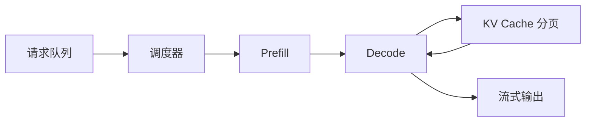

# 推理与服务 {#inference-serving}

> [AI](../) › 推理与服务

把模型变成高吞吐、低延迟、成本可控的服务。理解决定性能的核心机制：KV Cache、连续批处理、PagedAttention、前缀缓存、投机解码和量化，并按数据中心、边缘、本地等场景选择推理引擎。

> 相关主题：[Transformer 与大模型原理](../03-transformer-llm/) · [API 网关](../../microservices/02-api-gateway/) · [LLMOps 与 GPU 基础设施](../18-llmops-infra/)

## 本关定位

| 项 | 内容 |
|----|------|
| 定位 | 第三章生产化：自托管开放权重模型，或读懂云端 API 的延迟与计费 |
| 前置要求 | [Transformer 与大模型原理](../03-transformer-llm/)；了解 GPU 显存与 HTTP 服务压测 |
| 粗略用时 | 2 周（粗略参考） |
| 章节 | 第三章 生产化 |

## 闯关任务

**QUEST 15 · 第三章 生产化**

- [ ] 能够解释 TTFT、TPOT / ITL、吞吐和并发之间的关系，并完成一次压测。
- [ ] 能够估算一个模型在给定上下文与并发下的权重显存和 KV Cache 显存。
- [ ] 能够说明 PagedAttention、连续批处理、前缀缓存、投机解码各解决什么问题。
- [ ] 能够用 vLLM 或 SGLang 部署一个 OpenAI 兼容接口，并用 Ollama 在本地运行模型。
- [ ] 能够根据精度与显存要求选择 FP8、INT4、GGUF 等量化方案。

**奖励**：+100 XP · 徽章「吞吐优化师」（徽章名暂定，内容建设中）

## 知识要点

### 关键指标

- TTFT（Time To First Token）：首 Token 延迟，主要由 Prefill（处理整段输入）决定，影响「开始响应」的体感。
- TPOT / ITL：每个输出 Token 的间隔，由 Decode 阶段决定，影响「打字速度」。
- 吞吐：单位时间生成的 Token 总数；并发越高吞吐越大，但单请求延迟会变差，需要按 SLO 取平衡。
- 成本：每百万输出 Token 的 GPU 成本 = GPU 总小时成本 ÷ 每小时生成的输出 Token 数 × 1,000,000；另计空闲冗余、CPU / 网络 / 存储与运维。

### 显存估算

- 权重显存 ≈ 参数量 × 每参数字节数；KV Cache 随上下文长度和并发线性增长，长上下文、高并发时往往比权重还大。
- GQA（分组查询注意力）让多个 Query 头共享一组 K/V，是现代模型降低 KV Cache 的关键。

```python
from transformers import AutoConfig

def kv_cache_bytes(layers, kv_heads, head_dim, seq_len, batch, bytes_per_elem=2):
    # 每个 token 在每层存 K 和 V 两份，形状都是 kv_heads × head_dim
    return 2 * layers * kv_heads * head_dim * seq_len * batch * bytes_per_elem

cfg = AutoConfig.from_pretrained("HuggingFaceTB/SmolLM2-135M-Instruct")
head_dim = cfg.hidden_size // cfg.num_attention_heads
print(f"SmolLM2-135M: 层数 {cfg.num_hidden_layers}, KV 头 {cfg.num_key_value_heads}, head_dim {head_dim}")
per_token = kv_cache_bytes(cfg.num_hidden_layers, cfg.num_key_value_heads, head_dim, 1, 1)
print(f"每 token KV Cache: {per_token / 1024:.1f} KiB (BF16)")

# 一个 8B 级稠密模型的典型结构（示例参数：32 层、8 个 KV 头、head_dim 128）
for seq, batch in [(8_192, 1), (8_192, 32), (131_072, 1)]:
    gib = kv_cache_bytes(32, 8, 128, seq, batch) / 1024**3
    print(f"8B 级示例  上下文 {seq:>7,} × 并发 {batch:>2}: {gib:6.1f} GiB")

print(f"同配置若不用 GQA（32 个 KV 头），8K × 32 并发: {kv_cache_bytes(32, 32, 128, 8_192, 32) / 1024**3:.1f} GiB")
```

运行输出：

```text
SmolLM2-135M: 层数 30, KV 头 3, head_dim 64
每 token KV Cache: 22.5 KiB (BF16)
8B 级示例  上下文   8,192 × 并发  1:    1.0 GiB
8B 级示例  上下文   8,192 × 并发 32:   32.0 GiB
8B 级示例  上下文 131,072 × 并发  1:   16.0 GiB
同配置若不用 GQA（32 个 KV 头），8K × 32 并发: 128.0 GiB
```

```python
params = 8e9
for name, bits in [("BF16", 16), ("FP8", 8), ("INT4 (AWQ/GPTQ)", 4)]:
    print(f"8B 参数 {name:<16} 权重约 {params * bits / 8 / 1024**3:5.1f} GiB")
```

运行输出：

```text
8B 参数 BF16             权重约  14.9 GiB
8B 参数 FP8              权重约   7.5 GiB
8B 参数 INT4 (AWQ/GPTQ)  权重约   3.7 GiB
```

### 核心机制



- PagedAttention：像操作系统分页一样按块管理 KV Cache，消除碎片，显著提高可容纳的并发数。
- 连续批处理：每生成一步就把完成的请求移出、新请求加入批次，而不是等整批结束。
- 前缀缓存：相同系统提示词或文档前缀的 KV Cache 可复用，降低 TTFT 与成本；云端 API 的「缓存命中价格」也基于此。
- Chunked Prefill：把长输入切块与 Decode 交错执行，避免长请求阻塞其他请求。
- PD 分离：Prefill（算力密集）与 Decode（显存带宽密集）放在不同 GPU 池，分别扩缩。
- 投机解码：小草稿模型或 EAGLE / MTP 头一次猜多个 Token，大模型并行验证，输出分布不变但延迟更低。

### 部署 OpenAI 兼容服务

```bash
# vLLM：单机 2 卡张量并行
vllm serve Qwen/Qwen3-8B --tensor-parallel-size 2 \
  --max-model-len 32768 --gpu-memory-utilization 0.9

# SGLang：默认端口 30000
sglang serve --model-path Qwen/Qwen3-8B

# Ollama：本地 GGUF 模型
ollama run qwen3:8b
```

```python
# 示意：需要先按上面的命令启动 vLLM（默认端口 8000）
from openai import OpenAI

client = OpenAI(base_url="http://localhost:8000/v1", api_key="EMPTY")
stream = client.chat.completions.create(
    model="Qwen/Qwen3-8B",
    messages=[{"role": "user", "content": "用一句话解释 KV Cache"}],
    stream=True,
)
for chunk in stream:
    print(chunk.choices[0].delta.content or "", end="", flush=True)
```

### 量化

- FP8：数据中心 GPU 上精度损失小、速度提升明显，是自托管的常用默认。
- NVFP4 / MXFP8：新一代 GPU 支持的低精度格式，见 [前沿与趋势](../20-trends/)。
- INT4（AWQ / GPTQ）：显存约为 BF16 的四分之一，适合单卡部署较大模型，需评估精度损失。
- GGUF：llama.cpp / Ollama 使用的格式，适合 CPU、Mac 与边缘设备。

### 分布式与网关

- llm-d（Kubernetes 原生）、NVIDIA Dynamo：多副本、PD 分离与 KV 感知路由。
- 前置网关做鉴权、限流、模型路由与降级，见 [API 网关](../../microservices/02-api-gateway/) 与 [容错与弹性](../../microservices/05-resilience/)。

### 以 SLO goodput 选引擎，不只看吞吐峰值

- vLLM、SGLang、TensorRT-LLM 要在相同模型 revision、精度 / 量化、硬件、输入 / 输出长度分布、并发和缓存命中条件下比较；功能支持矩阵先于跑分，不能把某硬件上的峰值外推到其他 GPU。
- 端到端 TTFT 包含网关、排队、网络与 prefill；ITL / TPOT 反映 decode 体验。报告 P50 / P95 / P99、错误率和满足 TTFT / TPOT 门限的请求数（goodput），避免高吞吐但用户全超时。
- 分别压测冷启动、冷缓存与热前缀；用接近真实的到达速率，记录拒绝 / 超时请求，不能只统计已完成的成功流。
- 权重量化与 KV 量化是独立维度；AWQ / GPTQ 是权重量化方法，GGUF 是包含张量与元数据的文件格式，支持多种量化表示。检查精度、内核、GPU 架构和模型支持，不把 INT4 / FP8 当通用开关。

### Java 入口与 GPU 服务分层

沿用 [API 网关](../../microservices/02-api-gateway/) → Java AI 应用服务 → 推理服务的分层：入口负责认证、租户配额和预算，应用层编排检索 / 工具，GPU 层负责调度与 KV。队列上限、背压、取消、超时与熔断的配置要贯穿整条链，详见 [框架韧性](../07-app-frameworks/)。前缀缓存按可信租户边界隔离（支持时使用租户 salt），语义答案缓存还须绑定模型、提示、权限与数据版本，不能误用 [业务缓存](../../microservices/08-caching/) 的通用键。

## 选型对比

| 引擎 | 版本 | 场景 | 特点 |
|------|------|------|------|
| vLLM | 0.33.0 | 数据中心通用 | PagedAttention，生态与模型支持最广 |
| SGLang | 0.5.23 | 数据中心、Agent 与结构化输出 | RadixAttention 前缀复用 |
| TensorRT-LLM | 1.2.1 | NVIDIA GPU 极致优化 | 性能高，构建与运维较复杂 |
| llama.cpp | v0.9.0 | CPU、Mac、边缘 | GGUF 量化，依赖少 |
| Ollama | 0.40.14 | 本地开发 | 一条命令拉起模型 |
| llm-d | 1.0.0 | K8s 分布式推理 | KV 感知路由、PD 分离 |
| NVIDIA Dynamo | 1.6.1 | 多节点分布式推理 | PD 分离与 KV 管理 |

> [!WARNING]
> vLLM 的 GitHub「Latest」曾显示 `v0.33.0rc3`，但 PyPI 正式版 0.33.0 已于 2026-11-02 发布；TensorRT-LLM 最新正式版仍是 1.2.1（2026-04），之后都是 rc 预发布；llama.cpp 另有滚动构建号（如 `b12125`）。命令行参数以 2026-11-05 的 vLLM / SGLang 源码为准，`Qwen/Qwen3-8B` 仅为示例模型。

## 常见误区

- 只看单请求延迟：生产瓶颈通常是并发下的吞吐与尾延迟，要用真实流量分布压测。
- 只算权重显存：长上下文和高并发时 KV Cache 才是大头，显存不足会导致排队或抢占。
- 把 `max-model-len` 设到模型最大值：会预留过多 KV Cache，降低可承载的并发。
- 认为量化一定无损：INT4 在数学、代码等任务上可能明显退化，上线前必须评测。
- 提示词前缀每次都变：把时间戳等动态内容放在前面，前缀缓存就无法命中。
- 推理服务直接暴露公网：缺少鉴权与限流，容易被滥用产生高额成本。

## 实践任务

- 运行本页的显存估算代码，换成你关注的模型（读其 `config.json`），算出 32K 上下文、16 并发下的 KV Cache。
- 用 Ollama 在本地运行一个小模型，用 OpenAI SDK 调用它，记录 TTFT 和每秒 Token 数。
- 在一张 GPU 上分别用 vLLM 和 SGLang 部署同一模型，用相同并发压测，对比吞吐与 P95 延迟。
- 构造共享长系统提示词的请求，比较开启与关闭前缀缓存时的 TTFT。

## 资料索引

- [vLLM GitHub](https://github.com/vllm-project/vllm) — 高吞吐推理引擎，README 链接到官方文档（docs.vllm.ai 核对时返回 429）
- [PagedAttention 论文](https://arxiv.org/abs/2309.06180) — vLLM 核心论文
- [SGLang 文档](https://docs.sglang.ai/) — RadixAttention 与结构化生成
- [Speculative Decoding 论文](https://arxiv.org/abs/2211.17192) — 投机解码原理
- [llama.cpp](https://github.com/ggml-org/llama.cpp) — 本地 GGUF 推理
- [llm-d](https://llm-d.ai/) — K8s 原生分布式推理
- [vLLM 基准 CLI](https://docs.vllm.ai/en/stable/benchmarking/cli/) — 延迟、吞吐与 SLO 压测
- [vLLM 量化 KV](https://docs.vllm.ai/en/stable/features/quantization/quantized_kvcache/) — KV 精度与容量取舍
- [vLLM 前缀缓存设计](https://docs.vllm.ai/en/stable/design/prefix_caching/) — 哈希、租户 salt 与安全隔离
- [TensorRT-LLM 支持矩阵](https://nvidia.github.io/TensorRT-LLM/reference/support-matrix.html) — 模型、精度与硬件支持
- [GGUF 规范](https://github.com/ggml-org/ggml/blob/master/docs/gguf.md) — 容器格式与量化表示

## 通关自测

先独立作答，再展开参考答案核对；简答题答出要点即算对。答对 ≥ 80% 即可进入下一关。

1. 【单选】用户抱怨「点了发送要等很久才开始出字」，最相关的指标是：
    - A. TPOT
    - B. TTFT
    - C. 吞吐
    - D. 显存占用
2. 【单选】PagedAttention 主要解决的问题是：
    - A. 模型精度下降
    - B. KV Cache 显存碎片与浪费
    - C. 网络延迟
    - D. 分词速度
3. 【单选】32 层、8 个 KV 头、head_dim 128 的模型，BF16 下每个 token 的 KV Cache 约为：
    - A. 32 KiB
    - B. 128 KiB
    - C. 1 MiB
    - D. 8 MiB
4. 【简答】投机解码为什么能在不改变输出分布的前提下降低延迟？
5. 【简答】为什么要做 PD 分离（Prefill / Decode 分离）？

<details markdown><summary>参考答案</summary>

1. B — TTFT 由排队和 Prefill 决定，体现为开始响应前的等待。
2. B — 按块分配 KV Cache，避免为每个请求按最大长度预留连续显存。
3. B — 2（K 和 V）× 32 × 8 × 128 × 2 字节 = 131072 字节 = 128 KiB。
4. Decode 阶段受显存带宽限制，一次验证多个 Token 与生成一个 Token 的成本接近。草稿模型先猜多个 Token，大模型并行验证，接受与草稿一致的部分，并按拒绝采样规则修正，所以最终分布与大模型单独生成一致，但每次前向能产出多个 Token。
5. Prefill 是算力密集型，Decode 是显存带宽密集型，混在同一批 GPU 上会互相干扰：长 Prefill 会拖慢正在 Decode 的请求。分离后两类节点可以分别选型、分别扩缩，提升利用率并稳定延迟。

</details>

---

← [上一节：微调与对齐](../14-fine-tuning/) · [返回 AI](../) · [下一节：多模态](../16-multimodal/) →
