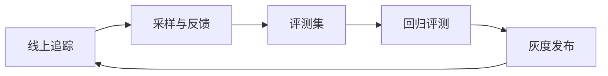

# 评测与可观测 Evals & Observability

> [AI](../) › 评测与可观测

LLM 应用的「测试 + 监控」：离线评测集回归、LLM-as-judge、RAG 专项指标，以及基于 OpenTelemetry GenAI 语义约定的线上追踪与成本监控。

> 相关主题：[可观测性](../../microservices/10-observability/) · [检索增强生成](../08-rag/) · [AI Agent](../09-agents/) · [安全与治理](../19-security-governance/)

## 本关定位

| 项 | 内容 |
|----|------|
| 定位 | 第三章生产化：让 LLM 应用的质量可度量、行为可追踪、成本可控 |
| 前置要求 | [LLM API 编程模式](../06-llm-api-programming/)、[检索增强生成](../08-rag/)；了解日志、指标、链路追踪的基本概念 |
| 粗略用时 | 1–2 周（粗略参考） |
| 章节 | 第三章 生产化 |

## 闯关任务

**QUEST 17 · 第三章 生产化**

- [ ] 能够区分规则、参考答案、LLM-as-judge 与人工四类评测，并为业务场景选择组合。
- [ ] 能够建立版本化的评测集，在提示词或模型变更时做回归评测。
- [ ] 能够识别 LLM-as-judge 的位置、长度与自偏好偏差，并用人工标注样本校准。
- [ ] 能够解释 RAG 的上下文召回、上下文精度、忠实度与答案相关性指标。
- [ ] 能够按 OpenTelemetry GenAI 语义约定为模型调用、工具调用与 Agent 打点。
- [ ] 能够搭建线上追踪、成本看板与用户反馈闭环。

**奖励**：+100 XP · 徽章「质量守门人」（徽章名暂定，内容建设中）

## 知识要点

### 评测类型

- 基于规则：包含关键词、正则、JSON 可解析、长度限制；便宜、确定，适合格式与硬约束。
- 参考答案：与标准答案比对（精确匹配、语义相似度），适合有唯一答案的任务。
- LLM-as-judge：用评审模型按评分标准打分或做成对比较，适合开放式回答；需要校准。
- 人工评测：成本最高，用于建立「金标准」样本和校准自动评测。
- 评测集要版本化：和代码一起存放，记录来源（线上采样、失败案例、红队），每次变更提示词、模型或检索策略都跑一遍。

```python
import json

# 评测集：输入 + 规则断言（版本化存储在仓库中）
cases = [
    {"id": "c1", "input": "退款多久到账", "must": ["1–3 个工作日"]},
    {"id": "c2", "input": "能开发票吗", "must": ["电子发票"]},
    {"id": "c3", "input": "返回 JSON 格式的订单状态", "json": True},
]

def app_v1(q):  # 待评测的应用，这里用固定回答代替模型调用
    return {"c1": "原路退回，1–3 个工作日到账。", "c2": "可以开票。", "c3": '{"status": "已发货"}'}[q]

def check(case, out):
    if case.get("json"):
        try:
            json.loads(out)
            return True
        except ValueError:
            return False
    return all(m in out for m in case["must"])

passed = [c["id"] for c in cases if check(c, app_v1(c["id"]))]
print(f"规则评测通过 {len(passed)}/{len(cases)}：{passed}")

# 成对比较：交换 A/B 位置各评一次，两次结论一致才计入，用来抵消位置偏差
def biased_judge(first, second):  # 模拟一个偏爱「第一个答案」的评审模型
    return "first"

def pairwise(a, b, judge):
    r1 = judge(a, b)          # a 在前
    r2 = judge(b, a)          # b 在前
    win1 = "a" if r1 == "first" else "b"
    win2 = "b" if r2 == "first" else "a"
    return win1 if win1 == win2 else "不一致（疑似位置偏差）"

print("成对比较结果：", pairwise("回答 A", "回答 B", biased_judge))
```

运行输出：

```text
规则评测通过 2/3：['c1', 'c3']
成对比较结果： 不一致（疑似位置偏差）
```

### LLM-as-judge 的偏差

- 位置偏差：倾向于选择排在前面（或后面）的答案；对策是交换顺序各评一次。
- 长度偏差：倾向于更长的回答；对策是在评分标准中明确「简洁优先」或控制长度。
- 自偏好：倾向于同系列模型的输出；对策是换用不同厂商的评审模型。
- 校准：抽 50–100 条人工标注样本，计算评审模型与人工结论的一致率，达标后再大规模使用。

### RAG 专项指标

- 上下文召回（Context Recall）：回答所需的信息是否都被检索到。
- 上下文精度（Context Precision）：检索结果中相关片段是否排在前面。
- 忠实度（Faithfulness）：回答中的陈述是否都能在检索到的上下文中找到依据，用来发现幻觉。
- 答案相关性（Answer Relevancy）：回答是否切题。
- 检索指标与生成指标分开看，才能定位问题出在检索还是生成，见 [检索增强生成](../08-rag/)。

### 评测工具

```yaml
# promptfooconfig.yaml：运行 npx promptfoo@latest eval
prompts:
  - "你是客服助手，简洁回答：{{question}}"
providers:
  - openai:gpt-6-luna
tests:
  - vars:
      question: 退款多久到账
    assert:
      - type: icontains
        value: 工作日
      - type: llm-rubric
        value: 回答礼貌，且没有编造具体金额
  - vars:
      question: 用 JSON 返回订单状态，字段为 status
    assert:
      - type: is-json
```

- promptfoo：YAML 配置 + CLI，适合提示词与模型的矩阵对比，并内置红队扫描。
- DeepEval：pytest 风格，把评测写成单元测试接入 CI。
- Ragas：RAG 指标的参考实现。
- Langfuse：开源 LLM 工程平台，集追踪、评测、提示词管理与数据集于一体，可自托管。

### OpenTelemetry GenAI 语义约定

- 模型调用 span 名为 `{gen_ai.operation.name} {gen_ai.request.model}`，如 `chat gpt-6-luna`；工具调用为 `execute_tool {gen_ai.tool.name}`；Agent 为 `invoke_agent {gen_ai.agent.name}`。
- 常用属性：`gen_ai.operation.name`（必填）、`gen_ai.provider.name`、`gen_ai.request.model`、`gen_ai.response.model`、`gen_ai.usage.input_tokens`、`gen_ai.usage.output_tokens`、`gen_ai.conversation.id`。
- 旧属性 `gen_ai.system` 已被 `gen_ai.provider.name` 取代，老的埋点库需要升级。
- 提示词与回答内容默认不应写入 span，按需开启并做脱敏，见 [安全与治理](../19-security-governance/)。

```python
from opentelemetry import trace
from opentelemetry.sdk.trace import TracerProvider
from opentelemetry.sdk.trace.export import SimpleSpanProcessor
from opentelemetry.sdk.trace.export.in_memory_span_exporter import InMemorySpanExporter

exporter = InMemorySpanExporter()          # 生产中换成 OTLP Exporter，发往 Collector / Langfuse
provider = TracerProvider()
provider.add_span_processor(SimpleSpanProcessor(exporter))
trace.set_tracer_provider(provider)
tracer = trace.get_tracer("support-bot")

with tracer.start_as_current_span("invoke_agent 客服助手") as agent:
    agent.set_attributes({"gen_ai.operation.name": "invoke_agent", "gen_ai.agent.name": "客服助手"})
    with tracer.start_as_current_span("chat gpt-6-luna") as llm:
        llm.set_attributes({
            "gen_ai.operation.name": "chat",
            "gen_ai.provider.name": "openai",
            "gen_ai.request.model": "gpt-6-luna",
            "gen_ai.usage.input_tokens": 812,
            "gen_ai.usage.output_tokens": 46,
        })
    with tracer.start_as_current_span("execute_tool search_orders") as tool:
        tool.set_attributes({"gen_ai.operation.name": "execute_tool", "gen_ai.tool.name": "search_orders"})

spans = sorted(exporter.get_finished_spans(), key=lambda s: s.start_time)
root = spans[0].context.span_id
for s in spans:
    indent = "" if s.context.span_id == root else "  └─ "
    attrs = {k: v for k, v in s.attributes.items() if k != "gen_ai.operation.name"}
    print(f"{indent}{s.name}  {attrs}")
tokens = sum(s.attributes.get("gen_ai.usage.input_tokens", 0) + s.attributes.get("gen_ai.usage.output_tokens", 0) for s in spans)
print("本次请求总 Token：", tokens)
```

运行输出：

```text
invoke_agent 客服助手  {'gen_ai.agent.name': '客服助手'}
  └─ chat gpt-6-luna  {'gen_ai.provider.name': 'openai', 'gen_ai.request.model': 'gpt-6-luna', 'gen_ai.usage.input_tokens': 812, 'gen_ai.usage.output_tokens': 46}
  └─ execute_tool search_orders  {'gen_ai.tool.name': 'search_orders'}
本次请求总 Token： 858
```

### 线上闭环



- 追踪采样：全量记录元数据（模型、Token、延迟、错误），内容采集默认关闭；确需按比例或异常采集时先获得授权并脱敏。
- 成本看板：按模型、功能、租户聚合 Token 与费用，设置预算告警。
- 用户反馈：点赞、点踩、重新生成、人工接管都是信号，关联到 trace 后回流评测集。
- 回归告警：评测分数、错误率、P95 延迟、单次请求成本超过阈值时告警；指标与告警体系见 [可观测性](../../microservices/10-observability/)。

### 语义约定的状态与用量口径

- 主仓库当前 release 为 `v1.45.0`（2026-11-02），GenAI 在 `v1.42.0`（2026-06-12）迁往独立仓库，不是到 1.45 才迁移。独立 `semantic-conventions-genai` 截至 2026-11-05 无 release，当前 registry 的相关 `gen_ai.*` 属性仍标 `development`，此状态已核实，不再列作待核实。
- 固定 semconv / instrumentation 版本与字段映射；旧主仓库属性被 deprecated 不表示新仓库已稳定。缓存读写分别为 `gen_ai.usage.cache_read.input_tokens` 与 `gen_ai.usage.cache_write.input_tokens`，不要继续使用旧的 cache_creation 名称。
- `input_tokens` 包括缓存输入，`output_tokens` 包括 reasoning 输出；缓存 / reasoning 是分项，不应与总数再次相加。Agent 父 span 可能聚合子调用，用量结算只选一个层级；本页示例每次只在模型 span 记录用量。
- 流式中断缺失 usage 时标记未知，账单与在线估算定期对账；trace 采样率不能直接拿来计算完整账单，真实费用还受模型 / 地区 / 缓存价格版本影响。

### 衔接 Java 与微服务可观测链路

复用 [微服务可观测性](../../microservices/10-observability/) 的 trace / metrics / logs：网关 → Spring AI 应用 → 检索 → 模型 / 工具调用形成关联链；跨 [消息队列](../../microservices/06-messaging/) 传播 trace context，长异步任务可用 span link 表达因果。Spring AI 自带 observation 时先确认层级，避免又手动为同一次模型请求重复计费。

- 指标标签使用受控模型名、操作、结果类型等低基数维度；请求 ID、会话 ID、原始问题、动态工具参数只放适当的 span / 日志，不能做无限增长的 metrics label。
- 同时看离线质量 / 安全回归、线上成功率 / SLO、Token / 费用与人工接管，只有 P95 延迟或 LLM-judge 总分都不够；质量下降与检索 / prompt / 模型版本关联。
- 默认不采集原文、图片、音频或工具 secret；任何按异常采集内容的策略也须先脱敏、授权和限期留存，详见 [安全与治理](../19-security-governance/)。

## 选型对比

| 工具 | 版本 | 形态 | 适合场景 |
|------|------|------|----------|
| Langfuse | v4.75.0（Python SDK 5.2.0） | 开源平台，可自托管 | 追踪、评测、提示词管理一体化 |
| promptfoo | 0.125.1 | Node.js CLI | 提示词矩阵对比、CI 回归、红队 |
| DeepEval | 4.3.3 | Python 库 | pytest 风格的单元式评测 |
| Ragas | 0.4.3 | Python 库 | RAG 专项指标 |
| Inspect AI | 0.3.287 | Python 框架 | Agent 与能力评测，任务定义规范 |
| OpenTelemetry SDK | 1.45.2 | 标准与 SDK | 厂商中立的追踪与指标 |

> [!WARNING]
> OpenTelemetry 已把 GenAI 语义约定从主仓库迁到独立仓库 `open-telemetry/semantic-conventions-genai`，该仓库截至 2026-11-05 尚无 release，属性稳定性均为 `development`，名称仍可能调整。Langfuse 同时维护 v3（v3.227.0）与 v4 两条线；PyPI 上的 `promptfoo` 包（0.2.0）不是官方 npm CLI。版本于 2026-11-05 核对。

## 常见误区

- 只靠「看几个例子感觉不错」上线：没有评测集就无法判断改动是变好还是变坏。
- 直接相信 LLM-as-judge 的分数：未经人工校准的评审模型可能系统性偏向某类回答。
- 评测集一成不变：线上失败案例不回流，评测集会逐渐与真实流量脱节。
- RAG 只看最终答案：分不清是检索没找到还是生成没用好，优化方向就会错。
- 把完整提示词和用户数据写进 trace：带来隐私与合规风险，应脱敏并控制访问权限。
- 只监控延迟和错误率：LLM 应用还要监控 Token 成本、拒答率和回答质量。

## 实践任务

- 运行本页的评测代码，为你的应用补充 20 条评测用例，覆盖正常、边界和拒答场景。
- 用 promptfoo 对比两个提示词版本，把评测接入 CI，分数下降时让流水线失败。
- 抽 50 条样本人工标注，计算 LLM-as-judge 与人工结论的一致率，并测试交换顺序后的结果变化。
- 为一个 RAG 应用计算 Ragas 的忠实度与上下文召回，找出得分最低的 5 条并分析原因。
- 用 OpenTelemetry 为模型调用和工具调用打点，导出到 Langfuse 或你的 Collector，做一张按功能聚合的成本看板。

## 资料索引

- [OTel GenAI 语义约定](https://opentelemetry.io/docs/specs/semconv/gen-ai/) — 官方站点上的 GenAI 约定页面
- [semantic-conventions-genai](https://github.com/open-telemetry/semantic-conventions-genai) — GenAI 约定的新仓库，以此为准
- [Langfuse 文档](https://langfuse.com/docs) — 开源 LLM 工程平台
- [promptfoo 文档](https://www.promptfoo.dev/docs/intro/) — 提示词评测与红队
- [Judging LLM-as-a-Judge 论文](https://arxiv.org/abs/2306.05685) — MT-Bench 与评审偏差分析
- [Ragas 文档](https://docs.ragas.io/) — RAG 评测指标
- [OTel 主仓库发布记录](https://github.com/open-telemetry/semantic-conventions/releases) — v1.45.0 与 v1.42.0 迁移时间线
- [OTel GenAI Registry](https://github.com/open-telemetry/semantic-conventions-genai/blob/main/model/gen-ai/registry.yaml) — Development 状态及 Token / cache 字段
- [OTel GenAI 发布页](https://github.com/open-telemetry/semantic-conventions-genai/releases) — 独立仓库尚无 release
- [Spring AI 可观测性](https://docs.spring.io/spring-ai/reference/observability/) — ChatClient / 模型 / 工具 observation
- [OTel 上下文传播](https://opentelemetry.io/docs/concepts/context-propagation/) — 跨进程 trace context 与因果关联
- [Langfuse Python SDK 版本](https://pypi.org/project/langfuse/) — 2026-11-05 为 5.2.0，非平台版本

## 通关自测

先独立作答，再展开参考答案核对；简答题答出要点即算对。答对 ≥ 80% 即可进入下一关。

1. 【单选】检查模型输出是否为合法 JSON，最合适的评测方式是：
    - A. 人工评测
    - B. LLM-as-judge
    - C. 基于规则
    - D. 语义相似度
2. 【单选】交换两个答案的顺序各评一次，主要是为了消除：
    - A. 长度偏差
    - B. 位置偏差
    - C. 自偏好
    - D. 采样随机性
3. 【单选】按 OpenTelemetry GenAI 语义约定，一次对 `gpt-6-luna` 的对话调用，span 名应为：
    - A. `llm.call`
    - B. `openai gpt-6-luna`
    - C. `chat gpt-6-luna`
    - D. `gen_ai.chat`
4. 【简答】RAG 回答出现幻觉，应优先看哪些指标来定位问题？
5. 【简答】为什么线上 trace 默认不记录完整的提示词和回答？

<details markdown><summary>参考答案</summary>

1. C — JSON 是否可解析是确定性检查，用规则最便宜可靠。
2. B — 两次结论一致才计入，可以抵消评审模型偏爱某个位置的倾向。
3. C — span 名为 `{gen_ai.operation.name} {gen_ai.request.model}`。
4. 先看上下文召回，判断所需信息是否被检索到；再看忠实度，判断回答是否超出了检索到的上下文。召回低说明问题在检索，召回高而忠实度低说明问题在生成或提示词。
5. 提示词和回答可能包含个人信息、商业机密或密钥，全量记录会带来隐私、合规和存储成本问题。通常只记录元数据，按采样或异常记录内容，并做脱敏和访问控制。

</details>

---

← [上一节：多模态](../16-multimodal/) · [返回 AI](../) · [下一节：LLMOps 与 GPU 基础设施](../18-llmops-infra/) →
