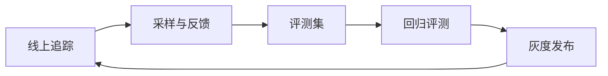

# 评测与可观测 {#evals-observability}

> [AI](../) › 评测与可观测

JSON 能不能解析，用规则，不用评审模型。评审模型要先和人工样本对齐，还要交换答案顺序。检索没找回和生成没用上证据，是两种失败。Token 不要把已经含在总数里的缓存再加一遍。

> 相关主题：[可观测性](../../microservices/10-observability/) · [检索增强生成](../08-rag/) · [AI Agent](../09-agents/) · [安全与治理](../19-security-governance/)

> [!NOTE]
> 本仓库和站点的内容由 AI 生成，资料与资源链接来源于网络，仅供学习参考；如有错误或侵权，请提 Issue 告知。

## 这一页补哪一块 {#_1}

规则、参考答案、LLM-as-judge 和人工各管一类问题。评测集要跟代码一起版本化。线上默认只记模型、Token、延迟和错误，不把完整提示词和回答写进 trace。用量只选一层：父 span 如果已经汇总了子调用，不要再加一遍。

## 四类评测 {#_4}

<span id="_2"></span>

- 规则：关键词、正则、JSON 能否解析、长度。便宜，结果确定。格式和硬约束用这个。
- 参考答案：精确匹配或语义相似度。适合有标准答案的题。
- LLM-as-judge：按评分标准打分或成对比较。适合开放回答，必须先校准。
- 人工：最贵。用来做金标准，并校准自动评测。

评测集和代码放在一起，记下来源是线上采样、失败案例还是红队。提示词、模型或检索一变，就再跑一遍。一次样本不是 [代码模型与评测](../13-code-models-evals/) 里的 pass@k。

下面用固定回答代替模型。不是一次真实调用。

```python
import json

# 评测集：输入 + 规则断言（版本化存储在仓库中）
cases = [
    {"id": "c1", "input": "退款多久到账", "must": ["1–3 个工作日"]},
    {"id": "c2", "input": "能开发票吗", "must": ["电子发票"]},
    {"id": "c3", "input": "返回 JSON 格式的订单状态", "json": True},
]

def app_v1(q):  # 待评测的应用，这里用固定回答代替模型调用
    return {"c1": "原路退回，1–3 个工作日到账。", "c2": "可以开票。", "c3": '{"status": "已发货"}'}[q]

def check(case, out):
    if case.get("json"):
        try:
            json.loads(out)
            return True
        except ValueError:
            return False
    return all(m in out for m in case["must"])

passed = [c["id"] for c in cases if check(c, app_v1(c["id"]))]
print(f"规则评测通过 {len(passed)}/{len(cases)}：{passed}")

# 成对比较：交换 A/B 位置各评一次，两次结论一致才计入，用来抵消位置偏差
def biased_judge(first, second):  # 模拟一个偏爱「第一个答案」的评审模型
    return "first"

def pairwise(a, b, judge):
    r1 = judge(a, b)          # a 在前
    r2 = judge(b, a)          # b 在前
    win1 = "a" if r1 == "first" else "b"
    win2 = "b" if r2 == "first" else "a"
    return win1 if win1 == win2 else "不一致（疑似位置偏差）"

print("成对比较结果：", pairwise("回答 A", "回答 B", biased_judge))
```

编写时的输出：

```text
规则评测通过 2/3：['c1', 'c3']
成对比较结果： 不一致（疑似位置偏差）
```

Java 对照：

```java
class RuleEval {
    public static void main(String[] args) {
        String[] ids = {"c1", "c2", "c3"};
        String[] must = {"1–3 个工作日", "电子发票", null};
        String[] out = {
            "原路退回，1–3 个工作日到账。",
            "可以开票。",
            "{\"status\": \"已发货\"}"
        };
        StringBuilder passed = new StringBuilder();
        int n = 0;
        for (int i = 0; i < ids.length; i++) {
            boolean ok = must[i] == null ? out[i].startsWith("{") : out[i].contains(must[i]);
            if (must[i] == null) {
                ok = out[i].contains("\"status\"");
            }
            if (ok) {
                if (n++ > 0) passed.append(", ");
                passed.append("'").append(ids[i]).append("'");
            }
        }
        System.out.println("规则评测通过 " + n + "/3：[" + passed + "]");
        System.out.println("成对比较结果： 不一致（疑似位置偏差）");
    }
}
```

2026-11-25 用 Python 3.12.3 和 OpenJDK 21.0.13.0.3 重跑了这两段，打印与输出块一致。输出块不改。Java 的成对比较那一行是直接打印的句子，没有像 Python 那样交换顺序再算。规则通过 2/3 是这三条固定回答的结果，不是模型质量。

## 评审模型的偏差 {#llm-as-judge}

- 位置偏差：偏向排在前面或后面的答案。交换顺序各评一次，两次一致才算。
- 长度偏差：偏向更长的回答。评分标准里写明简洁，或限制长度。
- 自偏好：偏向同系列模型的输出。换一家评审模型。
- 校准：抽 50 到 100 条人工标注，算和人工结论的一致率。没达标之前，不要用这个分数当发布门。

## 检索和生成分开看 {#rag}

- 上下文召回：回答需要的信息有没有被检索到。
- 上下文精度：相关片段是否排在前面。
- 忠实度：回答里的句子能否在检索到的上下文里找到依据。
- 答案相关性：是否切题。

召回低，先改检索。召回高而忠实度低，先改生成或提示。混成一个总分就不知道动哪一层。四种失败的分法见 [检索增强生成](../08-rag/)。

## 评测工具 {#_5}

```yaml
# promptfooconfig.yaml：运行 npx promptfoo@latest eval
prompts:
  - "你是客服助手，简洁回答：{{question}}"
providers:
  - openai:gpt-6-luna
tests:
  - vars:
      question: 退款多久到账
    assert:
      - type: icontains
        value: 工作日
      - type: llm-rubric
        value: 回答礼貌，且没有编造具体金额
  - vars:
      question: 用 JSON 返回订单状态，字段为 status
    assert:
      - type: is-json
```

- promptfoo：YAML 加 CLI，用来比提示词和模型，并带红队扫描。
- DeepEval：pytest 风格，评测可以进 CI。
- Ragas：RAG 指标的一种实现。
- Langfuse：追踪、评测、提示词和数据集。可以自托管。

2026-11-25 没有安装 promptfoo，没有调用 `gpt-6-luna`。这个模型名只是 YAML 里的字符串。版本表仍是 2026-11-05 的记录。

## 语义约定 {#opentelemetry-genai}

模型调用的 span 名是 `{gen_ai.operation.name} {gen_ai.request.model}`，例如 `chat gpt-6-luna`。工具是 `execute_tool {gen_ai.tool.name}`。Agent 是 `invoke_agent {gen_ai.agent.name}`。

常用属性包括 `gen_ai.operation.name`、`gen_ai.provider.name`、请求和响应的模型名、`gen_ai.usage.input_tokens`、`gen_ai.usage.output_tokens`、`gen_ai.conversation.id`。章内记下旧的 `gen_ai.system` 已被 `gen_ai.provider.name` 取代。

提示词和回答默认不写入 span。要记内容时先授权并脱敏，见 [安全与治理](../19-security-governance/)。

```python
from opentelemetry import trace
from opentelemetry.sdk.trace import TracerProvider
from opentelemetry.sdk.trace.export import SimpleSpanProcessor
from opentelemetry.sdk.trace.export.in_memory_span_exporter import InMemorySpanExporter

exporter = InMemorySpanExporter()          # 生产中换成 OTLP Exporter，发往 Collector / Langfuse
provider = TracerProvider()
provider.add_span_processor(SimpleSpanProcessor(exporter))
trace.set_tracer_provider(provider)
tracer = trace.get_tracer("support-bot")

with tracer.start_as_current_span("invoke_agent 客服助手") as agent:
    agent.set_attributes({"gen_ai.operation.name": "invoke_agent", "gen_ai.agent.name": "客服助手"})
    with tracer.start_as_current_span("chat gpt-6-luna") as llm:
        llm.set_attributes({
            "gen_ai.operation.name": "chat",
            "gen_ai.provider.name": "openai",
            "gen_ai.request.model": "gpt-6-luna",
            "gen_ai.usage.input_tokens": 812,
            "gen_ai.usage.output_tokens": 46,
        })
    with tracer.start_as_current_span("execute_tool search_orders") as tool:
        tool.set_attributes({"gen_ai.operation.name": "execute_tool", "gen_ai.tool.name": "search_orders"})

spans = sorted(exporter.get_finished_spans(), key=lambda s: s.start_time)
root = spans[0].context.span_id
for s in spans:
    indent = "" if s.context.span_id == root else "  └─ "
    attrs = {k: v for k, v in s.attributes.items() if k != "gen_ai.operation.name"}
    print(f"{indent}{s.name}  {attrs}")
tokens = sum(s.attributes.get("gen_ai.usage.input_tokens", 0) + s.attributes.get("gen_ai.usage.output_tokens", 0) for s in spans)
print("本次请求总 Token：", tokens)
```

编写时的输出：

```text
invoke_agent 客服助手  {'gen_ai.agent.name': '客服助手'}
  └─ chat gpt-6-luna  {'gen_ai.provider.name': 'openai', 'gen_ai.request.model': 'gpt-6-luna', 'gen_ai.usage.input_tokens': 812, 'gen_ai.usage.output_tokens': 46}
  └─ execute_tool search_orders  {'gen_ai.tool.name': 'search_orders'}
本次请求总 Token： 858
```

Java 只打印同样的三行，并用 `812 + 46` 得到 858。它没有创建 span：

```java
class GenAiSpans {
    public static void main(String[] args) {
        System.out.println("invoke_agent 客服助手  {'gen_ai.agent.name': '客服助手'}");
        System.out.println("  └─ chat gpt-6-luna  {'gen_ai.provider.name': 'openai', 'gen_ai.request.model': 'gpt-6-luna', 'gen_ai.usage.input_tokens': 812, 'gen_ai.usage.output_tokens': 46}");
        System.out.println("  └─ execute_tool search_orders  {'gen_ai.tool.name': 'search_orders'}");
        int tokens = 812 + 46;
        System.out.println("本次请求总 Token： " + tokens);
    }
}
```

2026-11-25 编译运行了这段 Java，打印与输出块一致。Python 需要 `opentelemetry` 包，没有安装，也没有跑。858 只是这两个字面量相加，不是一次真实请求的账单。

## 线上闭环 {#_6}



全量可以记模型、Token、延迟和错误。内容默认不采集。确要按比例或在异常时采集，先授权并脱敏。

成本按模型、功能和租户汇总，并设预算告警。点赞、点踩、重新生成和人工接管要能连回 trace，再流回评测集。分数、错误率、P95 延迟或单次成本越过阈值就告警。指标见 [可观测性](../../microservices/10-observability/)。

## 用量不要加两次 {#_7}

章内记录：主仓库 release 为 `v1.45.0`（2026-11-02）。GenAI 在 `v1.42.0`（2026-06-12）迁到独立仓库，不是到 1.45 才迁。独立的 `semantic-conventions-genai` 截至 2026-11-05 没有 release，相关 `gen_ai.*` 仍标 `development`。2026-11-25 没有重开这些页，不把 development 改成稳定，也不把版本改称当天的当前版。

固定语义约定和埋点库的版本。旧属性被标为 deprecated，不等于新仓库已经稳定。缓存读和缓存写分别是 `gen_ai.usage.cache_read.input_tokens` 与 `gen_ai.usage.cache_write.input_tokens`。不要再用旧的 cache_creation 名字。

`input_tokens` 已经包括缓存输入。`output_tokens` 已经包括 reasoning。缓存和 reasoning 是分项，不能再加进总数。Agent 父 span 可能已经汇总了子调用，结算只用一层。本页示例只在模型 span 上记用量。

流式中断、没有 usage 时标成未知。账单和在线估算要定期对账。trace 的采样率不是完整账单。真实费用还随模型、地区和缓存价格版本变化。这些价格版本本章没有重核。

## 接到已有的可观测链路 {#java}

沿用 [微服务可观测性](../../microservices/10-observability/)：网关、Spring AI、检索、模型和工具调用要能串成一条 trace。跨 [消息队列](../../microservices/06-messaging/) 时传播 trace context。长异步任务可以用 span link。Spring AI 若已经有 observation，先确认记在哪一层，避免同一次模型请求算两次钱。

指标标签只用受控的模型名、操作和结果类型。请求 ID、会话 ID、原始问题和动态工具参数放进 span 或日志，不要做成会无限增长的 metrics label。

同时看离线质量、线上成功率和 SLO、Token 费用、人工接管。只有 P95 或一个 judge 总分都不够。质量下降要能对上检索、提示词或模型版本。

默认不采集原文、图片、音频或工具里的 secret。

## 工具版本是当时的表 {#eval-choice}

<span id="_8"></span>

| 工具 | 版本（2026-11-05 记录） | 形态 | 适合场景 |
|------|------|------|----------|
| Langfuse | v4.75.0（Python SDK 5.2.0） | 开源平台，可自托管 | 追踪、评测、提示词管理一体化 |
| promptfoo | 0.125.1 | Node.js CLI | 提示词矩阵对比、CI 回归、红队 |
| DeepEval | 4.3.3 | Python 库 | pytest 风格的单元式评测 |
| Ragas | 0.4.3 | Python 库 | RAG 专项指标 |
| Inspect AI | 0.3.287 | Python 框架 | Agent 与能力评测 |
| OpenTelemetry SDK | 1.45.2 | 标准与 SDK | 厂商中立的追踪与指标 |

> [!WARNING]
> OpenTelemetry 已把 GenAI 语义约定从主仓库迁到独立仓库 `open-telemetry/semantic-conventions-genai`，该仓库截至 2026-11-05 尚无 release，属性稳定性均为 `development`，名称仍可能调整。Langfuse 同时维护 v3（v3.227.0）与 v4 两条线；PyPI 上的 `promptfoo` 包（0.2.0）不是官方 npm CLI。版本于 2026-11-05 核对。2026-11-25 没有重开，不把这些数字称为当天的当前版本。

## 常见误读 {#_3}

<span id="_9"></span>

- 看几个例子就上线：没有评测集就不知道改动是变好还是变坏。
- 未校准的 judge 分当发布门。
- 评测集不回收线上失败。
- RAG 只看最终答案：分不清检索和生成。
- 把 `input_tokens` 和缓存读数再加一遍。
- 父 span 和子 span 的用量加两次。
- 把完整提示词写进 trace。
- 把 Java 打印的 858 当成一次真实账单。
- 只监控延迟：还要看 Token、拒答和回答质量。

## 可选核对 {#eval-check}

<span id="_10"></span>

1. 检查输出是不是合法 JSON，为什么用规则而不是 LLM-as-judge？
2. 为什么线上 trace 默认不记录完整提示词？`input_tokens` 已经包含缓存输入时，再加一遍 cache 读数会怎样？

<details markdown><summary>参考答案</summary>

1. JSON 能否解析是确定的检查，规则最便宜。judge 适合开放回答，而且要先用人工样本校准，并交换顺序以看位置偏差。本页示例用的是固定回答，不是模型。
2. 提示词和回答可能有个人信息、机密或密钥。默认只记元数据。`input_tokens` 已含缓存输入，再加 `cache_read` 会把同一部分算两次。父 span 若已汇总子调用，用量只保留一层。Java 的 858 只是 812 与 46 相加。

</details>

<span id="_12"></span>

## 资料索引 {#_11}

- [OTel GenAI 语义约定](https://opentelemetry.io/docs/specs/semconv/gen-ai/) — 官方站点上的 GenAI 页；2026-11-25 未重开
- [semantic-conventions-genai](https://github.com/open-telemetry/semantic-conventions-genai) — 章内记截至 2026-11-05 无 release
- [Langfuse 文档](https://langfuse.com/docs) — 开源 LLM 工程平台
- [promptfoo 文档](https://www.promptfoo.dev/docs/intro/) — 提示词评测与红队；2026-11-25 未运行
- [Judging LLM-as-a-Judge 论文](https://arxiv.org/abs/2306.05685) — MT-Bench 与评审偏差
- [Ragas 文档](https://docs.ragas.io/) — RAG 评测指标
- [OTel 主仓库发布记录](https://github.com/open-telemetry/semantic-conventions/releases) — v1.45.0 与 v1.42.0 的章内时间线
- [OTel GenAI Registry](https://github.com/open-telemetry/semantic-conventions-genai/blob/main/model/gen-ai/registry.yaml) — 章内记下的 development 与 Token 字段
- [OTel GenAI 发布页](https://github.com/open-telemetry/semantic-conventions-genai/releases) — 独立仓库当时无 release
- [Spring AI 可观测性](https://docs.spring.io/spring-ai/reference/observability/) — observation 层级
- [OTel 上下文传播](https://opentelemetry.io/docs/concepts/context-propagation/) — 跨进程 trace context
- [Langfuse Python SDK 版本](https://pypi.org/project/langfuse/) — 2026-11-05 记下 5.2.0，不是平台版本

---

← [上一节：多模态](../16-multimodal/) · [返回 AI](../) · [下一节：LLMOps 与 GPU 基础设施](../18-llmops-infra/) →
