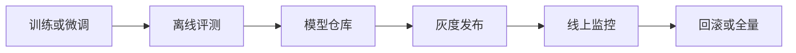

# LLMOps 与 GPU 基础设施 {#llmops-gpu-llmops-gpu-infra}

> [AI](../) › LLMOps 与 GPU 基础设施

在 Kubernetes 上运行训练与推理的平台能力：GPU 驱动与调度、批作业排队、模型服务化与弹性、模型版本与发布流程。

> 相关主题：[容器与 Kubernetes](../../microservices/12-containers-k8s/) · [持续交付与 GitOps](../../microservices/14-cicd-gitops/) · [推理与服务](../15-inference-serving/) · [微调与对齐](../14-fine-tuning/)

## 本关定位

| 项 | 内容 |
|----|------|
| 定位 | 第三章生产化：把推理引擎和训练任务变成可共享、可扩缩、可回滚的平台能力 |
| 前置要求 | [推理与服务](../15-inference-serving/)、[容器与 Kubernetes](../../microservices/12-containers-k8s/)；会写 Deployment 与 Service |
| 粗略用时 | 2–3 周（粗略参考） |
| 章节 | 第三章 生产化 |

## 闯关任务

**QUEST 18 · 第三章 生产化**

- [ ] 能够说明 GPU 软件栈各层的职责：驱动、CUDA、GPU Operator、Device Plugin 与 DRA。
- [ ] 能够比较整卡分配、MIG 与时间片共享三种 GPU 共享方式的取舍。
- [ ] 能够用 Kueue 为多个团队配置 GPU 配额与作业排队。
- [ ] 能够用 KServe 在 Kubernetes 上部署一个 LLM 推理服务。
- [ ] 能够根据压测数据做容量规划，并设计基于队列长度或 KV 占用的扩缩策略。
- [ ] 能够为模型设计版本、灰度与回滚流程。

**奖励**：+100 XP · 徽章「算力调度官」（徽章名暂定，内容建设中）

## 知识要点

### GPU 软件栈

- 节点层：GPU 驱动、CUDA 运行时、容器运行时的 NVIDIA 扩展。
- NVIDIA GPU Operator：用 Operator 自动安装和升级驱动、Container Toolkit、Device Plugin、DCGM 监控等组件，避免手工维护每个节点。
- Device Plugin：把 GPU 作为扩展资源 `nvidia.com/gpu` 暴露给调度器，Pod 在 `resources.limits` 中申请整数张卡。
- DRA（动态资源分配）：用 ResourceClaim 描述设备需求，可按型号、显存等属性筛选，比整数计数更灵活。
- 共享方式：整卡分配隔离最好；MIG 把一张卡硬切成多个实例，隔离强但规格固定；时间片共享利用率高但无显存隔离。

### 调度与配额

- 问题：多个团队共享 GPU 集群时，直接提交 Pod 会出现「谁先抢到算谁的」、部分 Pod 启动后空等其他 Pod 的情况。
- Kueue：作业先进入 LocalQueue，按 ClusterQueue 的配额决定何时整体准入；同一 cohort 内的队列可以借用彼此空闲的配额。
- Gang 调度：分布式训练需要所有 Worker 同时就绪，否则已启动的 Worker 会白白占卡。
- 拓扑感知：把同一作业的 Pod 放到同一机架或同一 NVLink 域内，减少通信开销。

```yaml
# Kueue v0.20：为 GPU 配置配额（API 版本 v1beta2）
apiVersion: kueue.x-k8s.io/v1beta2
kind: ResourceFlavor
metadata:
  name: gpu-flavor
---
apiVersion: kueue.x-k8s.io/v1beta2
kind: ClusterQueue
metadata:
  name: team-a-cq
spec:
  namespaceSelector: {}
  resourceGroups:
  - coveredResources: ["cpu", "memory", "nvidia.com/gpu"]
    flavors:
    - name: gpu-flavor
      resources:
      - name: cpu
        nominalQuota: 64
      - name: memory
        nominalQuota: 512Gi
      - name: nvidia.com/gpu
        nominalQuota: 8
---
apiVersion: kueue.x-k8s.io/v1beta2
kind: LocalQueue
metadata:
  namespace: team-a
  name: team-a-queue
spec:
  clusterQueue: team-a-cq
```

- 作业通过标签 `kueue.x-k8s.io/queue-name: team-a-queue` 进入队列；Kueue 支持 batch Job、JobSet、RayJob、PyTorchJob 等多种作业类型。

```python
# 模拟 Kueue 的配额准入：工作负载先排队，配额够才整体放行（Gang 语义）
quota = {"team-a": 8, "team-b": 8}           # 每个队列的 GPU 名义配额
used = {"team-a": 0, "team-b": 0}
borrow_limit = 4                              # 允许从同组空闲配额借用的上限
queue = [("训练 A1", "team-a", 8), ("推理压测 B1", "team-b", 2),
         ("训练 A2", "team-a", 4), ("训练 A3", "team-a", 8)]

for name, cq, gpus in queue:
    cohort_free = sum(quota.values()) - sum(used.values())   # 同组剩余总配额
    borrow = max(0, used[cq] + gpus - quota[cq])              # 超出自身配额的部分
    if gpus <= cohort_free and borrow <= borrow_limit:
        used[cq] += gpus
        note = f"，借用 {borrow} 张" if borrow else ""
        print(f"准入 {name}（{cq}，{gpus} GPU{note}）")
    else:
        print(f"排队 {name}（{cq}，{gpus} GPU）：配额不足，整体等待而不是部分启动")
print("当前占用：", used)
```

运行输出：

```text
准入 训练 A1（team-a，8 GPU）
准入 推理压测 B1（team-b，2 GPU）
准入 训练 A2（team-a，4 GPU，借用 4 张）
排队 训练 A3（team-a，8 GPU）：配额不足，整体等待而不是部分启动
当前占用： {'team-a': 12, 'team-b': 2}
```

### 分布式计算：Ray

- Ray Core：用 `@ray.remote` 把函数和类变成分布式任务与 Actor。
- Ray Train / Ray Data：分布式训练与批量推理、数据预处理。
- Ray Serve：在线服务编排，可组合多个模型。
- KubeRay：在 Kubernetes 上管理 RayCluster、RayJob、RayService，可与 Kueue 配合排队。

### 模型服务：KServe 与 llm-d

```yaml
# KServe 0.21：LLMInferenceService（API 版本 v1alpha2）
apiVersion: serving.kserve.io/v1alpha2
kind: LLMInferenceService
metadata:
  name: qwen3-8b
spec:
  model:
    uri: hf://Qwen/Qwen3-8B
    name: Qwen/Qwen3-8B
  replicas: 2
  router:
    scheduler: {}
    route: {}
    gateway: {}
  template:
    containers:
      - name: main
        resources:
          limits:
            nvidia.com/gpu: "1"
          requests:
            nvidia.com/gpu: "1"
```

- KServe 有两类资源：通用的 `InferenceService`（v1beta1，适合传统模型和简单 LLM 部署）与面向 LLM 的 `LLMInferenceService`（基于 vLLM 与 llm-d，支持 KV 感知路由、PD 分离）。
- llm-d 与 Gateway API Inference Extension：网关根据各副本的队列长度和前缀缓存命中选择后端，比普通轮询更适合 LLM。
- 推理引擎本身的参数与原理见 [推理与服务](../15-inference-serving/)。

### 弹性与成本

```python
import math

# 容量规划：根据峰值流量估算推理副本数（吞吐数据应来自你自己的压测）
peak_rps = 12                 # 峰值每秒请求数
avg_output_tokens = 400       # 平均每个请求生成的 Token
replica_tokens_per_s = 2500   # 单副本在目标 P95 延迟下压测得到的输出吞吐
gpus_per_replica = 1
headroom = 0.7                # 只用到 70% 容量，留出突发余量

need_tps = peak_rps * avg_output_tokens
replicas = math.ceil(need_tps / (replica_tokens_per_s * headroom))
print(f"峰值输出吞吐：{need_tps} tokens/s")
print(f"所需副本：{replicas}，GPU：{replicas * gpus_per_replica} 张")

# 每百万输出 Token 的 GPU 成本（单价为占位值，替换成你的实际价格）
gpu_hour_price = 2.0
cost_per_m = gpu_hour_price * gpus_per_replica / (replica_tokens_per_s * headroom * 3600) * 1_000_000
print(f"每百万输出 Token 成本：{cost_per_m:.2f}（与 GPU 单价同一货币单位）")
```

运行输出：

```text
峰值输出吞吐：4800 tokens/s
所需副本：3，GPU：3 张
每百万输出 Token 成本：0.32（与 GPU 单价同一货币单位）
```

- 扩缩信号：CPU 利用率对 GPU 推理几乎无意义，应使用排队请求数、KV Cache 占用率或 TTFT。
- 冷启动：拉取镜像和加载数十 GB 权重可能要数分钟，可用本地模型缓存、预热副本缓解；Scale-to-zero 只适合低频场景。
- Spot / 抢占：训练任务配合检查点可以用便宜的抢占式实例；在线推理要保留按需实例兜底。

### 模型生命周期



- 模型仓库：Hugging Face Hub 或私有仓库，记录版本、数据来源、评测结果。
- 发布：模型版本与推理配置一起走 GitOps，灰度比例逐步放大，见 [持续交付与 GitOps](../../microservices/14-cicd-gitops/)。
- 回滚：保留上一版本的副本或镜像，评测分数或线上指标异常时快速切回；评测与监控见 [评测与可观测](../17-evals-observability/)。

### 让模型真正可接流量：预热、排空与回滚

- `startupProbe` 覆盖权重下载、加载和内核预热；启动成功后才启用 liveness / readiness 检查。readiness 应表示能接受符合配置的推理请求，而不是进程存在；避免慢启动被 liveness 反复杀死。
- 终止时先撤流并拒绝新请求，再在 grace period 内排空在途流式请求、释放 GPU / KV；超时任务记录可恢复状态。`preStop` 与应用退出共享终止预算，不能无限延长已开始的生成。
- Java 入口、检索服务和 GPU worker 分别扩缩：入口看连接 / 请求 / 队列，GPU 看等待、KV 容量与满足 SLO 的吞吐。Kueue 负责工作负载准入与配额，不等于推理引擎逐请求 continuous batching 的队列。
- 将模型 revision、tokenizer、chat template、adapter、量化 / 引擎参数、prompt、embedding 与索引版本组成发布清单；灰度要验证兼容性，回滚时不能只退容器而保留不兼容索引。
- 权重从受控制品库获取并校验哈希；镜像、驱动、CUDA、内核与引擎组合在目标 GPU 验证。保留冷启动、节点故障、供应商失联与预算耗尽演练记录。

### 复用已经学过的云原生交付

配置 / secret 沿用 [配置管理](../../microservices/03-discovery-config/)；探针、资源限制、网络策略接 [容器与 Kubernetes](../../microservices/12-containers-k8s/)；模型制品与评测门禁接 [持续交付与 GitOps](../../microservices/14-cicd-gitops/)。AI 特有的 GPU、KV 和质量门禁是在已有平台上增加的能力，不是替换整套微服务运维。

## 选型对比

| 组件 | 版本 | 职责 | 说明 |
|------|------|------|------|
| Kubernetes | 1.37.2 | 容器编排 | DRA 用于更灵活的设备分配 |
| NVIDIA GPU Operator | v26.7.2 | GPU 驱动与组件自动化 | 统一管理驱动、Device Plugin、DCGM |
| Kueue | v0.20.4 | 作业排队与配额 | 多团队共享集群、Gang 准入 |
| Ray | 2.60.0 | 分布式训练、批推理、Serve | Python 原生，KubeRay 部署 |
| KubeRay | 1.7.1（1.8.0-rc.0 为预发布） | Ray Kubernetes Operator | 与 Ray 版本分别管理 |
| KServe | 0.21.0 | 模型服务化 | `InferenceService` 与 `LLMInferenceService` |
| llm-d | 1.0.0 | K8s 原生分布式推理 | KV 感知路由、PD 分离 |

> [!WARNING]
> 版本于 2026-11-05 在 GitHub Release 与 PyPI 核对。Kueue 同时维护 v0.20.x 与 v0.19.x（v0.19.11），本页 YAML 使用 v0.20 文档中的 `v1beta2` API；KServe `LLMInferenceService` 仍是 alpha API（`v1alpha2`），字段可能变化；Kubernetes 1.38 目前仅有 alpha 预发布。

## 常见误区

- 按 CPU 利用率扩缩推理服务：GPU 推理的瓶颈在显存和排队，CPU 指标几乎反映不了负载。
- 训练作业不做检查点：节点故障或被抢占后只能从头开始，浪费大量 GPU 时间。
- 分布式训练不用 Gang 调度：部分 Worker 启动后空等，既占卡又无法运行。
- 时间片共享当作隔离方案：多个进程共享显存，一个进程 OOM 会影响其他进程。
- 每次扩容都从公网拉模型权重：冷启动慢且不稳定，应使用镜像内置、PVC 或节点本地缓存。
- 模型上线绕过发布流程：没有版本、评测记录和回滚路径，出问题时无法定位和恢复。

## 实践任务

- 运行本页的容量规划代码，代入你在 [推理与服务](../15-inference-serving/) 中的压测结果，算出需要的 GPU 数和单位 Token 成本。
- 在本地 kind 或 minikube 集群安装 Kueue，用 CPU 资源模拟两个团队的配额，提交作业观察排队与借用。
- 在带 GPU 的集群上用 GPU Operator 完成驱动安装，部署一个申请 `nvidia.com/gpu: 1` 的测试 Pod。
- 用 KServe 部署一个小模型，配置灰度发布，把 10% 流量切到新版本并验证回滚。
- 用 Ray Data 对一批文本做批量推理，比较 1 个和 4 个 Worker 的耗时。

## 资料索引

- [KServe 文档](https://kserve.github.io/website/) — Kubernetes 上的模型服务化
- [Ray 文档](https://docs.ray.io/en/latest/) — 分布式 AI 计算框架
- [NVIDIA GPU Operator 文档](https://docs.nvidia.com/datacenter/cloud-native/gpu-operator/latest/index.html) — GPU 驱动与组件自动化
- [Kueue 文档](https://kueue.sigs.k8s.io/docs/) — Kubernetes 作业排队与配额
- [Kubernetes 调度 GPU](https://kubernetes.io/docs/tasks/manage-gpus/scheduling-gpus/) — 官方 GPU 调度说明
- [Kubernetes 动态资源分配](https://kubernetes.io/docs/concepts/scheduling-eviction/dynamic-resource-allocation/) — DRA 概念与用法
- [Kubernetes 探针](https://kubernetes.io/docs/concepts/workloads/pods/probes/) — startup、readiness 与 liveness 的职责
- [Kubernetes Pod 生命周期](https://kubernetes.io/docs/concepts/workloads/pods/pod-lifecycle/) — 终止、撤流与宽限期
- [Kueue 概念](https://kueue.sigs.k8s.io/docs/concepts/) — 工作负载准入、配额与队列
- [KubeRay 发布记录](https://github.com/kuberay-project/kuberay/releases) — 1.7.1 正式版，1.8.0-rc.0 为预发布；旧 ray-project 链接已重定向

## 通关自测

先独立作答，再展开参考答案核对；简答题答出要点即算对。答对 ≥ 80% 即可进入下一关。

1. 【单选】在 Kubernetes 中自动安装和升级 GPU 驱动、Device Plugin 等组件，常用的是：
    - A. Kueue
    - B. NVIDIA GPU Operator
    - C. KServe
    - D. Ray Serve
2. 【单选】需要强隔离、又想把一张大显存 GPU 分给多个小模型使用，最合适的是：
    - A. 时间片共享
    - B. MIG
    - C. 整卡分配
    - D. 增加 CPU 请求
3. 【单选】LLM 推理服务最不适合作为扩缩指标的是：
    - A. 排队请求数
    - B. KV Cache 占用率
    - C. CPU 利用率
    - D. TTFT
4. 【简答】分布式训练为什么需要 Gang 调度？Kueue 如何实现类似效果？
5. 【简答】推理服务冷启动慢的主要原因是什么？有哪些缓解办法？

<details markdown><summary>参考答案</summary>

1. B — GPU Operator 负责驱动、Container Toolkit、Device Plugin 与监控组件的生命周期。
2. B — MIG 在硬件层切分算力与显存，实例之间相互隔离。
3. C — GPU 推理的瓶颈在显存与排队，CPU 利用率无法反映真实负载。
4. 分布式训练的所有 Worker 需要同时就绪才能开始通信，部分启动会占用 GPU 却无法运行，还可能与其他作业互相等待造成死锁。Kueue 在配额足够容纳整个工作负载时才整体准入，不足时整体排队，达到「全有或全无」的效果。
5. 主要是拉取大镜像、下载数十 GB 模型权重、加载到显存以及引擎预热（如编译、CUDA Graph 捕获）。缓解办法包括节点本地模型缓存或 PVC、预拉镜像、保留最小预热副本、使用更快的权重格式与存储。

</details>

---

← [上一节：评测与可观测](../17-evals-observability/) · [返回 AI](../) · [下一节：安全与治理](../19-security-governance/) →
