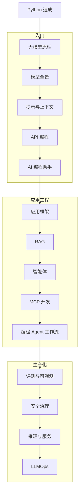

# AI 技术栈 {#ai-ai-stack}

从数学基础到大模型应用工程的完整技术栈：模型原理、提示与上下文、API 编程、RAG、Agent、MCP、AI 编程、微调、推理部署、评测、安全治理。偏实用工程，以 Python 与 Java 为主要实现语言。进入本主题前先完成预备关 [Python 速成](00-python-bridge/)（第一门语言是 C，Python 作 AI 桥接）。

> 相关主题：[Java 技术栈](../java/) · [Spring 框架](../java/09-spring/) · [微服务](../microservices/) · [DevOps](../devops/) · [学习路线](../roadmap/)

## 学习路径

## 子目录

| # | 子目录 | 内容 | 状态 |
|---|--------|------|------|
| 00 | [Python 速成](00-python-bridge/) | AI 前置：对照 C / Java 速成 Python | 🟡 |
| 01 | [数学与机器学习基础](01-foundations/) | 线性代数、概率、优化、经典 ML | 🟡 |
| 02 | [深度学习框架 DL](02-dl-frameworks/) | PyTorch / JAX / Transformers | 🟡 |
| 03 | [Transformer 与大模型原理](03-transformer-llm/) | 注意力、MoE、推理模型 | 🟡 |
| 04 | [模型全景](04-model-landscape/) | 闭源与开放权重、国产模型 | 🟡 |
| 05 | [提示词与上下文工程](05-prompt-context/) | 结构化提示、上下文管理、DSPy | 🟡 |
| 06 | [LLM API 编程模式](06-llm-api-programming/) | 流式、结构化输出、函数调用、多语言 SDK | 🟡 |
| 07 | [应用开发框架](07-app-frameworks/) | LangChain / Spring AI / LangChain4j / AI SDK | 🟡 |
| 08 | [检索增强生成 RAG](08-rag/) | 向量库、混合检索、重排、GraphRAG | 🟡 |
| 09 | [智能体](09-agents/) | Agent 模式、多 Agent、A2A | 🟡 |
| 10 | [MCP 协议与开发](10-mcp/) | Server / Client 开发、官方 SDK | 🟡 |
| 11 | [AI 编程助手与 IDE](11-ai-coding-tools/) | Cursor / Copilot / Claude Code / Codex | 🟡 |
| 12 | [编程智能体工作流](12-coding-agents/) | AGENTS.md、Spec 驱动、CI 集成 | 🟡 |
| 13 | [代码模型与评测](13-code-models-evals/) | SWE-bench Pro、Terminal-Bench | 🟡 |
| 14 | [微调与对齐](14-fine-tuning/) | LoRA / SFT / DPO / GRPO | 🟡 |
| 15 | [推理与服务](15-inference-serving/) | vLLM / SGLang / 量化 / KV Cache | 🟡 |
| 16 | [多模态](16-multimodal/) | 视觉、语音、图像与视频生成 | 🟡 |
| 17 | [评测与可观测](17-evals-observability/) | LLM-as-judge、Langfuse、OTel GenAI | 🟡 |
| 18 | [LLMOps 与 GPU 基础设施](18-llmops-infra/) | KServe / Ray / Kueue / GPU Operator | 🟡 |
| 19 | [安全与治理](19-security-governance/) | OWASP LLM Top 10、EU AI Act、国内法规 | 🟡 |
| 20 | [前沿与趋势](20-trends/) | 长程 Agent、开放权重、新架构 | 🟡 |
🟢 已完成 · 🟡 搭建中 · ⚪ 待开始

## 与 Java、微服务的衔接

AI 主题以工程落地为主，多处直接建立在 Java 与微服务能力之上：

| AI 子主题 | 衔接 |
|-----------|------|
| 07 应用框架（Spring AI / LangChain4j）、06 API 编程（openai-java / anthropic-java）、10 MCP（MCP Java SDK） | [Spring 框架](../java/09-spring/) · [并发](../java/05-concurrency/) · [测试](../java/08-testing/) |
| 15 推理服务（网关、限流、弹性） | [API 网关](../microservices/02-api-gateway/) · [容错与流量治理](../microservices/05-resilience/) |
| 17 评测与可观测（OTel GenAI） | [可观测性](../microservices/10-observability/) |
| 18 LLMOps 与 GPU 基础设施 | [容器与编排](../microservices/12-containers-k8s/) · [持续交付与 GitOps](../microservices/14-cicd-gitops/) |
| 19 安全治理（鉴权、密钥） | [安全](../microservices/11-security/) |
| 08 RAG（缓存、向量库与 PostgreSQL） | [缓存](../microservices/08-caching/) · [数据库与分库分表](../microservices/09-database-sharding/) |

> [!TIP]
> 先完成 00 Python 速成。应用开发者不必先啃 01–02：先走「入门 → 应用工程 → 生产化」，遇到需要原理时再回补。目录编号按知识依赖排列，学习路线按实用优先排列。

## 版本基线（2026-11）

> [!WARNING]
> 版本信息有时效，更新时同时改这里的日期。

- PyTorch 2.15.0 · Transformers 5.22.1 · vLLM 0.33.0 · SGLang 0.5.23 · Ollama 0.40.14
- Spring AI 2.0.2 · LangChain4j 1.23.0 · LangChain 1.4.9 · LangGraph 1.2.20 · Vercel AI SDK 7.0.163
- MCP 规范 2026-07-28 · A2A v1.0.1 · Claude Code 2.1.318 · Codex CLI 0.166.0 · Gemini CLI 0.67.0
- KServe 0.21.0 · Ray 2.60.0 · Langfuse v4.75.0 · OWASP LLM Top 10 2026

## 资料索引

- [Hugging Face LLM Course](https://huggingface.co/learn/llm-course/chapter1/1) — 免费 LLM 课程
- [Building effective agents](https://www.anthropic.com/engineering/building-effective-agents) — Agent 设计模式
- [MCP 官方文档](https://modelcontextprotocol.io/docs/getting-started/intro) — 模型上下文协议
- [Spring AI 参考文档](https://docs.spring.io/spring-ai/reference/) — Java / Spring 接入 LLM
- [OWASP Top 10 for LLM Applications 2026](https://genai.owasp.org/resource/owasp-genai-llm-top-10-2026/) — LLM 应用安全风险
