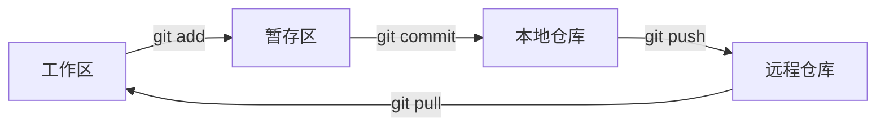

# Git 版本控制 {#git-git}

> [计算机基础](../) › Git 版本控制

工作区与暂存区、提交、分支、合并、远程仓库与 Pull Request。

## 本关定位

| 项 | 内容 |
|----|------|
| 所属阶段 | 阶段 1 计算机基础 · 第 4 关（第一章「系统与工具」最后一关） |
| 前置要求 | [Linux 与 Shell](../03-linux-shell/)：能在终端里导航和编辑文件 |
| 建议用时 | 1 周入门，之后每天使用中熟练 |
| 后续衔接 | 从本关起，所有练习代码都放进 Git 仓库；阶段产出 `cs-basics-lab` 仓库也用它管理。提交历史的 DAG 背景可选读网站上的 [关系](../../cs-theory/02-sets-relations-functions/) 和 [有向图](../../cs-theory/10-digraphs-dag/)。命令仍以本章为准；这两篇不在小程序打包的 35 篇里 |

Git 记录项目每一次修改的快照，让你可以随时回到过去、并行开发不同功能、和别人协作。它是程序员的必备工具，GitHub 等平台在它之上提供远程托管和 Pull Request 协作流程。

## 闯关任务

- [ ] 能够说清工作区、暂存区、本地仓库、远程仓库四个位置，以及 `add`、`commit`、`push`、`pull` 在它们之间搬运什么。
- [ ] 能够完成初始化、提交、查看历史和差异的日常操作，并写出清晰的提交信息。
- [ ] 能够创建、切换、合并分支，并手动解决合并冲突。
- [ ] 能够用 `.gitignore` 排除编译产物等不该提交的文件。
- [ ] 能够把本地仓库推送到 GitHub，并走通一次「分支 → Pull Request → 合并」流程。
- [ ] 能够安全地撤销修改：丢弃工作区改动、取消暂存、用 `revert` 撤销已推送的提交。

## 知识要点

### 四个位置



- **工作区**：你在编辑器里看到、修改的文件。
- **暂存区**（index）：下一次提交的「购物车」，用 `git add` 精确挑选要提交的改动。
- **本地仓库**：`.git` 目录，保存所有提交历史。每个提交是项目的完整快照，有唯一的哈希 ID。
- **远程仓库**：托管在 GitHub 等平台上的副本，用于备份和协作。`git pull` 相当于 `git fetch`（下载）+ 合并。

### 第一次使用与日常流程

```bash
# 只需配置一次
git config --global user.name "Your Name"
git config --global user.email "you@example.com"
git config --global init.defaultBranch main

# 新建仓库并提交
mkdir hello-c && cd hello-c
git init
printf '#include <stdio.h>\nint main(void) { puts("hi"); }\n' > hello.c
git status                 # 查看哪些文件有改动
git add hello.c            # 放入暂存区
git commit -m "Add hello world program"
git log --oneline          # 查看历史
```

日常循环：改代码 → `git status` / `git diff` 查看 → `git add` → `git commit`。提交要**小而完整**：一个提交只做一件事，提交信息第一行用一句话说明做了什么，例如 `Fix off-by-one in array loop`。

### 分支与合并

分支是指向某个提交的可移动指针，创建分支几乎没有成本。常见做法是 `main` 保持可用，新功能在单独的分支上开发：

```bash
git switch -c feature/parse-args   # 创建并切换到新分支
# 修改、提交若干次……
git switch main
git merge feature/parse-args       # 把功能分支合并回 main
git branch -d feature/parse-args   # 删除已合并的分支
```

`git switch` 和 `git restore` 是 Git 2.23 引入的命令，把旧的 `git checkout` 的两种用途拆开了；很多教程仍然用 `git checkout -b`，效果相同。

**合并冲突**：两个分支改了同一个文件的同一处，Git 无法自动决定，会在文件中留下标记：

```text
<<<<<<< HEAD
    printf("Hello\n");
=======
    printf("Hi there\n");
>>>>>>> feature/greeting
```

解决方法：编辑文件，保留正确的内容并删掉三种标记行，然后 `git add` 该文件并 `git commit` 完成合并。

### .gitignore

编译产物、编辑器配置、密钥文件不应进入仓库。在仓库根目录建 `.gitignore`：

```text
# 编译产物
*.o
*.out
/build/

# 编辑器与系统文件
.vscode/
.DS_Store

# 本地配置与密钥
.env
```

GitHub 维护着各语言的 [.gitignore 模板](https://github.com/github/gitignore)，可以从 `C.gitignore` 开始。

### 远程仓库与 Pull Request

```bash
git remote add origin git@github.com:<你的用户名>/hello-c.git
git push -u origin main            # 第一次推送并建立跟踪关系
git push                           # 之后直接推送
```

**Pull Request（PR）** 是 GitHub 上的协作流程：把功能分支推送到远程 → 在网页上发起 PR，请求合并到 `main` → 别人审查代码、讨论、你补充提交 → 审查通过后合并。即使一个人做项目，也可以用 PR 练习这套流程。参与别人的开源项目时，先 Fork 到自己账号下，再从 Fork 发起 PR。

### 撤销修改

| 场景 | 命令 |
|------|------|
| 丢弃工作区中某文件的修改 | `git restore 文件` |
| 把文件从暂存区撤回（保留修改） | `git restore --staged 文件` |
| 修改最近一次还没推送的提交 | `git commit --amend` |
| 撤销一个已推送的提交 | `git revert 提交ID` |

> [!WARNING]
> `git reset --hard` 和 `git push --force` 会丢弃提交或改写远程历史。在多人共用的分支上，撤销已推送的提交用 `git revert`，它会新建一个反向提交而不改写历史。

## 常见误区

- **「`git add .` 一把梭」**：容易把编译产物、密钥一起提交。先看 `git status`，配好 `.gitignore`。
- **「Git 就是 GitHub」**：Git 是本地运行的版本控制工具，GitHub 只是托管 Git 仓库的平台之一，类似的还有 GitLab、Gitee。
- **「把密码提交了，再删掉就行」**：历史中仍然保留着它，推送到公开仓库后应立即作废并更换该密码或密钥。
- **「冲突是出了大错」**：冲突是正常现象，只说明两处修改需要人来决定，按标记逐个处理即可。
- **提交信息写「update」「修改」**：几周后自己也看不懂，应写清楚改了什么、为什么改。

## 实践任务

1. 按上面的流程建立 `hello-c` 仓库，做至少 3 次提交，用 `git log --oneline --graph` 查看历史。
2. 在 [Learn Git Branching](https://learngitbranching.js.org/?locale=zh_CN) 完成「主要」标签下的前 4 关。
3. 故意制造一次冲突：在两个分支里改 `hello.c` 的同一行，合并并手动解决。
4. 在 GitHub 创建公开仓库 `cs-basics-lab`，配置 SSH 密钥后推送；之后本阶段的所有练习都提交到这里。
5. 在 `cs-basics-lab` 中新建分支、提交、发起 PR 并自己合并，走通完整流程。

## 资料索引

- [Pro Git 中文版](https://git-scm.com/book/zh/v2) — Git 官方推荐的免费书，第 1–3 章覆盖本关全部内容
- [Learn Git Branching](https://learngitbranching.js.org/?locale=zh_CN) — 可视化闯关练习分支、合并、变基，支持中文
- [GitHub 快速入门：](https://docs.github.com/zh/get-started/start-your-journey/hello-world) — GitHub 官方中文教程，走通仓库、分支、PR 流程
- [Git 官方文档](https://git-scm.com/docs) — 所有 Git 命令的参考手册（英文）
- [Oh Shit, Git!?!](https://ohshitgit.com/) — 常见翻车场景和对应的补救命令（英文）

## 通关自测

先独立作答，再展开参考答案核对；简答题答出要点即算对。答对 ≥ 80% 即可进入下一关。

1. 【单选】执行 `git add hello.c` 后，`hello.c` 的改动位于：
    - A. 只在工作区
    - B. 暂存区
    - C. 远程仓库
    - D. 已经形成提交
2. 【单选】下面哪个文件最应该写进 `.gitignore`？
    - A. `main.c`
    - B. `Makefile`
    - C. `main.o`
    - D. `README.md`
3. 【单选】某个错误提交已经推送到多人共用的 `main` 分支，最稳妥的撤销方式是：
    - A. `git reset --hard` 后 `git push --force`
    - B. `git revert` 该提交
    - C. 删除远程仓库重建
    - D. `git restore` 该文件
4. 【简答】出现合并冲突时，文件里的 `<<<<<<<`、`=======`、`>>>>>>>` 分别表示什么？怎样完成解决？
5. 【简答】简述一次 Pull Request 从开始到合并的流程。

<details markdown><summary>参考答案</summary>

1. B — `git add` 把改动放入暂存区，`git commit` 后才形成提交。
2. C — `.o` 是编译产物，可以随时重新生成，不应提交。
3. B — `revert` 新建一个反向提交，不改写共享历史；强推会破坏其他人的本地仓库。
4. `<<<<<<<` 到 `=======` 之间是当前分支（HEAD）的内容，`=======` 到 `>>>>>>>` 之间是被合并分支的内容。编辑成最终想要的代码并删除所有标记，然后 `git add` 再 `git commit`。
5. 新建功能分支并提交 → 推送到远程 → 在平台上发起 PR 指向目标分支 → 代码审查和讨论，按意见补充提交 → 审查通过、检查通过后合并，删除功能分支。

</details>

---

← [上一节：Linux 与 Shell](../03-linux-shell/) · [返回 计算机基础](../) · [下一节：计算机网络](../05-networking/) →
