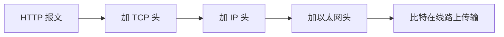

# 计算机网络 Networking

> [计算机基础](../) › 计算机网络

分层模型、IP、TCP / UDP、DNS、HTTP / HTTPS。

## 本关定位

| 项 | 内容 |
|----|------|
| 所属阶段 | 阶段 1 计算机基础 · 第 5 关（第二章「数据与网络」） |
| 前置要求 | [网络基础](../../getting-started/03-internet-basics/) 的概念；[Linux 与 Shell](../03-linux-shell/) 的命令行操作 |
| 建议用时 | 2–3 周（入门深度） |
| 后续衔接 | Java 阶段的 [IO 与 NIO](../../java/04-io-nio/) 和 Spring Web 开发都建立在 TCP 与 HTTP 之上。静态图上的连通和最短路可选读网站上的 [图与度数](../../cs-theory/05-graphs-degrees/) 和 [最短路证明](../../cs-theory/11-shortest-path-proofs/)，不代替本关协议，也不在小程序打包的 35 篇里 |

零基础入门里已经知道了「输入网址到看到网页」的大致过程，这一关把每一步拆开：数据怎样分层封装、IP 怎样找到目标机器、TCP 怎样保证可靠、DNS 怎样把域名变成地址、HTTP 报文长什么样，以及 HTTPS 多做了什么。

## 闯关任务

- [ ] 能够说出 TCP/IP 四层模型各层的职责和代表协议，并解释封装过程。
- [ ] 能够解释 IP 地址、子网掩码（CIDR）、端口的作用，区分公网地址与私有地址。
- [ ] 能够对比 TCP 与 UDP，描述 TCP 三次握手和可靠传输的基本手段。
- [ ] 能够描述一次 DNS 解析的过程，并用 `dig` 或 `nslookup` 查询记录。
- [ ] 能够读懂 HTTP 请求和响应报文，说出常见方法和状态码的含义。
- [ ] 能够解释 HTTPS 中 TLS 提供的三项保护，以及证书的作用。

## 知识要点

### 分层模型

网络把复杂的通信拆成若干层，每层只关心自己的职责，并使用下一层提供的服务：

| 层（TCP/IP 模型） | 职责 | 代表协议 | 数据单位 |
|-------------------|------|----------|----------|
| 应用层 | 具体应用的规则 | HTTP、DNS、SSH | 报文 |
| 传输层 | 进程到进程，可靠性 | TCP、UDP | 段 / 数据报 |
| 网络层 | 主机到主机，跨网络寻路 | IP、ICMP | 包 |
| 链路层 | 同一网络内相邻设备传输 | 以太网、Wi-Fi | 帧 |

发送时每层在数据前加上自己的头部（**封装**），接收方逐层拆开（**解封装**）。教材里常见的 OSI 七层模型多了表示层、会话层，并把链路层细分为数据链路层和物理层，主要用于讨论概念。



### IP 地址与端口

- **IPv4** 地址 32 位，写成 4 个十进制数，如 `192.0.2.10`；**IPv6** 地址 128 位，如 `2001:db8::1`。（这两个都是 RFC 规定的文档示例地址。）
- **CIDR 写法** `192.168.1.0/24` 表示前 24 位是网络号，这个网段有 256 个地址。
- **私有地址**：`10.0.0.0/8`、`172.16.0.0/12`、`192.168.0.0/16` 只在局域网内使用，出公网时由路由器做 **NAT**（地址转换）。`127.0.0.1` 是本机回环地址，即 `localhost`。
- **端口**（0–65535）区分同一台机器上的不同程序。常见约定：HTTP 80、HTTPS 443、SSH 22、DNS 53。「IP + 端口 + 协议」确定通信的一端。

### TCP 与 UDP

| 对比项 | TCP | UDP |
|--------|-----|-----|
| 连接 | 先建立连接 | 无连接，直接发 |
| 可靠性 | 保证按序、不丢、不重 | 尽力而为，可能丢失或乱序 |
| 开销 | 较大 | 很小 |
| 典型用途 | 网页、文件传输、SSH | DNS 查询、音视频通话、游戏 |

- **三次握手**：客户端发 SYN → 服务器回 SYN + ACK → 客户端发 ACK，双方确认彼此都能收发，并交换初始序号。
- **可靠传输**靠序号、确认（ACK）、超时重传；**流量控制**防止发送方压垮接收方；**拥塞控制**防止压垮整个网络。
- 关闭连接通常是四次挥手（双方各自发送 FIN 并确认）。
- HTTP/3 运行在基于 UDP 的 QUIC 协议之上，由 QUIC 自己实现可靠传输，说明「UDP 不可靠」只是指 UDP 本身不负责。

### DNS

DNS 把域名翻译成 IP 地址。解析过程：

1. 先查本机缓存和 `hosts` 文件。
2. 再问配置的**递归解析器**（通常由运营商或公共 DNS 提供）。
3. 递归解析器从**根服务器**开始逐级询问：根告诉它 `.com` 的服务器在哪，`.com` 的服务器告诉它 `example.com` 的权威服务器在哪，最后由**权威服务器**给出答案。
4. 结果按 TTL 缓存一段时间。

常见记录类型：`A`（IPv4 地址）、`AAAA`（IPv6 地址）、`CNAME`（别名）、`MX`（邮件服务器）、`NS`（权威服务器）。

```bash
dig example.com A +short        # 查询 A 记录
dig example.com AAAA +short     # 查询 AAAA 记录
nslookup example.com            # Windows 也可用
```

在 C 里，程序通过 `getaddrinfo` 让系统完成解析：

```c
#define _POSIX_C_SOURCE 200809L
#include <arpa/inet.h>
#include <netdb.h>
#include <stdio.h>
#include <sys/socket.h>

int main(int argc, char *argv[]) {
    const char *host = argc > 1 ? argv[1] : "example.com";
    struct addrinfo hints = {};
    hints.ai_family = AF_UNSPEC;          // IPv4 和 IPv6 都要
    hints.ai_socktype = SOCK_STREAM;

    struct addrinfo *res = nullptr;
    int err = getaddrinfo(host, "443", &hints, &res);
    if (err != 0) {
        fprintf(stderr, "getaddrinfo: %s\n", gai_strerror(err));
        return 1;
    }
    for (struct addrinfo *p = res; p != nullptr; p = p->ai_next) {
        char buf[INET6_ADDRSTRLEN];
        const void *addr = p->ai_family == AF_INET
            ? (const void *)&((struct sockaddr_in *)p->ai_addr)->sin_addr
            : (const void *)&((struct sockaddr_in6 *)p->ai_addr)->sin6_addr;
        inet_ntop(p->ai_family, addr, buf, sizeof buf);
        printf("%s -> %s\n", host, buf);
    }
    freeaddrinfo(res);
    return 0;
}
```

`= {}` 把结构体全部清零，是 C23 新增的写法；旧标准可写 `= {0}`。用 C 写网络程序的完整教程见 Beej's Guide to Network Programming。

### HTTP

HTTP 是基于文本的请求—响应协议。用 `curl -v https://example.com/` 可以看到完整往来，简化后如下：

```http
GET / HTTP/1.1
Host: example.com
User-Agent: curl/8.5.0
Accept: */*
```

```http
HTTP/1.1 200 OK
Content-Type: text/html
Content-Length: 1256

<!doctype html>
<html>...
```

- 请求由**请求行**（方法、路径、版本）、**头部**、空行、可选的**正文**组成；响应由**状态行**、头部、空行、正文组成。
- 常用方法：`GET` 获取、`POST` 提交、`PUT` 替换、`PATCH` 部分修改、`DELETE` 删除。
- 状态码按首位分类：2xx 成功、3xx 重定向、4xx 客户端错误（400、401、403、404）、5xx 服务器错误（500、502、503）。
- HTTP 本身**无状态**，登录状态靠 Cookie 或令牌在每次请求中携带。
- 版本：HTTP/1.1 文本格式；HTTP/2 二进制分帧、单连接多路复用；HTTP/3 基于 QUIC。语义（方法、状态码、头部）在 RFC 9110 中统一定义。

### HTTPS 与 TLS

HTTPS = HTTP + TLS。TLS 提供三项保护：

- **加密**：传输内容第三方看不懂。
- **完整性**：内容被篡改能被发现。
- **身份认证**：通过**证书**确认对方确实是该域名的拥有者。证书由浏览器和操作系统信任的证书颁发机构（CA）签发。

握手阶段用非对称加密（公钥 / 私钥）安全地协商出一个会话密钥，之后用对称加密传输数据，兼顾安全和速度。

> [!NOTE]
> 证书只证明「你连接的是这个域名」，不证明网站本身可信。钓鱼网站同样可以申请到合法证书。

## 常见误区

- **「IP 地址能唯一定位一台电脑」**：NAT 之后很多设备共用一个公网 IP，同一台设备的 IP 也可能变化。
- **「UDP 不可靠所以没用」**：DNS、实时音视频看重低延迟，丢一点数据可以接受；QUIC 还在 UDP 之上实现了可靠传输。
- **「状态码 200 就代表业务成功」**：有些接口把错误信息放在 200 响应的正文里，要按接口约定判断。
- **「用了 HTTPS 就绝对安全」**：TLS 只保护传输过程，服务器被攻破、网站本身是钓鱼站时它无能为力。
- **「`ping` 不通就是对方宕机」**：很多服务器出于安全考虑屏蔽了 ICMP，应结合 `curl` 等工具判断。

## 实践任务

1. 运行 `ip addr`（macOS 用 `ifconfig`）找到本机的局域网地址，判断它属于哪个私有地址段。
2. 用 `dig` 分别查询一个网站的 `A`、`AAAA`、`NS` 记录；加 `+trace` 观察从根服务器开始的逐级解析。
3. 运行 `curl -v https://example.com/`，在输出中找出 TLS 握手信息、请求行、响应状态行和响应头。
4. 编译运行上面的 `getaddrinfo` 示例（`gcc -std=c2x -Wall -Wextra resolve.c -o resolve`），解析 3 个不同域名。
5. 安装 Wireshark，抓取一次 `curl http://example.com/` 的过程，找到 TCP 三次握手的 3 个包（选做）。

## 资料索引

- [Computer Networking: A Top-Down Approach](https://gaia.cs.umass.edu/kurose_ross/index.php) — Kurose 与 Ross 的经典教材官网，提供免费课件、视频和交互练习（英文；中文版书名《计算机网络：自顶向下方法》）
- [MDN：HTTP 概述](https://developer.mozilla.org/zh-CN/docs/Web/HTTP/Guides/Overview) — Mozilla 的中文 HTTP 教程，覆盖报文、方法、状态码、缓存与 Cookie
- [Beej's Guide to Network Programming](https://beej.us/guide/bgnet/) — 用 C 和套接字 API 写网络程序的免费经典教程（英文）
- [RFC 9110: HTTP Semantics](https://www.rfc-editor.org/rfc/rfc9110) — HTTP 方法、状态码、头部的权威定义，遇到细节问题时查阅（英文）
- [RFC 9293: Transmission Control Protocol](https://www.rfc-editor.org/rfc/rfc9293) — 2022 年发布的 TCP 规范，整合了此前分散的多份 RFC（英文）

## 通关自测

先独立作答，再展开参考答案核对；简答题答出要点即算对。答对 ≥ 80% 即可进入下一关。

1. 【单选】TCP 和 UDP 属于哪一层？
    - A. 应用层
    - B. 传输层
    - C. 网络层
    - D. 链路层
2. 【单选】下面哪个是私有 IPv4 地址？
    - A. `8.8.8.8`
    - B. `192.168.3.7`
    - C. `203.0.113.5`
    - D. `1.1.1.1`
3. 【单选】把域名映射到 IPv6 地址的 DNS 记录类型是：
    - A. `A`
    - B. `CNAME`
    - C. `AAAA`
    - D. `MX`
4. 【简答】描述 TCP 三次握手的过程，以及为什么需要它。
5. 【简答】HTTPS 比 HTTP 多提供了哪三项保护？证书在其中起什么作用？

<details markdown><summary>参考答案</summary>

1. B — TCP、UDP 负责进程到进程的传输，属于传输层。
2. B — `192.168.0.0/16` 是私有地址段；`203.0.113.5` 是文档示例地址，不属于私有段。
3. C — `A` 对应 IPv4，`AAAA` 对应 IPv6。
4. 客户端发送 SYN，服务器回复 SYN + ACK，客户端再回复 ACK。它让双方确认彼此都能正常收发，并同步初始序号，为后续可靠传输打基础。
5. 加密、完整性、身份认证。证书由受信任的 CA 签发，把域名和服务器公钥绑定，浏览器据此确认自己连接的是真正的域名持有者。

</details>

---

← [上一节：Git 版本控制](../04-git/) · [返回 计算机基础](../) · [下一节：数据结构与算法](../06-data-structures-algorithms/) →
