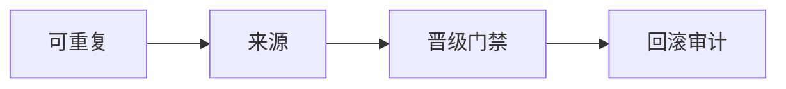

# DevOps {#devops}

本主题讨论一条流水线到底保证什么。它不教容器、云平台或监控后台，也不建这些目录。

> 相关主题：[Git 版本控制](../cs-basics/04-git/) · [微服务](../microservices/) · [分布式系统模型](../systems/distributed/)

> [!NOTE]
> 本仓库和站点的内容由 AI 生成，资料与资源链接来源于网络，仅供学习参考；如有错误或侵权，请提 Issue 告知。

---

## 流水线是一份约定 {#_1}

流水线承认哪些输入、执行哪些步骤、产出哪一件制品，以及这件制品在什么条件下可以进入下一个环境。四章把这份约定拆开：可重复性、来源与追溯、晋级与门禁、回滚与审计。

四章共用一条分界。流水线保证的是：同一份被承认的制品，带着它的证据往前走。它不保证程序正确，不保证依赖安全，也不保证目标环境里没有部分失效。

构建一次、再凭证据晋级，和在每个环境里重新构建，是两种不同的约定。后者不再保证「生产里跑的就是预发里验过的那一份」。

读过 [Git 版本控制](../cs-basics/04-git/) 再看最顺。这不是 Java 或微服务的前置。[微服务 12](../microservices/12-containers-k8s/) 和 [微服务 14](../microservices/14-cicd-gitops/) 写的是某一次实现；本主题写那次实现要遵守的约定。可以后读，也可以对照着读。

## 学习路径 {#devops-path}

## 子目录 {#devops-chapters}

| # | 子目录 | 内容 | 状态 |
|---|--------|------|------|
| 01 | [可重复性](01-repeatability/) | 输入没变时，制品身份不应悄悄改变 | 🟢 |
| 02 | [来源与追溯](02-provenance/) | 制品是谁、用什么、从哪次修订做出来的 | 🟢 |
| 03 | [晋级与门禁](03-promotion-gating/) | 同一份制品凭哪些证据进入下一环境 | 🟢 |
| 04 | [回滚与审计](04-rollback-audit/) | 撤回一次晋级，并留下当时承认了什么 | 🟢 |

🟢 已完成 · 🟡 搭建中 · ⚪ 待开始

容器与编排、GitOps、生产可观测性仍以微服务 [12](../microservices/12-containers-k8s/)、[14](../microservices/14-cicd-gitops/)、[10](../microservices/10-observability/) 为准。`ci-cd/`、`containers/`、`cloud/`、`observability/` 本批不建。测试分层见 [微服务 15](../microservices/15-testing/)。部分失效见 [分布式系统模型](../systems/distributed/)。

## 资料索引 {#_2}

- [Jez Humble 与 David Farley, Continuous Delivery](https://continuousdelivery.com/) — 部署流水线与「构建一次、多处晋级」的概念来源。下面各章引用的是这条保证，不是某一家 CI 产品的功能列表。
- [SLSA v1.2](https://slsa.dev/spec/v1.2/) — 2026-11-10 核对官方说明，状态仍为 Approved。用来取来源与验证的词汇，不把本主题写成逐级合规清单。
- [Git 版本控制](../cs-basics/04-git/) — 提交、分支和 PR 怎么用。本主题只问一次修订在来源证据里扮演什么角色。
- [微服务](../microservices/) — 容器、GitOps、测试和遥测的实践。那边是实现，这边是约定。
