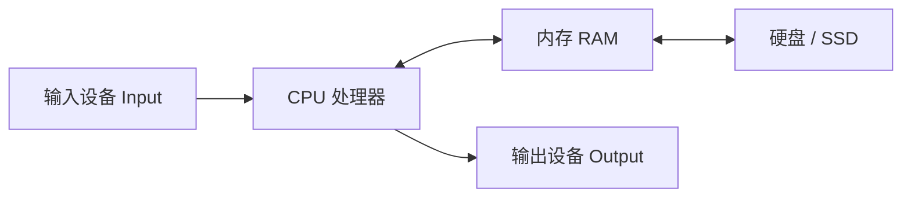

# 认识计算机 {#what-is-a-computer}

> [零基础入门](../) › 认识计算机

硬件、软件、二进制与存储单位：计算机是什么、各部分做什么。

## 本关定位

| 项 | 内容 |
|----|------|
| 所属阶段 | 阶段 0 零基础入门 · 第 1 关 |
| 前置要求 | 无 |
| 建议用时 | 3–5 天（粗略参考，按每天 1–2 小时） |
| 后续衔接 | [计算机组成](../../cs-basics/01-computer-organization/) 会把本关的「CPU、内存、二进制」讲深一层 |

这一关不写代码，目标是建立一张「计算机的地图」：知道机器由哪些部件组成、软件在其中扮演什么角色、信息为什么能用 0 和 1 表示。后面所有关卡都会反复用到这张地图。

## 闯关任务

- [ ] 能够说出 CPU、内存、硬盘 / SSD、输入设备、输出设备各自的作用，并举出至少一个例子。
- [ ] 能够区分硬件、操作系统和应用程序，说清操作系统在两者之间做什么。
- [ ] 能够解释「断电后内存里的数据丢失、硬盘里的数据还在」的原因。
- [ ] 能够把 0–255 之间的十进制数和二进制互相转换。
- [ ] 能够换算 bit、Byte、KB、MB、GB，并解释为什么 1 TB 硬盘在 Windows 里显示约 931 GB。

## 知识要点

### 计算机是一台「按程序处理信息」的机器

计算机做的事情可以概括成一条流水线：**输入 → 处理 → 存储 → 输出**。键盘、鼠标、麦克风、摄像头负责输入；CPU 负责处理；内存和硬盘负责存储；显示器、音箱、打印机负责输出。

现代计算机几乎都遵循「存储程序」的思想（常和冯·诺依曼结构一起提起）：程序和数据一样，都以二进制形式放在内存里，CPU 从内存中一条一条取出指令来执行。所以「安装软件」本质上是把程序文件放到硬盘上，「运行软件」是把它从硬盘读进内存，再交给 CPU 执行。

### 主要硬件各做什么

| 部件 | 作用 | 一个比喻 | 断电后数据 |
|------|------|----------|------------|
| CPU（中央处理器） | 执行指令：算术、比较、跳转 | 厨师 | 不保存 |
| 内存（RAM） | 存放正在运行的程序和数据，速度快 | 灶台边的操作台 | 丢失 |
| 硬盘 / SSD | 长期保存文件和已安装的程序 | 冰箱和仓库 | 保留 |
| 显卡（GPU） | 处理图形，也常用于 AI 计算 | 专门负责摆盘的帮厨 | 不保存 |
| 主板 | 把各部件连在一起 | 厨房的管线和台面 | — |

内存通常比硬盘快很多，但容量小、价格贵、断电就丢；硬盘容量大、能长期保存，但慢。计算机就是靠「把常用的东西搬到更快的地方」来平衡速度和容量的，这个思路在 [计算机组成](../../cs-basics/01-computer-organization/) 里叫「存储层次」。

### 软件：操作系统和应用程序

- **操作系统**（Windows、macOS、Linux、Android、iOS）管理硬件资源：决定哪个程序用 CPU、给程序分配内存、管理文件、驱动各种设备。
- **应用程序**（浏览器、聊天软件、编辑器）运行在操作系统之上，通过操作系统提供的接口使用硬件，而不是直接操作硬件。
- **驱动程序**是让操作系统认识某个具体硬件（例如某型号的打印机）的小程序。

### 为什么是二进制

电路最容易稳定地区分两种状态：有电压 / 没电压、磁化方向 A / B。用 1 和 0 表示这两种状态，最不容易出错。一个 0 或 1 叫 **1 bit（比特，位）**，8 个 bit 组成 **1 Byte（字节）**。

二进制每一位的权重是 2 的幂。以 8 位为例：

| 位权 | 128 | 64 | 32 | 16 | 8 | 4 | 2 | 1 |
|------|-----|----|----|----|---|---|---|---|
| `00001011` | 0 | 0 | 0 | 0 | 1 | 0 | 1 | 1 |

`00001011` = 8 + 2 + 1 = 11。十进制转二进制可以反过来：从最大的位权开始，放得下就写 1 并减掉，放不下就写 0。8 位能表示 2⁸ = 256 种组合，也就是 0–255。

文字、图片、声音最后都会变成数字：

- 文字：每个字符对应一个编号。英文字母 `A` 在 ASCII 中是 65；中文通常用 UTF-8 编码，常用汉字一般占 3 个字节。
- 图片：每个像素用红、绿、蓝三个 0–255 的数表示颜色。
- 声音：每秒采样很多次，把声波高度记成数字。

### 存储单位怎么换算

| 单位 | 十进制（硬盘厂商、网络常用） | 二进制（操作系统常用） |
|------|------------------------------|------------------------|
| 千 | 1 KB = 1000 B | 1 KiB = 1024 B |
| 兆 | 1 MB = 1000 KB | 1 MiB = 1024 KiB |
| 吉 | 1 GB = 1000 MB | 1 GiB = 1024 MiB |
| 太 | 1 TB = 1000 GB | 1 TiB = 1024 GiB |

硬盘厂商按十进制标「1 TB」= 10¹² 字节，Windows 按 1024 进位却仍写成「GB」，于是显示 10¹² ÷ 2³⁰ ≈ 931 GB。容量没有少，只是两种单位混用。

> [!NOTE]
> KiB、MiB 这类带 i 的写法是 IEC 定义的二进制前缀。日常交流里很多人仍把 1024 进位写成 KB，看到数字对不上时先想想是哪种进位。另外，网速常用 **bit** 计：100 Mbps 宽带理论上每秒约 12.5 MB。

## 常见误区

- **把内存和硬盘混为一谈**：手机宣传的「12 GB + 256 GB」，前者是内存（运行内存），后者是存储空间。内存不足时程序卡顿，存储不足时装不下文件。
- **认为内存越大电脑一定越快**：内存够用之后再加，提升就不明显了；CPU、SSD 同样影响速度。
- **以为删除文件就彻底消失**：「删除」通常只是移到回收站，或者只是把那块空间标记为可覆盖。处理旧设备前要用系统自带的「重置 / 抹掉」功能。
- **以为 Mb 和 MB 一样**：小写 b 是 bit，大写 B 是 Byte，差 8 倍。

## 实践任务

1. 查看自己电脑的配置：Windows 打开「设置 → 系统 → 系统信息」，macOS 点左上角苹果菜单 →「关于本机」。记下 CPU 型号、内存大小、存储容量和操作系统版本。
2. 打开任务管理器（Windows：`Ctrl` + `Shift` + `Esc`）或活动监视器（macOS），找出当前占用内存最多的 3 个程序。
3. 手算：把 13、100、255 转成 8 位二进制，再把 `01100100` 转回十进制。用系统计算器的「程序员」模式核对。
4. 计算一块标称 512 GB 的 SSD 在 Windows 里大约显示多少 GB（提示：512 × 10⁹ ÷ 2³⁰）。
5. 把以上结果写进学习笔记「我的电脑说明书」，后面几关会继续补充。

## 资料索引

- [LearnFree: Computer Basics](https://www.learnfree.org/series/computer-basics) — GCFGlobal 免费电脑入门系列（原 edu.gcfglobal.org 链接已跳转到 LearnFree 站点），从硬件、软件讲到开机使用（英文）
- [Khan Academy: Computers and the Internet](https://www.khanacademy.org/computing/computers-and-internet) — 二进制、数据表示、网络的互动入门课（英文，免费）
- [CS50x Week 0](https://cs50.harvard.edu/x/weeks/0/) — 哈佛 CS50 第 0 周：二进制、ASCII、Unicode、算法与 Scratch，含视频和讲义（英文，免费）
- [NIST: Prefixes for binary multiples](https://physics.nist.gov/cuu/Units/binary.html) — 美国国家标准与技术研究院对 KiB、MiB 等二进制前缀的官方说明（英文）
- [Crash Course Computer Science](https://www.youtube.com/playlist?list=PL8dPuuaLjXtNlUrzyH5r6jN9ulIgZBpdo) — 每集十来分钟的计算机科学科普视频，从电路讲到操作系统（英文）

## 通关自测

先独立作答，再展开参考答案核对；简答题答出要点即算对。答对 ≥ 80% 即可进入下一关。

1. 【单选】关机后数据仍然保存的是：
    - A. 内存（RAM）
    - B. CPU 缓存
    - C. SSD
    - D. 寄存器
2. 【单选】二进制 `00010110` 等于十进制的：
    - A. 20
    - B. 22
    - C. 24
    - D. 26
3. 【单选】100 Mbps 的网速，理论上每秒最多下载大约：
    - A. 100 MB
    - B. 50 MB
    - C. 12.5 MB
    - D. 1 MB
4. 【简答】操作系统在硬件和应用程序之间做了哪些事？说出两点。
5. 【简答】为什么标称 1 TB 的硬盘在 Windows 里只显示约 931 GB？

参考答案

1. C — 内存、缓存和寄存器断电后数据丢失，SSD 和硬盘是持久存储。
2. B — 16 + 4 + 2 = 22。
3. C — 网速以 bit 计，100 ÷ 8 = 12.5 MB/s，实际还会受协议开销影响。
4. 要点：管理 CPU 时间（决定谁先运行）、分配内存、管理文件、通过驱动程序控制设备，并给应用程序提供统一的接口。
5. 厂商按 1 TB = 10¹² 字节标注，Windows 按 1024 进位计算却仍显示「GB」，10¹² ÷ 2³⁰ ≈ 931。

---

[返回 零基础入门](../) · [下一节：用好电脑](../02-using-a-computer/) →
