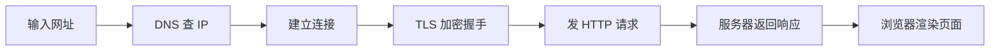

# 互联网常识 Internet Basics

> [零基础入门](../) › 互联网常识

IP、域名、浏览器、HTTP / HTTPS、账号安全与密码管理。

## 本关定位

| 项 | 内容 |
|----|------|
| 所属阶段 | 阶段 0 零基础入门 · 第 3 关 |
| 前置要求 | [用好电脑](../02-using-a-computer/) |
| 建议用时 | 3–5 天（粗略参考） |
| 后续衔接 | [计算机网络](../../cs-basics/05-networking/) 会展开分层模型、TCP / UDP、DNS 细节 |

这一关建立两个直觉：一是「打开一个网页时，背后发生了什么」，二是「怎样保护自己的账号」。前者是以后学 Web 和后端的起点，后者从今天起就要用上。

## 闯关任务

- [ ] 能够说出 IP 地址、端口、域名分别是什么，以及 DNS 的作用。
- [ ] 能够按顺序描述从输入网址到看到页面的主要步骤。
- [ ] 能够拆出一个 URL 的协议、域名、路径、查询参数。
- [ ] 能够解释 HTTP 和 HTTPS 的区别，并说出浏览器地址栏的「锁」能保证什么、不能保证什么。
- [ ] 能够为自己的重要账号启用密码管理器和两步验证，识别常见钓鱼手法。

## 知识要点

### IP 地址、端口和域名

- **IP 地址**是网络上设备的地址。IPv4 是 32 位，写成 4 段十进制，如 `203.0.113.10`；IPv6 是 128 位，写成十六进制，如 `2001:db8::1`（这两个都是专门留给文档举例的地址）。家里的设备一般拿到 `192.168.x.x` 这类局域网地址，经由路由器上网。
- **端口**区分同一台机器上的不同服务，范围 0–65535。HTTP 默认 80，HTTPS 默认 443。
- **域名**是给人记的名字，如 `github.com`。从右往左读：`.com` 是顶级域，`github` 是注册的二级域，前面还可以有 `www`、`docs` 等子域。
- **DNS（域名系统）**负责把域名翻译成 IP 地址，相当于互联网的通讯录。

### 输入网址之后发生了什么



1. 浏览器解析网址，得到域名 `github.com`。
2. 先查本机缓存，查不到就问 DNS 服务器，拿到 IP 地址。
3. 和这个 IP 的 443 端口建立连接（细节在 [计算机网络](../../cs-basics/05-networking/) 里学）。
4. HTTPS 会先做一次 TLS 握手，协商加密方式并验证服务器证书。
5. 浏览器发送 HTTP 请求，例如「给我 `/` 这个页面」。
6. 服务器返回响应：状态码 + 内容（HTML）。
7. 浏览器解析 HTML，再去请求其中引用的 CSS、JavaScript、图片，最后画出页面。

### 看懂一个 URL

```text
https://docs.github.com/zh/get-started?tool=webui#intro
└─┬─┘   └──────┬──────┘└──────┬──────┘└────┬────┘└─┬─┘
 协议        域名           路径        查询参数   片段
```

### HTTP 与 HTTPS

- **HTTP** 是浏览器和服务器之间「一问一答」的约定：请求有方法（`GET` 读取、`POST` 提交）和路径，响应有状态码和内容。
- 常见状态码：`200` 成功、`301` / `302` 跳转、`404` 找不到、`403` 无权限、`500` 服务器内部错误。规律是 2 开头成功、3 开头跳转、4 开头客户端的问题、5 开头服务器的问题。
- **HTTPS** = HTTP + TLS 加密。它保证三件事：内容在路上不被偷看、不被篡改、你连的确实是证书上写的那个域名。

> [!WARNING]
> 地址栏的「锁」只说明连接是加密的，**不说明网站可信**。钓鱼网站同样可以申请证书。判断真假要看域名本身：`github.com` 和 `github-login.com.example.xyz` 是两个完全不同的网站。

### 账号安全

- **密码要长、要唯一**：美国 NIST 的数字身份指南（SP 800-63B-4）要求单独使用的密码至少 15 个字符，并且不再强制混合字符类型或定期更换。对个人来说，最实用的做法是每个网站一个不同的长密码。
- **用密码管理器**：只记一个主密码，其余由管理器生成和保存。可以选择浏览器 / 系统自带的密码管理，或 Bitwarden、KeePassXC 等工具。
- **开启两步验证（2FA）**：密码之外再要一个验证器 App 的动态码或安全密钥。短信验证码聊胜于无，但可能被 SIM 卡劫持。
- **识别钓鱼**：「账号异常，请立即登录验证」「中奖」这类制造紧迫感的邮件和短信，链接一律不点，自己手动打开官网核实。
- **检查泄露**：在 Have I Been Pwned 输入邮箱，可以查看它是否出现在已公开的数据泄露中。

## 常见误区

- **「有锁就是安全网站」**：锁只代表加密，不代表对方是好人。
- **「复杂密码 + 到处复用」**：一个网站泄露，所有账号都会被「撞库」。唯一性比复杂度更重要。
- **「互联网 = 万维网 = 浏览器」**：万维网（Web）只是跑在互联网上的一种应用，邮件、游戏、视频通话也走互联网，但不一定经过浏览器。
- **「公共 Wi-Fi 随便连」**：在公共网络上，至少确保访问的都是 HTTPS 网站，不要在弹出的陌生登录页里输入密码。

## 实践任务

1. 在浏览器打开 `https://github.com`，点击地址栏的锁图标，查看证书颁发给谁、由谁签发、有效期到哪天。
2. 按 `F12` 打开开发者工具，切到「网络 / Network」面板后刷新页面，找到第一条请求，记下它的方法、状态码和响应类型。
3. 在终端运行下面的命令，看看域名解析到了哪个 IP（Windows、macOS、Linux 都自带 `nslookup`）：

```bash
nslookup github.com
```

4. 安装一个密码管理器，把最重要的 3 个账号（邮箱、GitHub、常用社交账号）改成随机生成的长密码，并开启两步验证。
5. 用一段话写下「输入网址到看到网页」的过程，放进学习笔记；学完 [计算机网络](../../cs-basics/05-networking/) 后再回来修改。

## 资料索引

- [MDN：万维网是如何工作的](https://developer.mozilla.org/zh-CN/docs/Learn_web_development/Getting_started/Web_standards/How_the_web_works) — 用简单比喻讲清浏览器、服务器、DNS 和数据包（中文）
- [MDN：什么是域名？](https://developer.mozilla.org/zh-CN/docs/Learn_web_development/Howto/Web_mechanics/What_is_a_domain_name) — 域名的结构、注册与解析过程（中文）
- [MDN：HTTP 概述](https://developer.mozilla.org/zh-CN/docs/Web/HTTP/Guides/Overview) — HTTP 请求、响应和状态码的入门说明（中文）
- [LearnFree: Internet Safety](https://www.learnfree.org/series/internet-safety) — GCFGlobal 的免费上网安全课：密码、钓鱼、隐私设置（英文）
- [NIST SP 800-63B-4](https://pages.nist.gov/800-63-4/sp800-63b.html) — 美国 NIST 数字身份指南中关于密码和多因素认证的部分，适合查原始规定（英文）
- [Have I Been Pwned](https://haveibeenpwned.com/) — 查询邮箱是否出现在已公开的数据泄露中（英文）

## 通关自测

先独立作答，再展开参考答案核对；简答题答出要点即算对。答对 ≥ 80% 即可进入下一关。

1. 【单选】把域名 `github.com` 转换成 IP 地址的是：
    - A. HTTP
    - B. DNS
    - C. TLS
    - D. HTML
2. 【单选】HTTPS 默认使用的端口是：
    - A. 21
    - B. 80
    - C. 443
    - D. 8080
3. 【单选】服务器返回状态码 `404`，最可能的意思是：
    - A. 请求成功
    - B. 服务器内部出错
    - C. 请求的资源不存在
    - D. 需要跳转到新地址
4. 【简答】浏览器地址栏显示了锁图标，能说明这个网站一定可信吗？为什么？
5. 【简答】为什么「每个网站一个不同的密码」比「一个很复杂的密码到处用」更安全？

<details markdown><summary>参考答案</summary>

1. B — DNS 是域名系统，负责域名到 IP 的解析。
2. C — HTTP 默认 80，HTTPS 默认 443。
3. C — 4xx 是客户端请求的问题，404 表示找不到资源。
4. 不能。锁只表示连接经过 TLS 加密、证书和域名匹配，钓鱼网站也能申请证书，是否可信要看域名是不是你要去的那个。
5. 任何一个网站泄露密码后，攻击者会拿它去其他网站「撞库」；密码各不相同时，损失只限于那一个网站。

</details>

---

← [上一节：用好电脑](../02-using-a-computer/) · [返回 零基础入门](../) · [下一节：学会学习与提问](../04-learning-to-learn/) →
