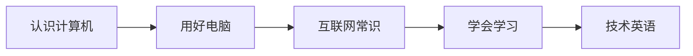

# 零基础入门 Getting Started

从完全不会到能熟练使用电脑和网络，并掌握自学方法。无前置要求，适合第一次接触编程路线的读者。

> 相关主题：[学习路线 Roadmap](../roadmap/) · [计算机基础 CS Basics](../cs-basics/)

## 学习路径

## 子目录

| # | 子目录 | 内容 | 状态 |
|---|--------|------|------|
| 01 | [认识计算机 What Is a Computer](01-what-is-a-computer/) | 硬件、软件、二进制与存储单位 | ⚪ |
| 02 | [用好电脑 Using a Computer](02-using-a-computer/) | 打字、文件、安装软件、快捷键 | ⚪ |
| 03 | [互联网常识 Internet Basics](03-internet-basics/) | IP、域名、HTTP、账号安全 | ⚪ |
| 04 | [学会学习与提问 Learning to Learn](04-learning-to-learn/) | 学习方法、搜索、提问的智慧 | ⚪ |
| 05 | [技术英语 Tech English](05-tech-english/) | 术语、报错、官方文档阅读 | ⚪ |

🟢 已完成 · 🟡 搭建中 · ⚪ 待开始

## 资料索引

<!-- - [标题](链接) — 一句话说明 -->
