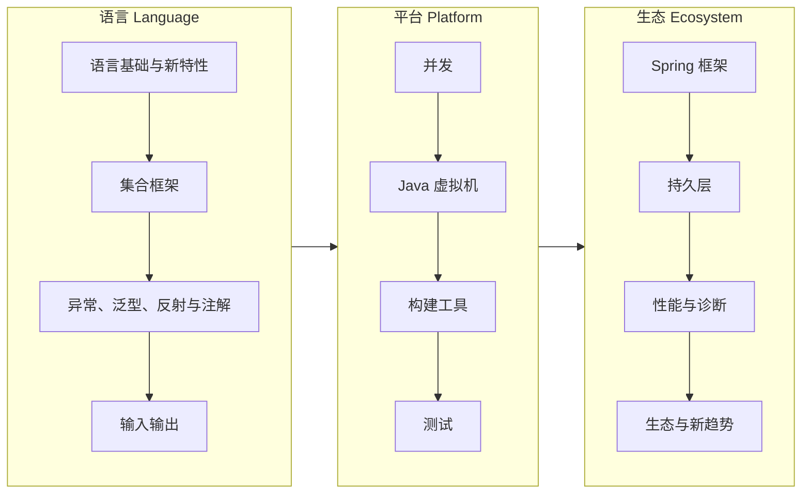

# Java 技术栈 {#java-java-stack}

Java 语言、JVM 和主流生态（Spring、持久层、构建与测试）的学习笔记。以最新 LTS（JDK 25）为基准，兼顾 8 / 11 / 17 / 21 的差异，按学习顺序排列，也可以当速查手册用。

> 相关主题：[编程](../programming/) · [Web](../web/) · [系统](../systems/) · [微服务](../microservices/)

## 学习路径

## 子目录

| # | 子目录 | 内容 | 状态 |
|---|--------|------|------|
| 01 | [语言基础与新特性](01-language-basics/) | 语法与新特性（8 → 11 → 17 → 21 → 25 LTS） | 🟡 |
| 02 | [集合框架](02-collections/) | 集合框架与选型 | 🟡 |
| 03 | [异常、泛型、反射与注解](03-core-advanced/) | 异常、泛型、反射、注解 | 🟡 |
| 04 | [输入输出 IO & NIO](04-io-nio/) | IO / NIO / NIO.2 / HttpClient | 🟡 |
| 05 | [并发](05-concurrency/) | 并发、线程池、虚拟线程 | 🟡 |
| 06 | [Java 虚拟机 JVM](06-jvm/) | 内存模型、GC、类加载、调优工具 | 🟡 |
| 07 | [构建工具](07-build-tools/) | Maven / Gradle | 🟡 |
| 08 | [测试](08-testing/) | JUnit 5 / Mockito / Testcontainers | 🟡 |
| 09 | [Spring 框架](09-spring/) | Spring Framework / Boot / Cloud | 🟡 |
| 10 | [持久层](10-persistence/) | JDBC / MyBatis / JPA / 事务 | 🟡 |
| 11 | [性能与诊断](11-performance-diagnostics/) | 性能分析与线上排障 | 🟡 |
| 12 | [生态与新趋势](12-ecosystem-trends/) | GraalVM、Valhalla、Panama、Leyden | 🟡 |
🟢 已完成 · 🟡 搭建中 · ⚪ 待开始

## 版本基线（2026-11）

> [!WARNING]
> 版本信息有时效，更新时同时改这里的日期。

- JDK：最新 LTS 为 JDK 25；最新功能版本为 JDK 27
- Spring Boot：4.1.x（最新 GA 4.1.2）；Boot 4.0 起基于 Spring Framework 7.0、Spring Security 7.0、Jackson 3.0
- Spring Cloud：2025.1.4（Oakwood），适配 Boot 4.0.x 和 4.1.x（从 2025.1.2 起支持 4.1.x）

## 资料索引

<!-- - [标题](链接) — 一句话说明 -->
