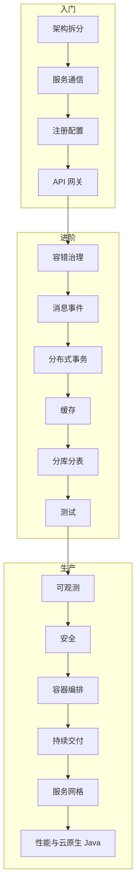

# 微服务 {#microservices}

微服务架构的完整技术体系：拆分、网关、治理、通信、数据、消息、可观测、安全和部署运维。语言中立讲原理，以 Java / Spring 为主要实现。

> 相关主题：[Java 技术栈](../java/) · [Spring 框架](../java/09-spring/) · [系统](../systems/) · [DevOps](../devops/)

## 学习路径

## 子目录

| # | 子目录 | 内容 | 状态 |
|---|--------|------|------|
| 01 | [架构基础与拆分](01-architecture/) | DDD、限界上下文、单体到微服务 | 🟢 |
| 02 | [API 网关](02-api-gateway/) | Spring Cloud Gateway / Kong / APISIX / Envoy | 🟢 |
| 03 | [注册发现与配置](03-discovery-config/) | Nacos / Consul / Config / K8s 原生 | 🟢 |
| 04 | [服务通信](04-communication/) | HTTP Interface / OpenFeign / gRPC / Dubbo | 🟢 |
| 05 | [容错与流量治理](05-resilience/) | Resilience4j / Sentinel | 🟢 |
| 06 | [消息与事件驱动](06-messaging/) | Kafka / RocketMQ / RabbitMQ / Pulsar | 🟢 |
| 07 | [分布式事务](07-distributed-transactions/) | Saga / Outbox / TCC / Seata | 🟢 |
| 08 | [缓存](08-caching/) | Redis / 多级缓存 | 🟢 |
| 09 | [数据库与分库分表](09-database-sharding/) | MySQL / PostgreSQL / ShardingSphere | 🟡 |
| 10 | [可观测性](10-observability/) | OpenTelemetry / Micrometer / Prometheus / Grafana | 🟡 |
| 11 | [安全](11-security/) | OAuth2 / OIDC / Keycloak / mTLS | 🟡 |
| 12 | [容器与编排](12-containers-k8s/) | Docker / Kubernetes / Helm | 🟡 |
| 13 | [服务网格](13-service-mesh/) | Istio ambient / Linkerd | 🟡 |
| 14 | [持续交付与 GitOps](14-cicd-gitops/) | GitHub Actions / Argo CD | 🟡 |
| 15 | [测试](15-testing/) | 契约测试 / Testcontainers | 🟡 |
| 16 | [性能与云原生 Java](16-cloud-native-java/) | GraalVM / CRaC / 虚拟线程 | 🟡 |
🟢 已完成 · 🟡 搭建中 · ⚪ 待开始

## 三套主流技术选型

| 维度 | Spring Cloud Netflix | Spring Cloud Alibaba | K8s 原生 |
|------|------|------|------|
| 注册发现 | Eureka | Nacos | K8s Service |
| 配置 | Spring Cloud Config | Nacos Config | ConfigMap / Secret |
| 网关 | Spring Cloud Gateway | Spring Cloud Gateway | Gateway API + Envoy |
| 容错 | Resilience4j | Sentinel | 网格 + Resilience4j |
| RPC | OpenFeign | Dubbo / OpenFeign | gRPC |
| 分布式事务 | Saga / Outbox | Seata | Saga / Outbox |

> [!WARNING]
> Netflix Hystrix、Ribbon、Zuul 1 已停止维护，新项目不要选。

## 版本基线（2026-11）

> [!WARNING]
> 版本信息有时效，更新时同时改这里的日期。

- Spring Boot 4.1.x · Spring Cloud 2025.1.x · Spring Cloud Alibaba 2025.1.0.0
- Nacos 3.3.0 · Kubernetes 1.37.2 · Istio 1.31.3 · OpenTelemetry Java Agent 2.33.1

章节里的代码，只有写明「编译通过」的片段在 2026-11-06 用 JDK 21.0.12.1 做过 `javac` 核对。其余 YAML、SQL 和命令是结构示意，没有连接中间件或集群运行。版本号沿用 2026-11-05 基线：当天之后的补丁（例如 Keycloak 26.8.2、Prometheus 3.16.0）不在本章改写范围内。

## 资料索引

- [Microservices.io 模式目录](https://microservices.io/patterns/) — 微服务常见模式
- [Spring Cloud 项目页](https://spring.io/projects/spring-cloud) — Spring Cloud 总览
- [Spring Cloud Alibaba](https://github.com/alibaba/spring-cloud-alibaba) — 阿里微服务生态
- [Istio Ambient 模式](https://istio.io/latest/docs/ambient/) — 无 sidecar 网格
- [OpenTelemetry Java](https://opentelemetry.io/docs/languages/java/) — Java 可观测统一采集
