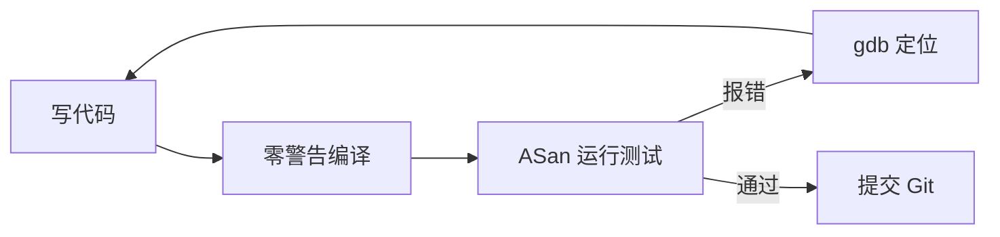

# 工具、调试与测试 {#tools-debugging}

> [编程入门](../) › 工具、调试与测试

编译警告、gdb、Valgrind / AddressSanitizer、make 与 Makefile、assert 测试。

## 本关定位

| 项 | 内容 |
|----|------|
| 所属阶段 | 阶段 2 编程入门 · 第 4 关（第二章「工程与实战」） |
| 前置要求 | [内存与数据](../03-memory-and-data/)：会用指针、`malloc` / `free`，写过多文件程序 |
| 建议用时 | 1–2 周，之后在每个练习中持续使用 |
| 后续衔接 | [问题求解](../05-problem-solving/) 和 [C 小项目](../06-small-projects/) 都要求零警告、Sanitizer 无报错、带 assert 测试并用 Makefile 构建 |

C 不会在运行时替你检查越界和内存错误，所以工具就是你的安全网。这一关建立一套固定的工作流：编译器警告拦住可疑代码，Sanitizer 和 Valgrind 抓内存错误，gdb 单步看清程序状态，make 自动化构建，assert 测试保证改代码时不会改坏。

## 闯关任务

- [ ] 能够用 `-Wall -Wextra -pedantic` 编译并清零警告，理解常见警告的含义。
- [ ] 能够用 gdb 设置断点、单步执行、查看变量和调用栈，定位段错误发生的位置。
- [ ] 能够用 AddressSanitizer 和 UndefinedBehaviorSanitizer 发现越界、use-after-free、泄漏和未定义行为，并读懂报告。
- [ ] 能够说出 Valgrind 与 AddressSanitizer 的区别和各自的适用场景。
- [ ] 能够为多文件 C 项目编写 Makefile，包含 `all`、`test`、`clean` 目标。
- [ ] 能够用 `assert` 为函数编写覆盖正常情况和边界情况的测试。

## 知识要点

### 调试工作流



遇到 bug 时先**稳定复现**，再**缩小范围**（删减输入、注释代码、二分定位），最后**验证修复**并补一个能抓住它的测试。

### 编译警告

推荐的日常编译选项：

```bash
gcc -std=c23 -Wall -Wextra -pedantic -g -O0 main.c -o main
```

| 警告 | 通常意味着 |
|------|------------|
| `unused variable` | 变量定义了没用，可能写错了变量名 |
| `format '%d' expects argument of type 'int'` | `printf` 格式符和参数类型不匹配 |
| `suggest parentheses around assignment used as truth value` | 在 `if` 里把 `==` 写成了 `=` |
| `comparison of integer expressions of different signedness` | 有符号和无符号比较，结果可能出乎意料 |
| `control reaches end of non-void function` | 有返回值的函数存在没有 `return` 的路径 |
| `function returns address of local variable` | 返回了栈上局部变量的地址 |

想更严格还可以加 `-Wconversion`（隐式转换丢失精度）、`-Wshadow`（变量遮蔽）。GCC 的 `-fanalyzer` 能做静态分析，发现部分内存泄漏和空指针解引用。

### AddressSanitizer 与 UndefinedBehaviorSanitizer

Sanitizer 是编译器在程序中插入检查代码的工具，GCC 和 Clang 都支持，只需加编译选项，程序运行时一旦出错就打印报告并停止。

| 工具 | 选项 | 能发现 |
|------|------|--------|
| AddressSanitizer（ASan） | `-fsanitize=address` | 堆 / 栈 / 全局数组越界、use-after-free、重复释放、内存泄漏（在 Linux 上由内置的 LeakSanitizer 报告） |
| UndefinedBehaviorSanitizer（UBSan） | `-fsanitize=undefined` | 有符号整数溢出、除以零、非法移位、空指针解引用等未定义行为 |

下面的程序有一个差一错误，它能正常编译，不加检查时运行也可能「看起来没问题」：

```c
#include <stdio.h>
#include <stdlib.h>

int main(void) {
    int *a = malloc(5 * sizeof *a);
    if (a == nullptr) {
        return EXIT_FAILURE;
    }
    for (int i = 0; i <= 5; i++) {   // 差一错误：i == 5 时越界
        a[i] = i;
    }
    printf("%d\n", a[0]);
    free(a);
    return 0;
}
```

```bash
gcc -std=c23 -Wall -Wextra -g -fsanitize=address,undefined bug.c -o bug
./bug
```

ASan 的报告（GCC 14、Linux x86-64，省略了地址细节）：

```text
==253737==ERROR: AddressSanitizer: heap-buffer-overflow on address 0x503000000054 ...
WRITE of size 4 at 0x503000000054 thread T0
    #0 0x560d59e232c0 in main /tmp/pb4/bug.c:10
...
0x503000000054 is located 0 bytes after 20-byte region [0x503000000040,0x503000000054)
allocated by thread T0 here:
    #0 0x7fbcedcf4c57 in malloc ../../../../src/libsanitizer/asan/asan_malloc_linux.cpp:69
    #1 0x560d59e231fb in main /tmp/pb4/bug.c:5
```

读法：错误类型是 `heap-buffer-overflow`（堆越界）；`WRITE of size 4` 表示写入了 4 字节（一个 `int`）；出错位置在 `bug.c` 第 10 行；越界地址紧挨在第 5 行 `malloc` 的 20 字节区域之后，也就是 `a[5]`。加 `-g` 才能看到文件名和行号。

忘记 `free` 时，程序结束会得到 LeakSanitizer 报告，例如 `Direct leak of 100 byte(s) in 1 object(s) allocated from: ... in main leak.c:5`；有符号溢出则由 UBSan 报告 `runtime error: signed integer overflow: 2147483647 + 1 cannot be represented in type 'int'`。

### Valgrind

Valgrind 不需要重新编译，直接运行已有的程序（建议带 `-g` 编译以显示行号）：

```bash
valgrind --leak-check=full ./app
```

- 它在模拟的 CPU 上运行程序，能发现非法读写、使用未初始化的值、内存泄漏，但程序会慢 10 倍以上。
- 主要支持 Linux；在较新的 macOS（尤其是 Apple 芯片）上基本无法使用，这时用 ASan。
- 不要同时使用 ASan 和 Valgrind：用 ASan 编译的程序不能再放到 Valgrind 下运行。

### gdb

gdb 让程序在指定位置暂停，查看变量、单步执行。编译时加 `-g -O0`，然后 `gdb ./app` 启动：

| 命令 | 作用 |
|------|------|
| `break main` / `break stats.c:20` | 在函数或某行设置断点 |
| `run` | 运行程序（可带参数：`run input.txt`） |
| `next` / `step` | 执行下一行；`step` 会进入函数内部 |
| `print x` / `print *p` / `print a[2]` | 查看变量和表达式的值 |
| `backtrace` | 查看调用栈：当前在哪个函数、是谁调用的 |
| `frame 1` | 切换到调用栈的第 1 层，查看那里的局部变量 |
| `watch total` | 变量值被修改时自动暂停 |
| `continue` / `quit` | 继续运行 / 退出 |

定位段错误的最快方法：在 gdb 中 `run`，程序崩溃后输入 `backtrace`，就能看到崩溃发生在哪个文件的哪一行，以及调用链。macOS 上通常用功能类似的 LLDB，命令略有不同（如 `breakpoint set`，常用缩写 `b`、`n`、`s`、`p`、`bt` 两者通用）。

### make 与 Makefile

make 根据文件的修改时间，只重新编译改动过的部分。下面是一个小项目的结构和 Makefile：

```text
stats/
├── Makefile
├── stats.h        # 函数声明
├── stats.c        # 函数实现
├── main.c         # 主程序
└── test_stats.c   # 测试
```

```makefile
CC      = gcc
CFLAGS  = -std=c23 -Wall -Wextra -pedantic -g -fsanitize=address,undefined

OBJS    = stats.o

.PHONY: all test clean

all: app

app: main.o $(OBJS)
	$(CC) $(CFLAGS) $^ -o $@

test_stats: test_stats.o $(OBJS)
	$(CC) $(CFLAGS) $^ -o $@

%.o: %.c stats.h
	$(CC) $(CFLAGS) -c $< -o $@

test: test_stats
	./test_stats

clean:
	rm -f *.o app test_stats
```

- 规则格式是「目标: 依赖」，下一行用 **Tab**（不能是空格）开头写命令。
- 自动变量：`$@` 是目标，`$<` 是第一个依赖，`$^` 是全部依赖。
- `%.o: %.c stats.h` 是模式规则：任何 `.o` 由同名 `.c` 生成，头文件改了也会重新编译。
- `.PHONY` 声明 `all`、`test`、`clean` 不是真实文件。
- 开发阶段让所有目标都带上 Sanitizer 和 `-g`，每次运行都顺便做内存检查；发布或测性能时再去掉 `-fsanitize=…` 并改用 `-O2`。修改 `CFLAGS` 后要先 `make clean`，否则旧的目标文件不会重新编译。

在项目目录中运行 `make` 构建程序，`make test` 运行测试，`make clean` 删除产物。

### 用 assert 写测试

`<assert.h>` 的 `assert(条件)` 在条件为假时打印文件名、行号和表达式，然后终止程序。用它可以写出最简单的单元测试：

```c
// 文件：stats.h
#ifndef STATS_H
#define STATS_H

#include <stddef.h>

// 返回 a[0..n-1] 的平均值；n 为 0 时返回 0.0
double stats_mean(const int a[], size_t n);

// 返回最大值；要求 n > 0
int stats_max(const int a[], size_t n);

#endif
```

```c
// 文件：stats.c
#include "stats.h"

#include <assert.h>

double stats_mean(const int a[], size_t n) {
    if (n == 0) {
        return 0.0;
    }
    long long sum = 0;
    for (size_t i = 0; i < n; i++) {
        sum += a[i];
    }
    return (double)sum / (double)n;
}

int stats_max(const int a[], size_t n) {
    assert(n > 0 && "stats_max 需要非空数组");
    int m = a[0];
    for (size_t i = 1; i < n; i++) {
        if (a[i] > m) {
            m = a[i];
        }
    }
    return m;
}
```

```c
// 文件：test_stats.c
#include <assert.h>
#include <math.h>
#include <stdio.h>

#include "stats.h"

static bool nearly_equal(double x, double y) {
    return fabs(x - y) < 1e-9;
}

static void test_mean(void) {
    const int a[] = {1, 2, 3, 4};
    assert(nearly_equal(stats_mean(a, 4), 2.5));
    assert(nearly_equal(stats_mean(a, 0), 0.0));      // 边界：空数组
}

static void test_max(void) {
    const int a[] = {-5, -2, -9};
    assert(stats_max(a, 3) == -2);                     // 全是负数
    const int one[] = {7};
    assert(stats_max(one, 1) == 7);                    // 只有一个元素
}

int main(void) {
    test_mean();
    test_max();
    puts("全部测试通过");
    return 0;
}
```

- 每个函数至少测试：正常情况、边界情况（空、一个元素、全部相同、负数、最大值）、错误输入。
- `assert` 在定义了 `NDEBUG` 宏时（例如 `-DNDEBUG`）会被全部移除，所以**不要把有副作用的代码写在 `assert` 里**，也不要用它处理用户输入错误；它用来检查「按程序逻辑不可能发生」的情况。
- 修复一个 bug 后，先写一个能复现它的测试，再修改代码，以后就不会再犯同样的错误。

> [!TIP]
> 把 `make test` 当作提交前的固定步骤：零警告、测试全过、Sanitizer 无报告，再 `git commit`。

## 常见误区

- **「程序没崩溃就没有内存错误」**：越界写入可能悄悄改坏别的数据，过很久才在别处出问题，要用 Sanitizer 主动检查。
- **满屏 `printf` 调试**：简单场景可以，但 gdb 的断点和 `backtrace` 通常更快，也不用改代码。
- **Makefile 里用空格缩进**：会报 `missing separator`，命令行必须以 Tab 开头。
- **在 `assert` 里调用有副作用的函数**：发布版本定义 `NDEBUG` 后整行消失，程序行为随之改变。
- **用 `-O2` 调试**：优化后变量可能被合并或消除，单步执行时跳来跳去，调试时用 `-O0 -g`。

## 实践任务

1. 把之前写过的所有练习用 `-Wall -Wextra -pedantic` 重新编译，清零全部警告并记录每类警告的原因。
2. 编译运行上面的 `bug.c`，读懂 ASan 报告后修复；再分别写出 use-after-free 和重复释放的例子，观察 ASan 报告的错误类型。
3. 用 gdb 调试一个会段错误的程序（例如解引用空指针）：`run` 后用 `backtrace` 找到出错行，用 `print` 查看相关变量。
4. 按上面的结构建立 `stats/` 项目，补充 `stats_min` 和 `stats_median` 函数及其测试，`make test` 全部通过。
5. 故意把 Makefile 中的一个 Tab 换成空格，观察报错；修改 `stats.h` 后运行 `make`，观察哪些文件被重新编译。

## 资料索引

- [GCC 手册：](https://gcc.gnu.org/onlinedocs/gcc/Warning-Options.html) — 所有警告选项的官方说明（英文）
- [AddressSanitizer 文档](https://clang.llvm.org/docs/AddressSanitizer.html) — Clang 官方文档，说明 ASan 能发现的错误类型和用法，GCC 用法相同（英文）
- [UndefinedBehaviorSanitizer 文档](https://clang.llvm.org/docs/UndefinedBehaviorSanitizer.html) — UBSan 的各项检查与选项（英文）
- [GDB 官方文档](https://sourceware.org/gdb/documentation/) — GDB 用户手册，入门先读「A Sample GDB Session」一章（英文）
- [Valgrind Quick Start Guide](https://valgrind.org/docs/manual/quick-start.html) — 几分钟上手 Valgrind 内存检查（英文）
- [GNU make 手册](https://www.gnu.org/software/make/manual/make.html) — make 的官方手册，规则、变量、模式规则都有详细说明（英文；中文入门可读阮一峰的 [Make 命令教程](https://www.ruanyifeng.com/blog/2015/02/make.html)）

## 通关自测

先独立作答，再展开参考答案核对；简答题答出要点即算对。答对 ≥ 80% 即可进入下一关。

1. 【单选】程序在循环中写越界了 `malloc` 出来的数组，最直接能报告出错行号的做法是：
    - A. 加 `-O2` 重新编译
    - B. 加 `-g -fsanitize=address` 编译后运行
    - C. 加 `-DNDEBUG` 编译
    - D. 多运行几次看是否崩溃
2. 【单选】Makefile 中命令行报 `missing separator`，最可能的原因是：
    - A. 没有写 `.PHONY`
    - B. 命令行用空格而不是 Tab 缩进
    - C. 变量名太长
    - D. 没有 `clean` 目标
3. 【单选】程序段错误后，在 gdb 中查看崩溃时调用链的命令是：
    - A. `print`
    - B. `next`
    - C. `backtrace`
    - D. `watch`
4. 【简答】ASan 和 Valgrind 各有什么优缺点？
5. 【简答】下面的写法有什么隐患？`assert(fclose(fp) == 0);`

<details markdown><summary>参考答案</summary>

1. B — ASan 在越界发生的那一刻报告错误类型和行号，`-g` 提供行号信息。
2. B — make 要求命令行以 Tab 开头。
3. C — `backtrace`（缩写 `bt`）显示调用栈。
4. ASan 需要重新编译，运行速度通常只慢约 2 倍，能发现栈和全局数组越界；Valgrind 无需重新编译，但慢 10 倍以上，且主要支持 Linux，擅长发现未初始化值的使用。两者不能同时使用。
5. `fclose` 有副作用（关闭文件）。定义 `NDEBUG` 后整个 `assert` 被移除，文件不会被关闭。应先调用 `int rc = fclose(fp);`，再检查 `rc`。

</details>

---

← [上一节：内存与数据](../03-memory-and-data/) · [返回 编程入门](../) · [下一节：问题求解](../05-problem-solving/) →
