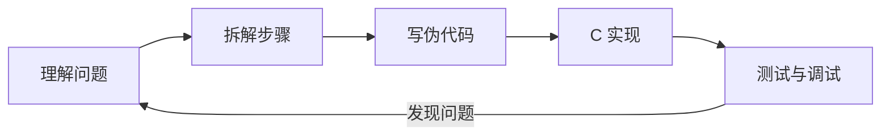

# 问题求解 Problem Solving

> [编程入门](../) › 问题求解

拆解问题、写伪代码；用 C 实现栈、队列、哈希表、排序和查找。

## 本关定位

| 项 | 内容 |
|----|------|
| 所属阶段 | 阶段 2 编程入门 · 第 5 关（第二章「工程与实战」） |
| 前置要求 | [内存与数据](../03-memory-and-data/)、[工具、调试与测试](../04-tools-debugging/)；[数据结构与算法](../../cs-basics/06-data-structures-algorithms/) 的概念部分 |
| 建议用时 | 3–4 周，之后长期练题 |
| 后续衔接 | [C 小项目](../06-small-projects/) 会直接复用本关写好的动态数组和哈希表 |

会语法不等于会编程。这一关练的是「从题目到代码」的过程：先理解问题、拆成小步骤、用伪代码理清思路，再用 C 实现并测试。顺带把计算机基础里学过的栈、队列、哈希表和排序亲手写一遍，每个实现都要通过 assert 测试和 Sanitizer 检查。

## 闯关任务

- [ ] 能够按「理解 → 拆解 → 伪代码 → 编码 → 测试」的步骤解决一个陌生问题。
- [ ] 能够在动手前列出输入输出、边界情况，并手动推演一个小例子。
- [ ] 能够用 C 实现基于数组的栈和环形队列，并用它们解决括号匹配等问题。
- [ ] 能够用 C 实现以字符串为键的拉链法哈希表，包括插入、查找和释放。
- [ ] 能够实现插入排序、归并排序和二分查找，分析其复杂度并编写测试。
- [ ] 能够为一个问题选择合适的数据结构，并说明理由。

## 知识要点

### 解题五步法



1. **理解问题**：用自己的话复述题目；明确输入是什么、输出是什么；列出边界情况（空输入、一个元素、极大值、非法输入）。
2. **手动推演**：拿一个小例子，在纸上一步步算出结果，记下自己「脑子里做了什么」。
3. **拆解**：把大问题拆成若干个可以单独写成函数的小问题，每个函数只做一件事。
4. **伪代码**：用接近自然语言的方式写出步骤，先不纠结语法。
5. **实现与测试**：一个函数一个函数地写，写完立刻用 assert 测试，再组合起来。

### 示例：括号匹配

问题：判断一个字符串中的 `()`、`[]`、`{}` 是否正确配对，例如 `{[()]}` 正确，`([)]` 错误。

推演发现：遇到右括号时，它必须和**最近一个还没配对**的左括号匹配，这正是「后进先出」，所以用栈。伪代码：

```text
创建空栈
对字符串中的每个字符 c：
    如果 c 是左括号：压栈
    如果 c 是右括号：
        如果栈为空：返回 失败
        弹出栈顶，如果与 c 不配对：返回 失败
遍历结束后：栈为空则 成功，否则 失败
```

C 实现，栈用固定容量的数组：

```c
#include <assert.h>
#include <stddef.h>
#include <string.h>

enum { STACK_CAP = 256 };

typedef struct {
    char data[STACK_CAP];
    size_t top;                 // 栈中元素个数
} CharStack;

static bool push(CharStack *s, char c) {
    if (s->top == STACK_CAP) {
        return false;           // 满了
    }
    s->data[s->top++] = c;
    return true;
}

static bool pop(CharStack *s, char *out) {
    if (s->top == 0) {
        return false;           // 空栈
    }
    *out = s->data[--s->top];
    return true;
}

static char opening_of(char c) {
    switch (c) {
    case ')': return '(';
    case ']': return '[';
    case '}': return '{';
    default:  return '\0';
    }
}

static bool balanced(const char *str) {
    CharStack s = {};
    for (const char *p = str; *p != '\0'; p++) {
        if (strchr("([{", *p) != nullptr) {
            if (!push(&s, *p)) {
                return false;
            }
        } else if (opening_of(*p) != '\0') {
            char top;
            if (!pop(&s, &top) || top != opening_of(*p)) {
                return false;
            }
        }
    }
    return s.top == 0;
}

int main(void) {
    assert(balanced(""));
    assert(balanced("{[()]}"));
    assert(balanced("int main(void) { return a[0]; }"));
    assert(!balanced("([)]"));
    assert(!balanced("(("));
    assert(!balanced(")"));
    return 0;
}
```

注意 `strchr` 会把字符串结尾的 `'\0'` 也当作可查找的字符，这里因为循环条件已排除 `'\0'`，所以不会误判。

### 环形队列

用数组实现队列时，出队后前面的空位要重复利用，于是让下标「绕回」开头：

```c
#include <assert.h>
#include <stddef.h>

enum { QUEUE_CAP = 4 };

typedef struct {
    int data[QUEUE_CAP];
    size_t head;                // 队首下标
    size_t len;                 // 元素个数
} IntQueue;

static bool enqueue(IntQueue *q, int x) {
    if (q->len == QUEUE_CAP) {
        return false;
    }
    q->data[(q->head + q->len) % QUEUE_CAP] = x;
    q->len++;
    return true;
}

static bool dequeue(IntQueue *q, int *out) {
    if (q->len == 0) {
        return false;
    }
    *out = q->data[q->head];
    q->head = (q->head + 1) % QUEUE_CAP;
    q->len--;
    return true;
}

int main(void) {
    IntQueue q = {};
    int x = 0;
    for (int i = 1; i <= 4; i++) {
        assert(enqueue(&q, i));
    }
    assert(!enqueue(&q, 5));                    // 已满
    assert(dequeue(&q, &x) && x == 1);          // 先进先出
    assert(enqueue(&q, 5));                     // 绕回数组开头
    for (int want = 2; want <= 5; want++) {
        assert(dequeue(&q, &x) && x == want);
    }
    assert(!dequeue(&q, &x));                   // 已空
    return 0;
}
```

用「队首下标 + 元素个数」表示状态，可以清楚地区分队列空和满，比只用首尾两个下标更不容易出错。

### 哈希表

下面是以字符串为键、整数为值的拉链法哈希表。哈希函数用简单的 FNV-1a，它不适合安全场景，但分布对练习来说足够好：

```c
#include <assert.h>
#include <stdint.h>
#include <stdlib.h>
#include <string.h>

typedef struct Entry {
    char *key;
    int value;
    struct Entry *next;
} Entry;

typedef struct {
    Entry **buckets;
    size_t nbuckets;
} HashMap;

static uint32_t fnv1a(const char *s) {
    uint32_t h = 2166136261u;
    for (; *s != '\0'; s++) {
        h ^= (unsigned char)*s;
        h *= 16777619u;
    }
    return h;
}

static bool map_init(HashMap *m, size_t nbuckets) {
    m->buckets = calloc(nbuckets, sizeof *m->buckets);   // 所有桶初始为空
    m->nbuckets = nbuckets;
    return m->buckets != nullptr;
}

static Entry *find(const HashMap *m, const char *key) {
    for (Entry *e = m->buckets[fnv1a(key) % m->nbuckets]; e != nullptr; e = e->next) {
        if (strcmp(e->key, key) == 0) {
            return e;
        }
    }
    return nullptr;
}

// 键已存在则更新值，否则插入新条目；内存不足时返回 false
static bool map_put(HashMap *m, const char *key, int value) {
    Entry *e = find(m, key);
    if (e != nullptr) {
        e->value = value;
        return true;
    }
    e = malloc(sizeof *e);
    if (e == nullptr) {
        return false;
    }
    e->key = strdup(key);                  // 复制一份，不依赖调用者的字符串
    if (e->key == nullptr) {
        free(e);
        return false;
    }
    size_t i = fnv1a(key) % m->nbuckets;
    e->value = value;
    e->next = m->buckets[i];               // 插到桶的链表头部
    m->buckets[i] = e;
    return true;
}

static bool map_get(const HashMap *m, const char *key, int *out) {
    const Entry *e = find(m, key);
    if (e == nullptr) {
        return false;
    }
    *out = e->value;
    return true;
}

static void map_free(HashMap *m) {
    for (size_t i = 0; i < m->nbuckets; i++) {
        Entry *e = m->buckets[i];
        while (e != nullptr) {
            Entry *next = e->next;
            free(e->key);
            free(e);
            e = next;
        }
    }
    free(m->buckets);
    *m = (HashMap){};
}

int main(void) {
    HashMap m;
    assert(map_init(&m, 8));
    const char *words[] = {"the", "cat", "the", "dog", "the", "cat"};
    for (size_t i = 0; i < sizeof words / sizeof words[0]; i++) {
        int count = 0;
        map_get(&m, words[i], &count);     // 不存在时 count 保持 0
        assert(map_put(&m, words[i], count + 1));
    }
    int n = 0;
    assert(map_get(&m, "the", &n) && n == 3);
    assert(map_get(&m, "cat", &n) && n == 2);
    assert(!map_get(&m, "bird", &n));
    map_free(&m);
    return 0;
}
```

这个版本桶数固定。真正的实现会在负载因子超过某个阈值（如 0.75）时把桶数翻倍并重新插入所有条目，这是本关的练习之一。

### 排序与查找

插入排序简单、在数据基本有序时很快；归并排序稳定且始终 O(n log n)，体现了**分治**思想：拆成两半分别排序，再合并两个有序数组。

```c
#include <assert.h>
#include <stdlib.h>
#include <string.h>

static void insertion_sort(int a[], size_t n) {
    for (size_t i = 1; i < n; i++) {
        int key = a[i];
        size_t j = i;
        while (j > 0 && a[j - 1] > key) {   // 把比 key 大的元素后移
            a[j] = a[j - 1];
            j--;
        }
        a[j] = key;
    }
}

// 对 a[lo, hi) 排序，tmp 是与 a 等长的辅助数组
static void merge_sort_rec(int a[], int tmp[], size_t lo, size_t hi) {
    if (hi - lo < 2) {
        return;
    }
    size_t mid = lo + (hi - lo) / 2;
    merge_sort_rec(a, tmp, lo, mid);
    merge_sort_rec(a, tmp, mid, hi);
    size_t i = lo, j = mid, k = lo;
    while (i < mid && j < hi) {
        tmp[k++] = a[i] <= a[j] ? a[i++] : a[j++];   // <= 保证稳定
    }
    while (i < mid) {
        tmp[k++] = a[i++];
    }
    while (j < hi) {
        tmp[k++] = a[j++];
    }
    memcpy(a + lo, tmp + lo, (hi - lo) * sizeof a[0]);
}

static bool merge_sort(int a[], size_t n) {
    if (n < 2) {
        return true;
    }
    int *tmp = malloc(n * sizeof *tmp);
    if (tmp == nullptr) {
        return false;
    }
    merge_sort_rec(a, tmp, 0, n);
    free(tmp);
    return true;
}

static bool is_sorted(const int a[], size_t n) {
    for (size_t i = 1; i < n; i++) {
        if (a[i - 1] > a[i]) {
            return false;
        }
    }
    return true;
}

int main(void) {
    int a[] = {5, -1, 3, 3, 0, 9, -7};
    int b[sizeof a / sizeof a[0]];
    size_t n = sizeof a / sizeof a[0];
    memcpy(b, a, sizeof a);

    insertion_sort(a, n);
    assert(is_sorted(a, n));
    assert(merge_sort(b, n));
    assert(memcmp(a, b, sizeof a) == 0);    // 两种算法结果一致

    srand(42);
    enum { N = 10'000 };
    static int big[N];
    for (size_t i = 0; i < N; i++) {
        big[i] = rand() % 1000 - 500;
    }
    assert(merge_sort(big, N) && is_sorted(big, N));
    return 0;
}
```

二分查找的写法见 [数据结构与算法](../../cs-basics/06-data-structures-algorithms/)。测试排序时，常用的技巧是**和一个确定正确的实现对拍**：对同一组随机数据分别用自己的函数和 `qsort` 排序，比较结果是否一致。

> [!TIP]
> 卡住超过 30 分钟就换个角度：缩小输入规模手动推演、打印中间状态、或者先写一个暴力解法再优化。看题解后隔几天不看答案重写一遍，才算真正掌握。

## 常见误区

- **一上来就写代码**：没想清楚就动手，往往写到一半推倒重来。先在纸上推演、写伪代码。
- **只测题目给的例子**：边界情况（空、一个元素、全部相同、已排序、逆序）才是 bug 的高发区。
- **一次写完整个程序再编译**：错误会成堆出现。写一个函数、测一个函数。
- **哈希表直接保存调用者传入的字符串指针**：调用者的缓冲区之后被改写或释放，表里的键就跟着坏了，应复制一份。
- **用 `size_t` 倒序循环写成 `for (size_t i = n - 1; i >= 0; i--)`**：`size_t` 永远不小于 0，循环不会结束；可以写 `for (size_t i = n; i-- > 0;)`。

## 实践任务

1. 用五步法解决「找出数组中出现次数超过一半的元素」：先写出输入输出、边界情况和伪代码，再实现并测试。
2. 把括号匹配的栈改成基于动态数组、可以自动扩容的版本，并支持任意长度的输入。
3. 为哈希表增加 `map_remove` 和自动扩容（负载因子超过 0.75 时桶数翻倍），用 10 万个随机字符串测试，ASan 无报错。
4. 实现快速排序，与归并排序、`qsort` 对拍 1000 组随机数组，并比较 10⁶ 个元素时的耗时。
5. 在 [Exercism C 练习](https://exercism.org/tracks/c) 中完成至少 10 道题，每道题都先写伪代码。

## 资料索引

- [Exercism C Track](https://exercism.org/tracks/c) — 免费的 C 语言练习题库，自带测试，可以申请导师代码审查（英文）
- [CS50x Week 5: Data Structures](https://cs50.harvard.edu/x/weeks/5/) — 用 C 讲链表、树、哈希表和字典树；Week 3 讲排序与递归（英文）
- [Hello 算法](https://github.com/krahets/hello-algo) — 中文图解数据结构与算法，每种结构都有 C 语言实现可以对照
- [VisuAlgo](https://visualgo.net/zh) — 排序、哈希表、链表等的动画演示，适合手动推演时对照
- [Project Euler](https://projecteuler.net/) — 数学与编程结合的经典题库，适合练习拆解问题和优化算法（英文）

## 通关自测

先独立作答，再展开参考答案核对；简答题答出要点即算对。答对 ≥ 80% 即可进入下一关。

1. 【单选】判断括号是否配对，最合适的数据结构是：
    - A. 队列
    - B. 栈
    - C. 哈希表
    - D. 二叉搜索树
2. 【单选】容量为 8 的环形队列，`head` 为 6、`len` 为 3，下一个入队元素会放在下标：
    - A. 9
    - B. 0
    - C. 1
    - D. 7
3. 【单选】统计一篇文章中每个单词出现的次数，最合适的数据结构是：
    - A. 有序数组
    - B. 栈
    - C. 哈希表
    - D. 队列
4. 【简答】`for (size_t i = n - 1; i >= 0; i--)` 有什么问题？怎么改？
5. 【简答】归并排序的「分治」体现在哪里？为什么它的时间复杂度是 O(n log n)？

<details markdown><summary>参考答案</summary>

1. B — 右括号要与最近未配对的左括号匹配，符合后进先出。
2. C — (6 + 3) % 8 = 1。
3. C — 以单词为键、次数为值，查找和更新平均 O(1)。
4. `size_t` 是无符号类型，`i >= 0` 永远成立；`i` 为 0 时再减 1 会回绕成最大值，导致越界。可改为 `for (size_t i = n; i-- > 0;)`，或使用有符号下标。
5. 把数组拆成两半分别递归排序（分），再把两个有序部分合并（治）。每一层合并共处理 n 个元素，拆分一共约 log₂n 层，所以总共 O(n log n)。

</details>

---

← [上一节：工具、调试与测试](../04-tools-debugging/) · [返回 编程入门](../) · [下一节：C 小项目](../06-small-projects/) →
