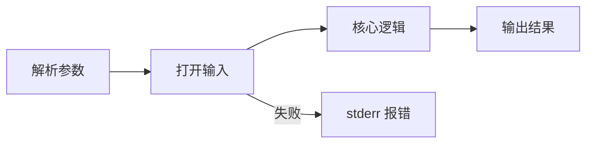

# C 小项目 Small Projects

> [编程入门](../) › C 小项目

用 C 写命令行工具：读写文件、处理命令行参数，多文件 + Makefile。

## 本关定位

| 项 | 内容 |
|----|------|
| 所属阶段 | 阶段 2 编程入门 · 第 6 关（第二章「工程与实战」，本阶段最后一关） |
| 前置要求 | [工具、调试与测试](../04-tools-debugging/)、[问题求解](../05-problem-solving/)；会用 [Linux 与 Shell](../../cs-basics/03-linux-shell/) 和 [Git](../../cs-basics/04-git/) |
| 建议用时 | 2–4 周 |
| 后续衔接 | 阶段 3 [Java 技术栈](../../java/)；进入 AI 前再学 [Python 速成](../../ai/00-python-bridge/) |

前五关学的语法、内存、工具和算法，在这一关合成一个完整的作品：一个真正能在终端里用的命令行工具。你要自己设计功能、拆分文件、处理命令行参数和文件读写、写测试和 Makefile，并用 Git 管理。完成后，你就有了一个可以放进 GitHub 展示的 C 项目。

## 闯关任务

- [ ] 能够通过 `argc` / `argv` 和 `getopt` 处理命令行参数与选项。
- [ ] 能够用 `fopen`、`fgetc`、`fgets`、`fclose` 读写文件，并正确处理打开失败、读取出错等情况。
- [ ] 能够遵守命令行工具的约定：结果写 stdout、错误写 stderr、用退出码表示成败、无文件参数时读标准输入。
- [ ] 能够把项目拆成「可测试的核心逻辑 + 薄的 `main`」，并用 Makefile 构建和运行测试。
- [ ] 能够独立完成一个零警告、Sanitizer 无报错、至少 5 个 assert 测试的 C 项目，并用 Git 提交。

## 知识要点

### 命令行工具的约定

| 约定 | 做法 |
|------|------|
| 参数 | `main(int argc, char *argv[])`；`argv[0]` 是程序名，`argv[argc]` 是空指针 |
| 选项 | 短选项如 `-l`、`-lw` 用 POSIX 的 `getopt` 解析；需要定义 `_POSIX_C_SOURCE` |
| 输入 | 有文件参数就读文件，没有就读 `stdin`，这样工具可以放进管道 |
| 输出 | 正常结果写 `stdout`，错误和用法提示写 `stderr` |
| 退出码 | 成功返回 `EXIT_SUCCESS`（0），失败返回 `EXIT_FAILURE`（非 0），Shell 中用 `$?` 查看 |
| 错误信息 | 带上程序名和出错的对象，如 `mywc: nope: No such file or directory`；用 `strerror(errno)` 或 `perror` 得到原因 |



### 示例项目：mywc

一个简化版的 `wc`：统计行数、单词数和字节数，支持 `-l`、`-w`、`-c` 选项、多个文件和标准输入。项目结构：

```text
mywc/
├── Makefile
├── counts.h        # 核心逻辑的接口
├── counts.c        # 统计逻辑，不关心数据来自哪里
├── main.c          # 解析参数、打开文件、打印结果
└── test_counts.c   # 针对 counts.c 的单元测试
```

核心逻辑只接收一个 `FILE *`，不关心它是文件、标准输入还是内存中的字符串，这样才容易测试：

```c
// 文件：counts.h
#ifndef COUNTS_H
#define COUNTS_H

#include <stddef.h>
#include <stdio.h>

typedef struct {
    size_t lines;
    size_t words;
    size_t bytes;
} Counts;

// 读完 fp 中的全部内容并统计；读取出错时返回 false
bool count_stream(FILE *fp, Counts *out);

#endif
```

```c
// 文件：counts.c
#include "counts.h"

#include <ctype.h>

bool count_stream(FILE *fp, Counts *out) {
    Counts c = {};
    bool in_word = false;
    int ch;
    while ((ch = fgetc(fp)) != EOF) {       // ch 必须是 int，才能区分 EOF
        c.bytes++;
        if (ch == '\n') {
            c.lines++;
        }
        if (isspace(ch)) {
            in_word = false;
        } else if (!in_word) {
            in_word = true;                 // 从空白进入非空白：新单词开始
            c.words++;
        }
    }
    *out = c;
    return !ferror(fp);
}
```

`main.c` 只负责和外部世界打交道：

```c
// 文件：main.c
#define _POSIX_C_SOURCE 200809L             // 启用 getopt 的声明
#include "counts.h"

#include <errno.h>
#include <stdlib.h>
#include <string.h>
#include <unistd.h>

typedef struct {
    bool lines, words, bytes;
} Options;

static void print_counts(const Options *opt, const Counts *c, const char *name) {
    if (opt->lines) printf("%8zu", c->lines);
    if (opt->words) printf("%8zu", c->words);
    if (opt->bytes) printf("%8zu", c->bytes);
    if (name != nullptr) printf(" %s", name);
    putchar('\n');
}

int main(int argc, char *argv[]) {
    Options opt = {};
    int ch;
    while ((ch = getopt(argc, argv, "lwc")) != -1) {
        switch (ch) {
        case 'l': opt.lines = true; break;
        case 'w': opt.words = true; break;
        case 'c': opt.bytes = true; break;
        default:
            fprintf(stderr, "用法：%s [-lwc] [文件...]\n", argv[0]);
            return EXIT_FAILURE;
        }
    }
    if (!opt.lines && !opt.words && !opt.bytes) {
        opt = (Options){true, true, true};  // 默认三项都显示，与 wc 一致
    }

    if (optind == argc) {                    // 没有文件参数：读标准输入
        Counts c;
        if (!count_stream(stdin, &c)) {
            perror("stdin");
            return EXIT_FAILURE;
        }
        print_counts(&opt, &c, nullptr);
        return EXIT_SUCCESS;
    }

    int status = EXIT_SUCCESS;
    Counts total = {};
    for (int i = optind; i < argc; i++) {
        FILE *fp = fopen(argv[i], "rb");
        if (fp == nullptr) {
            fprintf(stderr, "mywc: %s: %s\n", argv[i], strerror(errno));
            status = EXIT_FAILURE;           // 记下失败，继续处理其他文件
            continue;
        }
        Counts c;
        if (!count_stream(fp, &c)) {
            fprintf(stderr, "mywc: %s: 读取失败\n", argv[i]);
            status = EXIT_FAILURE;
        } else {
            print_counts(&opt, &c, argv[i]);
            total.lines += c.lines;
            total.words += c.words;
            total.bytes += c.bytes;
        }
        fclose(fp);
    }
    if (argc - optind > 1) {
        print_counts(&opt, &total, "total");
    }
    return status;
}
```

测试中用 POSIX 的 `fmemopen` 把字符串当作文件，不需要真的创建文件：

```c
// 文件：test_counts.c
#define _POSIX_C_SOURCE 200809L             // 启用 fmemopen 的声明
#include "counts.h"

#include <assert.h>
#include <string.h>

// 把一段字符串当作文件来统计
static Counts count_str(const char *s) {
    Counts c = {};
    FILE *fp = fmemopen((void *)s, strlen(s), "r");
    assert(fp != nullptr);
    assert(count_stream(fp, &c));
    fclose(fp);
    return c;
}

int main(void) {
    Counts c = count_str("");
    assert(c.lines == 0 && c.words == 0 && c.bytes == 0);

    c = count_str("hello world\n");
    assert(c.lines == 1 && c.words == 2 && c.bytes == 12);

    c = count_str("  leading and   multiple   spaces  ");
    assert(c.lines == 0 && c.words == 4);   // 没有换行符就不算一行

    c = count_str("a\nb\n\nc");
    assert(c.lines == 3 && c.words == 3 && c.bytes == 6);

    c = count_str("tab\tseparated\twords\n");
    assert(c.words == 3);

    puts("全部测试通过");
    return 0;
}
```

Makefile 与上一关的结构相同：

```makefile
CC      = gcc
CFLAGS  = -std=c23 -Wall -Wextra -pedantic -g -fsanitize=address,undefined

.PHONY: all test clean

all: mywc

mywc: main.o counts.o
	$(CC) $(CFLAGS) $^ -o $@

test_counts: test_counts.o counts.o
	$(CC) $(CFLAGS) $^ -o $@

%.o: %.c counts.h
	$(CC) $(CFLAGS) -c $< -o $@

test: test_counts
	./test_counts

clean:
	rm -f *.o mywc test_counts
```

构建、测试并与系统自带的 `wc` 对比：

```bash
make test
make
printf 'hello world\nfoo  bar baz\n' > a.txt
./mywc a.txt Makefile
wc a.txt Makefile
./mywc -l < a.txt
./mywc nope a.txt; echo "退出码 $?"
```

`./mywc a.txt` 输出 `2 5 25 a.txt`（与 `wc` 一致，只是列宽不同）；`./mywc nope a.txt` 会在 stderr 报 `mywc: nope: No such file or directory`，继续统计 `a.txt`，最后退出码为 1。

> [!NOTE]
> `fgetc` 返回 `int` 而不是 `char`，因为它需要一个不同于所有字符的值 `EOF` 来表示「读完了」。把返回值存进 `char` 再和 `EOF` 比较，是经典的 bug。

### 按行读取与解析

处理 CSV 这类按行组织的数据，用 `fgets` 一次读一行，再逐字段解析。下面是记账本项目的解析部分：金额用「分」存成整数，自己写解析函数而不是用 `double`，既避免浮点误差，也能严格检查格式：

```c
#include <assert.h>
#include <ctype.h>
#include <stdio.h>
#include <string.h>

typedef struct {
    char date[11];              // YYYY-MM-DD 加结尾 '\0'
    char category[32];
    long cents;                 // 金额用「分」存整数，避免浮点误差
} Record;

// 把 "-35.5"、"8000"、"0.05" 这样的金额转成分；格式不对返回 false
static bool parse_amount(const char *s, long *cents) {
    bool negative = (*s == '-');
    if (negative) {
        s++;
    }
    if (!isdigit((unsigned char)*s)) {
        return false;
    }
    long value = 0;
    while (isdigit((unsigned char)*s)) {
        value = value * 10 + (*s++ - '0');
    }
    value *= 100;
    if (*s == '.') {
        s++;
        for (long scale = 10; scale >= 1; scale /= 10) {    // 最多两位小数
            if (!isdigit((unsigned char)*s)) {
                break;
            }
            value += (*s++ - '0') * scale;
        }
    }
    if (*s != '\0' && *s != '\n') {
        return false;           // 还有多余字符
    }
    *cents = negative ? -value : value;
    return true;
}

// 解析形如 "2026-11-05,餐饮,-35.50" 的一行
static bool parse_record(const char *line, Record *r) {
    int consumed = 0;
    if (sscanf(line, "%10[^,],%31[^,],%n", r->date, r->category, &consumed) != 2
        || consumed == 0 || strlen(r->date) != 10) {
        return false;
    }
    return parse_amount(line + consumed, &r->cents);
}

int main(void) {
    long c = 0;
    assert(parse_amount("-35.5", &c) && c == -3550);
    assert(parse_amount("0.05\n", &c) && c == 5);
    assert(parse_amount("8000", &c) && c == 800000);
    assert(!parse_amount("12abc", &c));
    assert(!parse_amount("", &c));

    FILE *fp = tmpfile();
    assert(fp != nullptr);
    fputs("2026-11-05,餐饮,-35.50\n2026-11-05,工资,8000\n坏数据\n", fp);
    rewind(fp);

    char buf[256];
    long balance = 0;
    int line_no = 0;
    while (fgets(buf, sizeof buf, fp) != nullptr) {   // 一次读一行
        line_no++;
        Record r;
        if (!parse_record(buf, &r)) {
            fprintf(stderr, "第 %d 行格式错误，已跳过\n", line_no);
            continue;
        }
        balance += r.cents;
    }
    fclose(fp);
    printf("余额：%ld.%02ld 元\n", balance / 100, balance % 100);   // 余额为负时需单独处理符号
    assert(balance == 796450);
    return 0;
}
```

`sscanf` 的 `%10[^,]` 表示「最多读 10 个不是逗号的字符」，宽度限制防止写越界；`%n` 记录到目前为止消耗了多少字符，方便接着解析剩下的部分。`fgets` 读到的行如果超过缓冲区长度会被截断，要求严格时需要检查行末是否有 `'\n'`。

### 三选一的阶段作品

| 项目 | 必做功能 | 进阶功能 | 会用到 |
|------|----------|----------|--------|
| mywc / mygrep | `mywc`：`-l -w -c`、多文件、stdin；或 `mygrep`：在文件中查找包含某字符串的行，`-n` 显示行号、`-i` 忽略大小写 | `mygrep` 的 `-v` 反向匹配、`-c` 只计数；递归目录 | `getopt`、`fgets`、`strstr`、`tolower` |
| 记账本 | `add` / `list` / `sum` 子命令，数据存 CSV；按类别或月份汇总 | 删除记录、导出报表、按金额排序 | `fgets`、`sscanf`、追加模式 `"a"` 打开文件、动态数组、`qsort` |
| 词频统计 | 读入文本，统计每个单词出现次数，输出前 N 个高频词 | 忽略大小写和标点、停用词表、`-n` 指定 N | 上一关的哈希表、`qsort`、`isalpha` |

统一的完成标准：

- `-std=c23 -Wall -Wextra -pedantic` 编译零警告。
- 带 `-fsanitize=address,undefined` 运行所有测试和示例，没有任何报错；在 Linux 上可再用 Valgrind 检查一遍（需用不带 Sanitizer 的版本）。
- 至少 5 个 assert 测试，`make test` 一条命令运行。
- 至少 3 个源文件，`main.c` 只做参数与输入输出，核心逻辑可以单独测试。
- 用 Git 管理，提交信息清楚；附一份 README 说明用法和示例。

## 常见误区

- **把所有代码写进 `main`**：逻辑和输入输出搅在一起就无法单元测试。核心函数接收 `FILE *` 或字符串，`main` 只负责组装。
- **不检查 `fopen` 的返回值**：文件不存在时得到空指针，后续读取直接崩溃。
- **错误信息写到 stdout**：在管道里会混进正常结果；错误应写 stderr，并返回非 0 退出码。
- **用 `char` 接收 `fgetc` 的返回值**：无法可靠区分 `EOF`。
- **用 `double` 存金额**：`0.1 + 0.2` 不等于 `0.3`，涉及钱时用整数「分」。
- **`scanf("%s", buf)` 不限宽度**：输入过长会写越界，应写成 `%63s` 这样带宽度的形式，或用 `fgets`。

## 实践任务

1. 照着示例搭建 `mywc`，在自己的机器上 `make test` 并与系统 `wc` 对比至少 3 个文件的结果。
2. 给 `mywc` 增加 `-m` 选项统计字符数（提示：UTF-8 中，不是以 `10` 开头的字节才是一个字符的开始），用中文文本测试。
3. 从三个阶段作品中选一个完成，满足全部完成标准。
4. 用 `git init` 建仓库，每完成一个功能提交一次，最后推送到自己的 GitHub 并写好 README。
5. 选读 [kilo 教程](https://viewsourcecode.org/snaptoken/kilo/) 的前几章，看一个约 1000 行的 C 文本编辑器是如何一步步写出来的。

## 资料索引

- [getopt(3) — Linux manual page](https://man7.org/linux/man-pages/man3/getopt.3.html) — `getopt` 的权威说明，含完整示例；同站可查 `fopen`、`fmemopen` 等（英文）
- [CS50x Problem Set 5: Speller](https://cs50.harvard.edu/x/psets/5/speller/) — 用 C 和哈希表实现拼写检查器，与词频统计项目思路相通（英文）
- [Build Your Own Text Editor（kilo）](https://viewsourcecode.org/snaptoken/kilo/) — 一步步用 C 写出终端文本编辑器，适合作为下一个项目（英文）
- [GNU Coreutils Manual](https://www.gnu.org/software/coreutils/manual/coreutils.html) — `wc`、`grep` 之外的经典工具的选项和行为说明，可作为你的工具的「需求文档」（英文）
- [GNU Make Manual](https://www.gnu.org/software/make/manual/make.html) — Makefile 的官方手册（英文）
- [build-your-own-x](https://github.com/codecrafters-io/build-your-own-x) — 收集了「从零实现 Git、数据库、Shell 等」的教程，很多有 C 版本（英文）

## 通关自测

先独立作答，再展开参考答案核对；简答题答出要点即算对。答对 ≥ 80% 即完成编程入门阶段。

1. 【单选】执行 `./mywc -l a.txt b.txt` 时，`argc` 的值是：
    - A. 2
    - B. 3
    - C. 4
    - D. 5
2. 【单选】命令行工具遇到打不开的文件，最合适的做法是：
    - A. 把错误信息 `printf` 到 stdout，返回 0
    - B. 把错误信息写到 stderr，继续处理其他文件，最后返回非 0
    - C. 直接调用 `abort()`
    - D. 忽略这个文件，什么都不输出
3. 【单选】下面哪种方式最适合在单元测试中把一段字符串当作 `FILE *` 读取？
    - A. `fopen`
    - B. `fmemopen`
    - C. `popen`
    - D. `freopen`
4. 【简答】为什么 `fgetc` 的返回值要存在 `int` 而不是 `char` 中？
5. 【简答】为什么要把核心逻辑写成接收 `FILE *` 的函数，而不是直接写在 `main` 里？

<details markdown><summary>参考答案</summary>

1. C — `argv` 依次是 `./mywc`、`-l`、`a.txt`、`b.txt`，共 4 个。
2. B — 错误写 stderr 不污染管道中的结果，非 0 退出码让调用者知道出了问题，这也是 `wc`、`cat` 的做法。
3. B — `fmemopen` 是 POSIX 函数，把一块内存包装成流，无需创建临时文件。
4. `fgetc` 要返回所有可能的字节值 0–255，外加一个不同于它们的 `EOF`（负数）；`char` 放不下这么多值，可能把某个合法字节误认作 `EOF`，或永远等不到 `EOF`。
5. 这样核心逻辑与输入来源解耦：同一个函数可以处理文件、标准输入和测试用的内存字符串，便于单元测试和复用；`main` 只负责参数解析和输入输出。

</details>

---

← [上一节：问题求解](../05-problem-solving/) · [返回 编程入门](../)
