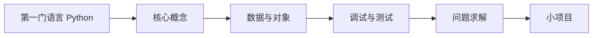

# 编程入门 Programming Basics

用一门语言建立编程思维，能独立把想法写成能跑、能调试的程序。本路线第一门语言选用 **Python**，阶段 3 再学 Java；与深入专题 [编程 Programming](../programming/) 分工。

> 相关主题：[计算机基础 CS Basics](../cs-basics/) · [Java 技术栈](../java/) · [编程 Programming](../programming/) · [学习路线 Roadmap](../roadmap/)

## 学习路径

## 子目录

| # | 子目录 | 内容 | 状态 |
|---|--------|------|------|
| 01 | [第一门语言与环境 First Language](01-first-language/) | 选用 Python；安装与运行环境 | ⚪ |
| 02 | [核心概念 Core Concepts](02-core-concepts/) | 变量、控制流、函数、递归 | ⚪ |
| 03 | [数据与对象 Data & Objects](03-data-and-objects/) | 列表、字典、类与对象 | ⚪ |
| 04 | [调试与测试 Debugging & Testing](04-debugging-testing/) | 报错、断点、单元测试 | ⚪ |
| 05 | [问题求解 Problem Solving](05-problem-solving/) | 拆解问题、伪代码、入门题 | ⚪ |
| 06 | [小项目 Small Projects](06-small-projects/) | 命令行工具、文件与 API | ⚪ |

🟢 已完成 · 🟡 搭建中 · ⚪ 待开始

> [!TIP]
> 目标明确是 Java 后端、希望少学一门语言的，可以用 MOOC.fi Java Programming 或 dev.java Learn 完成本阶段，再进入 [Java 技术栈](../java/)。

## 资料索引

<!-- - [标题](链接) — 一句话说明 -->
