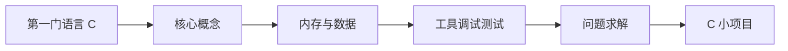

# 编程入门 {#programming-basics}

以 **C** 为第一门语言建立编程思维，看清程序和内存打交道的方式，能独立写出、调试小程序。阶段 3 再学 Java；进入 AI 前用 [Python 速成](../ai/00-python-bridge/) 补齐 Python。与深入专题 [编程](../programming/) 分工。语言定义规定了什么，写在 [编程](../programming/)。

> 相关主题：[计算机基础](../cs-basics/) · [Java 技术栈](../java/) · [编程](../programming/) · [学习路线](../roadmap/)

## 学习路径

## 子目录

| # | 子目录 | 内容 | 状态 |
|---|--------|------|------|
| 01 | [第一门语言 C 与环境](01-first-language-c/) | 为何选 C；gcc / clang；编译流程；C23 | 🟡 |
| 02 | [核心概念](02-core-concepts/) | 类型、控制流、函数、指针入门、多文件 | 🟡 |
| 03 | [内存与数据](03-memory-and-data/) | 数组、字符串、struct、malloc / free | 🟡 |
| 04 | [工具、调试与测试](04-tools-debugging/) | 警告、gdb、Valgrind、ASan、make | 🟡 |
| 05 | [问题求解](05-problem-solving/) | 伪代码；用 C 实现基础结构与算法 | 🟡 |
| 06 | [C 小项目](06-small-projects/) | 命令行工具、文件 IO、Makefile | 🟡 |
🟢 已完成 · 🟡 搭建中 · ⚪ 待开始

> [!TIP]
> 只想尽快做 Java 后端的，至少学完 02 核心概念和 03 内存与数据再进入 [Java 技术栈](../java/)；也可以用 MOOC.fi 或 dev.java 直接起步，但会错过 C 带来的内存直觉。

## 资料索引

<!-- - [标题](链接) — 一句话说明 -->
