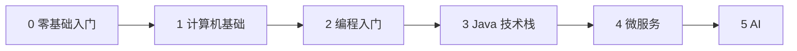

# 从零到 AI 学习路线 Learning Roadmap

从「计算机是什么」开始，经过计算机基础、编程入门，进入 Java、微服务，最后到 AI。六个阶段按由浅入深排列，每个阶段对应仓库里的一个主题。

> 相关主题：[零基础入门](../getting-started/) · [计算机基础](../cs-basics/) · [编程入门](../programming-basics/) · [Java](../java/) · [微服务](../microservices/) · [AI](../ai/)

## 路线总览

| 阶段 | 主题目录 | 一句话定位 | 关卡 | 粗略用时 |
|------|----------|------------|------|----------|
| 0 | [零基础入门 Getting Started](../getting-started/) | 会用电脑、会上网查资料、会学习 | 5 关 | 2–4 周 |
| 1 | [计算机基础 CS Basics](../cs-basics/) | 知道计算机怎么工作，会用 Linux 和 Git | 7 关 | 3–6 个月 |
| 2 | [编程入门 Programming Basics](../programming-basics/) | 能用一门语言独立写出小程序（第一门语言：Python） | 6 关 | 2–3 个月 |
| 3 | [Java 技术栈 Java Stack](../java/) | 能用 Java / Spring 写出可测试的后端服务 | 12 关 | 4–6 个月 |
| 4 | [微服务 Microservices](../microservices/) | 能设计、部署、观测一组协作的服务 | 16 关 | 4–6 个月 |
| 5 | [AI 技术栈 AI Stack](../ai/) | 能把大模型能力接进真实系统并上线 | 20 关 | 3–6 个月（应用方向） |

> [!WARNING]
> 用时只是粗略参考：按每周 10–15 小时、有一定自学能力估算，因人差异很大。阶段 1 和阶段 2 可以交叉进行，不必等阶段 1 全部通关才开始写代码。

## 怎么用这条路线

- 每个阶段先读主题页的学习目标与子目录，再按编号闯关。
- 已经有基础的读者：会编程的从阶段 3（Java）开始；做过 Java 后端的从阶段 4 或阶段 5 开始。
- 完全零基础：从阶段 0 开始；本路线第一门编程语言选用 Python。

## 资料索引

<!-- - [标题](链接) — 一句话说明 -->
