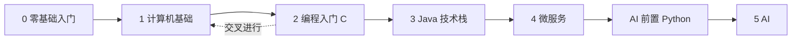

# 从零到 AI 学习路线 {#ai-learning-roadmap}

从「计算机是什么」开始，经过计算机基础、编程入门（C），进入 Java、微服务，经 Python 速成后到 AI。六个阶段按由浅入深排列，每个阶段对应仓库里的一个主题。

> 相关主题：[零基础入门](../getting-started/) · [计算机基础](../cs-basics/) · [理论基础](../cs-theory/) · [编程入门](../programming-basics/) · [Java](../java/) · [微服务](../microservices/) · [AI](../ai/)

## 路线总览

| 阶段 | 主题目录 | 一句话定位 | 关卡 | 粗略用时 |
|------|----------|------------|------|----------|
| 0 | [零基础入门](../getting-started/) | 会用电脑、会上网查资料、会学习 | 5 关 | 2–4 周 |
| 1 | [计算机基础](../cs-basics/) | 知道计算机怎么工作，会用 Linux 和 Git | 7 关 | 3–6 个月 |
| 2 | [编程入门](../programming-basics/) | 以 C 为第一门语言，能独立写出、调试小程序 | 6 关 | 3–4 个月 |
| 3 | [Java 技术栈](../java/) | 能用 Java / Spring 写出可测试的后端服务 | 12 关 | 4–6 个月 |
| 4 | [微服务](../microservices/) | 能设计、部署、观测一组协作的服务 | 16 关 | 4–6 个月 |
| 桥 | [AI 前置：Python 速成](../ai/00-python-bridge/) | 会 C 和 Java 后快速补齐 Python | 1 关（预备关） | 1–2 周 |
| 5 | [AI 技术栈](../ai/) | 能把大模型能力接进真实系统并上线 | 20 关 | 3–6 个月（应用方向） |

> [!WARNING]
> 用时只是粗略参考：按每周 10–15 小时估算，因人差异很大。阶段 1 和阶段 2 建议交叉进行：先学组成、Linux、Git，再学 C；学到指针和内存后回到操作系统、网络、DSA、数据库。

## 怎么用这条路线

- 每个阶段先读主题页的学习目标与子目录，再按编号闯关。
- 已经有基础的读者：会编程的从阶段 3（Java）开始；做过 Java 后端的从阶段 4 或阶段 5 开始。
- 完全零基础：从阶段 0 开始；本路线第一门编程语言选用 **C**；进入 AI 前补 [Python 速成](../ai/00-python-bridge/)。
- [理论基础](../cs-theory/) 是独立主题，不插在阶段 1 和阶段 2 之间。刚开始写程序时不必先读完它；已经在看算法、操作系统、数据库或服务依赖时，再按该页的两条读法跳到对应章。这 14 章只在网站上，不在小程序打包的 35 篇里。

## 资料索引

- [LearnFree: Computer Basics](https://www.learnfree.org/series/computer-basics) — 原 GCFGlobal 电脑入门系列（edu.gcfglobal.org 已迁至 LearnFree），从硬件、软件讲到开机使用（英文）
- [LearnFree: Windows Basics](https://www.learnfree.org/series/windows-basics) / [macOS Basics](https://www.learnfree.org/series/macos-basics) — 原 GCFGlobal 系统入门：桌面、文件、设置（英文）
- [LearnFree: Internet Safety](https://www.learnfree.org/series/internet-safety) — 原 GCFGlobal 上网安全课：密码、钓鱼、隐私设置（英文）
- [Khan Academy: Computers and the Internet](https://www.khanacademy.org/computing/computers-and-internet) — 二进制、数据、网络与安全的入门课（英文，免费）
