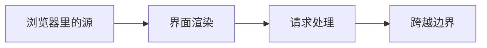

# Web 开发 {#web}

本主题先写浏览器怎样划分源，再写框架在 Web 边界上约定了什么。它不建协议目录，也不做框架选型。

> 相关主题：[计算机网络](../cs-basics/05-networking/) · [Spring 框架](../java/09-spring/) · [微服务](../microservices/)

> [!NOTE]
> 本仓库和站点的内容由 AI 生成，资料与资源链接来源于网络，仅供学习参考；如有错误或侵权，请提 Issue 告知。

---

## 源之上的应用约定 {#_1}

源是浏览器的权限单位。框架是应用层的结构约定。两者都叠在 HTTP 之上，都不替代报文和 TLS。[计算机网络](../cs-basics/05-networking/) 已经写了请求行、状态码和证书。本主题不重讲那一章。

后面三章共用三个问题。界面如何从状态得到。一次已经到达的请求如何得到响应。跨源时框架能声明什么，又不能把哪条边界删掉。

[Spring](../java/09-spring/) 和微服务里的网关、服务通信、认证，是某一次实现。本主题写框架这一层在约定什么。先读 [浏览器里的源](origin/) 和计算机网络最顺。这不是 Spring 或微服务的前置。

## 学习路径 {#web-path}

## 子目录 {#web-chapters}

| # | 子目录 | 内容 | 状态 |
|---|--------|------|------|
| 01 | [浏览器里的源](origin/) | 方案、主机、端口，以及脚本默认可读的范围 | 🟢 |
| 02 | [界面与渲染模型](02-rendering/) | 状态如何推导出界面，以及这次推导何时发生 | 🟢 |
| 03 | [请求处理与中间件](03-request-handling/) | 已到达的请求如何按约定变成响应 | 🟢 |
| 04 | [跨越源边界](04-crossing-boundary/) | 跨源时框架能声明什么，不能删掉什么 | 🟢 |
🟢 已完成 · 🟡 搭建中 · ⚪ 待开始

`frontend/`、`backend/`、`protocols/` 本批不建。网关、服务间调用和认证协议的落地仍以微服务 [02](../microservices/02-api-gateway/)、[04](../microservices/04-communication/)、[11](../microservices/11-security/) 为准。

## 资料索引 {#_2}

- [浏览器里的源](origin/) — 源的定义和脚本默认可读的范围。后面各章只回链，不重讲三元组。
- [计算机网络](../cs-basics/05-networking/) — HTTP 报文、状态码和 TLS。框架挂在请求上，不改写协议。
- [HTML Living Standard：Document](https://html.spec.whatwg.org/multipage/dom.html#document) — 浏览器先有文档。渲染章只用这一点。
- [Spring 框架](../java/09-spring/) — MVC 与 WebFlux 的实现和版本。本主题不写注解清单。
- [微服务](../microservices/) — 网关、服务通信和认证是入口与服务间的实践，不是浏览器里的源。
