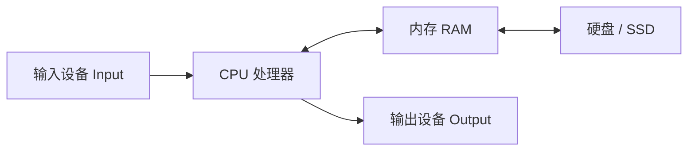

# What is a computer {#what-is-a-computer}

> [Getting Started](../) › What is a computer · [Chinese original](../../../../topics/getting-started/01-what-is-a-computer/)

Hardware, software, binary, and units of storage: what a computer is, and what each part does.

## Where this chapter fits {#_1}

| Item | Content |
|------|---------|
| Stage | Stage 0, Getting Started · Chapter 1 |
| Prerequisites | None |
| Suggested time | 3–5 days (a rough guide, at 1–2 hours a day) |
| What's next | [Computer organization](../../cs-basics/01-computer-organization/) takes this chapter's CPU, memory, and binary one level deeper |

This chapter has no code. The goal is a map of the computer: which parts the machine is made of, what role software plays, and why information can be written with 0 and 1. Every later chapter uses that map again.

## Quest tasks {#_2}

- [ ] Name what the CPU, memory, disk / SSD, input devices, and output devices each do, and give at least one example of each.
- [ ] Tell hardware, the operating system, and applications apart, and say what the operating system does between the other two.
- [ ] Explain why data in memory is lost when the power goes off, while data on disk remains.
- [ ] Convert decimal numbers from 0 to 255 to binary and back.
- [ ] Convert among bit, Byte, KB, MB, and GB, and explain why a 1 TB disk shows about 931 GB in Windows.

## What to know {#_3}

### A computer is a machine that processes information by following a program {#_4}

What a computer does fits one pipeline: **input → process → store → output**. The keyboard, mouse, microphone, and camera provide input. The CPU does the processing. Memory and the disk store. The display, speakers, and printer provide output.

Almost every modern computer follows the stored-program idea (usually mentioned together with the von Neumann architecture): a program, like data, sits in memory as binary, and the CPU fetches instructions from memory one by one and executes them. So "installing software" is putting the program files on disk, and "running software" is reading them from disk into memory and handing them to the CPU.

### What the main hardware does {#_5}

| Part | Role | A comparison | Data after power off |
|------|------|--------------|----------------------|
| CPU (central processing unit) | Executes instructions: arithmetic, comparisons, jumps | A cook | Not kept |
| Memory (RAM) | Holds the running program and its data; fast | The counter beside the stove | Lost |
| Disk / SSD | Keeps files and installed programs for the long term | A refrigerator and a warehouse | Kept |
| Graphics card (GPU) | Draws graphics, and is also often used for AI computation | A cook's assistant who only plates the food | Not kept |
| Motherboard | Connects the parts | The kitchen's pipes and counters | — |

Memory is usually much faster than a disk, but it is small, expensive, and loses its contents when the power goes off. A disk is large and keeps data, but it is slower. A computer balances speed and capacity by moving what is used often to the faster place. [Computer organization](../../cs-basics/01-computer-organization/) calls that idea the memory hierarchy.

### Software: the operating system and applications {#_6}

- An **operating system** (Windows, macOS, Linux, Android, iOS) manages hardware: which program gets the CPU, how much memory a program receives, the files, and the devices.
- An **application** (a browser, a chat program, an editor) runs on top of the operating system and uses hardware through the interfaces the operating system provides, rather than driving the hardware itself.
- A **driver** is a small program that lets the operating system recognize one particular piece of hardware, such as one model of printer.

### Why binary {#_7}

A circuit can reliably tell two states apart: voltage or no voltage, magnetization in direction A or B. Writing those states as 1 and 0 is the least error-prone choice. One 0 or 1 is **1 bit**. Eight bits make **1 Byte**.

Each binary place has a weight that is a power of two. For 8 bits:

| Weight | 128 | 64 | 32 | 16 | 8 | 4 | 2 | 1 |
|--------|-----|----|----|----|---|---|---|---|
| `00001011` | 0 | 0 | 0 | 0 | 1 | 0 | 1 | 1 |

`00001011` = 8 + 2 + 1 = 11. Decimal to binary runs the other way: start at the largest weight, write 1 and subtract when it fits, and write 0 when it does not. Eight bits represent 2⁸ = 256 combinations, which is 0–255.

Text, pictures, and sound all become numbers in the end:

- Text: each character has a number. The English letter `A` is 65 in ASCII. Chinese is usually encoded as UTF-8, and a common character takes 3 bytes.
- Pictures: each pixel's color is three numbers from 0 to 255, for red, green, and blue.
- Sound: many samples per second record the height of the wave as a number.

### How the storage units convert {#_8}

| Unit | Decimal (disk makers and networks) | Binary (operating systems) |
|------|------------------------------------|----------------------------|
| Kilo | 1 KB = 1000 B | 1 KiB = 1024 B |
| Mega | 1 MB = 1000 KB | 1 MiB = 1024 KiB |
| Giga | 1 GB = 1000 MB | 1 GiB = 1024 MiB |
| Tera | 1 TB = 1000 GB | 1 TiB = 1024 GiB |

Disk makers label "1 TB" in decimal, meaning 10¹² bytes. Windows counts by 1024 and still prints "GB", so it shows 10¹² ÷ 2³⁰ ≈ 931 GB. Nothing is missing. The two units were mixed.

> [!NOTE]
> KiB and MiB, the forms with an i, are the binary prefixes defined by the IEC. In everyday speech many people still write a count by 1024 as KB. When the numbers disagree, ask which base is in use. Network speed is usually counted in **bits**: a 100 Mbps connection is about 12.5 MB per second in theory.

## Common mistakes {#_9}

- **Treating memory and the disk as the same thing.** A phone advertised as "12 GB + 256 GB" means 12 GB of memory (the running memory) and 256 GB of storage. Too little memory makes programs stall. Too little storage means files will not fit.
- **Assuming more memory always makes the computer faster.** Once there is enough memory, adding more barely helps. The CPU and the SSD affect speed too.
- **Assuming a deleted file is gone.** "Delete" usually only moves it to the recycle bin, or only marks that space as reusable. Before disposing of an old device, use the system's own reset or erase function.
- **Assuming Mb and MB are the same.** A lowercase b is a bit. An uppercase B is a Byte. They differ by a factor of 8.

## Practice {#_10}

1. Look up your computer's specification. On Windows open Settings → System → About. On macOS use the Apple menu → About This Mac. Write down the CPU model, the amount of memory, the storage capacity, and the operating system version.
2. Open Task Manager (Windows: `Ctrl` + `Shift` + `Esc`) or Activity Monitor (macOS) and find the three programs currently using the most memory.
3. By hand, convert 13, 100, and 255 to 8-bit binary, then convert `01100100` back to decimal. Check with the calculator's Programmer mode.
4. Compute about how many GB a drive labeled 512 GB shows in Windows (hint: 512 × 10⁹ ÷ 2³⁰).
5. Put the results in a note called "specification of my computer". Later chapters add to it.

## Sources {#_11}

- [LearnFree: Computer Basics](https://www.learnfree.org/series/computer-basics) — GCFGlobal's free introduction, from hardware and software through turning the machine on (the old edu.gcfglobal.org links now redirect to LearnFree)
- [Khan Academy: Computers and the Internet](https://www.khanacademy.org/computing/computers-and-internet) — a free interactive introduction to binary, how data is represented, and networks
- [CS50x Week 0](https://cs50.harvard.edu/x/weeks/0/) — Harvard CS50, week 0: binary, ASCII, Unicode, algorithms, and Scratch, with video and notes, free
- [NIST: Prefixes for binary multiples](https://physics.nist.gov/cuu/Units/binary.html) — the U.S. National Institute of Standards and Technology's official note on KiB, MiB, and the other binary prefixes
- [Crash Course Computer Science](https://www.youtube.com/playlist?list=PL8dPuuaLjXtNlUrzyH5r6jN9ulIgZBpdo) — computer-science videos of about ten minutes each, from circuits to operating systems

## Check yourself {#_12}

Answer on your own first, then open the fold. A short answer counts when it has the point. 80% is the bar for the next chapter.

1. Which of these still holds its data after the machine is turned off?
    - A. Memory (RAM)
    - B. CPU cache
    - C. SSD
    - D. A register
2. The binary value `00010110` equals which decimal number?
    - A. 20
    - B. 22
    - C. 24
    - D. 26
3. A 100 Mbps connection can, in theory, download at most about how much per second?
    - A. 100 MB
    - B. 50 MB
    - C. 12.5 MB
    - D. 1 MB
4. What does the operating system do between the hardware and the applications? Name two things.
5. Why does a disk labeled 1 TB show only about 931 GB in Windows?

Answers

1. C — memory, cache, and registers lose their data when the power goes off. An SSD and a hard disk are persistent storage.
2. B — 16 + 4 + 2 = 22.
3. C — the speed is counted in bits. 100 ÷ 8 = 12.5 MB/s. Protocol overhead makes the real figure lower.
4. The points: it schedules CPU time (who runs first), allocates memory, manages files, controls devices through drivers, and gives applications one interface.
5. The maker labels 1 TB as 10¹² bytes. Windows counts by 1024 and still displays "GB". 10¹² ÷ 2³⁰ ≈ 931.

---

[Back to Getting Started](../) · [Next: Using a computer](../02-using-a-computer/) →
