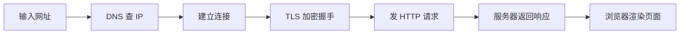

# Internet basics {#internet-basics}

> [Getting Started](../) › Internet basics · [Chinese original](../../../../topics/getting-started/03-internet-basics/)

IP addresses, domain names, the browser, HTTP / HTTPS, and account security and password management.

## Where this chapter fits {#_1}

| Item | Content |
|------|---------|
| Stage | Stage 0, Getting Started · Chapter 3 |
| Prerequisites | [Using a computer](../02-using-a-computer/) |
| Suggested time | 3–5 days (a rough guide) |
| What's next | [Computer networking](../../cs-basics/05-networking/) expands the layered model, TCP / UDP, and the details of DNS |

This chapter builds two instincts. One is what happens, behind the scenes, when you open a web page. The other is how to protect your accounts. The first is the starting point for later Web and backend study. The second is something to use starting today.

## Quest tasks {#_2}

- [ ] Say what an IP address, a port, and a domain name each are, and what DNS does.
- [ ] In order, describe the main steps from typing an address to seeing the page.
- [ ] Take a URL apart into its scheme, domain, path, and query.
- [ ] Explain the difference between HTTP and HTTPS, and say what the lock in the address bar does and does not guarantee.
- [ ] Turn on a password manager and two-factor authentication for your important accounts, and recognize common phishing.

## What to know {#_3}

### IP addresses, ports, and domain names {#ip}

- An **IP address** is a device's address on a network. IPv4 is 32 bits, written as four decimal numbers, such as `203.0.113.10`. IPv6 is 128 bits, written in hexadecimal, such as `2001:db8::1`. Both of those are addresses reserved for examples in documentation. A device at home usually receives a private address such as `192.168.x.x` and reaches the Internet through a router.
- A **port** distinguishes services on the same machine. The range is 0–65535. HTTP defaults to 80 and HTTPS to 443.
- A **domain name** is a name a person can remember, such as `github.com`. Read it from the right: `.com` is the top-level domain, `github` is the registered second-level domain, and `www` or `docs` can sit in front as a subdomain.
- **DNS (the Domain Name System)** translates a domain name into an IP address. It is the Internet's address book.

### What happens after you type an address {#_4}



1. The browser parses the address and gets the domain `github.com`.
2. It checks the local cache first. If the name is not there, it asks a DNS server and receives an IP address.
3. It opens a connection to port 443 on that IP. The details are in [Computer networking](../../cs-basics/05-networking/).
4. HTTPS first does a TLS handshake, agrees on encryption, and checks the server's certificate.
5. The browser sends an HTTP request, for example "give me the page `/`".
6. The server returns a response: a status code plus the content (HTML).
7. The browser parses the HTML, then requests the CSS, JavaScript, and images it refers to, and finally draws the page.

### Reading a URL {#url}

```text
https://docs.github.com/zh/get-started?tool=webui#intro
└─┬─┘   └──────┬──────┘└──────┬──────┘└────┬────┘└─┬─┘
 协议        域名           路径        查询参数   片段
```

### HTTP and HTTPS {#http-https}

- **HTTP** is the request-and-response agreement between a browser and a server. A request has a method (`GET` to read, `POST` to submit) and a path. A response has a status code and a body.
- Status codes you will see: `200` success, `301` / `302` a redirect, `404` not found, `403` forbidden, `500` an internal server error. The pattern is that 2 means success, 3 a redirect, 4 a problem in the client's request, and 5 a problem on the server.
- **HTTPS** is HTTP plus TLS encryption. It guarantees three things: the contents are not read on the way, they are not altered, and you are connected to the domain named on the certificate.

> [!WARNING]
> The lock in the address bar only means the connection is encrypted. **It does not mean the site is trustworthy.** A phishing site can get a certificate too. Judge the domain itself: `github.com` and `github-login.com.example.xyz` are two completely different sites.

### Account security {#_5}

- **Passwords should be long and unique.** The U.S. NIST digital-identity guideline (SP 800-63B-4) requires a password used on its own to be at least 15 characters, and it no longer requires mixed character classes or regular changes. For a person, the practical rule is a different long password on every site.
- **Use a password manager.** Remember one master password. The manager generates and stores the rest. That can be the manager built into the browser or the system, or a tool such as Bitwarden or KeePassXC.
- **Turn on two-factor authentication (2FA).** Besides the password, require a code from an authenticator app or a security key. An SMS code is better than nothing, but a SIM can be hijacked.
- **Recognize phishing.** Mail and text messages that create urgency, such as "your account is abnormal, log in immediately to verify" or "you have won a prize", should not be clicked. Open the real site yourself and check.
- **Check for breaches.** Enter an email address at Have I Been Pwned to see whether it appears in a published data breach.

## Common mistakes {#_6}

- **"A lock means a safe site."** The lock only means encryption. It does not mean the other party is honest.
- **"A complicated password, reused everywhere."** One site leaks, and every account is tried with that password. Uniqueness matters more than complexity.
- **"The Internet, the Web, and the browser are the same thing."** The Web is one application that runs on the Internet. Mail, games, and video calls also use the Internet, and they do not have to go through a browser.
- **"Join any public Wi-Fi."** On a public network, at least make sure every site you open is HTTPS, and do not type a password into a strange login page that popped up.

## Practice {#_7}

1. Open `https://github.com` in a browser, click the lock in the address bar, and see who the certificate was issued to, who signed it, and when it expires.
2. Press `F12` to open the developer tools, switch to the Network panel, and reload. Find the first request and write down its method, status code, and response type.
3. Run the command below in a terminal and see which IP the name resolves to. Windows, macOS, and Linux all include `nslookup`:

```bash
nslookup github.com
```

4. Install a password manager. Change your three most important accounts (email, GitHub, and the social account you use) to long random passwords, and turn on two-factor authentication.
5. Write, in one paragraph, what happens from typing an address to seeing the page, and put it in your notes. Come back and revise it after [Computer networking](../../cs-basics/05-networking/).

## Sources {#_8}

- [MDN: How the web works](https://developer.mozilla.org/zh-CN/docs/Learn_web_development/Getting_started/Web_standards/How_the_web_works) — browsers, servers, DNS, and packets, explained with simple comparisons (Chinese)
- [MDN: What is a domain name?](https://developer.mozilla.org/zh-CN/docs/Learn_web_development/Howto/Web_mechanics/What_is_a_domain_name) — the structure of a domain name, and how registration and resolution work (Chinese)
- [MDN: An overview of HTTP](https://developer.mozilla.org/zh-CN/docs/Web/HTTP/Guides/Overview) — an introduction to HTTP requests, responses, and status codes (Chinese)
- [LearnFree: Internet Safety](https://www.learnfree.org/series/internet-safety) — GCFGlobal's free course on passwords, phishing, and privacy settings
- [NIST SP 800-63B-4](https://pages.nist.gov/800-63-4/sp800-63b.html) — the password and multi-factor authentication part of NIST's digital-identity guideline, for the original rule
- [Have I Been Pwned](https://haveibeenpwned.com/) — look up whether an email address appears in a published data breach

## Check yourself {#_9}

Answer on your own first, then open the fold. A short answer counts when it has the point. 80% is the bar for the next chapter.

1. Which of these turns the domain name `github.com` into an IP address?
    - A. HTTP
    - B. DNS
    - C. TLS
    - D. HTML
2. The default port for HTTPS is:
    - A. 21
    - B. 80
    - C. 443
    - D. 8080
3. The server returned status code `404`. The most likely meaning is:
    - A. The request succeeded
    - B. The server failed internally
    - C. The requested resource does not exist
    - D. The client should redirect to a new address
4. The address bar shows a lock. Does that mean the site is certainly trustworthy? Why?
5. Why is "a different password on every site" safer than "one very complicated password used everywhere"?

<details markdown><summary>Answers</summary>

1. B — DNS is the Domain Name System. It resolves a name to an IP address.
2. C — HTTP defaults to 80 and HTTPS to 443.
3. C — 4xx means a problem in the client's request. 404 means the resource was not found.
4. No. The lock only means the connection is encrypted with TLS and the certificate matches the domain. A phishing site can get a certificate too. Trust depends on whether the domain is the one you meant to open.
5. After any one site leaks the password, an attacker tries it on other sites. When the passwords differ, the damage stays on that one site.

</details>

---

← [Previous: Using a computer](../02-using-a-computer/) · [Back to Getting Started](../) · [Next: Learning and asking questions](../04-learning-to-learn/) →
