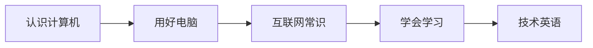

# Getting Started {#getting-started}

From no experience to using a computer and the network with confidence, and to having a way to study on your own. No prerequisites. Written for someone starting a programming path for the first time.

> Related topics: [Roadmap](../roadmap/) · [Computer Basics](../cs-basics/)

## Learning path {#_1}

## Chapters {#_2}

| # | Chapter | What it covers | Status |
|---|---------|----------------|--------|
| 01 | [What is a computer](01-what-is-a-computer/) | Hardware, software, binary, and units of storage | 🟡 |
| 02 | [Using a computer](02-using-a-computer/) | Typing, files, installing software, shortcuts | 🟡 |
| 03 | [Internet basics](03-internet-basics/) | IP, domain names, HTTP, account security | 🟡 |
| 04 | [Learning and asking questions](04-learning-to-learn/) | How to study, how to search, how to ask | 🟡 |
| 05 | [Tech English](05-tech-english/) | Terms, error messages, reading official manuals | 🟡 |
🟢 Complete · 🟡 In progress · ⚪ Not started

## Sources {#_3}

<!-- - [Title](url) — one-line note -->
